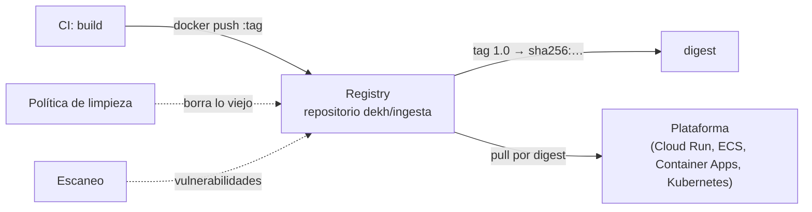

## 1. Resumen

«An image registry is a centralized location for storing and sharing your container images». Dentro de un registry, un **repositorio** agrupa las versiones de una imagen. La CI publica ahí lo que construye y las plataformas bajan de ahí lo que corren.

Tres decisiones definen cómo se usa:

- **tags mutables o inmutables:** con tags mutables, publicar otra imagen con el mismo tag lo mueve; ECR puede rechazarlo con tag immutability;
- **limpieza:** sin reglas, el registry acumula imágenes que nadie usa y que se cobran como almacenamiento;
- **escaneo:** las vulnerabilidades se detectan al publicar o en forma continua.

## 2. Qué es

- **Registry:** el servicio que guarda y entrega imágenes (Docker Hub, Artifact Registry, ECR, ACR, `registry:2` local).
- **Repositorio:** la colección de imágenes relacionadas, como `dekh/ingesta`.
- **Referencia:** `<registry>/<repositorio>:<tag>` o `<registry>/<repositorio>@sha256:<digest>`.
- **Tag inmutable:** un tag que el registry no deja reasignar.
- **Política de limpieza:** reglas que borran o archivan imágenes por antigüedad, tag o prefijo.

## 3. Problema que resuelve

La CI construye la imagen de un job y producción necesita bajarla, con permisos, cerca de donde corre y sin que alguien la reemplace por error. Un registry de la nube da autenticación con la identidad de esa nube, un lugar cercano a la plataforma y reglas sobre tags, limpieza y escaneo.

## 4. Cómo funciona

1. La CI se autentica en el registry con un helper de credenciales o un token.
2. Etiqueta la imagen con la dirección del repositorio y la publica con `docker push`.
3. El registry guarda la imagen por digest y apunta el tag a ese digest.
4. Si llega otra imagen con el mismo tag, el tag pasa a apuntar a ella (o el registry la rechaza, si los tags son inmutables).
5. La plataforma baja la imagen por tag o por digest.

## 5. Cuándo utilizarlo

- Siempre que una imagen se construye en un lugar y corre en otro.
- El registry de la misma nube y región que la plataforma, para autenticar con su identidad y bajar cerca.
- Tags inmutables en los repositorios de producción.

## 6. Cuándo no utilizarlo

- Docker Hub público para imágenes internas.
- Un tag como única referencia de lo que corre en producción: el digest es lo que no cambia.
- Un registry sin limpieza ni escaneo.

## 7. Ejemplo sencillo

En un `registry:2` local, se publica `dekh/ingesta:1.0` con la etiqueta `build-1` y después otra imagen con el mismo tag y la etiqueta `build-2`. El tag `1.0` pasa a traer `build-2`. El digest de la primera publicación sigue trayendo `build-1`.

## 8. Ejemplo de producción

El registry de un equipo de datos:

- un repositorio por job, en la región donde corren los jobs;
- tags inmutables iguales al hash del commit, y despliegue por digest;
- escaneo al publicar, con una alerta si aparece una vulnerabilidad crítica;
- una política que conserva las últimas versiones y borra las imágenes sin tag pasado un tiempo;
- la CI publica con una identidad que solo puede escribir en sus repositorios.

## 9. Arquitectura



## 10. Código

```bash
# Bash y Docker (ejecutado en la CI con un registry:2 local; ADR-016): en un repositorio con tags mutables, publicar
# otra imagen con el mismo tag lo mueve; la imagen anterior sigue disponible por su digest.
set -euo pipefail
REGISTRY="${REGISTRY:-localhost:5055}"   # registry:2 local que levanta el test
REPO="$REGISTRY/dekh/ingesta"

publish() {   # construye una imagen con la etiqueta de versión $1, la publica como :1.0 y devuelve su digest
  docker build -q -t "$REPO:1.0" - > /dev/null <<EOF
FROM alpine:3.22@sha256:5291449c3df73caf6ed85e649dec1b9e818b39a5d8c871e97afc13e9cd5e8fa8
LABEL org.opencontainers.image.version="$1"
EOF
  docker push -q "$REPO:1.0" > /dev/null
  docker image inspect --format '{{range .RepoDigests}}{{println .}}{{end}}' "$REPO:1.0" | grep "^$REPO@" | cut -d@ -f2
}
version() { docker image inspect --format '{{index .Config.Labels "org.opencontainers.image.version"}}' "$1"; }

FIRST=$(publish build-1)
SECOND=$(publish build-2)
[ "$FIRST" != "$SECOND" ] && echo "el tag 1.0 se movió a otro digest"

docker image rm -f "$REPO:1.0" "$REPO@$FIRST" > /dev/null 2>&1 || true
docker pull -q "$REPO:1.0" > /dev/null
echo "1.0 trae hoy: $(version "$REPO:1.0")"
docker pull -q "$REPO@$FIRST" > /dev/null
echo "el digest anterior trae: $(version "$REPO@$FIRST")"
```

El script se **ejecuta en la CI con Docker real y un `registry:2` local** (ADR-016), fijado por digest. Imprime `el tag 1.0 se movió a otro digest`, `1.0 trae hoy: build-2` y `el digest anterior trae: build-1`. Contra Artifact Registry, ECR o ACR cambia la dirección del repositorio y la autenticación (§11 a §13), y eso **no se ejecutó**.

## 11. GCP

En GCP, **Artifact Registry** es el registry recomendado, según *Artifact Registry overview*. Frente al `registry:2` local, según *Push and pull images*, *Configure cleanup policies* y *Artifact Registry pricing*:

| | `registry:2` local | Artifact Registry |
|---|---|---|
| Dirección | `localhost:5055/dekh/ingesta` | `LOCATION-docker.pkg.dev/PROJECT_ID/REPOSITORY/IMAGE` |
| Autenticación | Ninguna en el ejemplo | Helper de credenciales: `gcloud auth configure-docker LOCATION-docker.pkg.dev` |
| Limpieza | — | Políticas delete y keep por tag, prefijo o antigüedad, con dry run; efecto en aproximadamente un día |
| Cobro (consultado el 2026-10-19) | — | Almacenamiento, transferencia de salida y escaneo si está activado |

## 12. AWS

En AWS, **Amazon ECR** es el registry administrado. Según *Pushing a Docker image to an Amazon ECR private repository*, *Preventing image tags from being overwritten in Amazon ECR*, *Automate the cleanup of images by using lifecycle policies in Amazon ECR*, *Scan images for software vulnerabilities in Amazon ECR* y *Amazon Elastic Container Registry pricing*:

| | `registry:2` local | Amazon ECR |
|---|---|---|
| Autenticación | Ninguna en el ejemplo | `aws ecr get-login-password` pasado a `docker login` |
| Tags | Mutables: el ejemplo mueve `1.0` | Mutables o inmutables; con inmutabilidad, el segundo push de `1.0` falla con `ImageTagAlreadyExistsException` |
| Limpieza | — | Lifecycle policies que archivan o expiran imágenes dentro de las 24 horas |
| Escaneo | — | Basic (sistema operativo) o enhanced con Amazon Inspector (sistema operativo y paquetes, continuo) |
| Cobro (consultado el 2026-10-19) | — | Almacenamiento (Standard y Archive) y transferencia a internet |

## 13. Azure

En Azure, **Azure Container Registry** es el registry administrado. Según *Push your first image to your Azure container registry by using the Docker CLI*, *Azure Container Registry SKU features and limits* y *Azure Container Registry pricing*:

| | `registry:2` local | Azure Container Registry |
|---|---|---|
| Dirección | `localhost:5055` | `<registry>.azurecr.io`, en minúsculas |
| Autenticación | Ninguna en el ejemplo | `az acr login --name <registry>` |
| Planes | — | Basic, Standard y Premium; geo-replicación en Premium |
| Cobro (consultado el 2026-10-19) | — | Precio por día según el plan, con almacenamiento incluido; lo que excede, por GB y por día |

## 14. Buenas prácticas

- Un repositorio por imagen y tags únicos por build.
- Tags inmutables donde el registry lo permita, y despliegue por digest.
- Registry en la misma región que la plataforma.
- **Seguridad:** la CI publica con una identidad que solo escribe en sus repositorios; las plataformas solo leen; escaneo activado.
- **Observabilidad:** en ECR, las acciones de las lifecycle policies quedan en CloudTrail; registrar en el despliegue el digest que se bajó.
- **Costo:** los tres cobran el almacenamiento (consultado el 2026-10-19); una política de limpieza evita pagar por imágenes que nadie usa.

## 15. Errores frecuentes

- Republicar un tag y desplegar sin saber qué imagen corre.
- Credenciales de larga duración del registry guardadas en la CI.
- Un registry en otra región que la plataforma.
- Una política de limpieza sin dry run que borra imágenes en uso.

## 16. Trade-offs

Tags mutables son cómodos para desarrollo y peligrosos en producción; los inmutables obligan a un tag nuevo por build. La limpieza agresiva ahorra almacenamiento y puede borrar una imagen que se necesita para volver atrás. El escaneo continuo detecta vulnerabilidades nuevas en imágenes viejas, con un costo según el registry.

## 17. Conceptos relacionados

- `container-images`: lo que guarda el registry.
- `build-artifacts`: construir una vez y publicar.
- `ci-cd-pipelines`: la CI que publica.
- `ci-cd-secrets`: credenciales del registry.
- `docker-compose-environments`: el entorno local que baja imágenes.

## 18. Preguntas técnicas abiertas

1. ¿Puede alguien hoy republicar el tag que corre en producción?
2. ¿Cuántas imágenes guarda tu registry que nadie va a volver a usar?
3. ¿Quién se entera cuando una imagen en uso tiene una vulnerabilidad nueva?

## 19. Laboratorio relacionado

Pendiente (F4).

## 20. Fuentes

- Docker: *What is a registry?* y *docker image pull*.
- Google Cloud: *Artifact Registry overview*, *Push and pull images*, *Configure cleanup policies* y *Artifact Registry pricing*.
- AWS: *What is Amazon Elastic Container Registry?*, *Pushing a Docker image to an Amazon ECR private repository*, *Preventing image tags from being overwritten in Amazon ECR*, *Automate the cleanup of images by using lifecycle policies in Amazon ECR*, *Scan images for software vulnerabilities in Amazon ECR* y *Amazon Elastic Container Registry pricing*.
- Microsoft Learn: *Introduction to Azure Container Registry*, *Push your first image to your Azure container registry by using the Docker CLI*, *Azure Container Registry SKU features and limits* y *Azure Container Registry pricing*.

El detalle de cada fuente está en `sources` del frontmatter.

## 21. Fecha de última verificación

2026-10-19. Pasa a `verified`: revisión B-F3.1 del lote F3b-13b aplicada, sin VERIFY pendientes.

## 22. Historial de cambios importantes

- 2026-10-19: creación (lote F3b-13b).
- 2026-10-19: revisión B-F3.1 del lote F3b-13b aplicada (docs/reviews/cards-f3b-13b.md): sin hallazgos en esta ficha; sin cambios.
- 2026-10-19: `verification_status: verified` (sin VERIFY pendientes).
