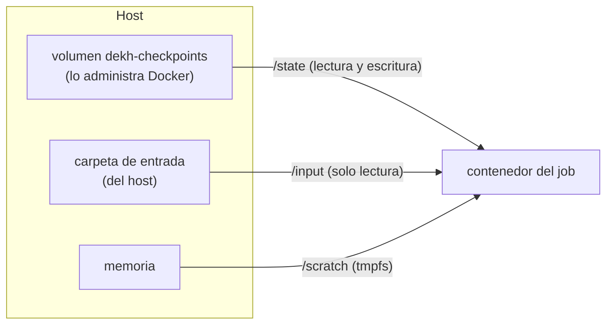

## 1. Resumen

Un contenedor escribe por defecto en su capa escribible, que se borra con él. Para los datos que deben quedar o entrar desde afuera, Docker ofrece montajes:

- **volumen:** persistente y administrado por Docker; «the preferred mechanism for persisting data»;
- **bind mount:** una ruta del host montada en el contenedor, que puede ser de solo lectura;
- **tmpfs:** temporal y en memoria; cuenta contra el límite de memoria del contenedor.

En la nube, las plataformas tienen sus propias opciones: en Cloud Run el disco es memoria y un bucket se monta con FUSE; en Fargate hay almacenamiento efímero de tamaño configurable y EFS para persistir; en Container Apps, almacenamiento de contenedor, de réplica y Azure Files.

## 2. Qué es

- **Volumen:** almacenamiento que crea y administra Docker; su contenido vive fuera del ciclo de vida de cualquier contenedor.
- **Bind mount:** un archivo o directorio del host visible dentro del contenedor; depende de la estructura del host.
- **tmpfs:** un sistema de archivos en memoria que se borra al detenerse el contenedor.
- **Solo lectura:** la opción `readonly` impide que el contenedor escriba en el montaje.
- **`--mount`:** la sintaxis explícita (`type=volume|bind|tmpfs,src=…,dst=…`).

## 3. Problema que resuelve

Un job incremental guarda qué archivos ya procesó en `/state/seen.txt`, dentro del contenedor. El contenedor se borra al terminar y la corrida siguiente vuelve a procesar todo. Con un volumen, el registro sobrevive a la corrida. Montar la entrada en solo lectura, además, evita que un error del job modifique los archivos originales.

## 4. Cómo funciona

1. `docker volume create` crea el volumen; Docker guarda sus datos en el host.
2. `docker run --mount type=volume,src=…,dst=/state` lo monta en el contenedor.
3. `--mount type=bind,src=<ruta del host>,dst=/input,readonly` expone una carpeta del host sin permitir escribir.
4. `--mount type=tmpfs,dst=/scratch` da un área temporal en memoria.
5. Al borrar el contenedor, el volumen queda; se borra con `docker volume rm`.

## 5. Cuándo utilizarlo

- **Volumen:** estado que debe sobrevivir entre corridas en el mismo host, como una base de datos local de desarrollo.
- **Bind mount:** entregar al contenedor archivos o configuración del host, en solo lectura cuando no debe cambiarlos.
- **tmpfs:** archivos intermedios que no deben tocar el disco y caben en memoria.

## 6. Cuándo no utilizarlo

- Un volumen local como almacenamiento de producción en la nube: el contenedor puede correr en otra máquina la próxima vez; ahí va un bucket o un servicio de archivos.
- Un bind mount con escritura sobre carpetas del host que no son del job.
- tmpfs para archivos grandes: cuentan contra la memoria del contenedor.

## 7. Ejemplo sencillo

Dos corridas del mismo job sobre dos CSV. La primera encuentra `0` procesados y deja `2` en el volumen. La segunda lee ese `2`. En las dos, intentar escribir en la entrada falla porque está montada en solo lectura.

## 8. Ejemplo de producción

Un job de ingesta en una plataforma administrada:

- lee la entrada de un bucket (en Cloud Run, montado con Cloud Storage FUSE en solo lectura);
- descomprime en un área temporal acotada: un volumen en memoria con límite de tamaño en Cloud Run, o el almacenamiento efímero de la tarea en Fargate;
- escribe el resultado y el checkpoint en almacenamiento externo, no en un volumen local.

## 9. Arquitectura



## 10. Código

```bash
# Bash y Docker (ejecutado en la CI con Docker real; ADR-016): los tres tipos de montaje para un job. El volumen guarda
# el checkpoint entre corridas, el bind mount entrega los archivos de entrada en solo lectura y tmpfs da un área
# temporal en memoria. INPUT_DIR es una carpeta del host con los CSV de entrada.
set -euo pipefail
IMG="alpine:3.22@sha256:5291449c3df73caf6ed85e649dec1b9e818b39a5d8c871e97afc13e9cd5e8fa8"
INPUT_DIR="${INPUT_DIR:-$PWD/input}"
docker volume create dekh-checkpoints > /dev/null

for run in 1 2; do
  docker run --rm \
    --mount type=volume,src=dekh-checkpoints,dst=/state \
    --mount "type=bind,src=$INPUT_DIR,dst=/input,readonly" \
    --mount type=tmpfs,dst=/scratch \
    "$IMG" sh -c '
      seen=$(cat /state/seen.txt 2>/dev/null || echo 0)
      files=$(ls /input/*.csv | wc -l)
      cp /input/*.csv /scratch/ && wc -l /scratch/*.csv > /dev/null
      echo "corrida '"$run"': ya procesados $seen, ahora $files"
      echo "$files" > /state/seen.txt
      touch /input/escribir.txt 2>/dev/null || echo "la entrada es de solo lectura"'
done

docker volume rm dekh-checkpoints > /dev/null
```

El script se **ejecuta en la CI con Docker real** (ADR-016), con Alpine fijada por digest. Imprime `corrida 1: ya procesados 0, ahora 2`, `la entrada es de solo lectura` y `corrida 2: ya procesados 2, ahora 2`, y borra el volumen al final.

## 11. GCP

En GCP, **Cloud Run** no tiene disco local persistente. Las diferencias, según *Container runtime contract* y *Configure Cloud Storage volume mounts for Cloud Run services*:

| | Docker | Cloud Run |
|---|---|---|
| Escritura sin montaje | Capa escribible, en disco | Sistema de archivos en memoria, sin límite propio: puede usar toda la memoria de la instancia |
| Área temporal | tmpfs, contra el límite de memoria | Volumen en memoria con límite de tamaño |
| Datos externos | Bind mount o volumen | Bucket de Cloud Storage montado con FUSE, sin instalar nada; puede ser de solo lectura |

## 12. AWS

En AWS, **ECS con Fargate** ofrece almacenamiento efímero y EFS. Las diferencias, según *Storage options for Amazon ECS tasks* y *Fargate task ephemeral storage for Amazon ECS*:

| | Docker | ECS con Fargate |
|---|---|---|
| Espacio local | El disco del host | Almacenamiento efímero: 20 GiB como mínimo, hasta 200 GiB con `ephemeralStorage` |
| Persistente | Volumen de Docker | Amazon EFS; los Docker volumes de ECS solo existen en EC2 |
| Bind mount | Ruta del host | Efímero |

## 13. Azure

En Azure, **Container Apps** distingue tres alcances. Las diferencias, según *Use storage mounts in Azure Container Apps*:

| | Docker | Container Apps |
|---|---|---|
| Del contenedor | Capa escribible | Efímero, hasta que el contenedor se apaga o se reinicia |
| Compartido entre contenedores | Un volumen montado en varios | Alcance de réplica (como EmptyDir de Kubernetes), mientras dura la réplica |
| Persistente | Volumen de Docker | Azure Files; no monta Azure NetApp Files ni Blob Storage |

## 14. Buenas prácticas

- Nada que deba quedar en la capa escribible.
- Entradas en solo lectura.
- Nombres de volumen que digan de qué job son, y borrarlos cuando el job ya no existe.
- **Seguridad:** bind mounts en solo lectura salvo que el job deba escribir; nunca montar carpetas del host con secretos que el job no necesita.
- **Observabilidad:** registrar al inicio qué checkpoint encontró el job, como en el ejemplo.
- **Costo:** tmpfs y el sistema de archivos de Cloud Run usan memoria del contenedor o de la instancia; para archivos grandes conviene un montaje con límite o almacenamiento externo antes que pedir más memoria.

## 15. Errores frecuentes

- Perder el checkpoint porque estaba en la capa escribible.
- Creer que un volumen local sigue al job a otra máquina.
- Llenar tmpfs o el sistema de archivos en memoria de Cloud Run y quedarse sin memoria.
- Montar la entrada con escritura y que el job la modifique por error.

## 16. Trade-offs

Los volúmenes persisten y los administra Docker, pero viven en un host. Los bind mounts son simples y conectan con el host, y dependen de su estructura. tmpfs es rápido y no deja rastro en disco, a cambio de memoria. En la nube, el almacenamiento durable es externo (bucket, EFS, Azure Files), con la latencia de la red.

## 17. Conceptos relacionados

- `containers`: por qué la capa escribible no alcanza.
- `checkpoints`: el estado del job entre corridas.
- `idempotency`: reprocesar sin duplicar.
- `dockerfile`: la imagen sin datos.
- `cloud-run-for-data`: volúmenes en Cloud Run.
- `container-apps-for-data`: almacenamiento en Container Apps.

## 18. Preguntas técnicas abiertas

1. ¿Qué datos de tu job deben sobrevivir a la corrida y dónde están hoy?
2. ¿Cuánta memoria usa tu job en archivos temporales?
3. ¿Qué entradas de tu job podrían montarse en solo lectura?

## 19. Laboratorio relacionado

Pendiente (F4).

## 20. Fuentes

- Docker: *Storage*, *Volumes*, *Bind mounts* y *tmpfs mounts*.
- Google Cloud: *Container runtime contract* y *Configure Cloud Storage volume mounts for Cloud Run services*.
- AWS: *Storage options for Amazon ECS tasks* y *Fargate task ephemeral storage for Amazon ECS*.
- Microsoft Learn: *Use storage mounts in Azure Container Apps*.

El detalle de cada fuente está en `sources` del frontmatter.

## 21. Fecha de última verificación

2026-10-19. Pasa a `verified`: revisión B-F3.1 del lote F3b-13a aplicada, sin VERIFY pendientes.

## 22. Historial de cambios importantes

- 2026-10-19: creación (lote F3b-13a).
- 2026-10-19: revisión B-F3.1 del lote F3b-13a aplicada (docs/reviews/cards-f3b-13a.md): sin hallazgos en esta ficha; sin cambios.
- 2026-10-19: `verification_status: verified` (sin VERIFY pendientes).
