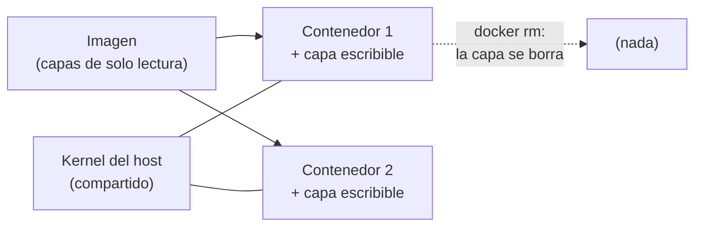

## 1. Resumen

Según Docker, «containers are isolated processes for each of your app's components». Un contenedor es un proceso del sistema operativo que corre aislado, con los archivos que necesita, y que arranca de una imagen. A diferencia de una máquina virtual, no trae su propio kernel: todos los contenedores de un host comparten el mismo.

Para Data Engineering importan dos consecuencias:

- **el job corre igual en la laptop, en la CI y en la nube**, porque lleva sus dependencias;
- **lo que el contenedor escribe en su capa escribible se pierde al borrarlo**: los datos que deben sobrevivir van a un volumen o a almacenamiento externo.

## 2. Qué es

- **Contenedor:** un proceso aislado, creado desde una imagen, con una capa escribible propia.
- **Imagen:** el paquete de solo lectura del que arranca (ver `container-images`).
- **Capa escribible:** donde el contenedor escribe por defecto; es única por contenedor y se borra con él.
- **PID 1:** el proceso principal del contenedor, en su propio espacio de nombres de procesos. Linux lo trata en forma especial con las señales.
- **Efímero:** un contenedor que se puede detener, borrar y reemplazar con una configuración mínima.

## 3. Problema que resuelve

Un job de ingesta en Python funciona en la laptop de quien lo escribió y falla en el servidor porque hay otra versión de Python o falta una biblioteca. Con un contenedor, el job lleva su runtime y sus dependencias. El servidor solo necesita un runtime de contenedores.

## 4. Cómo funciona

1. `docker run` crea un contenedor desde la imagen y arranca su proceso principal.
2. El proceso ve su propio árbol de procesos, en el que él es el PID 1, y un sistema de archivos que une las capas de la imagen con una capa escribible.
3. Lo que escribe va a la capa escribible. Otro contenedor de la misma imagen no lo ve.
4. Cuando el proceso termina, el contenedor se detiene; con `--rm`, Docker lo borra, y la capa escribible desaparece con él.

## 5. Cuándo utilizarlo

- Jobs de ingesta y transformación que deben correr igual en local, en la CI y en producción.
- Cargas que una plataforma de contenedores (Cloud Run, ECS, Container Apps) ejecuta y escala por ti.
- Herramientas con dependencias que no quieres instalar en el host, como una base de datos para pruebas.

## 6. Cuándo no utilizarlo

- Como lugar donde guardar datos: la capa escribible no persiste.
- Cuando el proceso necesita un kernel distinto del host: los contenedores comparten el kernel.
- Para un script de una línea sin dependencias, donde el contenedor solo agrega pasos.

## 7. Ejemplo sencillo

Un contenedor de Alpine escribe `lote 42` en `/tmp/checkpoint.txt` y termina. Se borra. Un contenedor nuevo de la misma imagen busca ese archivo y no lo encuentra: arranca de la imagen, no del contenedor anterior.

## 8. Ejemplo de producción

Un job diario de carga:

- corre en un contenedor que la plataforma crea para cada ejecución y borra al terminar;
- lee la entrada de un bucket y escribe el resultado en otro bucket o en el warehouse, nunca en su propio disco;
- guarda su avance en almacenamiento externo, para que un reintento continúe donde quedó;
- es idempotente, porque la plataforma puede reintentarlo.

## 9. Arquitectura



## 10. Código

```bash
# Bash y Docker (ejecutado en la CI con Docker real; ADR-016): un contenedor es un proceso aislado que arranca de una
# imagen. Lo que escribe en su capa escribible desaparece al borrarlo; otro contenedor de la misma imagen no lo ve.
set -euo pipefail
IMG="alpine:3.22@sha256:5291449c3df73caf6ed85e649dec1b9e818b39a5d8c871e97afc13e9cd5e8fa8"  # fijada por digest

docker run --rm "$IMG" sh -c 'echo "pid del proceso principal: $$"'      # el proceso del contenedor es el PID 1
docker run --name extract-1 "$IMG" sh -c 'echo "lote 42" > /tmp/checkpoint.txt'
docker rm extract-1 > /dev/null                                          # se borra con su capa escribible
docker run --rm "$IMG" sh -c 'cat /tmp/checkpoint.txt 2>/dev/null || echo "sin checkpoint: el contenedor nuevo arranca de la imagen"'
```

El script se **ejecuta en la CI con Docker real** (ADR-016), con la imagen de Alpine fijada por digest. Muestra que el proceso del contenedor es el PID 1 (`pid del proceso principal: 1`) y que un archivo escrito en un contenedor borrado no aparece en otro (`sin checkpoint: el contenedor nuevo arranca de la imagen`).

## 11. GCP

En GCP, **Cloud Run** ejecuta contenedores sin servidores que administrar (ver `cloud-run-for-data`). Las diferencias con un contenedor en Docker local, según *Container runtime contract* y *Cloud Run pricing*:

| | Docker local | Cloud Run |
|---|---|---|
| Qué ejecuta | Un contenedor desde una imagen, en el kernel del host | Contenedores con ejecutables para Linux 64-bit (ABI x86_64) |
| Escritura local | Capa escribible; se borra con el contenedor | Sistema de archivos en memoria: usa la memoria de la instancia y no persiste |
| Al apagar | `docker stop` envía SIGTERM al PID 1 | SIGTERM a todos los contenedores y 10 segundos antes de SIGKILL |
| Cobro (consultado el 2026-10-19) | — | Recursos usados, redondeados hacia arriba al tramo de 100 ms; facturación por solicitud o por instancia |

## 12. AWS

En AWS, **Amazon ECS** orquesta contenedores y **Fargate** les da cómputo sin servidores que administrar. Las diferencias, según *Amazon ECS task definitions*, *Fargate task ephemeral storage for Amazon ECS* y *AWS Fargate Pricing*:

| | Docker local | ECS con Fargate |
|---|---|---|
| Qué ejecuta | `docker run` con sus opciones | Una task definition en JSON: imagen, CPU, memoria, red, comando y rol de IAM de cada contenedor |
| Escritura local | Capa escribible; se borra con el contenedor | Almacenamiento efímero de la tarea: 20 GiB como mínimo, hasta 200 GiB con `ephemeralStorage` |
| Cobro (consultado el 2026-10-19) | — | vCPU, memoria, sistema operativo, arquitectura y almacenamiento, por segundo con un mínimo de 1 minuto, desde que empieza la descarga de la imagen hasta que termina la tarea, redondeado hacia arriba al segundo |

## 13. Azure

En Azure, **Container Apps** ejecuta contenedores y administra Kubernetes por ti (ver `container-apps-for-data`). Las diferencias, según *Containers in Azure Container Apps*, *Use storage mounts in Azure Container Apps* y *Azure Container Apps pricing*:

| | Docker local | Container Apps |
|---|---|---|
| Qué ejecuta | Cualquier imagen que corra en el host | Imágenes Linux x86-64 (`linux/amd64`) de cualquier registry |
| Si el proceso falla | Se reinicia según `--restart` (por defecto, no) | En una app se reinicia solo; en un job, un código de salida distinto de cero marca la ejecución como fallida |
| Escritura local | Capa escribible; se borra con el contenedor | Almacenamiento del contenedor, efímero: desaparece cuando se apaga o se reinicia |
| Cobro (consultado el 2026-10-19) | — | Consumption: recursos asignados por segundo y solicitudes; Dedicated: vCPU-segundo y GiB-segundo más un cargo base |

## 14. Buenas prácticas

- Diseñar contenedores efímeros: nada que no se pueda perder en la capa escribible.
- Un proceso principal en forma exec, que reciba SIGTERM y termine bien.
- Imágenes fijadas por digest para que cada ejecución use lo mismo (ver `container-images`).
- **Seguridad:** el contenedor aísla procesos, pero comparte el kernel del host; correr como usuario sin privilegios (ver `dockerfile`).
- **Observabilidad:** un archivo de log escrito en la capa escribible se borra con el contenedor; los logs que deben quedar se envían fuera de él.
- **Costo:** en Cloud Run, Fargate y Container Apps se paga el tiempo y los recursos del contenedor (consultado el 2026-10-19), así que un job que termina apenas acaba cuesta menos que uno que queda esperando.

## 15. Errores frecuentes

- Guardar el estado del job en el sistema de archivos del contenedor y perderlo en el reintento.
- Tratar un contenedor como una máquina virtual: entrar con una shell y cambiarlo a mano.
- Un proceso principal que ignora SIGTERM y termina por SIGKILL a mitad de una escritura.
- Llenar el sistema de archivos en memoria de Cloud Run y quedarse sin memoria.

## 16. Trade-offs

Un contenedor arranca rápido y es liviano porque comparte el kernel del host; a cambio, aísla menos que una máquina virtual. Que sea efímero facilita reintentar y escalar, y obliga a sacar el estado afuera. Las plataformas administradas quitan el trabajo de operar servidores, con sus propias reglas: en Cloud Run el disco es memoria, en Fargate el almacenamiento efímero tiene un tamaño configurable y en Container Apps la app se reinicia sola.

## 17. Conceptos relacionados

- `container-images`: de dónde arranca el contenedor.
- `dockerfile`: cómo se define la imagen y su proceso principal.
- `container-volumes`: dónde guardar lo que debe sobrevivir.
- `container-networking`: cómo se comunican los contenedores.
- `checkpoints`: el avance de un job, fuera del contenedor.
- `idempotency`: para que reintentar el contenedor sea seguro.
- `cloud-run-for-data`: contenedores serverless en GCP.
- `container-apps-for-data`: contenedores serverless en Azure.

## 18. Preguntas técnicas abiertas

1. ¿Qué escribe hoy tu job en su disco local que se perdería en un reintento?
2. ¿Cómo sabe tu proceso que la plataforma lo va a apagar?
3. ¿Qué parte de tu pipeline necesita un kernel o un sistema operativo distinto?

## 19. Laboratorio relacionado

Pendiente (F4).

## 20. Fuentes

- Docker: *What is a container?*, *Storage*, *Building best practices*, *docker container run* y *Dockerfile reference*.
- Google Cloud: *Container runtime contract* y *Cloud Run pricing*.
- AWS: *What is Amazon Elastic Container Service?*, *Amazon ECS task definitions*, *Fargate task ephemeral storage for Amazon ECS* y *AWS Fargate Pricing*.
- Microsoft Learn: *Containers in Azure Container Apps*, *Use storage mounts in Azure Container Apps* y *Azure Container Apps pricing*.

El detalle de cada fuente está en `sources` del frontmatter.

## 21. Fecha de última verificación

2026-10-19. Pasa a `verified`: revisión B-F3.1 del lote F3b-13a aplicada, sin VERIFY pendientes.

## 22. Historial de cambios importantes

- 2026-10-19: creación (lote F3b-13a).
- 2026-10-19: revisión B-F3.1 del lote F3b-13a aplicada (docs/reviews/cards-f3b-13a.md): Fargate cita «per second with a 1-minute minimum» y «rounded up to the nearest second»; Cloud Run redondea hacia arriba al tramo de 100 ms (*AWS Fargate Pricing* y *Cloud Run pricing*, consultadas el 2026-10-19).
- 2026-10-19: `verification_status: verified` (sin VERIFY pendientes).
