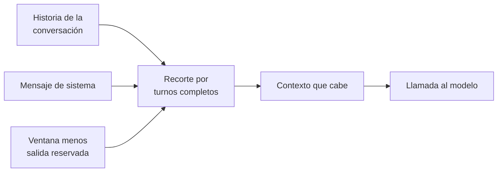

## 1. Resumen

La **ventana de contexto** es cuánto puede procesar un modelo en una llamada. En las tablas de Foundry es el total de tokens de la solicitud, y la entrada, la salida y el razonamiento **comparten** ese presupuesto: más entrada deja menos para la respuesta (*Foundry Models sold by Azure*).

Las ventanas crecieron: la página de Google da 1 millón de tokens de serie para Gemini (*Long context*) y la ficha de Nova Pro en Bedrock da 300K de contexto con un máximo de 10K de salida (*Nova Pro*). Igual hay que armar el contexto: una conversación o un lote de documentos crecen hasta no caber, y cada token de entrada se paga.

## 2. Qué es

- **Ventana:** el total de tokens de una llamada (`tokens`).
- **Límite de salida:** un tope para lo que el modelo genera; no garantiza ese tamaño (*Foundry Models sold by Azure*).
- **Límites separados:** si un modelo publica entrada y salida por separado, son límites individuales, no un total que se suma.
- **Historia:** en una conversación, todos los mensajes anteriores vuelven a enviarse en cada llamada.
- **Context caching:** reutilizar una parte fija del contexto entre llamadas; Google la presenta como la principal optimización de contextos largos (*Long context*).

## 3. Problema que resuelve

Un asistente sobre el catálogo de datos funciona bien en las primeras preguntas y después falla: la historia creció hasta pasarse del límite. La solicitud falla si los mensajes más la salida pedida no caben, y controlarlo es tarea de quien llama (*Work with chat completion models*).

## 4. Cómo funciona

1. Se conoce la ventana del modelo y se reserva la salida.
2. El mensaje de sistema se mantiene siempre.
3. Se agregan los turnos desde el más reciente hacia atrás mientras quepan.
4. El recorte es en orden: no se salta un turno para meter uno más viejo.
5. No se deja una respuesta sin su pregunta: si el turno más antiguo que entra es una respuesta, se quita.
6. Si el sistema y la salida reservada no caben, es un error de configuración, no algo que se recorta.

## 5. Cuándo utilizarlo

- Conversaciones o asistentes con historia.
- Lotes que juntan varios documentos en un mismo prompt.
- Al elegir modelo: la ventana define si una tarea cabe en una llamada o hay que dividirla.

## 6. Cuándo no utilizarlo

- Para meter un corpus entero en cada llamada «porque cabe»: se paga en cada llamada; recuperar solo lo relevante (`rag`) o cachear el contexto fijo puede ser más barato.
- Como reemplazo de resumir: una historia larga puede resumirse en lugar de recortarse.

## 7. Ejemplo sencillo

Doce mensajes (seis preguntas y seis respuestas) y un mensaje de sistema. Con ventana 400 y 100 reservados para la salida entran los 12. Con ventana 150 y 60 reservados entran 4: desde la pregunta 5. Con ventana 30 y 20 reservados, el sistema y la salida no caben y el armado falla con un error.

## 8. Ejemplo de producción

Un asistente interno responde preguntas sobre tablas del catálogo:

- ventana y salida máxima leídas de la configuración del modelo elegido, no del código;
- recorte por turnos completos con el conteo del tokenizador del modelo (`tokens`);
- la parte fija (instrucciones y descripción del catálogo) en caché, si el proveedor lo soporta;
- la llamada al modelo queda fuera del ejemplo (no ejecutado).

## 9. Arquitectura



## 10. Código

```python
# Python 3.12, biblioteca estándar (ejecutado en la CI): armar el contexto de una conversación sin pasarse de la
# ventana. La ventana se comparte entre entrada y salida: se reserva la salida y se recorta la historia más antigua,
# sin tocar el mensaje de sistema. El contador es inyectable; aquí, una estimación por caracteres.
from collections.abc import Callable
from dataclasses import dataclass


@dataclass(frozen=True)
class Mensaje:
    rol: str
    texto: str


def estimar(texto: str) -> int:
    return max(1, round(len(texto) / 4))


def recortar(historia: list[Mensaje], ventana: int, salida: int,
             contar: Callable[[str], int] = estimar) -> tuple[list[Mensaje], int]:
    """Mantiene el sistema y los turnos más recientes que caben en ventana - salida; devuelve (mensajes, tokens)."""
    sistema, turnos = historia[0], historia[1:]
    disponible = ventana - salida - contar(sistema.texto)
    if disponible < 0:
        raise ValueError("el mensaje de sistema y la salida reservada no caben en la ventana")
    elegidos: list[Mensaje] = []
    for m in reversed(turnos):
        costo = contar(m.texto)
        if costo > disponible:
            break  # se corta en orden: no se salta un turno para meter uno más viejo
        elegidos.insert(0, m)
        disponible -= costo
    while elegidos and elegidos[0].rol == "assistant":  # no dejar una respuesta sin su pregunta
        disponible += contar(elegidos.pop(0).texto)
    return [sistema, *elegidos], ventana - salida - disponible


historia = [Mensaje("system", "Respondes preguntas sobre el catálogo de datos. Si no sabes, dilo.")]
for i in range(1, 7):
    historia.append(Mensaje("user", f"Pregunta {i}: ¿qué tabla tiene las ventas del canal {i}?"))
    historia.append(Mensaje("assistant", f"Respuesta {i}: la tabla gold.ventas_canal_{i}, particionada por día."))

for ventana, salida in ((400, 100), (150, 60)):
    contexto, usados = recortar(historia, ventana, salida)
    print(f"ventana {ventana}, salida {salida}: {len(contexto) - 1} de {len(historia) - 1} mensajes, {usados} tokens;"
          f" el más antiguo: {contexto[1].texto[:11] if len(contexto) > 1 else '-'}")
try:
    recortar(historia, 30, 20)
except ValueError as error:
    print("ventana 30, salida 20:", error)
```

El script se **ejecuta en la CI** con la biblioteca estándar y pasa `mypy --strict`. Imprime `ventana 400, salida 100: 12 de 12 mensajes, 190 tokens`, `ventana 150, salida 60: 4 de 12 mensajes, 74 tokens; el más antiguo: Pregunta 5:` y el error de la ventana de 30. El contador es una estimación por caracteres; en producción se inyecta el del modelo.

## 11. GCP

En GCP, **Gemini en Gemini Enterprise Agent Platform**. Según *Long context* (no ejecutado):

| | Este concepto | Agent Platform |
|---|---|---|
| Ventana | La del modelo | 1 millón de tokens de serie para Gemini |
| Optimización | Recortar o resumir | Context caching como principal optimización |

## 12. AWS

En AWS, **Amazon Bedrock**. Según *Nova Pro* (no ejecutado):

| | Este concepto | Amazon Bedrock |
|---|---|---|
| Dónde está el límite | En la configuración del modelo | En la ficha de cada modelo |
| Nova Pro | — | 300K tokens de contexto, 10K de salida máxima |

## 13. Azure

En Azure, **Microsoft Foundry**. Según *Foundry Models sold by Azure* y *Work with chat completion models* (no ejecutado):

| | Este concepto | Microsoft Foundry |
|---|---|---|
| Qué cuenta | Entrada y salida | Entrada, salida y razonamiento comparten la ventana |
| Límites separados | — | No se suman |
| Historia | La arma quien llama | Igual en Chat Completions; la Responses API puede manejar el truncado |

## 14. Buenas prácticas

- Leer la ventana y la salida máxima de la ficha del modelo, por versión.
- Reservar la salida antes de armar la entrada.
- Recortar por turnos completos y mantener siempre el sistema.
- Preferir recuperar lo relevante a enviar todo lo que cabe.
- **Seguridad:** la historia también lleva lo que el usuario escribió; las mismas reglas de datos personales aplican a cada turno reenviado.
- **Observabilidad:** registrar tokens de entrada por llamada y cuántos turnos se recortaron.
- **Costo:** cada turno reenviado se vuelve a pagar como entrada.

## 15. Errores frecuentes

- Sumar los límites de entrada y salida cuando se publican por separado.
- No reservar la salida y recibir respuestas cortadas.
- Recortar a la mitad de un turno o dejar una respuesta sin su pregunta.
- Asumir que una ventana de 1 millón hace innecesario seleccionar el contexto.

## 16. Trade-offs

Más contexto da más información al modelo y cuesta más por llamada. Recortar es simple y pierde lo antiguo; resumir conserva más y agrega una llamada. Una ventana grande evita dividir tareas, pero no evita pagar cada token enviado.

## 17. Conceptos relacionados

- `tokens`: la unidad.
- `llm-fundamentals`: el modelo.
- `prompt-engineering`: qué va en el contexto.
- `rag`: recuperar solo lo relevante en lugar de enviar todo.

## 18. Preguntas técnicas abiertas

1. ¿Qué parte de tus prompts es fija y podría ir en caché?
2. ¿Recortarías o resumirías la historia de tu asistente?
3. ¿Cuántos tokens de salida necesita realmente tu tarea?

## 19. Laboratorio relacionado

Pendiente (F4).

## 20. Fuentes

- Google Cloud: *Long context*.
- AWS: *Nova Pro* (ficha de modelo de Amazon Bedrock).
- Microsoft Learn: *Foundry Models sold by Azure* y *Work with chat completion models*.

El detalle de cada fuente está en `sources` del frontmatter.

## 21. Fecha de última verificación

2026-10-25. `review_required`: pendiente de revisión B-F3.1 del lote F3b-21a.

## 22. Historial de cambios importantes

- 2026-10-25: creación (lote F3b-21a).
- 2026-10-25: §17 y `relations` enlazan `rag`, creadas en el lote F3b-21b (regla del §17); sin otros cambios.
