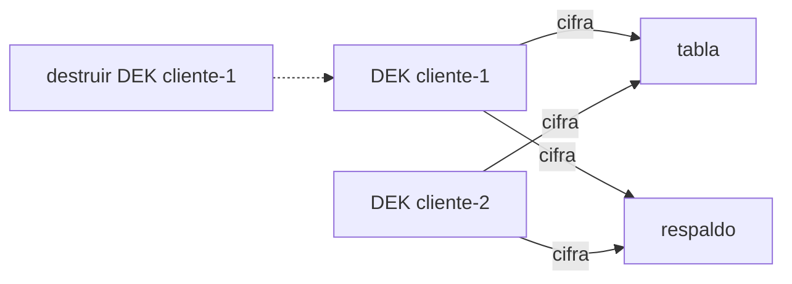

## 1. Resumen

**Crypto-shredding** es borrar datos **destruyendo la clave** con que están cifrados. Funciona cuando:

- cada titular (o cada grupo que se borra junto) tiene **su propia clave**;
- sus datos se cifran con esa clave **en todas las copias**: tabla, respaldos, exports, réplicas.

Destruir la clave deja ilegibles esos registros en todas las copias **a la vez, sin tocar las copias**: no hay que encontrar y reescribir cada respaldo. Los datos de los demás siguen legibles.

El límite está en la palabra «todas»: lo que se copió **en claro** (un export sin cifrar, un CSV descargado) no se borra destruyendo la clave.

## 2. Qué es

- **Clave por titular:** una DEK por persona, cliente o tenant.
- **Destrucción:** borrar la clave del KMS; en las tres nubes es irreversible y tiene un período de espera.
- **Copias:** todo lugar donde quedan los registros cifrados.

## 3. Problema que resuelve

Un cliente pide que se borren sus datos. Están en la tabla, en 30 respaldos diarios, en un export mensual y en una réplica de otra región. Reescribir cada respaldo para quitar sus filas es lento y arriesgado. Si sus campos están cifrados con su clave, destruirla los deja ilegibles en todas esas copias.

## 4. Cómo funciona

1. Al escribir, cada registro se cifra con la DEK de su titular, guardada en un KMS o un key store.
2. Las copias se hacen de los datos ya cifrados.
3. Para borrar a un titular, se destruye su DEK.
4. Al leer, sus registros quedan ilegibles en cualquier copia; los demás se leen normal.
5. El KMS respeta un período de espera antes de la destrucción definitiva; durante ese tiempo se puede revertir.

## 5. Cuándo utilizarlo

- Cuando hay pedidos de borrado por titular y muchas copias (respaldos, réplicas, exports).
- En sistemas multi-tenant, para borrar un tenant entero.

## 6. Cuándo no utilizarlo

- Si hay copias en claro: hay que borrarlas por otro lado.
- Con una clave compartida entre titulares: destruirla borraría a todos.
- Esperando que sea inmediato: los KMS imponen períodos de espera.

## 7. Ejemplo sencillo

Tres registros: dos del cliente 1 (correo y teléfono) y uno del cliente 2, en la tabla y en un respaldo. Se destruye la clave del cliente 1:

| Copia | Cliente 1 | Cliente 2 |
|---|---|---|
| tabla | ilegible (los dos registros) | legible |
| respaldo | ilegible (los dos registros) | legible |

El respaldo no se modificó.

## 8. Ejemplo de producción

- Campos personales cifrados con la DEK del titular; DEK envueltas por la KEK del dominio (`key-management`).
- Respaldos y réplicas se hacen sobre datos cifrados; ninguna copia en claro sale del perímetro.
- El pedido de borrado programa la destrucción de la DEK del titular y registra la fecha en que será definitiva.
- El linaje (`data-lineage`) confirma que no hay copias fuera del esquema cifrado.

## 9. Arquitectura



## 10. Código

```python
# Python 3.12 y cryptography (ejecutado en la CI; ADR-022): crypto-shredding. Cada titular tiene su propia clave de
# datos; sus registros se cifran con ella en la tabla y en la copia de respaldo. Borrar la clave deja ilegibles sus
# registros en todas las copias a la vez, sin tocar las copias; los de los demás siguen legibles.
import os

from cryptography.hazmat.primitives.ciphers.aead import AESGCM

claves: dict[str, bytes] = {}                         # en producción: claves por titular en un KMS o un key store


def cifrar(titular: str, valor: str) -> tuple[str, bytes, bytes]:
    clave = claves.setdefault(titular, AESGCM.generate_key(bit_length=256))
    nonce = os.urandom(12)
    return titular, nonce, AESGCM(clave).encrypt(nonce, valor.encode(), titular.encode())


def leer(registro: tuple[str, bytes, bytes]) -> str:
    titular, nonce, cifrado = registro
    if titular not in claves:
        return "ilegible (clave destruida)"
    return AESGCM(claves[titular]).decrypt(nonce, cifrado, titular.encode()).decode()


tabla = [cifrar("cliente-1", "ana.perez@example.com"), cifrar("cliente-2", "luis@example.org"),
         cifrar("cliente-1", "+56 9 1234 5678")]
respaldo = list(tabla)                                # una copia más: respaldo, export, réplica
del claves["cliente-1"]                               # el titular pide ser olvidado: se destruye su clave

for nombre, copia in (("tabla", tabla), ("respaldo", respaldo)):
    print(f"{nombre}: {[leer(r) for r in copia]}")
print("registros del respaldo modificados:", respaldo != tabla)
```

El script se **ejecuta en la CI con cryptography** (ADR-022) y pasa `mypy --strict`. Imprime la tabla y el respaldo con los registros del cliente 1 como `ilegible (clave destruida)` y el del cliente 2 legible, y `registros del respaldo modificados: False`.

## 11. GCP

En GCP, **Cloud KMS**. Según *Envelope encryption*, *Customer-managed encryption keys (CMEK)* y *Destroy and restore key versions* (no ejecutado):

| | Destrucción en el ejemplo | Cloud KMS |
|---|---|---|
| Clave por titular | Una DEK por cliente | La guía de envelope encryption: no usar la misma DEK para datos de dos usuarios |
| Para qué | Borrar a un titular | CMEK lista entre sus usos borrar datos en forma selectiva destruyendo la clave (crypto-shredding) |
| Destrucción | Inmediata | Programada, 30 días por defecto (configurable); se puede restaurar mientras tanto |
| Después | Ilegible | Los datos cifrados con esa versión no se pueden descifrar |

## 12. AWS

En AWS, **AWS KMS**. Según *Authenticated encryption* y *Delete an AWS KMS key* (no ejecutado):

| | Destrucción en el ejemplo | AWS KMS |
|---|---|---|
| Espera | Ninguna | 7 a 30 días, 30 por defecto (puede extenderse hasta 24 horas) |
| Después | Ilegible | Irreversible: los datos cifrados con la clave quedan irrecuperables, salvo excepciones (réplicas multi-región, material importado) |

## 13. Azure

En Azure, **Azure Key Vault**. Según *Authenticated encryption* y *Azure Key Vault: soft-delete overview* (no ejecutado):

| | Destrucción en el ejemplo | Azure Key Vault |
|---|---|---|
| Borrado | Inmediato | Soft-delete con período de retención |
| Protección | — | Purge protection evita la purga antes de tiempo |

El soft-delete y la purge protection protegen contra borrados por error; para crypto-shredding significan que la destrucción definitiva llega al final del período.

## 14. Buenas prácticas

- Una clave por titular o por tenant, nunca compartida.
- Ninguna copia en claro fuera del esquema cifrado.
- Registrar cuándo la destrucción será definitiva.
- **Seguridad:** la destrucción de claves es una operación crítica: pocas cuentas, aprobación y auditoría.
- **Observabilidad:** comprobar después del período que los registros del titular ya no se descifran.
- **Costo:** muchas claves cuestan operaciones del KMS; agrupar por tenant cuando el borrado es por tenant.

## 15. Errores frecuentes

- Exports en claro que la destrucción no alcanza.
- Una clave por tabla en lugar de por titular.
- Prometer un borrado inmediato cuando el KMS impone días de espera.

## 16. Trade-offs

Crypto-shredding borra en todas las copias sin reescribirlas, a cambio de una clave por titular y de cifrar todo lo que se copia. Borrar fila por fila no necesita claves y obliga a encontrar cada copia.

## 17. Conceptos relacionados

- `key-management`: las claves.
- `data-retention`: el borrado por plazo.
- `encryption-at-rest`: cifrar los datos.
- `data-lineage`: dónde están las copias.
- `gcp-cmek-with-kms`: CMEK en Google Cloud.

## 18. Preguntas técnicas abiertas

1. ¿Cuántas copias de los datos de un cliente existen hoy?
2. ¿Hay copias en claro fuera de tu perímetro?
3. ¿Cuánto tarda hoy un pedido de borrado en llegar a los respaldos?

## 19. Laboratorio relacionado

Pendiente (F4).

## 20. Fuentes

- cryptography: *Authenticated encryption*.
- Google Cloud: *Envelope encryption*, *Customer-managed encryption keys (CMEK)* y *Destroy and restore key versions* (Cloud KMS).
- AWS: *Delete an AWS KMS key*.
- Microsoft Learn: *Azure Key Vault: soft-delete overview*.

El detalle de cada fuente está en `sources` del frontmatter.

## 21. Fecha de última verificación

2026-10-21. `review_required`: pendiente de revisión B-F3.1 del lote F3b-18b.

## 22. Historial de cambios importantes

- 2026-10-21: creación (lote F3b-18b).
