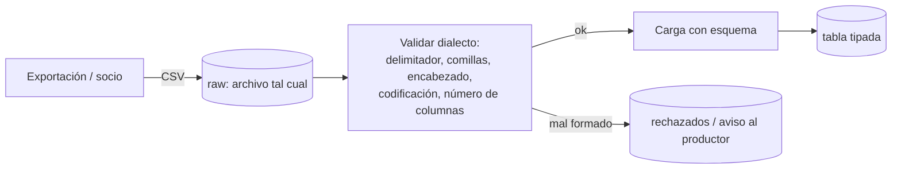

## 1. Resumen

CSV es texto tabular: una línea por registro y campos separados por un delimitador. Es el formato más común para intercambiar archivos entre sistemas y personas, y también el más ambiguo. La **RFC 4180** describe una versión mínima: comas, comillas dobles para los campos con comas, comillas o saltos de línea, y comillas escapadas duplicándolas. Cada herramienta, en cambio, tiene su variante: otro delimitador, otro escape, con o sin encabezado, otra codificación. Cargar CSV bien es, sobre todo, **configurar explícitamente el dialecto** y validar el número de columnas.

## 2. Qué es

Es un formato consolidado sin una norma estricta. La RFC 4180 (informativa) documenta la forma más común:

- registros separados por CRLF, con encabezado opcional;
- campos separados por comas, con el mismo número de campos en cada línea;
- los espacios forman parte del campo;
- los campos que contienen saltos de línea, comillas dobles o comas van entre comillas dobles;
- una comilla dentro del campo se escapa duplicándola: `"Dice ""hola"""`.

La documentación de Python lo resume: por la falta de una especificación estricta, cada aplicación produce CSV sutilmente distintos.

## 3. Problema que resuelve

Permite exportar e importar tablas entre casi cualquier sistema (bases de datos, planillas, ERPs, socios) con un formato que se abre en un editor de texto. Para datos planos y tabulares es simple, universal y fácil de producir.

## 4. Cómo funciona

Las decisiones de dialecto que hay que fijar al leer:

1. **Delimitador:** coma por defecto en la RFC y en las herramientas revisadas; también punto y coma, tab o barra vertical.
2. **Comillas y escape:** comilla doble y escape por duplicación (RFC, Redshift). Data Factory usa por defecto la barra invertida como carácter de escape: hay que alinearlo con el archivo.
3. **Saltos de línea dentro de campos:** válidos si el campo va entre comillas. En Python requieren abrir con `newline=''`; en BigQuery, `--allow_quoted_newlines`.
4. **Encabezado:** saltarlo explícitamente (`--skip_leading_rows=1`, `firstRowAsHeader`).
5. **Codificación:** UTF-8 sin BOM es lo más seguro; BigQuery recomienda quitar el BOM.
6. **Tipos:** CSV no los lleva. Se imponen al cargar (esquema) o al transformar.
7. **Filas mal formadas:** número de campos distinto del encabezado. Se rechazan o se toleran según la configuración (`--allow_jagged_rows`, `--max_bad_records`).

## 5. Cuándo utilizarlo

- Intercambio con sistemas o socios que solo exportan CSV.
- Datos planos y tabulares de tamaño moderado.
- Archivos que personas deben abrir o revisar.

## 6. Cuándo no utilizarlo

- Datos anidados o repetidos: BigQuery no los admite en CSV; mejor JSON, Avro o Parquet.
- Como formato de almacenamiento analítico: no tiene tipos, ni compresión por columna, ni estadísticas.
- Cuando se controla el productor: un formato con esquema (Avro, Parquet) evita la mayoría de los problemas de CSV.

## 7. Ejemplo sencillo

```text
pedido_id,cliente,comentario
A1,"Pérez, Ana",Entregar en conserjería
A2,Luis,"Dice ""urgente"""
```

La coma de `"Pérez, Ana"` no separa campos porque está entre comillas, y `""` dentro de un campo es una comilla literal.

## 8. Ejemplo de producción

Un socio envía cada día un CSV con punto y coma como delimitador, encabezado y comentarios que a veces incluyen saltos de línea. La carga a BigQuery declara todo explícitamente:

- `--field_delimiter=';'`;
- `--skip_leading_rows=1`;
- `--allow_quoted_newlines`;
- un esquema fijo;
- `--max_bad_records=0`, para que cualquier fila mal formada haga fallar la carga y se avise al socio.

Antes de cargar, un paso valida la codificación y quita el BOM.

## 9. Arquitectura



## 10. Código

```python
# Python 3.12, solo biblioteca estándar: leer CSV con comillas, comas y saltos de línea dentro de campos,
# y comprobar que todas las filas tengan las columnas del encabezado.
import csv
import io

DATA = (
    'pedido_id,cliente,comentario\r\n'
    'A1,"Pérez, Ana","Entregar en conserjería"\r\n'
    'A2,Luis,"Dice ""urgente""\r\ny llamar antes"\r\n'   # comillas dobladas y salto de línea dentro del campo
    'A3,Marta\r\n'                                         # fila con menos columnas
)


def read_csv(text: str) -> tuple[list[dict[str, str]], list[int]]:
    # newline='' deja que el módulo csv maneje los saltos de línea dentro de campos entre comillas.
    reader = csv.reader(io.StringIO(text, newline=""), strict=True)
    header = next(reader)
    rows: list[dict[str, str]] = []
    bad: list[int] = []
    for row in reader:
        if len(row) != len(header):
            bad.append(reader.line_num)          # línea física donde termina el registro
            continue
        rows.append(dict(zip(header, row)))
    return rows, bad


if __name__ == "__main__":
    rows, bad = read_csv(DATA)
    for r in rows:
        print(r)    # A1 con "Pérez, Ana"; A2 con el comentario de dos líneas y las comillas resueltas
    print("filas con columnas faltantes o sobrantes, en la línea:", bad)   # [5]
```

El registro A2 ocupa dos líneas físicas: por eso `line_num` no coincide con el número de registro.

## 11. GCP

**BigQuery** carga CSV con opciones explícitas: `--skip_leading_rows`, `--quote` (comilla doble por defecto), `--allow_quoted_newlines` (desactivada por defecto), `--allow_jagged_rows`, `--field_delimiter` y `--max_bad_records`. No admite datos anidados en CSV y recomienda quitar el BOM. Con gzip, la carga no se lee en paralelo y es más lenta. La autodetección no detecta el encabezado si todas las columnas son strings.

## 12. AWS

**Redshift** carga CSV con `COPY ... CSV`, opcionalmente con `QUOTE AS`. Los campos entre comillas pueden contener delimitadores, saltos de línea y retornos de carro, y una comilla se escapa con otra comilla, igual que en la RFC 4180. Con `CSV`, el delimitador por defecto es la coma.

## 13. Azure

**Data Factory** usa el formato de texto delimitado, con `columnDelimiter` (coma), `quoteChar` (comilla doble), `escapeChar`, `firstRowAsHeader`, `encodingName` y `compressionCodec`. Diferencia importante: su carácter de escape por defecto es la **barra invertida**, no la comilla duplicada de la RFC y de Redshift. Un CSV con `""` como escape requiere configurar `escapeChar` como comilla. Además, mapping data flow no admite UTF-8 con BOM.

## 14. Buenas prácticas

- Declarar el dialecto completo en cada carga: delimitador, comillas, escape, encabezado y codificación.
- Validar el número de columnas por fila y definir qué se hace con las mal formadas.
- UTF-8 sin BOM; documentarlo con el productor.
- Imponer un esquema al cargar; no confiar en la autodetección para tipos ambiguos.
- Convertir a un formato con esquema (Parquet) después de la zona raw.
- **Seguridad:** los CSV exportados suelen terminar en correos o carpetas compartidas; tratarlos como datos sensibles.
- **Observabilidad:** registrar filas leídas, rechazadas y el motivo por archivo, y alertar ante cambios en el número de columnas del encabezado.
- **Costo:** CSV ocupa más que los formatos binarios; comprimir en raw, sabiendo que en BigQuery el gzip vuelve la carga más lenta.

## 15. Errores frecuentes

- Abrir el archivo sin `newline=''` en Python y partir registros con saltos de línea dentro de campos.
- Suponer que todos los CSV usan coma y comilla doble con escape duplicado.
- Olvidar el encabezado y cargarlo como un registro.
- Perder caracteres por una codificación distinta de la declarada.
- Tolerar filas mal formadas sin contarlas.

## 16. Trade-offs

Universal y simple, a cambio de ambigüedad, falta de tipos y lecturas ineficientes. Frente a JSON: más compacto para datos planos, sin anidamiento. Frente a Avro y Parquet: legible y fácil de producir, sin esquema ni eficiencia de lectura.

## 17. Conceptos relacionados

- `file-ingestion`: donde más aparece CSV.
- `json-format`: la alternativa con anidamiento.
- `compression`: comprimir CSV y su efecto en la carga.
- `schema-on-read-vs-schema-on-write`: dónde se imponen los tipos.

## 18. Preguntas técnicas abiertas

1. ¿Qué validarías antes de cargar el CSV de un socio nuevo?
2. ¿Cómo detectarías que un productor cambió el delimitador o el orden de las columnas?
3. ¿Qué harías con un CSV donde algunos campos tienen saltos de línea sin comillas?

## 19. Laboratorio relacionado

Pendiente (F4).

## 20. Fuentes

- IETF: *RFC 4180, Common Format and MIME Type for Comma-Separated Values (CSV) Files* (referencia canónica).
- Python: *csv — CSV File Reading and Writing*.
- Google Cloud: *Load CSV data from Cloud Storage* (BigQuery).
- AWS: *Data format parameters* (Amazon Redshift).
- Microsoft Learn: *Delimited text format in Azure Data Factory*.

El detalle de cada fuente está en `sources` del frontmatter.

## 21. Fecha de última verificación

2026-10-06. Pasa a `verified`: revisión B-F3.1 del lote F3b-01b aplicada, sin VERIFY pendientes.

## 22. Historial de cambios importantes

- 2026-10-06: creación (lote F3b-01b, dominio 01-fundamentals).
- 2026-10-06: revisión B-F3.1 del lote F3b-01b aplicada (docs/reviews/cards-f3b-01b.md), sin cambios pedidos.
- 2026-10-06: `verification_status: verified` (sin VERIFY pendientes).
- 2026-10-13: `page_title` en cada cita, con el título de la página citada (ADR-012); sin cambios de contenido.
