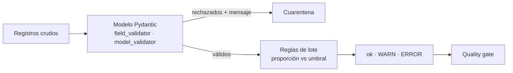

## 1. Resumen

Las herramientas de calidad traen reglas comunes: no nulos, únicos, rangos. Las reglas que dependen del negocio («la entrega no puede ser anterior al pedido», «no más de un 25 % de entregas lentas») hay que escribirlas. Un **validador propio** es esa regla en código, con dos niveles:

- **por registro:** el registro cumple o no; en Python, con `field_validator` y `model_validator` de Pydantic;
- **por lote:** una proporción medida sobre todas las filas, comparada con un **umbral**, con una **severidad** que decide si bloquear o avisar.

## 2. Qué es

- **Regla por registro:** se evalúa sobre una fila; si falla, la fila se rechaza con un mensaje.
- **Regla entre campos:** usa más de un campo de la misma fila (por ejemplo, `entrega >= pedido`); en Pydantic, un model validator *after* (*Validators*).
- **Regla de lote:** se evalúa sobre el conjunto (duplicados, proporción de entregas lentas).
- **Umbral:** cuánto se tolera antes de fallar.
- **Severidad:** `error` bloquea; `warn` deja pasar y avisa.

## 3. Problema que resuelve

Un pipeline de envíos acepta registros con región `oeste` (no existe) y entregas anteriores al pedido. Nadie lo nota hasta que el informe de tiempos de entrega muestra días negativos. Una regla por campo rechaza la región; una regla entre campos rechaza la fecha; una regla de lote avisa cuando las entregas lentas pasan del 25 %.

## 4. Cómo funciona

1. El modelo de Pydantic valida tipos; los `field_validator` agregan reglas por campo y el `model_validator(mode="after")`, reglas entre campos. Cada regla señala el error con `raise ValueError` (*Validators*).
2. `model_validate` valida cada registro crudo; un `ValidationError` lo rechaza con su mensaje (*Models*).
3. Sobre los registros válidos se miden las reglas de lote: cada una devuelve una proporción de 0 a 1.
4. La proporción se compara con el umbral; si lo supera, el resultado es la severidad de la regla.
5. El paso siguiente (el quality gate) decide: un `ERROR` bloquea, un `WARN` se reporta.

## 5. Cuándo utilizarlo

- Reglas de negocio que la herramienta no trae.
- Reglas entre campos o entre registros.
- Cuando la decisión depende de un umbral (no basta con «hay un caso»).

## 6. Cuándo no utilizarlo

- Para reglas que la herramienta ya trae (no nulos, únicos): usar las incorporadas.
- Cuando los datos ya están en el warehouse: la regla en SQL (`sql-quality-checks`) evita moverlos.
- Para lógica que cambia los datos: un validador valida; transformar es otra etapa.

## 7. Ejemplo sencillo

Seis envíos. Los validadores por registro rechazan `E2` (región `oeste`) y `E3` (entrega antes del pedido). Sobre los cuatro válidos, dos reglas de lote:

| Regla | Severidad | Umbral | Medido | Resultado |
|---|---|---|---|---|
| ids únicos | error | 0,00 | 0,25 (`E5` repetido) | `ERROR` |
| entregas de más de 7 días | warn | 0,25 | 0,75 | `WARN` |

## 8. Ejemplo de producción

Los validadores de un pipeline de envíos:

- un módulo `reglas.py` con el modelo de Pydantic y la lista de reglas de lote, cada una con nombre, dimensión, severidad y umbral;
- tests de pytest por regla, con un caso que pasa y uno que falla;
- los rechazados por registro van a cuarentena con el mensaje del `ValidationError`;
- el resultado de cada regla de lote se guarda en una tabla de resultados, con fecha y lote.

## 9. Arquitectura



## 10. Código

```python
"""Validadores propios: reglas por registro con Pydantic y reglas de lote con umbral y severidad."""
from collections.abc import Callable
from dataclasses import dataclass
from datetime import date
from typing import Literal, Self

from pydantic import BaseModel, ValidationError, field_validator, model_validator


class Envio(BaseModel):
    id: str
    region: str
    pedido: date
    entrega: date

    @field_validator("region")
    @classmethod
    def region_conocida(cls, v: str) -> str:
        if v not in {"norte", "centro", "sur"}:
            raise ValueError(f"región desconocida: {v}")
        return v

    @model_validator(mode="after")
    def entrega_despues_del_pedido(self) -> Self:
        if self.entrega < self.pedido:
            raise ValueError("la entrega es anterior al pedido")
        return self


@dataclass(frozen=True)
class ReglaDeLote:
    nombre: str
    severidad: Literal["error", "warn"]
    medir: Callable[[list[Envio]], float]   # proporción de filas que fallan, de 0 a 1
    umbral: float                            # falla si la proporción supera el umbral


def proporcion(envios: list[Envio], falla: Callable[[Envio], bool]) -> float:
    return sum(map(falla, envios)) / len(envios)


REGLAS = [
    ReglaDeLote("ids únicos", "error", lambda e: 1 - len({x.id for x in e}) / len(e), 0.0),
    ReglaDeLote("entregas de más de 7 días", "warn", lambda e: proporcion(e, lambda x: (x.entrega - x.pedido).days > 7), 0.25),
]
CRUDOS = [
    {"id": "E1", "region": "norte", "pedido": "2026-10-01", "entrega": "2026-10-03"},
    {"id": "E2", "region": "oeste", "pedido": "2026-10-01", "entrega": "2026-10-02"},
    {"id": "E3", "region": "sur", "pedido": "2026-10-05", "entrega": "2026-10-04"},
    {"id": "E4", "region": "sur", "pedido": "2026-10-01", "entrega": "2026-10-15"},
    {"id": "E5", "region": "centro", "pedido": "2026-10-02", "entrega": "2026-10-12"},
    {"id": "E5", "region": "centro", "pedido": "2026-10-02", "entrega": "2026-10-12"},
]

validos: list[Envio] = []
for crudo in CRUDOS:
    try:
        validos.append(Envio.model_validate(crudo))
    except ValidationError as exc:
        print(f"rechazado {crudo['id']}: {exc.errors()[0]['msg']}")

for regla in REGLAS:
    valor = regla.medir(validos)
    estado = "ok" if valor <= regla.umbral else regla.severidad.upper()
    print(f"{regla.nombre}: {valor:.2f} (umbral {regla.umbral:.2f}) -> {estado}")
```

El script se **ejecuta en la CI** y pasa `mypy --strict`. Imprime `rechazado E2: Value error, región desconocida: oeste`, `rechazado E3: Value error, la entrega es anterior al pedido`, `ids únicos: 0.25 (umbral 0.00) -> ERROR` y `entregas de más de 7 días: 0.75 (umbral 0.25) -> WARN`.

## 11. GCP

En GCP, **Knowledge Catalog** admite reglas SQL propias. Según *Validators* y *Auto data quality overview* (no ejecutado):

| | Validadores en Python con Pydantic | Knowledge Catalog |
|---|---|---|
| Por registro | `field_validator` y `model_validator`; la fila pasa o se rechaza | Row condition: una expresión SQL por fila, con umbral de porcentaje de filas que pasan |
| Por lote | Código propio con umbral y severidad | Table condition (expresión agregada) y SQL assertion (consulta que devuelve filas inválidas) |
| Dónde corre | En el proceso del pipeline, antes de cargar | Sobre la tabla, en un escaneo de calidad |

## 12. AWS

En AWS, **AWS Glue Data Quality**. Según *Validators* y *Data Quality Definition Language (DQDL) reference* (no ejecutado):

| | Validadores en Python con Pydantic | AWS Glue Data Quality |
|---|---|---|
| Regla propia | Una función de Python | `CustomSQL` o `ColumnValues` en un ruleset DQDL |
| Composición | Código | Reglas compuestas y filtros con `Where` en DQDL |

## 13. Azure

En Azure, **Microsoft Purview Unified Catalog**. Según *Validators* y *Create data quality rules* (no ejecutado):

| | Validadores en Python con Pydantic | Microsoft Purview |
|---|---|---|
| Regla propia | Una función de Python | Regla Custom: expresión por fila y filtro opcional |
| Lenguaje | Python | Expresiones regulares, expresiones de Azure Data Factory o SQL |

## 14. Buenas prácticas

- Cada regla con nombre, dimensión, severidad y umbral explícitos.
- Mensajes de error que digan el valor y la regla.
- Un test por regla, con un caso que pasa y uno que falla.
- Preferir las reglas incorporadas cuando existen.
- **Seguridad:** no incluir datos personales en los mensajes que van a logs.
- **Observabilidad:** guardar el valor medido de cada regla de lote, no solo si pasó.
- **Costo:** las reglas por registro en Python corren en el proceso del pipeline; las de lote sobre millones de filas conviene llevarlas a SQL.

## 15. Errores frecuentes

- Validadores que además transforman los datos sin decirlo.
- Umbrales en cero para todo: cualquier caso bloquea y el equipo los desactiva.
- Reglas de lote sin severidad: no queda claro si bloquear o avisar.
- Olvidar devolver la instancia en un model validator *after* (*Validators* lo exige).

## 16. Trade-offs

Un validador propio expresa cualquier regla y hay que mantenerlo y probarlo. Las reglas incorporadas de una herramienta son más baratas de mantener y cubren menos. Validar en Python antes de cargar protege el destino; validar en SQL sobre la tabla escala mejor para lotes grandes.

## 17. Conceptos relacionados

- `data-validation-with-pydantic`: modelos tipados en el borde.
- `sql-quality-checks`: reglas en SQL.
- `data-quality-dimensions`: qué mide cada regla.
- `schema-validation`: la forma del registro.
- `quality-gate`: qué hacer con el resultado.
- `dead-letter-queue`: los rechazados.

## 18. Preguntas técnicas abiertas

1. ¿Qué regla de negocio de tu pipeline no está escrita en ningún lado?
2. ¿Cuáles de tus reglas deberían avisar en lugar de bloquear?
3. ¿Tus reglas tienen tests?

## 19. Laboratorio relacionado

Pendiente (F4).

## 20. Fuentes

- Pydantic: *Validators* y *Models*.
- Google Cloud: *Auto data quality overview*.
- AWS: *Data Quality Definition Language (DQDL) reference*.
- Microsoft Learn: *Create data quality rules*.

El detalle de cada fuente está en `sources` del frontmatter.

## 21. Fecha de última verificación

2026-10-20. `review_required`: pendiente de revisión B-F3.1 del lote F3b-15a.

## 22. Historial de cambios importantes

- 2026-10-20: creación (lote F3b-15a).
