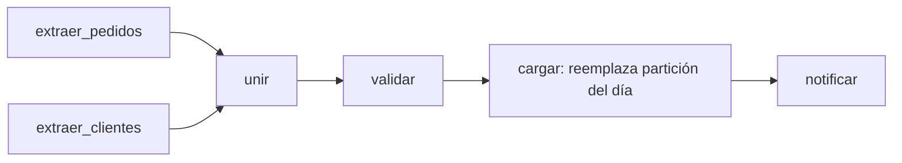

## 1. Resumen

Un DAG (grafo dirigido acíclico) modela un workflow como tareas unidas por dependencias, sin ciclos: define qué corre, en qué orden y bajo qué condiciones. Es la unidad básica de Airflow (que lo escribe "Dag") y la idea detrás de los pipelines de Data Factory o los flujos de Step Functions. Cada tarea debe ser pequeña, con una responsabilidad clara e idempotente, porque el orquestador la reintenta y la reejecuta.

## 2. Qué es

- **Grafo:** nodos (tareas) y aristas (dependencias).
- **Dirigido:** cada dependencia tiene sentido: B corre después de A.
- **Acíclico:** no hay ciclos; ninguna tarea depende, directa o indirectamente, de sí misma.

En Airflow, un Dag agrupa además lo necesario para ejecutarlo: cuándo corre (schedule), qué tareas tiene, sus dependencias, callbacks y parámetros como reintentos y timeouts. La documentación aclara que el término viene del concepto matemático, pero su significado en Airflow evolucionó más allá de la estructura de datos.

## 3. Problema que resuelve

Un pipeline real tiene pasos que pueden correr en paralelo, pasos que esperan a otros y pasos que solo deben correr si algo falló. Un script secuencial no expresa eso, no permite reintentar solo el paso que falló y no deja ver qué corrió y qué no. El DAG hace explícitas las dependencias y el estado de cada paso.

## 4. Cómo funciona

1. Se declaran las tareas y sus dependencias (`extraer >> validar >> cargar`).
2. El scheduler crea una **ejecución** del Dag por intervalo (Dag run) y, dentro de ella, una **instancia** de cada tarea (Task Instance) para ese intervalo.
3. Por defecto, una tarea corre cuando **todas** sus tareas upstream tuvieron éxito. Las *trigger rules* y el *branching* cambian ese comportamiento, por ejemplo para una tarea de limpieza que corre aunque algo haya fallado.
4. Cada instancia pasa por estados (en cola, corriendo, éxito, fallo, `up_for_retry`, `upstream_failed`...). Si falla y le quedan reintentos, se reprograma.

## 5. Cuándo utilizarlo

- Pipelines con varios pasos y dependencias entre ellos.
- Cuando se necesita reintentar o reejecutar pasos individuales.
- Cuando importa ver el historial de ejecuciones por intervalo.

## 6. Cuándo no utilizarlo

- Procesamiento de eventos uno a uno con baja latencia: un DAG por evento agrega demasiada sobrecarga; corresponde un consumidor de streaming.
- Lógica con ciclos (repetir hasta que se cumpla algo): se modela dentro de una tarea o con un sensor, no como ciclo en el grafo.
- Mover datos grandes entre tareas: las tareas deberían pasarse referencias (rutas, tablas), no los datos.

## 7. Ejemplo sencillo

`extraer_pedidos` y `extraer_clientes` corren en paralelo; `unir` espera a ambas; `publicar` corre después de `unir`. Si `extraer_clientes` falla, `unir` y `publicar` quedan en `upstream_failed` y solo se reintenta `extraer_clientes`.

## 8. Ejemplo de producción

Un Dag diario con cinco tareas:

- dos extracciones en paralelo;
- una validación de volumen y esquema;
- una carga que reemplaza la partición del día;
- una tarea de notificación con una trigger rule que corre aunque falle algo, para avisar al equipo.

Las tareas se pasan rutas de archivos, no datos. Cada una recibe la fecha lógica del intervalo, así que el Dag se puede reejecutar o recuperar por catchup sin duplicar.

## 9. Arquitectura



## 10. Código

```python
# Airflow 3 (TaskFlow) + google-cloud-bigquery: dos validaciones en paralelo y una carga que depende de ambas.
# Requiere: tablas proyecto.staging.pedidos(fecha, pedido_id, cliente_id, monto), proyecto.staging.clientes
# (cliente_id, segmento) y proyecto.dwh.ventas(fecha, pedido_id, cliente_id, monto, segmento), y credenciales
# con roles/bigquery.jobUser y roles/bigquery.dataEditor (ver el snippet airflow-daily-partition-dag).
from datetime import datetime

from airflow.sdk import dag, task
from google.cloud import bigquery

COUNT_DAY = "SELECT COUNT(*) AS filas FROM `proyecto.staging.pedidos` WHERE fecha = CAST(@dia AS DATE)"
COUNT_CUSTOMERS = "SELECT COUNT(*) AS filas FROM `proyecto.staging.clientes`"
REPLACE_PARTITION = """
BEGIN TRANSACTION;
DELETE FROM `proyecto.dwh.ventas` WHERE fecha = CAST(@dia AS DATE);
INSERT INTO `proyecto.dwh.ventas` (fecha, pedido_id, cliente_id, monto, segmento)
SELECT p.fecha, p.pedido_id, p.cliente_id, p.monto, c.segmento
FROM `proyecto.staging.pedidos` AS p
JOIN `proyecto.staging.clientes` AS c USING (cliente_id)
WHERE p.fecha = CAST(@dia AS DATE);
COMMIT TRANSACTION;
"""


def run(sql: str, ds: str) -> list:
    config = bigquery.QueryJobConfig(query_parameters=[bigquery.ScalarQueryParameter("dia", "STRING", ds)])
    return list(bigquery.Client().query_and_wait(sql, job_config=config))


@dag(schedule="@daily", start_date=datetime(2026, 9, 1), catchup=False)
def ventas():
    @task(retries=3)
    def validar_pedidos(*, ds: str) -> int:
        filas = run(COUNT_DAY, ds)[0].filas
        if filas == 0:
            raise ValueError(f"sin pedidos en staging para {ds}")
        return filas

    @task(retries=3)
    def validar_clientes(*, ds: str) -> int:
        filas = run(COUNT_CUSTOMERS, ds)[0].filas
        if filas == 0:
            raise ValueError("staging de clientes vacío")
        return filas

    @task(retries=3)
    def cargar(pedidos: int, clientes: int, *, ds: str) -> None:
        run(REPLACE_PARTITION, ds)               # reemplazo transaccional de la partición del día

    cargar(validar_pedidos(), validar_clientes())


ventas()
```

Las dependencias salen de pasar el resultado de una tarea a otra: `validar_pedidos` y `validar_clientes` no dependen entre sí y pueden correr en paralelo; `cargar` espera a las dos. La carga reemplaza la partición del día dentro de una transacción: si algo falla antes del `COMMIT`, la partición queda como estaba, y reintentar o reejecutar el día no duplica. Las extracciones que llenan el staging serían tareas anteriores con el mismo patrón (por ejemplo, el snippet `python-api-ingestion-retries`).

## 11. GCP

**Managed Service for Apache Airflow (ex Cloud Composer)** es el servicio de Google construido sobre Apache Airflow: ejecuta los mismos Dags. Lo que cambia es la operación (entorno, workers, configuración), no el modelo de Dag.

## 12. AWS

En AWS hay dos modelos distintos:

- **Amazon MWAA** ejecuta Apache Airflow administrado: los mismos Dags, con métricas y logs en CloudWatch y acceso controlado con IAM.
- **Step Functions** modela el flujo como una *state machine*, definida en Amazon States Language (ASL), no como un Dag de Python. Sus workflows Standard tienen ejecución exactly-once y pueden durar hasta un año; los Express son at-least-once y duran hasta cinco minutos.

En Step Functions los reintentos se declaran por estado (ver `api-ingestion`), y la noción de intervalo lógico de Airflow no forma parte del modelo de state machine.

## 13. Azure

En **Data Factory**, el equivalente es el **pipeline**: una agrupación lógica de *activities*. Una activity puede depender de otras con condiciones `Succeeded`, `Failed`, `Skipped` y `Completed`, que cumplen un papel parecido a las trigger rules de Airflow. Un pipeline se define en JSON (con sus activities, parámetros y concurrencia), no en código Python.

## 14. Buenas prácticas

- Tareas pequeñas con una responsabilidad; reintentar solo lo que falló.
- Tareas idempotentes y parametrizadas por el intervalo, nunca por "ahora".
- Pasar referencias entre tareas (rutas, nombres de tabla), no datos.
- Reintentos y timeouts explícitos en las tareas que tocan sistemas externos.
- **Seguridad:** credenciales en conexiones o gestores de secretos del orquestador, nunca en el código del Dag.
- **Observabilidad:** alertas por tarea fallida y por ejecución que supera su duración esperada; revisar las tareas en `upstream_failed` para encontrar la causa raíz.
- **Costo:** cada tarea ocupa un worker; demasiadas tareas diminutas agregan sobrecarga de scheduling, y demasiado pocas encarecen los reintentos.

## 15. Errores frecuentes

- Pasar grandes volúmenes de datos entre tareas en lugar de referencias.
- Tareas que usan la fecha actual y no son repetibles.
- Un único "megatarea" que hace todo y obliga a reejecutar el pipeline entero.
- Dependencias implícitas (una tarea asume que otra ya corrió, sin declararlo).

## 16. Trade-offs

Dividir en más tareas da reintentos más finos y mejor visibilidad, a cambio de más sobrecarga y más dependencias que mantener. Definir el flujo en código (Airflow) da versionado y pruebas, a cambio de requerir programación; los editores visuales (Data Factory) son más accesibles y más difíciles de revisar en un diff.

## 17. Conceptos relacionados

- `data-pipeline`: lo que el Dag representa.
- `catchup`: creación automática de ejecuciones pendientes.
- `idempotency`: requisito de cada tarea.
- Con ficha: `scheduler`, `data-orchestration`.
- `pipeline-dependencies`: dependencias entre tareas y dependencias de datos entre flujos.

## 18. Preguntas técnicas abiertas

1. ¿Cómo dividirías en tareas un pipeline que hoy es un script único?
2. ¿Qué trigger rule usarías para una tarea que debe limpiar archivos temporales pase lo que pase?
3. ¿Cuándo preferirías Step Functions sobre MWAA para orquestar un pipeline en AWS?

## 19. Laboratorio relacionado

Pendiente (F4): snippet "DAG de Airflow" (A-F3.2) y lab de tipo A.

## 20. Fuentes

- Apache Airflow: *Dags*, *Tasks* y *Pythonic Dags with the TaskFlow API*.
- Google Cloud: *Run parameterized queries*, *Work with multi-statement queries* y *Multi-statement transactions* (BigQuery).
- Google Cloud: *Managed Airflow overview*.
- AWS: *What is Amazon MWAA?*, *What is Step Functions?* y *Call HTTPS APIs in Step Functions workflows*.
- Microsoft Learn: *Pipelines and activities* (Data Factory).

El detalle de cada fuente está en `sources` del frontmatter.

## 21. Fecha de última verificación

2026-10-01. Pasa a `verified`: revisión B-F3.1 del lote 3 aplicada, sin VERIFY pendientes.

## 22. Historial de cambios importantes

- 2026-09-30: creación (lote 3 de F3).
- 2026-10-01: revisión B-F3.1 aplicada: §10 ejecutable, con validaciones en paralelo y la transacción de reemplazo de la partición a la vista (antes llamaba a funciones no definidas).
- 2026-10-01: `verification_status: verified` (revisión B-F3.1 del lote 3 aplicada; sin VERIFY pendientes).
- 2026-10-06: la sección de conceptos relacionados ya no lista como pendientes de ficha a `scheduler`, `data-orchestration`, que ya tienen ficha.
- 2026-10-11: §17 enlaza `pipeline-dependencies`, que ya tiene ficha (lote F3b-05a); antes figuraba como pendiente de ficha.
- 2026-10-13: `page_title` en cada cita, con el título de la página citada (ADR-012); sin cambios de contenido.
- 2026-10-14: lote F3b-rel (regla del §17): relations incluye `data-orchestration`, `pipeline-dependencies`, `scheduler`.
