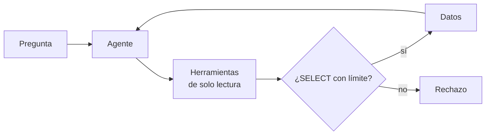

## 1. Resumen

Un **agente de datos** responde preguntas sobre datos estructurados con un bucle de agente (`llm-agents`): descubre las tablas, las describe, arma una consulta, la ejecuta y explica el resultado. BigQuery lo llama conversational analytics, con data agents configurados sobre tablas, vistas, grafos o UDF (*Conversational analytics overview*); su API es GA para BigQuery y Looker desde el 2026-06-23. Fabric declara su data agent como «generally available» y de solo lectura (*Fabric data agent concepts*).

Es emergente: no reemplaza el modelado ni la capa semántica. Lo que la plataforma aporta es el **control**: herramientas de solo lectura, una sentencia SELECT con límite de filas (`ai-assisted-sql-generation`) y una respuesta que **cita la consulta** que la produjo.

## 2. Qué es

- **Herramientas:** listar tablas, describirlas, consultar; expuestas, por ejemplo, con MCP (`model-context-protocol`).
- **Conexión de solo lectura:** la base se abre en modo lectura; el agente no puede escribir aunque lo intente.
- **Control de la consulta:** una sola sentencia SELECT y LIMIT obligatorio.
- **Contexto:** descripciones, glosario y consultas verificadas que el agente usa (`natural-language-catalog-interfaces`).
- **Respuesta citada:** el número y la consulta que lo produjo.

## 3. Problema que resuelve

Un gerente pregunta cuánto vendió cada región. Hoy espera un día a que un analista escriba la consulta. Un agente lo responde en segundos; sin controles, también podría ejecutar un `DELETE` que llegó en la conversación o leer tablas de más. Con herramientas de solo lectura y la consulta citada, la respuesta se puede auditar.

## 4. Cómo funciona

1. El agente lista las tablas disponibles para el usuario.
2. Describe las que parecen relevantes.
3. Propone una consulta; el control la valida y le agrega un LIMIT.
4. La ejecuta con conexión de solo lectura.
5. Responde citando la consulta.

## 5. Cuándo utilizarlo

- Preguntas exploratorias sobre tablas con buena metadata.
- Equipos de negocio que esperan días por consultas simples.
- Con datos ya modelados y una capa semántica o glosario.

## 6. Cuándo no utilizarlo

- Para escribir o corregir datos.
- Sobre tablas sin descripciones: el agente adivina.
- Como fuente oficial de un reporte sin revisar la consulta.

## 7. Ejemplo sencillo

| Llamada | Resultado |
|---|---|
| `listar_tablas()` | `['ventas']` |
| `describir('ventas')` | `region TEXT`, `monto INT` |
| `consultar(SELECT … GROUP BY region)` | `[('norte', 160), ('sur', 40)]` |
| `consultar(DELETE FROM ventas)` | Rechazada: solo una sentencia SELECT |

## 8. Ejemplo de producción

Agente de ventas:

- herramientas de solo lectura sobre el dominio de ventas (`least-privilege`);
- contexto desde el catálogo y consultas verificadas;
- validación del SQL antes de ejecutar (`ai-assisted-sql-generation`);
- respuesta con la consulta citada y registro de la conversación;
- en la nube (no ejecutado): conversational analytics de BigQuery, SageMaker Data Agent o Fabric data agent.

## 9. Arquitectura



## 10. Código

```python
# Python 3.12, biblioteca estándar (ejecutado en la CI): un agente de datos de solo lectura. Las herramientas son
# listar tablas, describirlas y consultar; la conexión se abre en modo solo lectura (mode=ro), las consultas pasan
# por un control (solo SELECT y LIMIT obligatorio) y la respuesta cita la consulta que la produjo. El «modelo» es
# un plan fijo de llamadas: lo que se prueba es que las herramientas no dejan escribir ni leer de más.
import re
import sqlite3
import tempfile
from pathlib import Path

LIMITE = 100


def tools(db: Path) -> dict[str, object]:
    def conn() -> sqlite3.Connection:
        return sqlite3.connect(f"file:{db}?mode=ro", uri=True)

    def listar_tablas() -> list[str]:
        with conn() as c:
            return [r[0] for r in c.execute("SELECT name FROM sqlite_master WHERE type = 'table' ORDER BY name")]

    def describir(tabla: str) -> list[str]:
        with conn() as c:
            return [f"{r[1]} {r[2]}" for r in c.execute(f"PRAGMA table_info({tabla!r})")]

    def consultar(sql: str) -> list[tuple[object, ...]]:
        if not re.match(r"\s*select\b", sql, re.I) or ";" in sql.strip().rstrip(";"):
            raise PermissionError("solo una sentencia SELECT")
        if not re.search(r"\blimit\s+\d+", sql, re.I):
            sql = f"{sql.rstrip().rstrip(';')} LIMIT {LIMITE}"
        with conn() as c:
            return list(c.execute(sql))

    return {"listar_tablas": listar_tablas, "describir": describir, "consultar": consultar}


base = Path(tempfile.mkdtemp())
db = base / "ventas.db"
with sqlite3.connect(db) as c:
    c.execute("CREATE TABLE ventas (region text, monto int)")
    c.executemany("INSERT INTO ventas VALUES (?, ?)", [("norte", 100), ("norte", 60), ("sur", 40)])

PLAN = [  # lo que «decidió» el modelo ante «¿cuánto vendió cada región?» y un intento de escribir
    ("listar_tablas", ()),
    ("describir", ("ventas",)),
    ("consultar", ("SELECT region, sum(monto) FROM ventas GROUP BY region ORDER BY region",)),
    ("consultar", ("DELETE FROM ventas",)),
]
herramientas = tools(db)
for nombre, args in PLAN:
    funcion = herramientas[nombre]
    try:
        resultado = funcion(*args)  # type: ignore[operator]
        print(f"{nombre}{args if args else '()'} → {resultado}")
    except (PermissionError, sqlite3.OperationalError) as exc:
        print(f"{nombre} rechazada: {exc}")
print("respuesta: norte 160, sur 40 (consulta citada: SELECT region, sum(monto) FROM ventas GROUP BY region)")
```

El script se **ejecuta en la CI** con la biblioteca estándar (SQLite en modo solo lectura) y pasa `mypy --strict`. Imprime las cuatro llamadas del §7 y la respuesta con la consulta citada. El plan del modelo es fijo.

## 11. GCP

En GCP, **conversational analytics** de BigQuery. Según *Conversational analytics overview* y *Conversational Analytics API release notes* (no ejecutado):

| | Este concepto | BigQuery |
|---|---|---|
| Agente | Herramientas de solo lectura | Data agents con contexto e instrucciones sobre tablas, vistas, grafos o UDF |
| Estado | — | «The Conversational Analytics API is generally available (GA) for BigQuery and Looker» (2026-06-23) |

## 12. AWS

En AWS, el **SageMaker Data Agent**. Según *SageMaker Data Agent* (no ejecutado):

| | Este concepto | SageMaker Data Agent |
|---|---|---|
| Qué hace | Consultar y responder | Generar código y planes de ejecución, diagnosticar errores y recomendar análisis |
| Dónde | Herramientas propias | Notebooks y Query Editor de SageMaker Unified Studio |

## 13. Azure

En Azure, el **Fabric data agent**. Según *Fabric data agent concepts* (no ejecutado):

| | Este concepto | Fabric data agent |
|---|---|---|
| Acceso | Solo lectura | Acceso de solo lectura a todas las fuentes |
| Estado | — | «generally available feature»; los controles de Purview para data agents, en preview |

## 14. Buenas prácticas

- Conexión de solo lectura, no solo instrucciones de «no escribas».
- LIMIT y tiempo máximo por consulta.
- Respuesta que cita la consulta.
- **Seguridad:** el agente consulta con la identidad del usuario o con una de solo lectura acotada al dominio.
- **Observabilidad:** preguntas, consultas y rechazos por día.
- **Costo:** límites de filas y de bytes; las consultas del agente se etiquetan para atribuirlas (`finops-for-data`).

## 15. Errores frecuentes

- Confiar en el prompt para impedir escrituras.
- Dejar que el agente vea todas las tablas.
- Publicar la respuesta sin la consulta.
- Agentes sobre tablas sin metadata.

## 16. Trade-offs

El agente acerca los datos a quien pregunta a cambio de consultas que hay que validar y auditar. Más contexto mejora las respuestas y cuesta mantenerlo. Es emergente: las funciones y sus estados cambian seguido.

## 17. Conceptos relacionados

- `llm-agents`: el bucle.
- `natural-language-catalog-interfaces`: encontrar los datos.
- `ai-assisted-sql-generation`: validar el SQL.
- `least-privilege`: solo lectura.
- `model-context-protocol`: exponer las herramientas.
- `finops-for-data`: atribuir el consumo.

## 18. Preguntas técnicas abiertas

1. ¿Qué preguntas recurrentes respondería un agente en tu equipo?
2. ¿Con qué identidad consultaría?
3. ¿Cómo revisarías las consultas que ejecutó?

## 19. Laboratorio relacionado

Pendiente (F4).

## 20. Fuentes

- Google Cloud: *Conversational analytics overview* y *Conversational Analytics API release notes*.
- AWS: *SageMaker Data Agent*.
- Microsoft Learn: *Fabric data agent concepts*.

El detalle de cada fuente está en `sources` del frontmatter.

## 21. Fecha de última verificación

2026-10-27. `review_required`: pendiente de revisión B-F3.1 del lote F3b-23a.

## 22. Historial de cambios importantes

- 2026-10-27: creación (lote F3b-23a).
