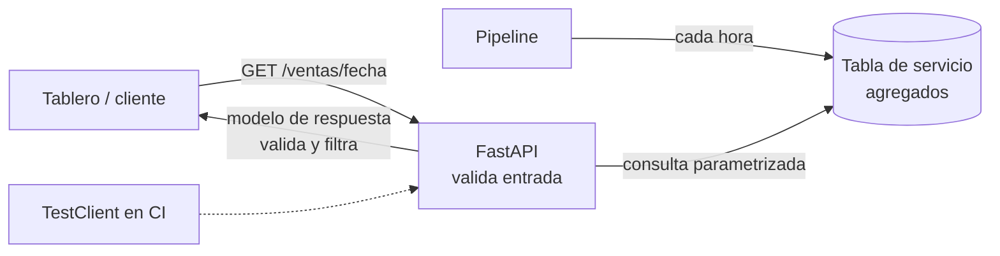

## 1. Resumen

FastAPI es un framework web de Python que usa anotaciones de tipo y Pydantic para validar lo que entra y lo que sale de una API. En datos se usa para exponer agregados o tablas de servicio a otras aplicaciones, para recibir eventos o cargas, y para APIs internas de plataforma. Hay tres reglas que lo hacen seguro y predecible:

- parámetros con tipos y restricciones;
- un modelo de respuesta que valida y filtra lo que sale;
- tests con `TestClient`, sin servidor.

## 2. Qué es

- **Path operation:** una función decorada con `@app.get(...)`, `@app.post(...)`. Sus parámetros salen de la ruta, la query o el cuerpo, según su tipo.
- **Validación de entrada:** `fecha: date` acepta solo fechas ISO. `Query(ge=1, le=1000)` y `Query(pattern=...)` restringen rangos y formatos. Si falla, la respuesta es un error de validación (422) y la función no se ejecuta.
- **Modelo de respuesta:** el tipo de retorno (o `response_model`) valida lo que devuelve la función y **filtra** los campos a lo declarado.
- **def y async def:** una función `def` corre en un threadpool externo; una `async def`, en el event loop. Una llamada bloqueante dentro de `async def` bloquea el servidor.

## 3. Problema que resuelve

Exponer datos con un servidor hecho a mano obliga a validar parámetros, serializar, documentar y manejar errores en cada endpoint. FastAPI lo deriva de las anotaciones: la validación, la documentación OpenAPI y la conversión a JSON salen de los tipos. Los errores de entrada se rechazan antes de llegar a la consulta, y un error de programación que devolvería datos incompletos se detecta en el modelo de respuesta.

## 4. Cómo funciona

1. Al recibir una petición, FastAPI extrae los parámetros y los valida contra las anotaciones. Si no cumplen, responde 422 con el detalle.
2. Llama a la función: en el threadpool si es `def`, en el event loop si es `async def`.
3. Valida el valor devuelto contra el modelo de respuesta, y deja solo los campos declarados.
4. Serializa a JSON.
5. En pruebas, `TestClient(app)` hace las peticiones en el mismo proceso, a través de HTTPX, sin abrir puertos.

## 5. Cuándo utilizarlo

- APIs de lectura sobre agregados ya calculados (una tabla de servicio, una caché), con parámetros acotados.
- Endpoints para recibir eventos o archivos que luego entran a un pipeline.
- APIs internas de plataforma (lanzar un backfill, consultar el estado de un job) con validación estricta.

## 6. Cuándo no utilizarlo

- Para exponer consultas arbitrarias al warehouse: cada petición puede escanear mucho y costar caro. Mejor agregados precalculados, o el acceso directo controlado del warehouse.
- Para mover grandes volúmenes: una API JSON pagina mal millones de filas. Para eso, exportaciones a archivos u otros mecanismos de compartir datos.
- Cuando el consumidor necesita streaming de eventos: una cola o un bus de eventos encaja mejor.

## 7. Ejemplo sencillo

```python
from fastapi import FastAPI
from fastapi.testclient import TestClient

app = FastAPI()


@app.get("/salud")
def salud() -> dict[str, str]:
    return {"estado": "ok"}


print(TestClient(app).get("/salud").json())   # {'estado': 'ok'}
```

## 8. Ejemplo de producción

Un equipo comercial consulta los totales diarios por tienda desde un tablero interno. La API FastAPI lee de una tabla de servicio que el pipeline actualiza cada hora. No consulta los hechos crudos. Los parámetros están acotados: fecha válida, tienda con el patrón `T\d+`, límite entre 1 y 1000. El modelo de respuesta solo deja `tienda` y `total`. La API corre en un contenedor con un proceso por contenedor, escuchando en el puerto que indica la plataforma. Las pruebas con `TestClient` cubren el caso feliz, el 404 y los 422 de cada parámetro.

## 9. Arquitectura



## 10. Código

```python
# Python 3.12, FastAPI 0.143.0 y Pydantic 2 (ejecutado; mypy --strict sin errores): API de lectura de un
# agregado, con validación de parámetros, modelo de respuesta y pruebas con TestClient (sin servidor).
from datetime import date
from typing import Annotated

from fastapi import FastAPI, HTTPException, Query
from fastapi.testclient import TestClient
from pydantic import BaseModel, Field

VENTAS = {  # en producción: una consulta parametrizada al warehouse o a una tabla de servicio
    date(2026, 10, 7): [("T1", 120), ("T2", 40)],
    date(2026, 10, 8): [("T2", 75)],
}


class TotalTienda(BaseModel):
    tienda: str
    total: int = Field(ge=0)


class Respuesta(BaseModel):
    fecha: date
    items: list[TotalTienda]


app = FastAPI(title="ventas-api")


@app.get("/ventas/{fecha}", response_model=Respuesta)
def ventas_por_dia(
    fecha: date,                                                   # se valida como fecha ISO
    tienda: Annotated[str | None, Query(pattern=r"^T\d+$")] = None,
    limite: Annotated[int, Query(ge=1, le=1000)] = 100,
) -> Respuesta:
    filas = VENTAS.get(fecha)
    if filas is None:
        raise HTTPException(status_code=404, detail="sin datos para esa fecha")
    items = [TotalTienda(tienda=t, total=m) for t, m in filas if tienda in (None, t)][:limite]
    return Respuesta(fecha=fecha, items=items)


cliente = TestClient(app)
print(cliente.get("/ventas/2026-10-07").json())
# {'fecha': '2026-10-07', 'items': [{'tienda': 'T1', 'total': 120}, {'tienda': 'T2', 'total': 40}]}
print(cliente.get("/ventas/2026-10-07", params={"tienda": "T2"}).json()["items"])   # [{'tienda': 'T2', 'total': 40}]
print(cliente.get("/ventas/2026-10-09").status_code)                                 # 404
print(cliente.get("/ventas/ayer").status_code, cliente.get("/ventas/2026-10-07", params={"limite": 0}).status_code)   # 422 422
print(cliente.get("/ventas/2026-10-07", params={"tienda": "x'; drop"}).status_code)   # 422: el patrón rechaza el valor
```

Se ejecutó con FastAPI 0.143.0 y Starlette 1.7.0 en el entorno de pruebas, y `mypy --strict` pasó sin errores. Al importar `TestClient`, esa versión de Starlette emite un `StarletteDeprecationWarning` que pide instalar `httpx2` en lugar de `httpx`. Las pruebas pasan igual. Antes de fijar versiones conviene revisar las notas de la versión de Starlette. El valor con comilla de `tienda` nunca llega a la función: el patrón lo rechaza con 422.

## 11. GCP

En **Cloud Run**, el contenedor de un servicio debe escuchar en `0.0.0.0`, no en `127.0.0.1`, en el puerto al que Cloud Run envía las peticiones. Por defecto es 8080, y Cloud Run inyecta la variable `PORT`. La documentación tiene un quickstart para desplegar una aplicación FastAPI desde el código fuente con un solo comando. Como Cloud Run replica instancias, encaja con la recomendación de FastAPI de un proceso por contenedor.

## 12. AWS

Esta ficha no cita una fuente de AWS sobre FastAPI. El código de la aplicación no cambia; lo que cambia es el servicio de cómputo y su contrato (puerto, proceso, escalado).

## 13. Azure

Esta ficha no cita una fuente de Azure sobre FastAPI (ver §12).

## 14. Buenas prácticas

- Todos los parámetros tipados y acotados (`ge`, `le`, `pattern`, enums).
- Modelo de respuesta explícito, para que no salgan campos internos.
- Consultas parametrizadas hacia la base; nunca armar SQL con los parámetros recibidos.
- `def` para código bloqueante, como la mayoría de los drivers de base de datos síncronos, y `async def` solo con bibliotecas asíncronas.
- Un proceso por contenedor cuando la plataforma replica instancias.
- **Seguridad:** autenticación en todas las rutas que no sean públicas, el modelo de respuesta como filtro de campos sensibles, límites de tamaño y de paginación para evitar extracciones masivas, y no devolver trazas internas en los errores.
- **Observabilidad:** registrar ruta, código de estado, latencia y parámetros no sensibles por petición; medir los 422 por parámetro (un cliente mal integrado) aparte de los 5xx.
- **Costo:** servir desde agregados precalculados acota el costo por petición; un endpoint que consulta tablas grandes en cada llamada traslada el costo del warehouse a cada usuario de la API.

## 15. Errores frecuentes

- Parámetros sin límites (`limite: int` sin `le`): un cliente pide un millón de filas.
- Devolver el objeto de base de datos completo sin modelo de respuesta: se exponen columnas internas.
- `async def` con un driver síncrono: cada consulta bloquea el event loop y todas las peticiones.
- Varios workers por contenedor en una plataforma que ya replica instancias: más memoria sin más capacidad útil.
- Escuchar en `127.0.0.1` dentro del contenedor: la plataforma no puede enrutar las peticiones.

## 16. Trade-offs

FastAPI da validación, documentación y serialización a partir de los tipos, con poco código. A cambio, depende de Pydantic y Starlette, y sus versiones, y obliga a entender el modelo `def`/`async def`. Una API propia agrega un servicio que operar. Para consumidores internos de datos, a veces basta con dar acceso controlado a una vista del warehouse.

## 17. Conceptos relacionados

- `data-validation-with-pydantic`: la validación que usa FastAPI.
- `http-clients`: el lado del consumidor y `TestClient`.
- `testing-with-pytest`: las pruebas de la API.
- `python-concurrency`: `def` frente a `async def`.

## 18. Preguntas técnicas abiertas

1. ¿Qué parámetros de tu API podrían forzar una consulta cara y cómo los acotarías?
2. ¿Expondrías los datos con una API propia o con acceso a una vista del warehouse? ¿Qué lo decide?
3. ¿Cómo versionarías el modelo de respuesta sin romper a los clientes existentes?

## 19. Laboratorio relacionado

Pendiente (F4).

## 20. Fuentes

- FastAPI: *Query Parameters and String Validations*, *Response Model*, *Concurrency and async / await*, *Testing* y *FastAPI in Containers - Docker*.
- Google Cloud: *Container runtime contract* y *Quickstart: Build and deploy a Python (FastAPI) web app* (Cloud Run).

El detalle de cada fuente está en `sources` del frontmatter.

## 21. Fecha de última verificación

2026-10-09. Pasa a `verified`: revisión B-F3.1 del lote F3b-03b aplicada, sin VERIFY pendientes.

## 22. Historial de cambios importantes

- 2026-10-08: creación (lote F3b-03b).
- 2026-10-09: revisión B-F3.1 del lote F3b-03b aplicada (docs/reviews/cards-f3b-03b.md): filas aprobadas sin cambios en esta ficha.
- 2026-10-09: `verification_status: verified` (sin VERIFY pendientes).
- 2026-10-13: `page_title` en cada cita, con el título de la página citada (ADR-012); sin cambios de contenido.
