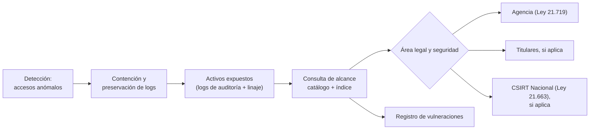

## 1. Resumen

Esta ficha no es asesoría legal: si una vulneración se reporta, y a quién, lo deciden el área legal y seguridad; aquí se explica cómo ingeniería entrega en horas los datos que esa decisión necesita. Es ficha hija de `chile-data-protection`.

Cuando hay un incidente, la primera pregunta es: **¿cuántas personas, qué datos, y hay sensibles, financieros o de menores de 14?** Si la respuesta toma una semana de consultas manuales, el reporte llega tarde. Ingeniería marca la diferencia teniendo listo antes del incidente el catálogo de clasificación, el índice de titulares, el linaje y los logs de acceso. Un mismo incidente puede activar también la Ley 21.663, con plazos propios.

## 2. Qué es

- **[Obligación legal · Ley 19.628, art. 14 sexies]** **Vulneración:** destrucción, filtración, pérdida o alteración accidental o ilícita, o comunicación o acceso no autorizados; se reporta a la Agencia sin dilaciones indebidas cuando hay riesgo razonable para los titulares.
- **[Obligación legal · Ley 19.628, art. 14 sexies]** **Registro de vulneraciones:** naturaleza, efectos, categorías, número aproximado de titulares y medidas; se lleva aunque no se reporte.
- **[Obligación legal · Ley 19.628, art. 14 sexies]** **Aviso a los titulares:** además de la Agencia, si hay datos sensibles, de niños y niñas menores de 14 años o de obligaciones económicas, financieras, bancarias o comerciales.
- **[Obligación legal · Ley 21.663, art. 9]** Las instituciones del art. 4 de la Ley 21.663 reportan al CSIRT Nacional: alerta temprana en 3 horas, actualización en 72 horas (24 si un operador de importancia vital ve afectados sus servicios esenciales), informe final en 15 días corridos y, los operadores de importancia vital, plan de acción en 7 días.
- **[Decisión de arquitectura]** **Consulta de alcance:** desde las tablas o archivos expuestos, obtiene titulares únicos, categorías, presencia de menores y periodo.

## 3. Problema que resuelve

**[Buena práctica]** Sin preparación: no se sabe qué tablas leyó la cuenta comprometida, no se sabe si había datos financieros, los logs ya rotaron, y el conteo de afectados es una estimación que cambia cada día.

**[Obligación legal · Ley 19.628, art. 34 ter]** Omitir las comunicaciones o los registros de una vulneración es infracción grave (letra k)); omitir en forma deliberada la comunicación es gravísima (art. 34 quáter f)).

## 4. Cómo funciona

1. **[Buena práctica]** Detectar: alertas sobre accesos anómalos, exportaciones masivas y cuentas de servicio.
2. **[Buena práctica]** Contener y preservar: revocar credenciales, congelar logs y snapshots; no borrar evidencia.
3. **[Decisión de arquitectura]** Determinar los activos expuestos con logs de auditoría y linaje, incluidos derivados y exportaciones.
4. **[Decisión de arquitectura]** Ejecutar la consulta de alcance con el catálogo y el índice de titulares.
5. **[Obligación legal · Ley 19.628, art. 14 sexies]** El área legal decide el reporte a la Agencia y el aviso a titulares; registrar el incidente y las medidas.
6. **[Obligación legal · Ley 21.663, art. 9]** Si la institución está obligada por la Ley 21.663 (lo determina el área legal), calcular sus plazos desde que se tomó conocimiento.
7. **[Obligación legal · Ley 19.628, art. 15 bis]** Si el incidente es de un encargado, este debe reportarlo al responsable: el canal está en el contrato.
8. **[Obligación legal · Ley 19.628, art. 14 quinquies]** Tener la evidencia de los controles previa al incidente: el responsable debe acreditar que sus medidas existían y funcionaban.

## 5. Cuándo utilizarlo

- En la preparación (antes del incidente) y en cada incidente que toque datos personales, propio o de un encargado.

## 6. Cuándo no utilizarlo

- Para decidir si existe «riesgo razonable» o si se notifica: lo deciden el área legal y seguridad.

## 7. Ejemplo sencillo

| Dato expuesto | ¿Aviso a titulares además de la Agencia? |
|---|---|
| Contacto e identificación de adultos | No por la regla especial; depende del riesgo |
| Datos de pago | Sí (obligaciones financieras) |
| Datos de salud | Sí (sensibles) |
| Cualquier dato de un niño o niña menor de 14 | Sí |

## 8. Ejemplo de producción

| Preparación | Implementación posible |
|---|---|
| Clasificación por columna | Tags de categoría: `sensible`, `financiero`, `contacto` |
| Edad o categoría de titular | Flag de menor de 14 años en el índice de titulares |
| Logs de acceso con retención suficiente | Logs de auditoría exportados a almacenamiento inmutable |
| Consulta de alcance probada | Simulacro semestral |
| Canal con encargados | Cláusula de aviso y contacto en el contrato |

### Evidencia de cumplimiento

| Evidencia | Dónde queda | Quién la produce |
|---|---|---|
| Registro de vulneraciones | Sistema de incidentes | Seguridad |
| Resultado de la consulta de alcance | Expediente del incidente, sin datos personales | Ingeniería |
| Logs preservados | Almacenamiento inmutable | Plataforma |
| Simulacros | Reporte del ejercicio | Seguridad, ingeniería |

## 9. Arquitectura



## 10. Código

```python
# Python 3.12+, biblioteca estándar. Alcance de una vulneración (art. 14 sexies): a partir de las tablas
# expuestas, calcula titulares únicos, categorías de datos y si corresponde avisar también a los titulares.
# El registro usa conteos y categorías, no datos personales.
from dataclasses import dataclass
from datetime import datetime, timedelta


@dataclass(frozen=True)
class Tabla:
    nombre: str
    categorias: frozenset[str]          # desde el catálogo de clasificación
    titulares: frozenset[str]           # llaves seudónimas presentes (desde el índice de titulares)
    menores_14: frozenset[str]          # titulares menores de 14 años


AVISO_A_TITULARES = {"sensible", "financiero"}   # art. 14 sexies: además, niños y niñas menores de 14

CATALOGO = [
    Tabla("silver.pasajeros", frozenset({"identificación", "contacto"}),
          frozenset({"t1", "t2", "t3", "t4"}), frozenset({"t4"})),
    Tabla("silver.pagos", frozenset({"financiero"}), frozenset({"t1", "t2"}), frozenset()),
    Tabla("gold.vuelos_agregados", frozenset(), frozenset(), frozenset()),
]


def alcance(expuestas: set[str], detectado: datetime) -> dict[str, object]:
    tablas = [t for t in CATALOGO if t.nombre in expuestas]
    titulares = set().union(*(t.titulares for t in tablas))
    categorias = set().union(*(t.categorias for t in tablas))
    menores = set().union(*(t.menores_14 for t in tablas))
    avisar = bool(categorias & AVISO_A_TITULARES) or bool(menores)
    return {
        "detectado": detectado.isoformat(timespec="minutes"),
        "tablas": sorted(expuestas),
        "titulares_aprox": len(titulares),
        "categorias": sorted(categorias),
        "incluye_menores_14": bool(menores),
        "reportar_a_agencia": "si hay riesgo razonable para los titulares (decide Legal)",
        "avisar_a_titulares": avisar,
    }


def plazos_ley_21663(conocimiento: datetime, operador_vital: bool) -> dict[str, str]:
    """Ley 21.663, art. 9, solo si la institución está obligada (art. 4): alerta temprana, actualización e informe final."""
    p = {"alerta_temprana": conocimiento + timedelta(hours=3),
         "actualizacion": conocimiento + timedelta(hours=24 if operador_vital else 72),
         "informe_final": conocimiento + timedelta(hours=3) + timedelta(days=15)}  # desde la alerta temprana
    if operador_vital:
        p["plan_de_accion"] = conocimiento + timedelta(days=7)
    return {k: v.isoformat(timespec="minutes") for k, v in p.items()}


if __name__ == "__main__":
    print(alcance({"silver.pasajeros", "silver.pagos"}, datetime(2026, 10, 22, 9, 40)))
    print(alcance({"gold.vuelos_agregados"}, datetime(2026, 10, 22, 9, 40)))
    print("plazos Ley 21.663 (no operador vital):", plazos_ley_21663(datetime(2026, 10, 22, 9, 40), False))
```

El script se **ejecuta en la CI** con la biblioteca estándar y pasa `mypy --strict`. Imprime el alcance de dos incidentes: el primero expone 4 titulares, datos financieros y un menor de 14, así que corresponde avisar a los titulares por dos razones; el segundo expone una tabla agregada sin titulares. Ambos se registran. Al final, los plazos de la Ley 21.663 para una institución obligada que no es operador de importancia vital.

## 11. GCP

En GCP, **Cloud Audit Logs**. Según *Ley 19628 SOBRE PROTECCION DE LOS DATOS PERSONALES* y *Cloud Audit Logs overview* (no ejecutado):

| Necesidad | Servicio | Etiqueta |
|---|---|---|
| Logs de acceso a datos | Data Access audit logs: desactivados por defecto, salvo en BigQuery; hay que activarlos | **[Decisión de arquitectura]** |

## 12. AWS

En AWS, **AWS CloudTrail**. Según *Ley 19628 SOBRE PROTECCION DE LOS DATOS PERSONALES* y *Logging data events* (no ejecutado):

| Necesidad | Servicio | Etiqueta |
|---|---|---|
| Logs de acceso a datos | Data events de CloudTrail: no se registran por defecto y tienen cargos adicionales | **[Decisión de arquitectura]** |

## 13. Azure

En Azure, **auditoría de Azure SQL Database**. Según *Ley 19628 SOBRE PROTECCION DE LOS DATOS PERSONALES* y *Auditing for Azure SQL Database* (no ejecutado):

| Necesidad | Servicio | Etiqueta |
|---|---|---|
| Logs de acceso a datos | Auditoría hacia Azure Storage, Log Analytics o Event Hubs | **[Buena práctica]** |

## 14. Buenas prácticas

- **[Buena práctica]** Activar los logs de acceso a datos antes de necesitarlos; en varias nubes no están activos por defecto.
- **[Buena práctica]** **Seguridad:** cuentas de servicio con mínimo privilegio, para que el radio de exposición sea chico.
- **[Obligación legal · Ley 21.663, art. 9]** Un único procedimiento con dos salidas (Ley 21.719 y Ley 21.663) cuando la institución está obligada por ambas.
- **[Buena práctica]** **Observabilidad:** tiempo de cálculo del alcance como métrica del simulacro.
- **[Buena práctica]** **Costo:** retener los logs de acceso en almacenamiento frío, no en la plataforma de consulta.

## 15. Errores frecuentes

- Borrar o rotar logs durante la investigación.
- Contar filas en lugar de titulares únicos.
- Olvidar derivados y exportaciones de la tabla expuesta.
- No registrar incidentes que se decidió no reportar.

## 16. Trade-offs

Más logs y por más tiempo permiten un alcance preciso, pero cuestan y también contienen datos personales. Conviene registrar identificadores y metadatos de acceso, no los valores consultados.

## 17. Conceptos relacionados

- `chile-data-protection`: ficha padre.
- `incident-response`: el runbook.
- `data-subject-rights-pipeline`: el índice de titulares.
- `processing-activities-inventory`: categorías y actividades.
- `privacy-controls-as-code`: evidencia previa.
- `processors-and-international-transfers`: encargados.
- `observability-logs`: los logs.

## 18. Preguntas técnicas abiertas

1. ¿Cuánto tardarías en saber cuántas personas había en una tabla filtrada?
2. ¿Tus logs de acceso a datos están activos y cuánto se retienen?
3. ¿Sabes qué tablas tienen datos de menores de 14 años?

## 19. Laboratorio relacionado

Pendiente (F4). Propuesta: simulacro con logs de auditoría y consulta de alcance.

## 20. Fuentes

- BCN Ley Chile: *Ley 19628 SOBRE PROTECCION DE LOS DATOS PERSONALES* (versión con vigencia diferida desde 2026-12-01), *Ley 21663 LEY MARCO DE CIBERSEGURIDAD* y *Decreto 295*.
- Google Cloud: *Cloud Audit Logs overview*.
- AWS: *Logging data events*.
- Microsoft Learn: *Auditing for Azure SQL Database*.

El detalle de cada fuente está en `sources` del frontmatter.

## 21. Fecha de última verificación

2026-10-22: art. 14 sexies, Ley 21.663 (art. 9) y Decreto 295 consultados ese día en BCN. `review_required`: pasa a `verified` solo con la aprobación explícita de Felipe (`owner_approved_at`). Revisión mensual.

## 22. Historial de cambios importantes

- 2026-10-22: creación (upgrade de 19); reemplaza a `personal-data-breach-readiness`, que queda como alias.
