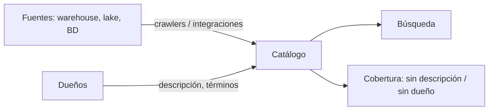

## 1. Resumen

Un **catálogo de datos** es el inventario buscable de los datos: qué tablas y archivos existen, qué contienen, quién es su dueño y dónde están. Su trabajo es que quien busca datos los encuentre y los entienda sin preguntarle a nadie.

Un catálogo útil tiene tres cosas:

- **cobertura:** las fuentes importantes están, y se cargan solas (crawlers, integraciones), no a mano;
- **contexto:** descripción, dueño y significado de negocio, no solo el schema (`metadata-management`);
- **búsqueda:** por nombre, por descripción y por término de negocio.

## 2. Qué es

- **Entrada (entry):** un activo catalogado (tabla, vista, archivo, modelo).
- **Metadata técnica:** schema, ubicación, tamaño; casi siempre automática.
- **Metadata de negocio:** descripción, dueño, términos de glosario; casi siempre la agregan personas.
- **Glosario:** términos de negocio con definición, vinculados a activos.
- **Inventario frente a publicación:** algunos catálogos separan lo que un equipo registra de lo que se publica para todos (SageMaker Catalog lo hace por proyecto, *Catalog in IDC-based domains*).

## 3. Problema que resuelve

Un analista necesita «las facturas por pedido». Pregunta en tres canales, le pasan cuatro tablas con nombres parecidos y usa la que no es. Con un catálogo, busca «pedido», ve que `finanzas.facturas` es «Facturas emitidas por pedido», con dueño finanzas, y sabe a quién preguntar.

## 4. Cómo funciona

1. Las fuentes se registran: automáticamente (crawlers, integraciones de la nube) o a mano para fuentes propias.
2. La metadata técnica llega con el registro.
3. Los dueños agregan la de negocio: descripción, dueño, términos.
4. La búsqueda recorre nombres, descripciones y términos.
5. Se mide la cobertura: activos sin descripción o sin dueño.

En PostgreSQL, `COMMENT ON` guarda una descripción por objeto y `obj_description` la lee (*COMMENT*, *9.27. System Information Functions and Operators*): alcanza para un catálogo mínimo.

## 5. Cuándo utilizarlo

- Cuando hay más tablas de las que una persona recuerda.
- Cuando varios equipos producen y consumen datos.
- Como base para dueños, clasificación y linaje.

## 6. Cuándo no utilizarlo

- Como lista estática en un documento: se desactualiza el primer mes.
- Catalogando todo sin descripción ni dueño: un inventario sin contexto no ayuda a elegir.

## 7. Ejemplo sencillo

Cuatro tablas con descripción y dueño en su comentario. Búsquedas:

| Busca | Encuentra |
|---|---|
| «pedido» | `finanzas.facturas`, `ventas.devoluciones`, `ventas.pedidos` |
| «finanzas» | `finanzas.facturas` |

`finanzas.facturas` aparece al buscar «pedido» por su descripción, no por su nombre.

## 8. Ejemplo de producción

- Registro automático de todas las tablas del warehouse y del lake.
- Descripción y dueño obligatorios para publicar una tabla en la capa de consumo.
- Un glosario de 50 términos de negocio, vinculados a las columnas.
- Un reporte semanal de activos sin descripción o sin dueño, por equipo.

## 9. Arquitectura



## 10. Código

```python
# Python 3.12 y psycopg contra PostgreSQL 17 (ejecutado en la CI con el servicio postgres:17): un catálogo mínimo.
# Cada tabla tiene una descripción (COMMENT ON) con su dueño; se busca por palabra en nombres y descripciones, como
# haría quien no sabe dónde están los datos. PG_HOST, PG_PORT, PG_USER, PG_PASSWORD y PG_DB: base vacía temporal.
import os

import psycopg
from psycopg import sql

TABLAS = {
    "ventas.pedidos": ("id int, cliente_id int, monto numeric", "Pedidos confirmados, uno por fila. Dueño: comercial"),
    "ventas.devoluciones": ("id int, pedido_id int, motivo text", "Devoluciones de pedidos. Dueño: comercial"),
    "finanzas.facturas": ("id int, pedido_id int, total numeric", "Facturas emitidas por pedido. Dueño: finanzas"),
    "rrhh.empleados": ("id int, area text", "Planta de empleados. Dueño: personas"),
}

with psycopg.connect(host=os.environ["PG_HOST"], port=os.environ["PG_PORT"], user=os.environ["PG_USER"],
                     password=os.environ["PG_PASSWORD"], dbname=os.environ["PG_DB"], autocommit=True) as conn:
    for esquema in {t.split(".")[0] for t in TABLAS}:
        conn.execute(f"CREATE SCHEMA {esquema}")
    for tabla, (columnas, descripcion) in TABLAS.items():
        conn.execute(f"CREATE TABLE {tabla} ({columnas})")
        conn.execute(sql.SQL("COMMENT ON TABLE {} IS {}").format(sql.Identifier(*tabla.split(".")), sql.Literal(descripcion)))

    def buscar(palabra: str) -> list[tuple[str, str]]:
        filas = conn.execute(
            "SELECT n.nspname || '.' || c.relname, obj_description(c.oid, 'pg_class') FROM pg_class c "
            "JOIN pg_namespace n ON n.oid = c.relnamespace WHERE c.relkind = 'r' AND n.nspname <> 'pg_catalog' "
            "AND n.nspname <> 'information_schema' AND (c.relname ILIKE %(p)s OR obj_description(c.oid, 'pg_class') ILIKE %(p)s) "
            "ORDER BY 1", {"p": f"%{palabra}%"}).fetchall()
        return [(str(t), str(d)) for t, d in filas]

    for palabra in ("pedido", "finanzas"):
        print(f"buscar «{palabra}»:")
        for tabla, descripcion in buscar(palabra):
            print(f"  {tabla}: {descripcion}")
```

El script se **ejecuta en la CI contra el servicio postgres:17**, en una base vacía que el test crea y borra, y pasa `mypy --strict`. Imprime las tres tablas que aparecen al buscar «pedido» y la única que aparece al buscar «finanzas».

## 11. GCP

En GCP, **Knowledge Catalog**. Según *COMMENT* y *About metadata in Knowledge Catalog* (no ejecutado):

| | Catálogo mínimo en PostgreSQL | Knowledge Catalog |
|---|---|---|
| Activos | Tablas con `COMMENT ON` | Entries automáticas desde fuentes de Google Cloud o creadas para fuentes propias |
| Metadata | Un comentario por objeto | Aspect types predefinidos (Schema, Overview, Contacts, DataQuality, Lineage) o propios, y aspects que llenan sistemas, escaneos, pipelines o personas |
| Relaciones | — | Entry links: synonym, definition, schema-join, related |

## 12. AWS

En AWS hay dos piezas con páginas propias: el **AWS Glue Data Catalog** y **Amazon SageMaker Catalog**. Según *COMMENT*, *Data discovery and cataloging in AWS Glue* y *Catalog in IDC-based domains* (no ejecutado):

| | Catálogo mínimo en PostgreSQL | Glue Data Catalog | SageMaker Catalog |
|---|---|---|---|
| Qué guarda | Comentarios | Metadata técnica: ubicación, schema y métricas de ejecución | Catálogo con contexto de negocio |
| Cómo se llena | A mano | Crawlers que escanean las fuentes | Assets traídos como inventario de un proyecto y publicados después |

Las páginas citadas no dicen que uno reemplace al otro.

## 13. Azure

En Azure, **Microsoft Purview Unified Catalog**. Según *COMMENT* y *Learn about Microsoft Purview Unified Catalog* (no ejecutado):

| | Catálogo mínimo en PostgreSQL | Purview Unified Catalog |
|---|---|---|
| Inventario | Las tablas de la base | Activos, su metadata y su linaje |
| Organización | Esquemas | Governance domains y data products |
| Contexto de negocio | La descripción | Glossary terms y critical data elements |

## 14. Buenas prácticas

- Registro automático de las fuentes; lo manual solo para lo que no se integra.
- Descripción y dueño como requisito para publicar.
- Medir la cobertura y publicarla por equipo.
- **Seguridad:** el catálogo muestra metadata; los permisos sobre los datos siguen en la fuente, y la metadata sensible (nombres de columnas con datos personales) también necesita control.
- **Observabilidad:** entradas sin actualizar hace meses y búsquedas sin resultado son señales de un catálogo que no se usa.
- **Costo:** los escaneos automáticos leen metadata de muchas fuentes; programarlos con la frecuencia que cambian.

## 15. Errores frecuentes

- Un catálogo lleno de tablas sin descripción.
- Cargarlo a mano y no mantenerlo.
- Confundir el catálogo técnico (schemas) con el de negocio (significado y dueño).
- Suponer que, por estar en el catálogo, un dato es confiable.

## 16. Trade-offs

Más fuentes catalogadas dan más cobertura y más mantenimiento. Exigir metadata de negocio mejora la búsqueda y frena la publicación. Un catálogo central da una vista única; uno por plataforma es más simple y deja vistas parciales.

## 17. Conceptos relacionados

- `metadata-management`: qué metadata y cómo se mantiene.
- `dataplex-governance`, `purview-governance`, `glue-catalog-and-etl`: el catálogo en cada nube.
- `data-lineage`: el linaje desde la entrada.
- `data-products`: lo que se publica.

## 18. Preguntas técnicas abiertas

1. ¿Qué porcentaje de tus tablas tiene descripción y dueño?
2. ¿Cómo encuentra hoy un analista nuevo la tabla que necesita?
3. ¿Tu catálogo se llena solo o a mano?

## 19. Laboratorio relacionado

Pendiente (F4).

## 20. Fuentes

- PostgreSQL 17: *COMMENT* y *9.27. System Information Functions and Operators*.
- Google Cloud: *About metadata in Knowledge Catalog*.
- AWS: *Data discovery and cataloging in AWS Glue* y *Catalog in IDC-based domains* (SageMaker Unified Studio).
- Microsoft Learn: *Learn about Microsoft Purview Unified Catalog*.

El detalle de cada fuente está en `sources` del frontmatter.

## 21. Fecha de última verificación

2026-10-20. `review_required`: pendiente de revisión B-F3.1 del lote F3b-17a.

## 22. Historial de cambios importantes

- 2026-10-20: creación (lote F3b-17a).
