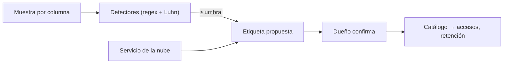

## 1. Resumen

**Clasificar** es etiquetar columnas y activos según el tipo de dato que contienen (correo, teléfono, tarjeta, identificación) para saber qué proteger, quién accede y cuánto se conserva. Sin clasificación, no se sabe dónde hay datos sensibles ni hasta dónde llegan.

El ejemplo de esta ficha usa **expresiones regulares sobre una muestra**: es una **heurística**. Da falsos negativos (un teléfono dentro de un comentario, una tarjeta en una columna de códigos) y puede dar falsos positivos. **No reemplaza** a los servicios de las nubes: Sensitive Data Protection, Macie y Purview usan detectores incorporados y personalizados y, en Macie, machine learning (*What is Amazon Macie?*).

## 2. Qué es

- **Tipo de dato sensible:** correo, teléfono, tarjeta, identificación (en Sensitive Data Protection, un **infoType**, *InfoTypes and infoType detectors*).
- **Detector:** lo que reconoce el tipo (regex, diccionario, modelo).
- **Umbral:** qué proporción de la muestra debe calzar para etiquetar la columna.
- **Etiqueta de columna:** el resultado, publicado en el catálogo.
- **Falso positivo / negativo:** etiquetar lo que no es / no etiquetar lo que sí es.

## 3. Problema que resuelve

Una auditoría pregunta dónde hay números de tarjeta. El equipo revisa nombres de columnas y encuentra `medio_pago`. No mira `comentario` ni `codigo_pedido`, donde también aparecen. Un escaneo de contenido, aunque sea heurístico, cubre más que los nombres; un servicio de clasificación, más todavía.

## 4. Cómo funciona

1. Se toma una muestra de valores por columna.
2. Cada detector calcula qué proporción de la muestra calza.
3. Si supera el umbral, la columna recibe la etiqueta.
4. Para tarjetas, el regex de 13 a 19 dígitos se combina con el dígito verificador (Luhn), que reduce falsos positivos.
5. El dueño confirma o corrige; la etiqueta se publica en el catálogo y alimenta accesos y retención.

## 5. Cuándo utilizarlo

- Como primer barrido de una base sin clasificar, antes de un servicio.
- En pruebas y en la CI, para que una columna nueva con datos sensibles no pase sin etiqueta.
- Siempre confirmado por una persona.

## 6. Cuándo no utilizarlo

- Como único control de datos sensibles: es una heurística.
- Sobre texto libre esperando encontrar todo: un regex de columna completa no ve un dato dentro de una frase.

## 7. Ejemplo sencillo

Umbral: 60 % de la muestra.

| Columna | Muestra (resumen) | Etiqueta | Lectura |
|---|---|---|---|
| `contacto` | 3 de 4 correos | email (75 %) | acierto |
| `fono` | 2 de 3 celulares | telefono_cl (67 %) | acierto |
| `medio_pago` | 2 de 3 tarjetas válidas por Luhn | tarjeta (67 %) | acierto |
| `comentario` | un celular dentro de una frase | sin etiqueta | **falso negativo** |
| `codigo_pedido` | una tarjeta entre códigos | sin etiqueta | **falso negativo**: 25 % no llega al umbral |

## 8. Ejemplo de producción

- Un servicio de clasificación de la nube escanea las fuentes y propone etiquetas (no ejecutado).
- La heurística corre en la CI sobre muestras de desarrollo: una columna nueva que parece sensible y no tiene etiqueta falla el control.
- El dueño confirma cada etiqueta; las confirmadas van al catálogo.
- Accesos y retención se definen por etiqueta.

## 9. Arquitectura



## 10. Código

```python
"""Clasificación heurística de columnas con expresiones regulares sobre una muestra de valores.

Es una heurística: da falsos positivos y falsos negativos, y no reemplaza a Sensitive Data Protection, Macie ni Purview.
"""
import re
from collections.abc import Callable

PATRONES: dict[str, Callable[[str], bool]] = {
    "email": lambda v: re.fullmatch(r"[^@\s]+@[^@\s]+\.[a-z]{2,}", v, re.I) is not None,
    "telefono_cl": lambda v: re.fullmatch(r"\+?56 ?9 ?\d{4} ?\d{4}", v) is not None,
    "tarjeta": lambda v: re.fullmatch(r"\d{13,19}", v.replace(" ", "").replace("-", "")) is not None and luhn(v),
}
UMBRAL = 0.6   # proporción mínima de valores que deben calzar para etiquetar la columna


def luhn(valor: str) -> bool:
    digitos = [int(d) for d in re.sub(r"\D", "", valor)][::-1]
    total = sum(d if i % 2 == 0 else (d * 2 - 9 if d * 2 > 9 else d * 2) for i, d in enumerate(digitos))
    return total % 10 == 0


MUESTRA = {   # valores ficticios: correos en dominios reservados, teléfonos y tarjetas de prueba
    "contacto": ["ana@example.com", "luis@example.org", "sin correo", "pedro@example.net"],
    "fono": ["+56 9 1234 5678", "+56912345678", "22 123 4567"],
    "medio_pago": ["4111 1111 1111 1111", "5500-0000-0000-0004", "1234 5678 9012 3456"],
    "comentario": ["llamar al +56 9 1234 5678", "todo ok", "entregar en conserjería"],
    "codigo_pedido": ["4111111111111111", "P-1002", "P-1003", "P-1004"],
}

for columna, valores in MUESTRA.items():
    etiquetas = []
    for etiqueta, calza in PATRONES.items():
        proporcion = sum(calza(v) for v in valores) / len(valores)
        if proporcion >= UMBRAL:
            etiquetas.append(f"{etiqueta} ({proporcion:.0%})")
    print(f"{columna}: {', '.join(etiquetas) or 'sin etiqueta'}")
```

El script se **ejecuta en la CI** y pasa `mypy --strict`. Imprime `contacto: email (75%)`, `fono: telefono_cl (67%)`, `medio_pago: tarjeta (67%)`, y `sin etiqueta` para `comentario` y `codigo_pedido`: los dos falsos negativos que muestran el límite de la heurística.

## 11. GCP

En GCP, **Sensitive Data Protection**. Según *Sensitive Data Protection overview* e *InfoTypes and infoType detectors* (no ejecutado):

| | Heurística con regex (esta ficha) | Sensitive Data Protection |
|---|---|---|
| Qué detecta | Tres patrones propios | infoTypes incorporados y personalizados (diccionarios, regex, etiquetas de metadata) |
| Confianza | Proporción de la muestra | Likelihood de coincidencia, ajustable |
| Alcance | Una muestra en memoria | Escaneo y perfilado continuo de BigQuery, Cloud SQL y Cloud Storage; también desidentifica |

## 12. AWS

En AWS, **Amazon Macie**. Según *What is Amazon Macie?* y *Using managed data identifiers* (no ejecutado):

| | Heurística con regex (esta ficha) | Amazon Macie |
|---|---|---|
| Técnica | Regex y Luhn | Machine learning y coincidencia de patrones |
| Tipos | Tres | Managed data identifiers para muchos países y regiones, incluidos credenciales y datos financieros |
| Alcance | Una muestra | Objetos de Amazon S3, con inventario y evaluación de seguridad de los buckets |

## 13. Azure

En Azure, **Purview Data Map**. Según *Data classification in Data Map* (no ejecutado):

| | Heurística con regex (esta ficha) | Purview Data Map |
|---|---|---|
| Clases | Tres | Más de 200 clasificaciones de sistema y clasificaciones propias |
| Cuándo | En la CI o a pedido | Automáticamente al escanear, o a mano después |

## 14. Buenas prácticas

- Presentar la heurística como tal y medir sus falsos negativos.
- Combinar regex con validaciones (Luhn para tarjetas).
- Confirmación del dueño antes de publicar la etiqueta.
- Usar un servicio de clasificación para las fuentes de producción.
- **Seguridad:** la muestra contiene datos sensibles; se procesa con los mismos permisos que los datos y no se guarda en logs.
- **Observabilidad:** columnas sin clasificar y columnas nuevas, medidas por dominio.
- **Costo:** escanear todo el contenido es caro; muestrear y priorizar lo publicado.

## 15. Errores frecuentes

- Clasificar solo por el nombre de la columna.
- Presentar un regex como detección completa.
- Etiquetas sin confirmación que nadie corrige.
- Guardar la muestra de valores sensibles en un archivo de resultados.

## 16. Trade-offs

Un umbral bajo detecta más y da más falsos positivos; uno alto, al revés. La heurística es barata y explicable; un servicio cubre más tipos y contextos, con costo y configuración.

## 17. Conceptos relacionados

- `data-catalog`: donde se publica.
- `data-retention`: la clase define la retención.
- `data-lineage`: hasta dónde llegan los datos sensibles.
- `metadata-management`: la clasificación como metadata.
- `data-ownership`: quien confirma.

## 18. Preguntas técnicas abiertas

1. ¿Sabes en qué columnas de tu base hay datos personales?
2. ¿Revisas el contenido o solo los nombres?
3. ¿Quién confirma las etiquetas?

## 19. Laboratorio relacionado

Pendiente (F4).

## 20. Fuentes

- Google Cloud: *Sensitive Data Protection overview* e *InfoTypes and infoType detectors*.
- AWS: *What is Amazon Macie?* y *Using managed data identifiers*.
- Microsoft Learn: *Data classification in Data Map*.

El detalle de cada fuente está en `sources` del frontmatter.

## 21. Fecha de última verificación

2026-10-21. Pasa a `verified`: revisión B-F3.1 del lote F3b-17b aplicada, sin VERIFY pendientes.

## 22. Historial de cambios importantes

- 2026-10-21: creación (lote F3b-17b).
- 2026-10-21: revisión B-F3.1 del lote F3b-17b aplicada (docs/reviews/cards-f3b-17b.md), sin hallazgos en esta ficha.
- 2026-10-21: `verification_status: verified` (sin VERIFY pendientes).
- 2026-10-21: datos de ejemplo sin dominios ni números reales (teléfonos marcados como ficticios); sin cambios de contenido (auditoría antes de publicar el repositorio).
