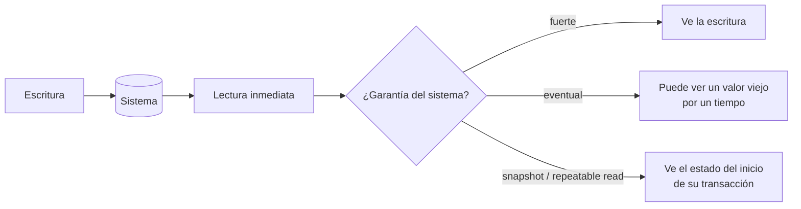

## 1. Resumen

La consistencia responde a una pregunta práctica: **después de escribir, ¿qué ve la siguiente lectura?**

- Con **consistencia fuerte**, cualquier lectura posterior ve la escritura.
- Con **consistencia eventual**, puede ver un valor viejo por un tiempo.

Entre ambos extremos hay niveles intermedios: sesión, prefijo consistente y *staleness* acotada. Dentro de una base, los **niveles de aislamiento** definen qué ve una transacción mientras otras escriben. En ingeniería de datos importa en tres lugares:

- el almacenamiento de objetos (¿el archivo recién escrito ya aparece en el listado?);
- los permisos (¿el acceso recién revocado ya se aplica?);
- las lecturas durante una carga.

## 2. Qué es

Es un concepto consolidado de sistemas distribuidos y bases de datos:

| Nivel | Garantía |
|---|---|
| Fuerte (linealizable) | Toda lectura ve la última escritura confirmada |
| Staleness acotada | Las lecturas pueden atrasarse, pero como mucho K versiones o T tiempo |
| Sesión | Un mismo cliente ve sus propias escrituras |
| Prefijo consistente | Nunca se ven escrituras fuera de orden |
| Eventual | Las réplicas convergen en algún momento; una lectura puede ver valores viejos |

Los niveles intermedios son los que expone Azure Cosmos DB. Los **niveles de aislamiento** (Read Committed, Repeatable Read, Serializable, snapshot) son la versión transaccional de la misma pregunta.

## 3. Problema que resuelve

Suponer una consistencia que el sistema no da produce errores difíciles de reproducir. Por ejemplo:

- un job lista archivos justo después de escribirlos y no encuentra uno;
- un reporte suma dos tablas leídas en momentos distintos y no cuadra;
- se revoca un permiso y durante un minuto el usuario todavía accede.

Conocer las garantías de cada sistema permite diseñar alrededor de ellas.

## 4. Cómo funciona

1. **Almacenamiento de objetos:**
   - Cloud Storage y S3 dan consistencia fuerte para leer tras escribir y borrar objetos; en Cloud Storage, también para los listados.
   - Hay excepciones documentadas: en Cloud Storage, cambios de acceso y recreación de buckets son eventuales, y los objetos públicos en caché pueden no ser fuertes.
2. **Bases transaccionales:** el nivel de aislamiento decide qué ve una transacción. En PostgreSQL, *Read Committed* (por defecto) deja que dos lecturas de la misma transacción vean datos distintos si otra confirma en el medio; *Repeatable Read* lee siempre el snapshot del inicio.
3. **Warehouses:** BigQuery usa aislamiento por snapshot dentro de una transacción.
4. **Bases distribuidas:** Spanner ofrece consistencia externa, más estricta que la serializabilidad. Cosmos DB deja elegir entre cinco niveles, intercambiando consistencia por latencia y disponibilidad.

## 5. Cuándo utilizarlo

Este criterio aplica al:

- diseñar pipelines que escriben y luego listan o leen lo escrito;
- leer varias tablas que deben cuadrar entre sí;
- elegir una base distribuida o su nivel de consistencia;
- aplicar cambios de permisos que deben surtir efecto de inmediato.

## 6. Cuándo no utilizarlo

- Para exigir consistencia fuerte en todo: en sistemas distribuidos tiene costo en latencia y disponibilidad. Muchos casos toleran lecturas levemente atrasadas (un contador de vistas).
- Como sustituto de la idempotencia: aun con consistencia fuerte, los reintentos pueden duplicar si la operación no es idempotente.

## 7. Ejemplo sencillo

Una transacción de reporte lee el stock (10). En ese momento otra sesión vende 3 y confirma. Si el reporte vuelve a leer:

- con *Read Committed* ve 7;
- con *Repeatable Read* sigue viendo 10, el snapshot del inicio.

Ninguno está "mal": son garantías distintas.

## 8. Ejemplo de producción

Un pipeline escribe archivos Parquet en Cloud Storage y luego lista el prefijo para cargarlos a BigQuery. Como el listado es fuertemente consistente, puede confiar en que ve todos los archivos escritos. Para no depender de eso, igual escribe un manifest con la lista exacta. En cambio, al revocar el acceso de un proveedor al bucket, el equipo sabe que el cambio es eventual (alrededor de un minuto) y lo considera en el procedimiento de baja.

## 9. Arquitectura



## 10. Código

```python
# Python 3.12 + psycopg 3: dos sesiones sobre la misma fila muestran qué ve cada nivel de aislamiento.
# Requiere: PostgreSQL accesible en DATABASE_URL (por ejemplo, el de `make db-up`).
import os

import psycopg
from psycopg import IsolationLevel

URL = os.environ["DATABASE_URL"]


def lecturas(nivel: IsolationLevel) -> tuple[int, int]:
    """Lee el stock dos veces en una transacción mientras otra sesión confirma un cambio en el medio."""
    with psycopg.connect(URL, autocommit=True) as admin:
        admin.execute("DROP TABLE IF EXISTS stock_demo")
        admin.execute("CREATE TABLE stock_demo (sku TEXT PRIMARY KEY, unidades INT NOT NULL)")
        admin.execute("INSERT INTO stock_demo VALUES ('A1', 10)")

    with psycopg.connect(URL) as lector, psycopg.connect(URL, autocommit=True) as escritor:
        lector.isolation_level = nivel
        with lector.transaction():
            primera = lector.execute("SELECT unidades FROM stock_demo WHERE sku = 'A1'").fetchone()[0]
            escritor.execute("UPDATE stock_demo SET unidades = 7 WHERE sku = 'A1'")  # se confirma ya
            segunda = lector.execute("SELECT unidades FROM stock_demo WHERE sku = 'A1'").fetchone()[0]
    return primera, segunda


if __name__ == "__main__":
    print("READ COMMITTED :", lecturas(IsolationLevel.READ_COMMITTED))   # (10, 7): ve el cambio confirmado
    print("REPEATABLE READ:", lecturas(IsolationLevel.REPEATABLE_READ))  # (10, 10): ve su snapshot
```

Ejecutado contra PostgreSQL, imprime `(10, 7)` y `(10, 10)`.

## 11. GCP

**Cloud Storage** es fuertemente consistente para leer, sobrescribir y borrar objetos y para listar. Son eventuales los cambios de acceso (alrededor de un minuto) y la recreación de buckets; los objetos públicos en caché pueden no ser fuertes. **BigQuery** usa snapshot dentro de las transacciones. **Spanner** ofrece consistencia externa por defecto, más estricta que la serializabilidad, para OLTP global.

## 12. AWS

**S3** ofrece consistencia fuerte de lectura tras escritura para PUT (nuevos y sobrescrituras) y DELETE en todas las regiones, y también para ACL, tags y metadatos de objetos. En la práctica, el comportamiento de lectura tras escritura de objetos es equivalente al de Cloud Storage; las diferencias están en los detalles de cada operación, que conviene revisar en la documentación de cada uno.

## 13. Azure

**Azure Cosmos DB** expone la consistencia como una elección explícita, con cinco niveles:

- Strong;
- Bounded staleness;
- Session;
- Consistent prefix;
- Eventual.

Cada uno equilibra disponibilidad, latencia y rendimiento; la documentación remite al teorema PACELC. A diferencia de los almacenes de objetos, donde la consistencia viene dada, aquí se configura por cuenta y se puede sobrescribir por solicitud, solo para lecturas desde el SDK.

## 14. Buenas prácticas

- Conocer la garantía de cada sistema en las operaciones que usa el pipeline, no "en general".
- Manifests explícitos de los archivos a cargar en vez de depender de listados.
- Elegir el nivel de aislamiento según lo que el proceso necesita leer de forma coherente.
- Reintentos idempotentes en todo lo que toque sistemas con consistencia eventual.
- **Seguridad:** los cambios de permisos pueden ser eventuales; en una baja de acceso, verificar que el cambio surtió efecto en lugar de suponerlo inmediato.
- **Observabilidad:** registrar en los logs la versión o el timestamp leído, para diagnosticar lecturas atrasadas.
- **Costo:** los niveles fuertes en bases distribuidas suelen costar más latencia; reservarlos para lo que lo necesita.

## 15. Errores frecuentes

- Suponer que todos los sistemas son fuertemente consistentes en todas las operaciones.
- Leer varias tablas en momentos distintos y esperar que cuadren sin una transacción o un snapshot común.
- Confiar en que una revocación de acceso es instantánea.
- Elegir el nivel más fuerte "por las dudas" en una base distribuida y pagar latencia sin necesidad.

## 16. Trade-offs

Consistencia más fuerte simplifica el razonamiento, a cambio de latencia, menor disponibilidad ante fallos y menor concurrencia. Consistencia más débil da rendimiento y disponibilidad, a cambio de que la aplicación tolere lecturas atrasadas. El teorema CAP formaliza el caso extremo, cuando hay particiones de red.

## 17. Conceptos relacionados

- `acid`: transacciones y aislamiento.
- `cap-theorem`: el límite teórico en sistemas distribuidos.
- `idempotency`: reintentos seguros ante lecturas atrasadas.
- `gcs-buckets-and-objects`: el almacenamiento de objetos en GCP.

## 18. Preguntas técnicas abiertas

1. ¿Qué operaciones de tu pipeline dependen de leer inmediatamente lo que se acaba de escribir?
2. ¿Qué nivel de aislamiento necesita un reporte que suma varias tablas en una base OLTP?
3. ¿Qué nivel de consistencia elegirías en Cosmos DB para un carrito de compras y por qué?

## 19. Laboratorio relacionado

Pendiente (F4).

## 20. Fuentes

- PostgreSQL: *Transaction Isolation*; psycopg: *Connection classes* y *Transactions management*.
- Google Cloud: *Cloud Storage consistency*, *Multi-statement transactions* (BigQuery) y *Spanner: TrueTime and external consistency*.
- AWS: *What is Amazon S3?*
- Microsoft Learn: *Consistency level choices* (Azure Cosmos DB).

El detalle de cada fuente está en `sources` del frontmatter.

## 21. Fecha de última verificación

2026-10-06. Pasa a `verified`: revisión B-F3.1 del lote F3b-01a aplicada, sin VERIFY pendientes.

## 22. Historial de cambios importantes

- 2026-10-05: creación (lote F3b-01a, dominio 01-fundamentals).
- 2026-10-06: `verification_status: verified` (revisión B-F3.1 del lote F3b-01a aplicada; sin VERIFY pendientes).
