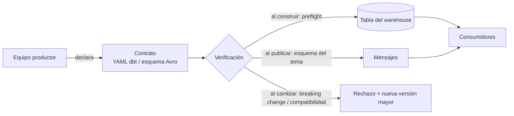

## 1. Resumen

Un contrato de datos es un acuerdo explícito sobre la forma de los datos que un productor entrega: qué campos, de qué tipo, con qué restricciones y cómo pueden cambiar. Lo que lo distingue de la documentación es que **se verifica automáticamente**.

Es una práctica **modern**: no hay una especificación única y cada herramienta aplica su parte. Esta ficha usa el término en el sentido que le dan sus fuentes:

- los *model contracts* de dbt;
- el esquema de Pub/Sub, que la documentación de Google describe como "un contrato entre publicador y suscriptor";
- los modos de compatibilidad del registro de esquemas de Glue, que AWS describe como "el contrato" entre productores y consumidores.

Un contrato no reemplaza las pruebas de calidad ni la evolución de esquema: las complementa.

## 2. Qué es

Un contrato fija tres cosas:

1. **Estructura:** nombres de campos o columnas y sus tipos.
2. **Restricciones:** por ejemplo, `not_null`. Su aplicación depende de la plataforma.
3. **Reglas de cambio:** qué cambios son compatibles y cuáles rompen a los consumidores.

Las fuentes de esta ficha lo aplican en dos lugares:

| Dónde | Cómo lo aplica |
|---|---|
| Tablas del warehouse | dbt verifica antes de construir el modelo que la consulta devuelve las columnas y tipos del contrato |
| Mensajes y eventos | Pub/Sub rechaza mensajes que no cumplen el esquema del tema; Glue y Event Hubs solo aceptan versiones de esquema compatibles con el modo configurado |

dbt aclara qué queda fuera: la calidad (pruebas de datos) no forma parte del contrato, igual que en una API la disponibilidad no forma parte de la estructura de la respuesta.

## 3. Problema que resuelve

Un productor cambia un tipo, renombra una columna o deja de enviar un campo, y los consumidores se enteran cuando su pipeline falla o, peor, cuando sus números cambian sin error. El contrato mueve la detección al momento del cambio, del lado del productor, antes de que los datos lleguen a los consumidores.

## 4. Cómo funciona

1. **Se declara el contrato** junto al código del productor: un YAML de dbt o un esquema Avro o Protobuf en un registro.
2. **Se verifica al producir:**
   - dbt hace un *preflight* que compara nombres y tipos de la consulta con el contrato e incluye columnas, tipos y restricciones en el DDL;
   - Pub/Sub no publica un mensaje que no se ajusta al esquema.
3. **Se verifica al cambiar:**
   - dbt compara con el estado anterior del proyecto y marca como *breaking change* quitar una columna, cambiar su tipo o quitar o modificar una restricción;
   - Glue y Event Hubs rechazan una versión nueva del esquema que no cumple el modo de compatibilidad.
4. **Se versiona:** según dbt, un cambio incompatible exige subir la versión mayor del modelo. Así los consumidores migran a su ritmo.

## 5. Cuándo utilizarlo

- En las fronteras entre equipos: un dominio que publica datos que otros consumen.
- En modelos de dbt de los que dependen tableros o equipos externos.
- En temas de mensajería con varios suscriptores.

## 6. Cuándo no utilizarlo

- En modelos intermedios internos de un mismo equipo que cambian con frecuencia: el contrato agrega fricción sin consumidores que proteger.
- En los casos que dbt no admite: modelos Python, vistas materializadas, materializaciones `ephemeral`, materializaciones custom (salvo que su autor lo agregue), modelos con CTE recursivas en BigQuery, seeds, snapshots y sources. Las vistas admiten nombres y tipos, pero no restricciones, y los incrementales solo admiten contrato con `on_schema_change: append_new_columns` o `fail`.
- Como sustituto de pruebas de calidad: un contrato de estructura no detecta valores fuera de rango ni duplicados.

## 7. Ejemplo sencillo

El equipo de ventas publica la tabla `pedidos` con `pedido_id` (string, no nulo), `monto` (numeric) y `creado_en` (timestamp). Un cambio que borra `creado_en` falla en la integración continua del equipo de ventas, y no en el tablero de finanzas al día siguiente.

## 8. Ejemplo de producción

Un dominio de pedidos publica eventos a Pub/Sub con un esquema Avro asociado al tema, y su modelo `fct_pedidos` en dbt tiene `contract: enforced: true`. Cuando el equipo necesita cambiar `monto` de numeric a float64, la CI de dbt lo marca como breaking change. El equipo publica una versión nueva del modelo y mantiene la anterior mientras los consumidores migran. En el tema, agrega un campo opcional con default, compatible con la resolución de esquemas de Avro.

## 9. Arquitectura



## 10. Código

Contrato de un modelo dbt, con la sintaxis de *model contracts*:

```yaml
# models/marts/fct_pedidos.yml
models:
  - name: fct_pedidos
    config:
      materialized: table
      contract:
        enforced: true
    columns:
      - name: pedido_id
        data_type: string
        constraints:
          - type: not_null
      - name: monto
        data_type: numeric
      - name: creado_en
        data_type: timestamp
```

La lógica de detección de cambios incompatibles, ilustrada en Python con los criterios que dbt documenta (no es el código de dbt):

```python
# Python 3.12, solo biblioteca estándar: compara dos versiones de un contrato de columnas y lista los cambios
# que rompen a los consumidores, con los mismos criterios que dbt usa para detectar breaking changes.
from dataclasses import dataclass


@dataclass(frozen=True)
class Column:
    data_type: str
    constraints: frozenset[str] = frozenset()


Contract = dict[str, Column]


def breaking_changes(old: Contract, new: Contract) -> list[str]:
    problems: list[str] = []
    for name, col in old.items():
        if name not in new:
            problems.append(f"{name}: columna eliminada")
        elif new[name].data_type != col.data_type:
            problems.append(f"{name}: tipo {col.data_type} -> {new[name].data_type}")
        elif not col.constraints <= new[name].constraints:
            problems.append(f"{name}: restricción quitada {sorted(col.constraints - new[name].constraints)}")
    return problems  # agregar columnas nuevas no rompe a los consumidores


v1: Contract = {
    "pedido_id": Column("string", frozenset({"not_null"})),
    "monto": Column("numeric"),
    "creado_en": Column("timestamp"),
}
v2: Contract = {
    "pedido_id": Column("string"),                 # quita not_null
    "monto": Column("float64"),                    # cambia el tipo
    "canal": Column("string"),                     # columna nueva: no rompe
}

for problem in breaking_changes(v1, v2):
    print(problem)
assert breaking_changes(v1, v1 | {"canal": Column("string")}) == []
```

Ejecutado, imprime los tres problemas: la restricción quitada en `pedido_id`, el cambio de tipo de `monto` y la eliminación de `creado_en`. Pasa `mypy --strict`. dbt además detecta cuando se modifica una restricción o se elimina un modelo con contrato; el ejemplo cubre solo quitar.

## 11. GCP

**Pub/Sub** asocia un esquema Avro o Protocol Buffer a un tema y no publica los mensajes que no lo cumplen. La documentación lo describe como un contrato entre publicador y suscriptor y como autoridad central de tipos de mensaje entre equipos. Los esquemas admiten revisiones.

En **BigQuery**, los *model contracts* de dbt aplican nombres y tipos. Según la tabla de dbt para BigQuery:

| Restricción | Se puede definir | Se aplica |
|---|---|---|
| `not_null` | Sí | Sí: el modelo no se construye si la viola |
| `primary_key`, `foreign_key` | Sí | No: solo metadatos |
| `unique`, `check` | No | No |

Una clave primaria declarada en el contrato, entonces, no impide duplicados: hace falta una prueba de datos.

## 12. AWS

El **AWS Glue Schema Registry** controla la evolución con 8 modos de compatibilidad: NONE, DISABLED, BACKWARD, BACKWARD_ALL, FORWARD, FORWARD_ALL, FULL y FULL_ALL. AWS los describe como el contrato entre aplicaciones productoras y consumidoras: una versión nueva del esquema solo se acepta si cumple el modo.

## 13. Azure

**Azure Schema Registry**, en Event Hubs, es un repositorio central de esquemas (Avro, JSON Schema, Protobuf) organizado en *schema groups*; Microsoft lo presenta como una forma de gestionar el contrato fuera de los datos del evento. El modo de compatibilidad (Backward, Forward o None) se fija por grupo, y la evolución de esquemas solo se admite para Avro. Es menos granular que los 8 modos de Glue: las equivalencias entre nubes no son exactas.

## 14. Buenas prácticas

- Contratos en los modelos «públicos», como recomienda dbt (los que usan otros equipos, proyectos o tableros), no en cada modelo intermedio.
- Detectar los cambios incompatibles en la CI del productor y versionar en lugar de romper.
- Combinar contrato (estructura) y pruebas (calidad): resuelven problemas distintos.
- Revisar qué restricciones aplica de verdad cada plataforma; en muchas son solo metadatos.
- **Seguridad:** la documentación de Pub/Sub advierte no incluir información sensible, como datos personales o de seguridad, en los nombres de campo del esquema; el contrato suele publicarse para muchos equipos.
- **Observabilidad:** registrar los rechazos (mensajes no publicados, builds fallidos por contrato) y avisar al equipo productor.
- **Costo:** detectar el cambio antes de construir evita reprocesar tablas y backfills en los consumidores.

## 15. Errores frecuentes

- Creer que una restricción declarada se aplica cuando la plataforma la trata como metadato.
- Usar el contrato como sustituto de las pruebas de calidad.
- Cambiar un tipo "compatible" sin versionar y romper a los consumidores en silencio.
- Asumir que los modos de compatibilidad de Glue y de Event Hubs son equivalentes.
- Contratos en todos los modelos, que frenan cambios internos sin proteger a nadie.

## 16. Trade-offs

Un contrato da estabilidad a los consumidores y detección temprana a cambio de fricción para el productor: cada cambio incompatible requiere una versión nueva y un periodo de convivencia. Cuanto más estricto el modo de compatibilidad, menos cambios caben sin versionar.

## 17. Conceptos relacionados

- `schema-evolution`: qué cambios admite cada motor.
- `avro-format`: resolución de esquemas entre escritor y lector.
- `data-validation-with-pydantic`: verificar registros en código.
- `data-pipeline`: dónde se ubican las fronteras.

## 18. Preguntas técnicas abiertas

1. ¿Qué modelos de tu proyecto tienen consumidores fuera del equipo y merecen contrato?
2. ¿Qué restricciones aplica realmente tu warehouse y cuáles son solo metadatos?
3. ¿Cómo coordinarías la migración de los consumidores a una versión mayor?

## 19. Laboratorio relacionado

Pendiente (F4).

## 20. Fuentes

- dbt: *Model contracts*.
- Google Cloud: *Pub/Sub schemas*.
- AWS: *AWS Glue Schema Registry*.
- Microsoft Learn: *Azure Schema Registry in Event Hubs* y *Schema Registry concepts*.
- Apache: *Avro Specification* (resolución de esquemas).

El detalle de cada fuente está en `sources` del frontmatter.

## 21. Fecha de última verificación

2026-10-06. Pasa a `verified`: revisión B-F3.1 del lote F3b-01b aplicada, sin VERIFY pendientes.

## 22. Historial de cambios importantes

- 2026-10-06: creación (lote F3b-01b, dominio 01-fundamentals).
- 2026-10-06: revisión B-F3.1 del lote F3b-01b aplicada (docs/reviews/cards-f3b-01b.md): §11 con la tabla de restricciones de BigQuery según dbt, sin el VERIFY; §6 y la nota de dbt con todas las exclusiones (vistas materializadas, materializaciones custom, CTE recursivas en BigQuery y `on_schema_change` en incrementales).
- 2026-10-06: `verification_status: verified` (sin VERIFY pendientes).
- 2026-10-13: `page_title` en cada cita, con el título de la página citada (ADR-012); sin cambios de contenido.
