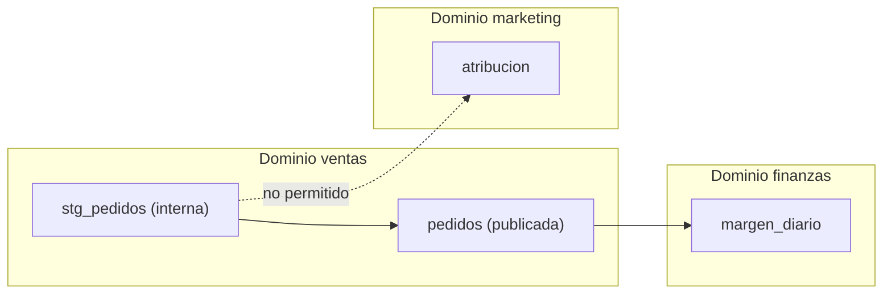

## 1. Resumen

Un **dominio de datos** agrupa los datos de un área de negocio (ventas, finanzas, marketing) con sus dueños. Dos reglas lo hacen útil:

- **ownership por dominio:** el dominio es dueño de sus datos (`data-ownership`);
- **frontera:** el dominio decide qué **publica** para otros (un producto, con contrato) y qué queda **interno**; otro dominio lee solo lo publicado.

Es la idea de data mesh de llevar el ownership a los dominios de negocio y tratar los datos como producto (*Data Mesh Principles and Logical Architecture*, Nivel 4). Las herramientas de nube tienen objetos llamados «domain», pero no significan lo mismo en todas (ver §11 a §13).

## 2. Qué es

- **Dominio:** un área de negocio con sus datos y sus dueños.
- **Tabla interna:** la usa solo el dominio (staging, intermedias); puede cambiar sin aviso.
- **Tabla publicada:** un producto para otros dominios, con contrato y dueño.
- **Lectura entre dominios:** permitida si lee algo publicado; si no, se pide que se publique.

## 3. Problema que resuelve

Marketing lee `ventas.stg_pedidos`, una tabla intermedia de ventas. Ventas la cambia en un refactor y el modelo de atribución de marketing se rompe; nadie sabía que marketing la usaba. Con dominios y frontera, esa lectura no se permite: marketing pide a ventas que publique lo que necesita, con contrato.

## 4. Cómo funciona

1. Cada tabla se asigna a un dominio y se marca publicada o interna.
2. Cada job pertenece a un dominio.
3. Para cada lectura (del linaje o de los permisos): mismo dominio, ok; otro dominio y publicada, ok; otro dominio e interna, no.
4. Las lecturas no permitidas se convierten en pedidos de publicación al dominio dueño.

## 5. Cuándo utilizarlo

- En organizaciones con varios equipos que producen datos.
- Cuando los cambios de un equipo rompen a otros que leían sus tablas internas.
- Como base de un catálogo de productos por dominio.

## 6. Cuándo no utilizarlo

- En equipos chicos con un solo dueño de datos: los dominios agregan proceso sin beneficio.
- Con dominios definidos por sistema (el CRM, el ERP) en lugar de por área de negocio.

## 7. Ejemplo sencillo

| Job (dominio) | Lee | Resultado |
|---|---|---|
| `margen_diario` (finanzas) | `ventas.pedidos` (publicada) | ok |
| `margen_diario` (finanzas) | `finanzas.stg_facturas` (interna, propia) | ok |
| `atribucion` (marketing) | `ventas.stg_pedidos` (interna de ventas) | no: pedir que la publique |
| `cierre_mensual` (finanzas) | `marketing.campanias` (publicada) | ok |

## 8. Ejemplo de producción

- Cinco dominios, cada uno con dueño, steward y su esquema o proyecto.
- Lo publicado vive en un esquema de consumo por dominio, con contrato y catálogo.
- Los permisos entre dominios solo se dan sobre lo publicado.
- Un control semanal sobre el linaje detecta lecturas de tablas internas de otro dominio.

## 9. Arquitectura



## 10. Código

```python
"""Dominios de datos: cada tabla pertenece a un dominio y otro dominio solo puede leer lo que ese dominio publica."""
DOMINIO = {   # tabla -> (dominio, publicada para otros dominios)
    "ventas.stg_pedidos": ("ventas", False),
    "ventas.pedidos": ("ventas", True),
    "finanzas.stg_facturas": ("finanzas", False),
    "finanzas.facturas": ("finanzas", True),
    "marketing.campanias": ("marketing", True),
}
LECTURAS = [  # (job, dominio del job, tabla que lee)
    ("margen_diario", "finanzas", "ventas.pedidos"),
    ("margen_diario", "finanzas", "finanzas.stg_facturas"),
    ("atribucion", "marketing", "ventas.stg_pedidos"),
    ("cierre_mensual", "finanzas", "marketing.campanias"),
]

for job, dominio_job, tabla in LECTURAS:
    dominio_tabla, publicada = DOMINIO[tabla]
    if dominio_tabla == dominio_job:
        veredicto = "ok (mismo dominio)"
    elif publicada:
        veredicto = f"ok (producto publicado por {dominio_tabla})"
    else:
        veredicto = f"NO: tabla interna de {dominio_tabla}; pedir que la publique"
    print(f"{job} [{dominio_job}] lee {tabla}: {veredicto}")
```

El script se **ejecuta en la CI** y pasa `mypy --strict`. Imprime las cuatro lecturas y su veredicto; la de `atribucion` sobre `ventas.stg_pedidos` sale `NO: tabla interna de ventas; pedir que la publique`.

## 11. GCP

En GCP, los **data products de Knowledge Catalog** son lo que un dominio publica. Según *Data Mesh Principles and Logical Architecture* y *About data products* (no ejecutado):

| | Dominio (este concepto) | Knowledge Catalog |
|---|---|---|
| Lo publicado | Un producto con contrato | Data product: colección curada de activos, con descripción, documentación, aspects y contratos |
| Acceso | Solo a lo publicado | Grupos de acceso y rol de IAM por defecto que configuran los dueños del producto |
| Objeto «dominio» | Área de negocio | La página citada no define un objeto dominio |

## 12. AWS

En AWS, los **domains de Amazon SageMaker Unified Studio**. Según *Data Mesh Principles and Logical Architecture* y *Domains in Amazon SageMaker Unified Studio* (no ejecutado):

| | Dominio (este concepto) | SageMaker Unified Studio |
|---|---|---|
| Qué es | Un área de negocio con sus datos | La entidad que organiza activos, usuarios y proyectos |
| Granularidad | Uno por área | Uno para toda la empresa o varios por unidad de negocio |
| Tipos | — | Basados en IAM Identity Center o basados en IAM, según la autenticación |

Un domain de SageMaker Unified Studio puede contener varias áreas de negocio: no es lo mismo que un dominio de datos.

## 13. Azure

En Azure, los **governance domains** de Purview Unified Catalog. Según *Data Mesh Principles and Logical Architecture*, *Governance domains in Unified Catalog* y *Learn about Microsoft Purview Unified Catalog* (no ejecutado):

| | Dominio (este concepto) | Purview |
|---|---|---|
| Qué es | Un área de negocio con sus datos | Governance domain: organiza los datos por conceptos de negocio y distribuye el ownership |
| Lo publicado | Productos | Data products que agrupan activos relacionados |

## 14. Buenas prácticas

- Dominios por área de negocio, no por sistema.
- Frontera explícita entre interno y publicado.
- Permisos entre dominios solo sobre lo publicado.
- **Seguridad:** la frontera reduce quién puede leer tablas intermedias con datos sin filtrar.
- **Observabilidad:** lecturas entre dominios desde el linaje, revisadas cada semana.
- **Costo:** publicar exige mantener contratos y documentación; publicar solo lo que otros necesitan.

## 15. Errores frecuentes

- Dominios que copian el organigrama de TI.
- Leer tablas internas de otro dominio «por ahora».
- Llamar dominio al objeto «domain» de una herramienta sin revisar qué agrupa.

## 16. Trade-offs

Fronteras claras protegen a los consumidores de cambios internos y obligan a publicar y mantener productos. Más dominios dan más autonomía y más coordinación entre ellos.

## 17. Conceptos relacionados

- `data-mesh`: dominios en data mesh.
- `data-ownership`: dueños por dominio.
- `data-products`: lo publicado.
- `data-contracts`: el contrato.
- `data-lineage`: lecturas entre dominios.

## 18. Preguntas técnicas abiertas

1. ¿Qué tablas internas de tu equipo leen otros equipos?
2. ¿Tus dominios son áreas de negocio o sistemas?
3. ¿Qué publicaría tu dominio como producto?

## 19. Laboratorio relacionado

Pendiente (F4).

## 20. Fuentes

- Zhamak Dehghani: *Data Mesh Principles and Logical Architecture* (Nivel 4).
- Google Cloud: *About data products*.
- AWS: *Domains in Amazon SageMaker Unified Studio*.
- Microsoft Learn: *Governance domains in Unified Catalog* y *Learn about Microsoft Purview Unified Catalog*.

El detalle de cada fuente está en `sources` del frontmatter.

## 21. Fecha de última verificación

2026-10-21. Pasa a `verified`: revisión B-F3.1 del lote F3b-17b aplicada, sin VERIFY pendientes.

## 22. Historial de cambios importantes

- 2026-10-21: creación (lote F3b-17b).
- 2026-10-21: revisión B-F3.1 del lote F3b-17b aplicada (docs/reviews/cards-f3b-17b.md), sin hallazgos en esta ficha.
- 2026-10-21: `verification_status: verified` (sin VERIFY pendientes).
