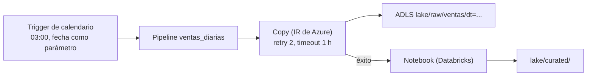

## 1. Resumen

**Azure Data Factory (ADF)** es el servicio de integración de datos de Azure. Un **pipeline** agrupa **actividades**:

- de movimiento: **Copy**, entre almacenes en la nube y on-premises;
- de transformación: por ejemplo, un notebook de Databricks o un data flow;
- de control: dependencias, condiciones y bucles.

Los **triggers** lo lanzan: de calendario, tumbling window (con estado) o por evento. El cómputo es el **integration runtime**: el de Azure, o uno self-hosted para redes privadas.

Dos detalles de su documentación importan desde el primer día:
- cada actividad tiene **0 reintentos por defecto** y un timeout de 12 horas;
- la página dice que **Data Factory en Microsoft Fabric es la siguiente generación de ADF** y recomienda empezar ahí a quien es nuevo; las cargas existentes pueden actualizarse a Fabric. No dice que ADF esté deprecado.

## 2. Qué es

- **Pipeline:** grupo de actividades que se despliega y programa como conjunto, con parámetros.
- **Actividad:** de movimiento, transformación o control. La de ejecución tiene una **política**: `timeout` (12 horas por defecto, mínimo 10 minutos), `retry` (0 por defecto) y `retryIntervalInSeconds` (30 por defecto).
- **Trigger:**
  - de calendario: según el reloj;
  - tumbling window: intervalos periódicos que conservan estado, uno a uno con su pipeline;
  - por evento: por ejemplo, un archivo nuevo.
- **Integration runtime:** de Azure (copias en la nube, data flows, despacho de actividades) o self-hosted (redes privadas y on-premises).
- **Costo:** ejecuciones de actividades (orquestación), horas de DIU (copias) y horas de vCore (data flows).

## 3. Problema que resuelve

Mover datos entre decenas de orígenes y destinos, en la nube y on-premises, y coordinar los pasos que los transforman, sin escribir conectores ni administrar servidores. La actividad Copy cubre el caso más común sin código.

## 4. Cómo funciona

1. El trigger de calendario lanza el pipeline cada día con la fecha como parámetro.
2. La actividad Copy lee el origen y escribe Parquet en ADLS, en la partición del día, usando el integration runtime de Azure.
3. Si la copia falla, se reintenta según su política (2 veces cada 120 segundos en el ejemplo).
4. Una actividad siguiente lanza la transformación (por ejemplo, un notebook) solo si la copia terminó bien.
5. El monitoreo muestra cada ejecución del pipeline y de sus actividades.

## 5. Cuándo utilizarlo

- Copias entre muchos almacenes, incluidos on-premises con self-hosted IR.
- Orquestación de pasos en Azure (Copy, notebooks, procedimientos) con triggers.
- Cargas existentes en ADF; para proyectos nuevos, la página recomienda evaluar Data Factory en Fabric.

## 6. Cuándo no utilizarlo

- Transformaciones complejas en código: van en Spark (Databricks, Synapse o Fabric), y ADF solo las lanza.
- Equipos con DAGs de Airflow y dependencias complejas entre ellos: un orquestador de Airflow.
- Dar por hecho que hay reintentos: por defecto son 0.

## 7. Ejemplo sencillo

El pipeline `ventas_diarias` tiene una actividad Copy que lleva un CSV a Parquet en `lake/raw/ventas/dt=<fecha>/`. Un trigger de calendario lo lanza a las 3:00 con la fecha del día como parámetro.

## 8. Ejemplo de producción

Un pipeline por dominio:

- **Copy** con 2 reintentos y timeout de 1 hora;
- notebook de Databricks que transforma `raw/` a `curated/`;
- procedimiento en el warehouse que publica las tablas.

Un trigger tumbling window de 1 día permite re-ejecutar ventanas pasadas una por una, conservando cuáles terminaron. Las alertas avisan cuando una ejecución falla.

## 9. Arquitectura



## 10. Código

```hcl
# Terraform (validado en la CI con terraform validate, sin credenciales; no se aplicó): una data factory, un pipeline
# con una actividad Copy (de Blob a ADLS) parametrizada por fecha y un trigger de calendario diario.
# Requiere: provider hashicorp/azurerm ~> 5.0; grupo de recursos y datasets de origen y destino existentes.
terraform {
  required_providers {
    azurerm = {
      source  = "hashicorp/azurerm"
      version = "~> 5.0"
    }
  }
}

provider "azurerm" {
  features {}
}

variable "resource_group_name" {
  type = string
}

variable "location" {
  type    = string
  default = "eastus2"
}

resource "azurerm_data_factory" "datos" {
  name                = "dekh-adf"
  location            = var.location
  resource_group_name = var.resource_group_name

  identity {
    type = "SystemAssigned"
  }
}

resource "azurerm_data_factory_pipeline" "ventas_diarias" {
  name            = "ventas_diarias"
  data_factory_id = azurerm_data_factory.datos.id
  parameters = {
    fecha = ""
  }

  activities_json = jsonencode([
    {
      name = "CopiarVentas"
      type = "Copy"
      policy = {
        timeout                = "0.01:00:00"
        retry                  = 2
        retryIntervalInSeconds = 120
      }
      inputs  = [{ referenceName = "ventas_origen", type = "DatasetReference" }]
      outputs = [{ referenceName = "ventas_raw", type = "DatasetReference", parameters = { fecha = "@pipeline().parameters.fecha" } }]
      typeProperties = {
        source = { type = "DelimitedTextSource" }
        sink   = { type = "ParquetSink" }
      }
    }
  ])
}

resource "azurerm_data_factory_trigger_schedule" "diario" {
  name            = "diario_0300"
  data_factory_id = azurerm_data_factory.datos.id
  pipeline_name   = azurerm_data_factory_pipeline.ventas_diarias.name
  frequency       = "Day"
  interval        = 1
  start_time      = "2026-10-01T03:00:00Z"
  pipeline_parameters = {
    fecha = "@formatDateTime(trigger().scheduledTime, 'yyyy-MM-dd')"
  }
}
```

El bloque de Terraform se valida en la CI con `terraform validate`, sin credenciales (`make validate-terraform`), y **no se aplicó**. La política de la actividad sigue *Pipelines and activities in Azure Data Factory and Azure Synapse Analytics*: timeout de 1 hora (por encima del mínimo de 10 minutos) y 2 reintentos, porque el valor por defecto es 0. Los datasets `ventas_origen` y `ventas_raw` se suponen existentes.

## 11. GCP

No aplica de forma específica: esta ficha describe Data Factory. Lo más cercano en GCP para orquestar pasos es Workflows (ver `step-functions-workflows`, que lo compara). Las diferencias, según sus páginas:

| | Data Factory | Workflows |
|---|---|---|
| Unidad | Pipeline de actividades (Copy, transformación, control) | Workflow de pasos en YAML o JSON |
| Reintentos | Política por actividad: `retry` (0 por defecto) y `retryIntervalInSeconds` (30 por defecto) | `try`/`retry` con `max_retries` y `backoff` |
| Cobro | Ejecuciones de actividades, horas de DIU y de vCore | Pasos ejecutados; cada reintento cuenta |

## 12. AWS

No aplica de forma específica. Lo más cercano para orquestar es Step Functions (ver `step-functions-workflows`). Las diferencias, según sus páginas:

| | Data Factory | Step Functions |
|---|---|---|
| Unidad | Pipeline de actividades, con Copy incorporado para mover datos | Máquina de estados en Amazon States Language |
| Reintentos | `retry` por actividad, 0 por defecto | `Retry` por estado; sin él, un error hace fallar la ejecución |
| Cobro | Ejecuciones de actividades, horas de DIU y de vCore | Standard por transición de estado; Express por solicitud y duración |

## 13. Azure

**Azure Data Factory.** Pipelines, actividades y su política, triggers, integration runtime, la actividad Copy y el modelo de costos son los de sus páginas. La relación con Fabric es la que dicen la introducción de ADF y *What is Data Factory in Microsoft Fabric?*: siguiente generación y camino de actualización. Los precios se consultan en la página de precios.

## 14. Buenas prácticas

- Declarar `retry` y `timeout` en cada actividad: por defecto no hay reintentos y el timeout es de 12 horas.
- Parametrizar la fecha y escribir por partición, para re-ejecutar sin duplicar.
- Tumbling window cuando hay que reprocesar ventanas pasadas con estado.
- Data Factory como orquestador; la lógica pesada en Spark o SQL.
- **Seguridad:** identidad administrada de la factory (la del ejemplo es `SystemAssigned`) para acceder a los almacenes; secretos fuera de las definiciones del pipeline.
- **Observabilidad:** alertas por ejecución fallida y seguimiento de duración y filas copiadas por actividad.
- **Costo:** se paga por ejecuciones de actividades, DIU de las copias y vCore de los data flows; los reintentos también ejecutan. Los montos se consultan en la página de precios.

## 15. Errores frecuentes

- Confiar en reintentos que no se configuraron.
- Pipelines enormes con decenas de actividades en lugar de pipelines por dominio.
- Copias que agregan archivos con nombres nuevos en cada reintento.
- Empezar un proyecto nuevo en ADF sin evaluar Data Factory en Fabric, como recomienda su página.

## 16. Trade-offs

Data Factory mueve datos entre muchos almacenes sin código y orquesta servicios de Azure, a cambio de un modelo de pipeline con menos expresividad que el código de Airflow y de costos por actividad y DIU. Data Factory en Fabric es la siguiente generación según Microsoft, con su propio modelo de capacidad.

## 17. Conceptos relacionados

- `orchestration-landscape` y `data-orchestration`: dónde encaja.
- `retries`: la política de cada actividad.
- `step-functions-workflows`: los orquestadores de AWS y GCP.
- `adls-gen2-storage`: el destino de las copias.
- `azure-analytics-landscape`: ADF frente a Fabric, Synapse y Databricks.

## 18. Preguntas técnicas abiertas

1. ¿Qué actividades de tus pipelines tienen reintentos configurados?
2. ¿Qué ventanas necesitas reprocesar, y te conviene un tumbling window?
3. ¿Qué pipelines llevarías a Data Factory en Fabric?

## 19. Laboratorio relacionado

Pendiente (F4).

## 20. Fuentes

- Microsoft Learn, Azure Data Factory: *What is Azure Data Factory?*, *Pipelines and activities in Azure Data Factory and Azure Synapse Analytics*, *Pipeline execution and triggers in Azure Data Factory or Azure Synapse Analytics*, *Integration runtime in Azure Data Factory*, *Copy activity in Azure Data Factory and Azure Synapse Analytics* y *Plan to manage costs*; *Data Pipeline pricing*.
- Microsoft Learn, Microsoft Fabric: *What is Data Factory in Microsoft Fabric?*
- Google Cloud, Workflows: *Workflows overview*, *Retry steps* y *Workflows pricing*. AWS, Step Functions: *Choosing workflow type* y *Handling errors in Step Functions workflows*.

El detalle de cada fuente está en `sources` del frontmatter.

## 21. Fecha de última verificación

2026-10-13. `review_required`: pendiente de revisión B-F3.1 del lote F3b-10a.

## 22. Historial de cambios importantes

- 2026-10-13: creación (lote F3b-10a).
