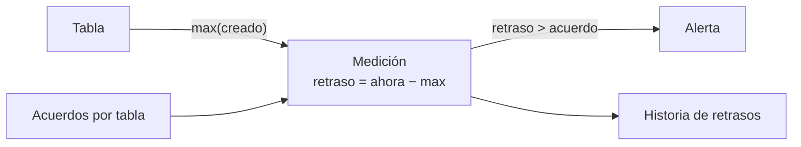

## 1. Resumen

La **frescura** de una tabla es cuánto tiempo pasó desde su dato más reciente. Por sí sola no dice nada: se compara con un **acuerdo** por consumidor («pedidos con menos de 1 h de retraso», «clientes del día anterior»). Es la versión medible de la dimensión de **oportunidad** de DAMA UK (*The Government Data Quality Framework*) y de Freshness en Knowledge Catalog (*Auto data quality overview*).

Se mide de dos formas que **no son lo mismo**:

- **por el dato:** el máximo de una columna de tiempo del negocio (`creado`, `actualizado`);
- **por la escritura:** la hora de la última carga o modificación (por ejemplo, `last_modified_time` en BigQuery).

Una carga que corre a tiempo pero trae datos viejos es fresca por escritura y atrasada por dato.

## 2. Qué es

- **Retraso:** `ahora − máximo(columna de tiempo)`.
- **Acuerdo:** el retraso máximo aceptado por cada consumidor.
- **Estado:** ok o atrasada.
- **Frescura por escritura:** hora de la última modificación de la tabla o partición.

## 3. Problema que resuelve

El pipeline nocturno de pedidos corre todos los días a las 06:00 y termina bien. Una semana, el origen deja de enviar los pedidos nuevos: el pipeline carga cero filas, la tabla se «actualiza» y el tablero muestra los pedidos de hace tres días. La frescura por dato (`max(creado)`) lo detecta; la hora de la última corrida, no.

## 4. Cómo funciona

1. Por cada tabla se elige la columna de tiempo del dato y el acuerdo.
2. Después de cada carga (o cada cierto tiempo), se calcula `max(columna)`.
3. Retraso = ahora − ese máximo, en UTC.
4. Si el retraso supera el acuerdo, la tabla está atrasada y se alerta.
5. Se guarda la serie de retrasos para ver tendencias.

## 5. Cuándo utilizarlo

- En toda tabla con consumidores que dependen de datos recientes.
- Como base de un SLO de frescura (16b).
- En tablas incrementales, donde una carga vacía no falla.

## 6. Cuándo no utilizarlo

- En tablas de referencia que cambian poco (un maestro de países): el acuerdo sería de meses.
- Con columnas de tiempo que pone el pipeline al cargar (`cargado_en`): mide la escritura, no el dato.

## 7. Ejemplo sencillo

A las 09:00 UTC:

| Tabla | Dato más reciente | Retraso | Acuerdo | Estado |
|---|---|---|---|---|
| `pedidos` | 06:40 | 2,3 h | 1 h | atrasada |
| `clientes` | 01:30 | 7,5 h | 24 h | ok |

## 8. Ejemplo de producción

Una tabla de metadatos con una fila por tabla monitoreada: columna de tiempo, acuerdo, consumidor y canal de alerta. Un job cada 15 minutos calcula el retraso de cada una con `max(...)`, guarda la medición y alerta si se pasa del acuerdo dos veces seguidas. En BigQuery, la vista PARTITIONS da además la hora de la última escritura por partición, para distinguir «no se cargó» de «se cargó con datos viejos».

## 9. Arquitectura



## 10. Código

```python
# Python 3.12 y psycopg contra PostgreSQL 17 (ejecutado en la CI con el servicio postgres:17): la frescura de cada
# tabla es la distancia entre ahora y su dato más reciente, comparada con lo que acordó cada consumidor.
# PG_HOST, PG_PORT, PG_USER, PG_PASSWORD y PG_DB apuntan a una base vacía que el test crea y borra.
import os
from datetime import datetime, timedelta, timezone

import psycopg

AHORA = datetime(2026, 10, 20, 9, 0, tzinfo=timezone.utc)   # fijo, para que el ejemplo sea reproducible
ACUERDOS = {"pedidos": timedelta(hours=1), "clientes": timedelta(hours=24)}

with psycopg.connect(host=os.environ["PG_HOST"], port=os.environ["PG_PORT"], user=os.environ["PG_USER"],
                     password=os.environ["PG_PASSWORD"], dbname=os.environ["PG_DB"]) as conn:
    conn.execute("CREATE TABLE pedidos (id int PRIMARY KEY, creado timestamptz NOT NULL)")
    conn.execute("CREATE TABLE clientes (id int PRIMARY KEY, actualizado timestamptz NOT NULL)")
    conn.execute("INSERT INTO pedidos VALUES (1, '2026-10-20 06:10+00'), (2, '2026-10-20 06:40+00')")
    conn.execute("INSERT INTO clientes VALUES (1, '2026-10-19 22:00+00'), (2, '2026-10-20 01:30+00')")
    ultimos = {
        "pedidos": conn.execute("SELECT max(creado) FROM pedidos").fetchone(),
        "clientes": conn.execute("SELECT max(actualizado) FROM clientes").fetchone(),
    }

for tabla, fila in ultimos.items():
    assert fila is not None and fila[0] is not None
    ultimo = fila[0].astimezone(timezone.utc)
    retraso, acuerdo = AHORA - ultimo, ACUERDOS[tabla]
    estado = "ok" if retraso <= acuerdo else "ATRASADA"
    print(f"{tabla}: dato más reciente {ultimo:%Y-%m-%d %H:%M} UTC, retraso {retraso.total_seconds() / 3600:.1f} h, "
          f"acuerdo {acuerdo.total_seconds() / 3600:.0f} h -> {estado}")
```

El script se **ejecuta en la CI contra el servicio postgres:17**, en una base vacía que el test crea y borra, y pasa `mypy --strict`. Con la hora fija de las 09:00 UTC imprime `pedidos: ... retraso 2.3 h, acuerdo 1 h -> ATRASADA` y `clientes: ... retraso 7.5 h, acuerdo 24 h -> ok`.

## 11. GCP

En GCP, **BigQuery** expone la hora de la última escritura por partición. Según *The Government Data Quality Framework* y *PARTITIONS view* (no ejecutado):

| | Frescura por dato | BigQuery (vista PARTITIONS) |
|---|---|---|
| Qué mide | El dato más reciente de la tabla | `last_modified_time`: la última escritura de datos en la partición |
| Qué detecta | Datos viejos aunque la carga haya corrido | Que la partición no se escribió |
| Costo de medir | Una consulta `max()` sobre la tabla | Una consulta sobre metadatos |

Knowledge Catalog, además, tiene una dimensión Freshness para sus reglas de calidad (*Auto data quality overview*).

## 12. AWS

En AWS, **AWS Glue Data Quality**. Según *The Government Data Quality Framework* y *Data Quality Definition Language (DQDL) reference* (no ejecutado):

| | Frescura por dato (este concepto) | AWS Glue Data Quality |
|---|---|---|
| Forma | Una medición propia contra un acuerdo | Un tipo de regla DQDL, `DataFreshness`, dentro de un ruleset |

## 13. Azure

En Azure, **Microsoft Purview**. Según *The Government Data Quality Framework* y *Create data quality rules* (no ejecutado):

| | Frescura por dato (este concepto) | Regla Freshness de Purview |
|---|---|---|
| Base | El máximo de una columna de tiempo del dato | Las fechas de última modificación del activo |
| Resultado | Retraso en horas frente al acuerdo | Puntaje 100 (pasa) o 0 (falla) |
| Fuentes | Cualquier tabla con columna de tiempo | No soportada para Snowflake, Azure Databricks Unity Catalog, Google BigQuery, Synapse ni Azure SQL |

## 14. Buenas prácticas

- Medir por el dato y, si se puede, también por la escritura.
- Un acuerdo por tabla y por consumidor, escrito.
- Calcular en UTC.
- **Seguridad:** el job que mide solo necesita leer la columna de tiempo.
- **Observabilidad:** guardar la serie de retrasos, no solo el estado.
- **Costo:** `max()` sobre una columna de partición o con índice es barato; sobre una tabla grande sin partición, no.

## 15. Errores frecuentes

- Medir la hora de la última corrida del pipeline y llamarla frescura.
- Usar una columna que pone el pipeline (`cargado_en`).
- Mezclar zonas horarias.
- Un solo acuerdo para todas las tablas.

## 16. Trade-offs

Medir más seguido detecta antes y cuesta más consultas. Por dato es más fiel; por escritura es más barato. Acuerdos estrictos protegen a los consumidores y generan más alertas en días atípicos.

## 17. Conceptos relacionados

- `data-observability`: el panorama.
- `data-quality-dimensions`: oportunidad y Freshness.
- `volume-anomalies`: otra señal.
- `incremental-load`: cargas que pueden dejar la tabla vieja.

## 18. Preguntas técnicas abiertas

1. ¿Qué columna de tiempo usarías para medir la frescura de tu tabla principal?
2. ¿Cuál es el acuerdo de frescura con su consumidor principal?
3. ¿Tu pipeline falla si carga cero filas?

## 19. Laboratorio relacionado

Pendiente (F4).

## 20. Fuentes

- *The Government Data Quality Framework* (GOV.UK, 2020).
- Google Cloud: *Auto data quality overview* y *PARTITIONS view*.
- AWS: *Data Quality Definition Language (DQDL) reference*.
- Microsoft Learn: *Create data quality rules*.

El detalle de cada fuente está en `sources` del frontmatter.

## 21. Fecha de última verificación

2026-10-20. `review_required`: pendiente de revisión B-F3.1 del lote F3b-16a.

## 22. Historial de cambios importantes

- 2026-10-20: creación (lote F3b-16a).
