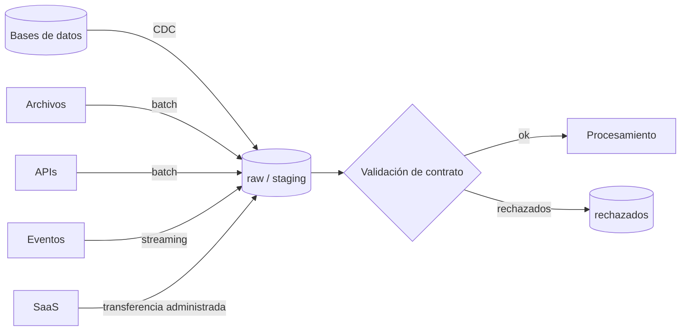

## 1. Resumen

Ingerir es traer datos de donde nacen (bases de datos, archivos, APIs, eventos, aplicaciones SaaS) a la plataforma de datos. Hay cinco modos principales:

- **batch**, por lotes periódicos;
- **streaming**, evento a evento;
- **CDC**, para replicar cambios de una base;
- **transferencias administradas**, para fuentes conocidas;
- **consulta federada**, para leer sin copiar.

El modo se elige por frescura, volumen y tipo de fuente. Todos comparten las mismas exigencias: idempotencia, un contrato de entrada claro y trazabilidad de qué llegó y cuándo.

## 2. Qué es

Es la primera etapa del ciclo de vida del dato en la plataforma. Esta ficha da la visión general y remite a las fichas de cada modo:

| Modo | Cuándo | Ejemplos de servicios | Ficha |
|---|---|---|---|
| Batch | Frescura de horas, exports periódicos | Load jobs de BigQuery, Data Transfer Service, `COPY` de Redshift, Copy activity de Data Factory | `batch-ingestion`, `file-ingestion` |
| Streaming | Frescura de segundos o minutos | Pub/Sub y su suscripción de BigQuery, Kinesis, Event Hubs | `streaming-ingestion` |
| CDC | Replicar una base sin consultas pesadas | Datastream, AWS DMS, Debezium | `change-data-capture` |
| API | Sistemas que solo exponen API | Código propio, conectores | `api-ingestion` |
| Federada | Leer sin copiar, datos chicos o puntuales | `EXTERNAL_QUERY`, tablas externas | `oltp-vs-olap`, `data-lake` |

## 3. Problema que resuelve

Los datos útiles están repartidos en sistemas que no se diseñaron para análisis. Sin una ingesta controlada, cada consumidor extrae a su manera, se carga de más a las fuentes, se pierden o duplican registros y nadie sabe si los datos de hoy están completos.

## 4. Cómo funciona

1. **Conocer la fuente:** cómo expone los datos (tabla, archivo, API, eventos), con qué volumen, frecuencia y garantías (¿puede reenviar? ¿tiene marca de modificación?).
2. **Elegir el modo** según la frescura necesaria y lo que la fuente permite.
3. **Aterrizar crudo** en una zona raw o staging, con metadatos de la carga (origen, fecha, lote).
4. **Hacerla idempotente:** reemplazar el período o fusionar por clave, para que reintentos y reprocesos no dupliquen.
5. **Validar la entrada** contra el contrato: esquema, tipos y reglas mínimas. Los registros que no cumplen van a una zona de rechazados, no se descartan en silencio.
6. **Registrar y medir:** filas leídas y cargadas, duración y frescura, para cuadrar contra la fuente.

## 5. Cuándo utilizarlo

Siempre que un dato externo a la plataforma deba usarse en forma recurrente para análisis, ML o productos.

## 6. Cuándo no utilizarlo

- Para una consulta única sobre un dato que vive en otro sistema: una consulta federada puede bastar, sin construir un pipeline.
- Para copiar "todo, por si acaso": cada fuente ingerida tiene costo de operación, almacenamiento y gobierno.
- Sin acordar con el dueño de la fuente: una extracción pesada sin coordinación puede afectar a la operación.

## 7. Ejemplo sencillo

Un ERP exporta cada noche un archivo de pedidos a Cloud Storage. Una carga batch lo lleva a `raw.pedidos`, reemplazando el día. Si el job falla y se reintenta, el resultado es el mismo.

## 8. Ejemplo de producción

Una empresa ingiere con tres modos:

- **CDC** con Datastream desde la base de pedidos;
- **streaming** con Pub/Sub para los eventos de la web;
- **batch** diario por API para el sistema de pagos.

Todo aterriza en `raw`, con columnas de metadatos (`_fuente`, `_cargado_en`, `_lote`). Un tablero de frescura muestra la última carga de cada fuente y alerta si una se atrasa más que su SLA.

## 9. Arquitectura



## 10. Código

```bash
# Tres modos de ingesta hacia BigQuery. Requiere: bq y gcloud autenticados; datasets y tablas creados.

# 1. Batch idempotente desde Cloud Storage (--replace=true reemplaza la tabla del día).
bq load --source_format=PARQUET --replace=true \
  raw.pedidos_20261004 gs://empresa-lake/pedidos/dt=2026-10-04/*.parquet

# 2. Streaming: una suscripción de Pub/Sub que escribe cada mensaje en BigQuery.
gcloud pubsub subscriptions create eventos-a-bigquery \
  --topic=eventos --bigquery-table=mi-proyecto.raw.eventos

# 3. Federada (sin copiar): consulta puntual a Cloud SQL a través de una conexión de BigQuery.
bq query --use_legacy_sql=false \
  "SELECT * FROM EXTERNAL_QUERY('mi-proyecto.us.tienda', 'SELECT pedido_id, estado FROM pedidos LIMIT 10;')"
```

Cada modo tiene sus requisitos y riesgos: carga idempotente en batch, duplicados por entrega al menos una vez en streaming, y carga sobre la base de origen en la consulta federada.

## 11. GCP

En **BigQuery** los modos están documentados por separado: load jobs y **Data Transfer Service** (cargas programadas, recomendadas para lo recurrente) en batch; la **suscripción de BigQuery en Pub/Sub** en streaming; **Datastream** para CDC; y tablas externas o consultas federadas para leer sin cargar.

## 12. AWS

En AWS, la ingesta se reparte en servicios: `COPY` de Redshift desde S3 para batch, **Kinesis** para streaming, **DMS** para cargas completas y CDC desde bases de datos, y **Glue** para jobs de extracción. A diferencia de GCP, no hay un único punto de entrada al warehouse: cada servicio se combina con S3 como zona de aterrizaje.

## 13. Azure

En Azure y Fabric, la pieza central de la ingesta batch es la **Copy activity** de Data Factory, que lee, convierte, mapea columnas y escribe, con tolerancia configurable a filas incompatibles. Para streaming, **Event Hubs**, y para replicar bases operacionales, el **mirroring** de Fabric. La orquestación y la copia viven en el mismo servicio (Data Factory), a diferencia de GCP, donde suelen separarse.

## 14. Buenas prácticas

- Aterrizar crudo antes de transformar, con metadatos de carga.
- Ingestas idempotentes: reemplazar el período o fusionar por clave.
- Validar contra un contrato y apartar los rechazados con su motivo.
- Coordinar con el dueño de la fuente la ventana y el método de extracción.
- **Seguridad:** credenciales en un gestor de secretos, cuentas de ingesta con permisos mínimos y clasificación de datos personales desde la llegada.
- **Observabilidad:** frescura por fuente, filas leídas frente a cargadas y alertas por atrasos respecto del SLA.
- **Costo:** traer solo lo necesario (columnas, períodos incrementales) y elegir streaming solo cuando la frescura lo justifica.

## 15. Errores frecuentes

- Ingestas que agregan en vez de reemplazar y duplican al reintentar.
- Transformar durante la ingesta y perder el dato crudo para reprocesar.
- Consultas pesadas sobre la base primaria de una aplicación.
- No registrar cuándo llegó cada lote y no poder responder "¿esto está completo?".
- Descartar registros inválidos sin avisar.

## 16. Trade-offs

Batch es simple y barato, pero no es fresco. Streaming es fresco, pero más complejo y con duplicados. CDC replica fielmente sin cargar la base, a cambio de operar el conector. La federación no copia, pero carga el origen y no escala para uso recurrente. Lo habitual es combinar modos según la fuente.

## 17. Conceptos relacionados

- `batch-ingestion`, `streaming-ingestion`, `file-ingestion` y `api-ingestion`: cada modo en detalle.
- `change-data-capture`: ingesta de cambios.
- `data-pipeline`: el sistema del que la ingesta es la primera etapa.

## 18. Preguntas técnicas abiertas

1. ¿Qué modo de ingesta usarías para una base que no tiene columna de modificación?
2. ¿Cómo sabrías, cada mañana, si la ingesta de ayer está completa?
3. ¿Qué metadatos de carga agregarías a cada registro y por qué?

## 19. Laboratorio relacionado

Pendiente (F4).

## 20. Fuentes

- Google Cloud: *Introduction to loading data*, *bq command-line tool reference* y *Federated query functions* (BigQuery); *Create BigQuery subscriptions* (Pub/Sub).
- AWS: *Creating tasks for ongoing replication using AWS DMS*, *What is Amazon Kinesis Data Streams?*, *COPY* (Amazon Redshift) y *What is AWS Glue?*
- Debezium: *PostgreSQL connector*.
- Microsoft Learn: *Copy activity in Azure Data Factory*, *What is Azure Event Hubs* y *Mirroring in Microsoft Fabric*.

El detalle de cada fuente está en `sources` del frontmatter.

## 21. Fecha de última verificación

2026-10-06. Pasa a `verified`: revisión B-F3.1 del lote F3b-01a aplicada, sin VERIFY pendientes.

## 22. Historial de cambios importantes

- 2026-10-05: creación (lote F3b-01a, dominio 01-fundamentals).
- 2026-10-06: revisión B-F3.1 del lote F3b-01a aplicada (docs/reviews/cards-f3b-01a.md): fuentes para COPY de Redshift, Glue, Event Hubs, el mirroring de Fabric y Debezium.
- 2026-10-06: `verification_status: verified` (revisión B-F3.1 del lote F3b-01a aplicada; sin VERIFY pendientes).
