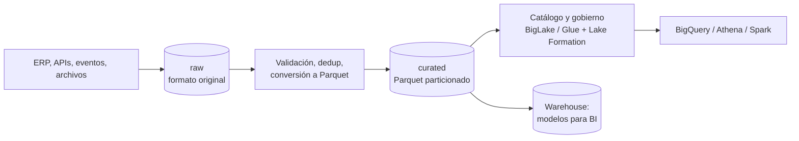

## 1. Resumen

Un data lake guarda datos de muchas fuentes en **almacenamiento de objetos** (Cloud Storage, S3, ADLS), en su formato original o en formatos abiertos como Parquet, y deja que distintos motores los consulten (BigQuery, Athena, Spark). Su ventaja es separar almacenamiento barato de cómputo y no exigir un modelo antes de guardar. Su riesgo es convertirse en un depósito sin orden: sin zonas, catálogo, particionado ni gobierno, nadie sabe qué hay ni si es confiable.

## 2. Qué es

Es un paradigma de almacenamiento consolidado, no un producto. Lo definen tres rasgos:

- **Almacenamiento de objetos** como base: escala sin límite práctico y se paga por volumen.
- **Datos crudos y curados** en archivos: JSON, CSV o Avro tal como llegan, y Parquet u otros formatos columnares ya limpios.
- **Cómputo separado:** los datos no pertenecen a un motor; varios motores leen los mismos archivos, con un **catálogo** que describe tablas, columnas y particiones.

Frente a un data warehouse, el lake prioriza la flexibilidad y el costo de almacenamiento; el warehouse, el rendimiento y la consistencia de consultas sobre datos modelados. Los *lakehouse* (formatos de tabla abiertos como Iceberg o Delta) combinan ambos y se tratan en su propia ficha.

## 3. Problema que resuelve

Cargar todo directamente a un warehouse obliga a definir el schema antes de guardar y a pagar almacenamiento de warehouse por datos que quizá nadie consulte. Además, deja fuera datos semiestructurados o binarios. El lake permite **guardar primero** (barato, con historia completa y reproducible) y **modelar después**, cuando se sabe qué se necesita, y deja los mismos datos disponibles para analítica, ciencia de datos y reprocesos.

## 4. Cómo funciona

1. **Zonas** (convención habitual, con nombres que varían):
   - *raw/landing*: lo que llega, inmutable;
   - *curated/silver*: limpio, deduplicado y en Parquet;
   - *consumption/gold*: agregados o modelos listos para consumir.
2. **Organización por prefijos:** `gs://lake/raw/pedidos/dt=2026-10-01/archivo.json`. El patrón `clave=valor` (estilo Hive) permite que los motores detecten particiones y lean solo las necesarias.
3. **Catálogo:** registra tablas sobre los prefijos (tablas externas de BigQuery, Glue Data Catalog, metastore de Spark), para consultar con SQL sin mover datos.
4. **Gobierno:** acceso por tabla, columna o fila en la capa de catálogo (BigLake, Lake Formation), en lugar de dar permisos sobre los buckets a cada usuario.
5. **Ciclo de vida:** clases de almacenamiento y reglas de expiración por zona.

## 5. Cuándo utilizarlo

- Aterrizar datos de muchas fuentes antes de decidir su modelo (ELT).
- Guardar historia cruda completa para reprocesar y auditar.
- Datos semiestructurados, logs o archivos grandes que no conviene cargar enteros al warehouse.
- Cuando varios motores (SQL, Spark, ML) deben leer los mismos datos.

## 6. Cuándo no utilizarlo

- Como única capa para BI con muchos usuarios concurrentes: un warehouse o una capa modelada responde mejor y con más consistencia.
- Para datos que se actualizan registro a registro: los archivos inmutables no se prestan a updates frecuentes (los formatos de tabla abiertos lo mejoran a costa de complejidad).
- Sin un responsable del catálogo y el gobierno: el lake se degrada a un "data swamp".

## 7. Ejemplo sencillo

```text
gs://empresa-lake/
  raw/pedidos/dt=2026-10-01/pedidos_0001.json
  raw/pedidos/dt=2026-10-02/pedidos_0001.json
  curated/pedidos/dt=2026-10-01/part-0000.parquet
  curated/pedidos/dt=2026-10-02/part-0000.parquet
```

Una tabla externa sobre `curated/pedidos/` permite consultar con SQL y filtrar por `dt` para leer solo un día.

## 8. Ejemplo de producción

Una empresa aterriza en Cloud Storage los exports diarios de su ERP, eventos de Pub/Sub (suscripción de export a Cloud Storage) y archivos de socios. Un job diario valida, deduplica y convierte a Parquet en la zona curada, particionada por fecha. BigQuery consulta la zona curada con tablas BigLake: los analistas tienen acceso a las tablas, no al bucket, y las columnas con datos personales tienen seguridad a nivel de columna. La zona raw pasa a una clase de almacenamiento más barata a los 30 días y se borra a los 2 años. Los modelos para BI se materializan en BigQuery desde la zona curada.

## 9. Arquitectura



## 10. Código

```sql
-- BigQuery: tabla BigLake sobre la zona curada (Parquet particionado estilo Hive en Cloud Storage).
-- Requiere: una conexión de recurso de Cloud (proyecto.us.lake) cuya cuenta de servicio pueda leer el
-- bucket, y archivos en gs://empresa-lake/curated/pedidos/dt=AAAA-MM-DD/*.parquet.
CREATE EXTERNAL TABLE IF NOT EXISTS `proyecto.lake.pedidos`
WITH CONNECTION `proyecto.us.lake`
WITH PARTITION COLUMNS          -- detecta dt desde el layout clave=valor
OPTIONS (
  uris = ['gs://empresa-lake/curated/pedidos/*'],
  format = 'PARQUET',
  hive_partition_uri_prefix = 'gs://empresa-lake/curated/pedidos',
  require_hive_partition_filter = true   -- toda consulta debe filtrar por partición
);

SELECT COUNT(*) AS pedidos
FROM `proyecto.lake.pedidos`
WHERE dt = '2026-10-01';   -- solo lee los archivos de ese prefijo
```

Con `WITH CONNECTION` la tabla es BigLake: los usuarios reciben acceso a la tabla y la conexión lee el bucket. Sin ella sería una tabla externa común, y cada usuario necesitaría permisos de lectura sobre el bucket.

## 11. GCP

El lake vive en **Cloud Storage**. **BigQuery** lo consulta con tablas externas, y las **tablas BigLake** agregan delegación de acceso: una conexión con su propia cuenta de servicio lee los archivos y los usuarios solo reciben permisos sobre la tabla. Eso habilita seguridad a nivel de fila y columna sobre archivos en el lake. Con BigQuery Omni, las tablas BigLake también pueden apuntar a S3 y Blob Storage.

## 12. AWS

El lake vive en **S3**, el catálogo es el **Glue Data Catalog** y el motor SQL típico es **Athena**, que consulta los archivos en S3 sin infraestructura y cobra por consulta. Las particiones estilo Hive se registran con `MSCK REPAIR TABLE`, y las demás con `ALTER TABLE ADD PARTITION`. El gobierno fino lo da **Lake Formation**, con permisos a nivel de base, tabla, columna, fila y celda que respetan Athena, Redshift Spectrum, Glue y EMR. Diferencia con GCP: catálogo, gobierno y motor son tres servicios separados, mientras que en GCP los tres pasan por BigQuery y BigLake.

## 13. Azure

**Azure Data Lake Storage** no es un servicio aparte: es un conjunto de capacidades de Blob Storage que se activan con el **espacio de nombres jerárquico**. Este aporta directorios reales con operaciones atómicas, acceso compatible con Hadoop mediante ABFS y un modelo de permisos más granular. Es una diferencia de fondo con Cloud Storage y S3, donde los "directorios" son prefijos de nombres de objeto. Activarlo es irreversible: una cuenta con espacio de nombres jerárquico no puede volver a uno plano, y algunas cargas (backups, imágenes) no ganan nada con él.

## 14. Buenas prácticas

- Zonas explícitas con reglas claras: raw inmutable, curated con calidad garantizada.
- Formatos columnares abiertos (Parquet) en las zonas que se consultan.
- Particionar por fecha con layout `clave=valor` y obligar a filtrar por partición en tablas grandes.
- Evitar muchos archivos pequeños: compactar en la zona curada.
- Todo dato en el lake debe estar en el catálogo, con responsable y descripción.
- **Seguridad:** gobernar el acceso en la capa de tablas (BigLake, Lake Formation) y no con permisos amplios sobre buckets; cifrar y aplicar retención especialmente a la zona raw, que suele tener datos personales sin enmascarar.
- **Observabilidad:** registrar por zona y partición cuántos archivos y bytes llegan y cuándo, y alertar si una partición esperada no aparece o trae muchos archivos pequeños; vigilar los bytes leídos por las consultas sobre tablas externas.
- **Costo:** reglas de ciclo de vida por zona y clases de almacenamiento frías para raw; en motores que cobran por bytes leídos, Parquet y particiones bajan el costo de cada consulta.

## 15. Errores frecuentes

- Guardar todo sin catálogo ni responsable: nadie sabe qué hay ni si está vigente.
- Dar a los analistas lectura sobre todo el bucket, incluida la zona raw con datos personales.
- Miles de archivos pequeños por partición, que vuelven lentas y caras las consultas.
- Consultar JSON crudo de forma recurrente en lugar de curarlo a Parquet.
- Suponer que "guardar sin schema" evita el problema del schema: solo lo traslada a quien lee.

## 16. Trade-offs

Almacenamiento barato, flexible y abierto a varios motores, a cambio de gobierno, catálogo y calidad que hay que construir. Frente a un warehouse: menor costo por TB y más flexibilidad, pero consultas menos predecibles y sin transacciones sobre archivos simples. Los lakehouse cierran parte de esa brecha agregando una capa de tabla, a cambio de más componentes.

## 17. Conceptos relacionados

- `parquet-format`: el formato de la zona curada.
- `gcs-buckets-and-objects`: el almacenamiento en GCP.
- `partitioning`: cómo organizar para leer menos.
- `schema-evolution`: el problema del schema en lectura.
- `etl-vs-elt`: el lake como zona de aterrizaje.
- Del blueprint, pendientes de ficha: `data-warehouse`, `lakehouse`.

## 18. Preguntas técnicas abiertas

1. ¿Qué datos dejarías solo en el lake y cuáles cargarías también al warehouse? ¿Con qué criterio?
2. ¿Cómo evitarías que la zona raw se convierta en una fuente de acceso a datos personales sin control?
3. ¿Qué harías con una partición diaria que contiene 50 000 archivos de 10 KB?

## 19. Laboratorio relacionado

Pendiente (F4).

## 20. Fuentes

- Google Cloud: *Introduction to external data sources*, *Introduction to BigLake tables* y *Data definition language statements* (BigQuery); *Object Lifecycle Management* (Cloud Storage); *Subscription overview* (Pub/Sub).
- AWS: *What is Amazon S3?*, *What is AWS Lake Formation?*, *What is Amazon Athena?* y *Partition your data* (Athena).
- Microsoft Learn: *Introduction to Azure Data Lake Storage* y *Azure Data Lake Storage hierarchical namespace*.

El detalle de cada fuente está en `sources` del frontmatter.

## 21. Fecha de última verificación

2026-10-04. Pasa a `verified`: revisión B-F3.1 del lote 5 aplicada, sin VERIFY pendientes.

## 22. Historial de cambios importantes

- 2026-10-02: creación (lote 5 de F3).
- 2026-10-04: revisión B-F3.1 del lote 5 aplicada (docs/reviews/cards-lote5.md): viñeta de Observabilidad en §14.
- 2026-10-04: `verification_status: verified` (revisión B-F3.1 del lote 5 aplicada; sin VERIFY pendientes).
