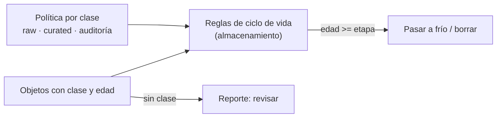

## 1. Resumen

La **gestión del ciclo de vida** son las **políticas de gobierno** que fijan, por **clase de datos**, qué pasa con cada objeto a lo largo del tiempo: cuándo pasa a almacenamiento frío, cuándo se borra y cuáles no se tocan. Cada nube las aplica con reglas en el almacenamiento.

**No es lo mismo que `data-lifecycle`**, que describe las etapas por las que pasa un dato (generación, ingesta, almacenamiento, procesamiento, entrega, archivo y borrado) y muestra cómo automatizar la retención con reglas. Esta ficha trata la decisión de gobierno detrás de esas reglas: qué clases de datos hay, quién es dueño de cada política y qué pasa con lo que no tiene clase.

## 2. Qué es

- **Clase de datos:** un grupo con la misma política (raw, curated, auditoría).
- **Etapa:** a partir de cierta edad, una acción (pasar a frío, borrar).
- **Acción por defecto:** lo que pasa si no aplica ninguna etapa (mantener).
- **Sin clase:** un objeto sin clase no tiene política; es un hallazgo, no un caso normal.

## 3. Problema que resuelve

Un bucket guarda todo en la clase más cara, desde hace años, sin distinguir los raw que nadie lee de los datos de auditoría que hay que conservar. Con una política por clase, los raw pasan a frío al mes y se borran al año, los curated pasan a frío a los 90 días, la auditoría se conserva, y lo que no tiene clase aparece para revisarse.

## 4. Cómo funciona

1. Se define una política por clase: etapas con edad y acción.
2. Cada objeto tiene su clase (por prefijo, etiqueta o catálogo).
3. Para cada objeto se calcula su edad y la última etapa que alcanzó.
4. El almacenamiento aplica la acción con sus reglas de ciclo de vida (Cloud Storage, S3, Azure).
5. Los objetos sin clase se reportan.

Las reglas de cada nube tienen sus propias prioridades: en Cloud Storage, Delete gana sobre SetStorageClass (*Object Lifecycle Management*).

## 5. Cuándo utilizarlo

- En buckets y lakes con datos de distinta importancia.
- Cuando el costo de almacenamiento crece sin control.
- Junto con la retención, para que lo vencido se borre solo.

## 6. Cuándo no utilizarlo

- Sin clases definidas: una regla para todo el bucket trata igual lo crítico y lo descartable.
- Moviendo a frío datos que se leen seguido: las transiciones y la lectura en frío tienen costo (la página de S3 lo advierte).

## 7. Ejemplo sencillo

Política: raw → frío a los 30 días y borrar a los 365; curated → frío a los 90; auditoría → conservar. Hoy, 20 de octubre de 2026:

| Objeto | Edad | Acción |
|---|---|---|
| `raw/pedidos/2026-10-01.json` | 19 días | mantener |
| `raw/pedidos/2026-08-01.json` | 80 días | pasar a frío |
| `raw/pedidos/2025-09-01.json` | 414 días | borrar |
| `curated/ventas/2026-05.parquet` | 142 días | pasar a frío |
| `auditoria/accesos/2024-01.log` | 993 días | mantener |
| `tmp/sin-clase.csv` | 292 días | SIN CLASE: revisar |

## 8. Ejemplo de producción

- Clases definidas en el catálogo, con su política y su dueño.
- Prefijos por clase en el lake (`raw/`, `curated/`, `auditoria/`), con una regla de ciclo de vida por prefijo.
- Auditoría en un bucket aparte con retención bloqueada (`data-retention`).
- Un reporte mensual de objetos sin clase y de bytes por clase y etapa.

## 9. Arquitectura



## 10. Código

```python
"""Una política de ciclo de vida por clase de datos, evaluada sobre un inventario de objetos: qué acción toca a cada uno.

La política es del equipo; las reglas de ciclo de vida de cada nube la aplican en el almacenamiento (no ejecutado aquí).
"""
from datetime import date

HOY = date(2026, 10, 20)
POLITICA = {  # clase -> etapas (días desde la creación, acción), en orden
    "raw": [(30, "pasar a almacenamiento frío"), (365, "borrar")],
    "curated": [(90, "pasar a almacenamiento frío")],
    "auditoria": [],   # se conserva; su retención la fija otra política
}
OBJETOS = [
    ("raw/pedidos/2026-10-01.json", "raw", date(2026, 10, 1)),
    ("raw/pedidos/2026-08-01.json", "raw", date(2026, 8, 1)),
    ("raw/pedidos/2025-09-01.json", "raw", date(2025, 9, 1)),
    ("curated/ventas/2026-05.parquet", "curated", date(2026, 5, 31)),
    ("auditoria/accesos/2024-01.log", "auditoria", date(2024, 1, 31)),
    ("tmp/sin-clase.csv", "", date(2026, 1, 1)),
]


def accion(clase: str, creado: date) -> str:
    if clase not in POLITICA:
        return "SIN CLASE: revisar (no se aplica ninguna regla)"
    edad, elegida = (HOY - creado).days, "mantener"
    for dias, paso in POLITICA[clase]:
        if edad >= dias:
            elegida = paso
    return elegida


for ruta, clase, creado in OBJETOS:
    print(f"{ruta} ({(HOY - creado).days} días): {accion(clase, creado)}")
```

El script se **ejecuta en la CI** y pasa `mypy --strict`. Imprime la acción de cada objeto: `mantener`, `pasar a almacenamiento frío`, `borrar` y `SIN CLASE: revisar` para el objeto sin clase. Es la evaluación de la política; aplicar las acciones lo hacen las reglas de cada nube (no ejecutado).

## 11. GCP

En GCP, **Object Lifecycle Management** de Cloud Storage. Según *Object Lifecycle Management* (no ejecutado):

| | Política por clase (este concepto) | Cloud Storage |
|---|---|---|
| Dónde vive | En el catálogo o el repositorio | Una configuración de ciclo de vida en el bucket |
| Alcance | Por clase de datos | Reglas sobre objetos actuales y futuros del bucket, con condiciones |
| Conflictos | La última etapa alcanzada | Delete gana sobre SetStorageClass; entre clases, la de menor precio de almacenamiento |

## 12. AWS

En AWS, **S3 Lifecycle**. Según *Managing the lifecycle of objects* (no ejecutado):

| | Política por clase (este concepto) | S3 Lifecycle |
|---|---|---|
| Acciones | Pasar a frío, borrar | Transition (a otra clase de almacenamiento) y Expiration (S3 borra) |
| Costo | — | La página advierte costos por transiciones y solicitudes |

## 13. Azure

En Azure, **lifecycle management** de Blob Storage. Según *Azure Blob Storage lifecycle management overview* (no ejecutado):

| | Política por clase (este concepto) | Azure Blob Storage |
|---|---|---|
| Acciones | Pasar a frío, borrar | Pasar a un tier más frío si no se accede o modifica; volver a hot al acceder; borrar al final del ciclo |
| Alcance | Por clase | Toda la cuenta, contenedores o un subconjunto de blobs; incluye versiones anteriores y snapshots |

## 14. Buenas prácticas

- Clases pocas y claras, con dueño.
- Un prefijo o etiqueta por clase, para que la regla del almacenamiento coincida con la política.
- Revisar las prioridades de cada nube cuando hay varias reglas.
- **Seguridad:** borrar lo que ya no sirve reduce exposición; la auditoría se separa y se protege.
- **Observabilidad:** bytes por clase y etapa; objetos sin clase.
- **Costo:** pasar a frío ahorra almacenamiento y encarece leer; elegir la edad según cómo se usa cada clase.

## 15. Errores frecuentes

- Confundir esta política con el ciclo de vida conceptual del dato.
- Una sola regla para todo el bucket.
- Objetos sin clase que nunca se revisan.
- Mover a frío datos que se consultan cada semana.

## 16. Trade-offs

Más clases ajustan mejor la política y cuestan más de mantener. Mover a frío pronto ahorra almacenamiento y encarece las lecturas ocasionales. Borrar pronto reduce costo y riesgo, y quita historia.

## 17. Conceptos relacionados

- `data-retention`: el borrado por plazo.
- `data-lifecycle`: el ciclo de vida conceptual.
- `gcs-storage-classes-and-lifecycle`: Cloud Storage en detalle.
- `data-catalog`: donde vive la clase.

## 18. Preguntas técnicas abiertas

1. ¿Qué clases de datos tiene tu lake?
2. ¿Qué porcentaje de tus objetos no tiene clase?
3. ¿Cuánto de lo que guardas en la clase más cara se lee cada mes?

## 19. Laboratorio relacionado

Pendiente (F4).

## 20. Fuentes

- Google Cloud: *Object Lifecycle Management*.
- AWS: *Managing the lifecycle of objects*.
- Microsoft Learn: *Azure Blob Storage lifecycle management overview*.

El detalle de cada fuente está en `sources` del frontmatter.

## 21. Fecha de última verificación

2026-10-20. `review_required`: pendiente de revisión B-F3.1 del lote F3b-17a.

## 22. Historial de cambios importantes

- 2026-10-20: creación (lote F3b-17a).
