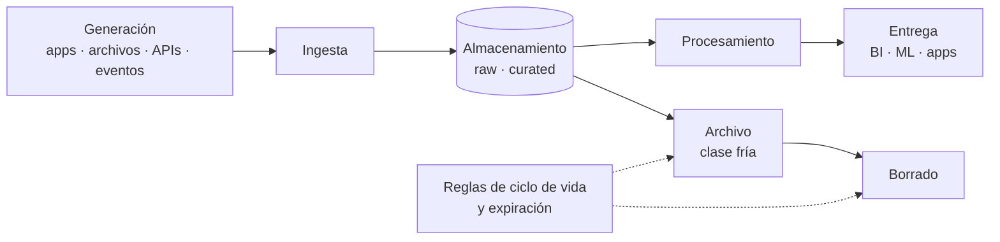

## 1. Resumen

Todo dato pasa por etapas: se **genera** en una fuente, se **ingiere**, se **almacena**, se **procesa** (limpia, integra, modela), se **entrega** a quien lo usa y, al final, se **archiva** o se **borra**. Pensar el ciclo completo evita los dos extremos caros: datos que nunca llegan a ser útiles y datos que se guardan para siempre sin motivo. Las nubes automatizan la última etapa con reglas de ciclo de vida (cambiar de clase de almacenamiento, borrar) y expiración de tablas.

## 2. Qué es

Es un marco consolidado para organizar el trabajo con datos. Las etapas habituales:

| Etapa | Pregunta | Ejemplos |
|---|---|---|
| Generación | ¿Dónde nace el dato? | Base de una aplicación, archivo, API, evento, sensor |
| Ingesta | ¿Cómo llega a la plataforma? | Batch, streaming, CDC |
| Almacenamiento | ¿Dónde y cómo se guarda? | Lake, warehouse, lakehouse; formato y particiones |
| Procesamiento | ¿Cómo se vuelve útil? | Limpieza, integración, modelado |
| Entrega | ¿Quién lo usa y cómo? | BI, ML, aplicaciones, socios |
| Archivo y borrado | ¿Cuánto se conserva y qué pasa después? | Clases de almacenamiento frías, expiración, borrado |

Microsoft describe los componentes de una arquitectura de big data en una secuencia equivalente, y AWS incluye la gestión del ciclo de vida entre las competencias del data engineer.

## 3. Problema que resuelve

Sin una visión del ciclo:

- se ingieren datos que nadie consume;
- se procesan una y otra vez datos que no cambian;
- se guardan copias sin fecha de vencimiento, con costo creciente y riesgo legal si contienen datos personales.

Pensar el ciclo de punta a punta asigna a cada etapa un responsable, una calidad esperada y una retención.

## 4. Cómo funciona

1. **Al ingerir**, se registran origen, fecha de llegada y sensibilidad del dato: es lo que después decide su retención.
2. **Al almacenar**, cada zona tiene su política: la raw puede expirar antes que la curada si se puede reconstruir, o conservarse más si es la única copia de la fuente.
3. **Al procesar y entregar**, se documenta qué datos derivados dependen de cuáles, para saber qué afecta un borrado.
4. **Al archivar o borrar**, se automatiza con reglas declarativas:
   - en Cloud Storage, `SetStorageClass` y `Delete`;
   - en S3, transiciones y expiraciones;
   - en Blob Storage, cambio de nivel y borrado;
   - en BigQuery, expiración de tablas y particiones.
5. **Retención técnica:** los mecanismos de recuperación (time travel, versiones, soft delete) retienen datos por un tiempo después de borrarlos. Cuentan en el plazo real de borrado.

## 5. Cuándo utilizarlo

- Al diseñar cualquier plataforma o pipeline nuevo.
- Al definir políticas de retención por requisitos legales o de privacidad.
- Al revisar costos de almacenamiento.
- Al responder una solicitud de borrado de datos personales: hay que saber en qué etapas y copias está el dato.

## 6. Cuándo no utilizarlo

- Como trámite documental desconectado de la plataforma: las reglas deben estar implementadas (lifecycle, expiración), no solo escritas.
- Para decidir plazos legales: la retención la definen negocio y cumplimiento; el data engineer la implementa.

## 7. Ejemplo sencillo

Los archivos de ventas que llegan cada día pasan a una clase de almacenamiento fría a los 90 días y se borran a los 2 años. La tabla agregada en BigQuery se conserva mientras el negocio la use, y la tabla de staging expira a los 7 días.

## 8. Ejemplo de producción

Una empresa define la retención por zona y la implementa en Terraform:

- **raw:** en Cloud Storage, pasa a Coldline a los 90 días y se borra a los 3 años;
- **staging en BigQuery:** expiración de tablas a 7 días;
- **curated y marts:** sin expiración, con revisión anual.

Un inventario documenta qué datasets contienen datos personales. Ante una solicitud de borrado se aplica en todas las zonas, y se contemplan la ventana de time travel y la retención de versiones.

## 9. Arquitectura



## 10. Código

```hcl
# Terraform: retención automática de la zona raw del lake (Cloud Storage).
# Requiere: provider hashicorp/google configurado; el nombre del bucket debe ser único.
terraform {
  required_providers {
    google = {
      source  = "hashicorp/google"
      version = "~> 8.0"
    }
  }
}

resource "google_storage_bucket" "raw" {
  name                        = "empresa-lake-raw"
  location                    = "US"
  uniform_bucket_level_access = true

  # Archivo: a los 90 días, clase de almacenamiento fría.
  lifecycle_rule {
    condition {
      age = 90
    }
    action {
      type          = "SetStorageClass"
      storage_class = "COLDLINE"
    }
  }

  # Borrado: a los 3 años.
  lifecycle_rule {
    condition {
      age = 1095
    }
    action {
      type = "Delete"
    }
  }
}
```

La zona de staging en BigQuery se gestiona con la expiración por defecto del dataset (`default_table_expiration_days`), como en la ficha `data-warehouse`.

## 11. GCP

En **Cloud Storage**, Object Lifecycle Management aplica reglas con `SetStorageClass` y `Delete`; si dos reglas aplican, gana `Delete`. En **BigQuery**, `default_table_expiration_days` fija la expiración de las tablas de un dataset. Time travel y fail-safe retienen datos borrados por un tiempo, lo que extiende el plazo real del borrado.

## 12. AWS

En **S3**, una configuración de ciclo de vida combina acciones de **transición** (por ejemplo, a S3 Standard-IA o a Glacier tras cierta cantidad de días) y de **expiración**. El modelo es el mismo que en Cloud Storage, con otros nombres de clases. AWS menciona explícitamente la gestión del ciclo de vida entre las competencias del data engineer.

## 13. Azure

En **Blob Storage** (y ADLS), las políticas de ciclo de vida mueven blobs entre niveles o los borran. Tienen límites propios: el borrado no actúa en contenedores inmutables, y la política no rehidrata blobs del nivel de archivo. La inmutabilidad, útil para cumplimiento, puede impedir borrar en el plazo previsto: hay que diseñar ambas políticas juntas.

## 14. Buenas prácticas

- Definir retención por zona y por sensibilidad del dato, y escribirla en el código de infraestructura.
- Registrar en la ingesta el origen y la clasificación de cada dataset.
- Expirar automáticamente staging y datos reconstruibles.
- Considerar time travel, versiones y soft delete al calcular cuándo un dato desaparece de verdad.
- **Seguridad:** los datos personales deben tener una retención y un procedimiento de borrado que cubra todas las copias y zonas.
- **Observabilidad:** inventario de datasets con dueño, tamaño, último uso y política de retención; alertar sobre datasets sin política.
- **Costo:** clases frías para lo que se lee poco y expiración para lo que no se necesita; revisar antes los costos de recuperación y la duración mínima de las clases frías.

## 15. Errores frecuentes

- Guardar todo "por si acaso" sin fecha de vencimiento.
- Borrar la zona raw cuando es la única copia de una fuente que no se puede volver a extraer.
- Olvidar las copias derivadas al borrar un dato personal.
- Reglas de ciclo de vida escritas a mano en la consola, distintas entre ambientes.
- Pasar a clase fría datos que se leen seguido, y pagar más por recuperación.

## 16. Trade-offs

Retener más permite reprocesar y auditar, a cambio de costo y riesgo. Retener menos baja ambos, pero limita la reconstrucción. Las clases frías abaratan el almacenamiento y encarecen la lectura. La decisión se toma por zona y por tipo de dato, no una sola para toda la plataforma.

## 17. Conceptos relacionados

- `what-is-data-engineering`: el rol responsable del ciclo.
- `data-ingestion` y `data-transformation`: dos etapas del ciclo.
- `data-lake`: las zonas y su retención.
- `gcs-buckets-and-objects`: dónde se aplican las reglas en GCP.

## 18. Preguntas técnicas abiertas

1. ¿Qué datos de tu plataforma no podrías reconstruir si borraras la zona raw?
2. ¿Cuánto tarda de verdad en desaparecer un registro borrado, considerando time travel y versiones?
3. ¿Cómo combinarías inmutabilidad por cumplimiento con un derecho de borrado?

## 19. Laboratorio relacionado

Pendiente (F4).

## 20. Fuentes

- Microsoft Learn: *Big data architectures* y *Azure Blob Storage lifecycle management overview*.
- AWS: *AWS Certified Data Engineer - Associate* y *Managing the lifecycle of objects* (Amazon S3).
- Google Cloud: *Object Lifecycle Management* (Cloud Storage); *Data definition language statements* e *Introduction to datasets* (BigQuery).
- HashiCorp: documentación de `google_storage_bucket` (repositorio oficial del provider).

El detalle de cada fuente está en `sources` del frontmatter.

## 21. Fecha de última verificación

2026-10-06. Pasa a `verified`: revisión B-F3.1 del lote F3b-01a aplicada, sin VERIFY pendientes.

## 22. Historial de cambios importantes

- 2026-10-05: creación (lote F3b-01a, dominio 01-fundamentals).
- 2026-10-06: `verification_status: verified` (revisión B-F3.1 del lote F3b-01a aplicada; sin VERIFY pendientes).
