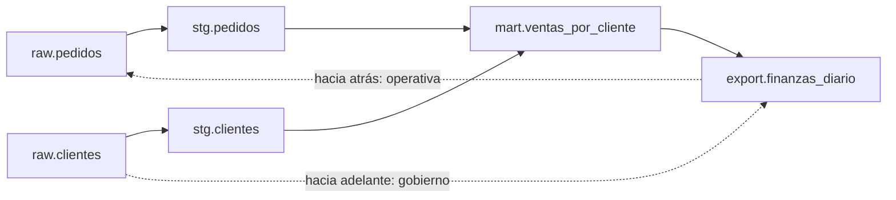

## 1. Resumen

El **linaje** registra de dónde viene cada dataset y qué se deriva de él. Se arma con los **jobs**: cada uno lee entradas y escribe salidas, y esas relaciones forman un grafo (*Object Model*, OpenLineage). Sirve con dos vistas:

- **operativa, hacia atrás:** una tabla está mal, ¿qué fuentes y jobs la alimentan? Es el camino de `root-cause-analysis`;
- **de gobierno, hacia adelante:** si cambia o se borra una fuente (o tiene datos sensibles), ¿qué tablas, reportes y consumidores se ven afectados?

Es el mismo grafo recorrido en sentidos opuestos. **OpenLineage** es un estándar abierto para emitir esos eventos (*About OpenLineage*), y Knowledge Catalog, DataZone y SageMaker Unified Studio aceptan eventos en ese formato.

## 2. Qué es

- **Job:** un proceso que lee y escribe datasets.
- **Run:** una ejecución de un job, con estados START, RUNNING, COMPLETE, ABORT, FAIL u OTHER (*The Run Cycle*).
- **Dataset:** una tabla, un archivo o un tema, identificado por namespace y nombre.
- **Facets:** metadata extra sobre jobs, runs y datasets (schema, SQL, calidad).
- **Linaje a nivel de columna:** qué columnas de entrada alimentan cada columna de salida.

## 3. Problema que resuelve

El equipo de clientes quiere cambiar el tipo de una columna en `raw.clientes`. Nadie sabe quién la usa. Con el linaje, la vista hacia adelante muestra `stg.clientes`, `mart.ventas_por_cliente` y `export.finanzas_diario`: el cambio afecta a finanzas, y se coordina antes. Al revés, cuando el export de finanzas sale mal, la vista hacia atrás lista las cinco tablas de las que depende.

## 4. Cómo funciona

1. Cada job emite un evento START al empezar y COMPLETE (o FAIL) al terminar, con sus entradas y salidas.
2. Los eventos van a un backend o, como aquí, a un archivo JSON Lines (transporte `file`, *Configuration*).
3. Con los eventos COMPLETE se arman dos índices: salida → entradas y entrada → salidas.
4. Hacia atrás desde una tabla: todo lo que la alimenta.
5. Hacia adelante desde una fuente: todo lo que se deriva de ella.

## 5. Cuándo utilizarlo

- Para analizar el impacto de un cambio antes de hacerlo.
- Para encontrar la causa de un dato malo.
- Para saber hasta dónde llegan los datos sensibles de una fuente.
- Para borrar o archivar con seguridad: qué depende de esa tabla.

## 6. Cuándo no utilizarlo

- Como reemplazo del DAG del orquestador: el DAG ordena tareas de un pipeline; el linaje une datasets entre pipelines y herramientas.
- A mano en un diagrama: se desactualiza; el linaje sirve si lo emiten los jobs.

## 7. Ejemplo sencillo

Cuatro jobs: `stg_pedidos` (raw.pedidos → stg.pedidos), `stg_clientes` (raw.clientes → stg.clientes), `mart_ventas` (las dos stg → mart.ventas_por_cliente) y `reporte_finanzas` (mart → export.finanzas_diario).

| Pregunta | Respuesta |
|---|---|
| ¿De dónde viene `export.finanzas_diario`? (operativa) | `mart.ventas_por_cliente`, `raw.clientes`, `raw.pedidos`, `stg.clientes`, `stg.pedidos` |
| ¿Qué se ve afectado si cambia `raw.clientes`? (gobierno) | `export.finanzas_diario`, `mart.ventas_por_cliente`, `stg.clientes` |

## 8. Ejemplo de producción

- Los jobs de Spark, dbt y Airflow emiten eventos OpenLineage a un backend de linaje (no ejecutado).
- Antes de un cambio de schema en una fuente, el PR incluye la lista hacia adelante y avisa a los dueños afectados.
- En un incidente, la guardia recorre el linaje hacia atrás desde la tabla rota.
- Las fuentes con datos sensibles se marcan, y el linaje muestra hasta qué tablas llegan.

## 9. Arquitectura



## 10. Código

```python
# Python 3.12 y openlineage-python 1.54 (ejecutado en la CI; ADR-021): cada job emite eventos START y COMPLETE con sus
# entradas y salidas a un archivo JSON Lines, sin backend; después se arma el grafo para ir hacia atrás (de dónde viene
# una tabla: vista operativa) y hacia adelante (qué depende de una fuente: vista de gobierno, impacto de un cambio).
import json
import sys
import tempfile
from collections import defaultdict
from datetime import datetime, timezone
from pathlib import Path

from openlineage.client import OpenLineageClient
from openlineage.client.event_v2 import InputDataset, Job, OutputDataset, Run, RunEvent, RunState
from openlineage.client.uuid import generate_new_uuid

archivo = Path(sys.argv[1] if len(sys.argv) > 1 else tempfile.mkdtemp()) / "lineage.jsonl"
client = OpenLineageClient(config={"transport": {"type": "file", "log_file_path": str(archivo), "append": True}})
PRODUCER, NS = "https://example.com/pipelines/ventas", "postgres://warehouse"
JOBS = {  # job -> (entradas, salidas)
    "stg_pedidos": (["raw.pedidos"], ["stg.pedidos"]),
    "stg_clientes": (["raw.clientes"], ["stg.clientes"]),
    "mart_ventas": (["stg.pedidos", "stg.clientes"], ["mart.ventas_por_cliente"]),
    "reporte_finanzas": (["mart.ventas_por_cliente"], ["export.finanzas_diario"]),
}

for nombre, (entradas, salidas) in JOBS.items():
    run, job = Run(runId=str(generate_new_uuid())), Job(namespace="ventas", name=nombre)
    for estado in (RunState.START, RunState.COMPLETE):
        client.emit(RunEvent(eventType=estado, eventTime=datetime.now(timezone.utc).isoformat(), run=run, job=job,
                             producer=PRODUCER, inputs=[InputDataset(namespace=NS, name=n) for n in entradas],
                             outputs=[OutputDataset(namespace=NS, name=n) for n in salidas]))

eventos = [json.loads(linea) for linea in archivo.read_text(encoding="utf-8").splitlines()]
completos = [e for e in eventos if e["eventType"] == "COMPLETE"]
arriba: dict[str, set[str]] = defaultdict(set)   # dataset -> datasets de los que se deriva
abajo: dict[str, set[str]] = defaultdict(set)    # dataset -> datasets que se derivan de él
for e in completos:
    for salida in e["outputs"]:
        for entrada in e["inputs"]:
            arriba[salida["name"]].add(entrada["name"])
            abajo[entrada["name"]].add(salida["name"])


def recorrer(grafo: dict[str, set[str]], inicio: str) -> list[str]:
    vistos: set[str] = set()
    pendientes = [inicio]
    while pendientes:
        for vecino in grafo[pendientes.pop()]:
            if vecino not in vistos:
                vistos.add(vecino)
                pendientes.append(vecino)
    return sorted(vistos)


print(f"eventos: {len(eventos)} ({len(completos)} COMPLETE)")
print("de dónde viene export.finanzas_diario:", recorrer(arriba, "export.finanzas_diario"))
print("qué se ve afectado si cambia raw.clientes:", recorrer(abajo, "raw.clientes"))
```

El script se **ejecuta en la CI con openlineage-python 1.54** (ADR-021), con transporte a archivo y sin backend, y pasa `mypy --strict`. Imprime `eventos: 8 (4 COMPLETE)`, las cinco tablas de las que viene `export.finanzas_diario` y las tres que se ven afectadas si cambia `raw.clientes`.

## 11. GCP

En GCP, **Knowledge Catalog**. Según *About OpenLineage* y *About data lineage* (no ejecutado):

| | OpenLineage con archivo (este ejemplo) | Knowledge Catalog |
|---|---|---|
| Captura | Los jobs emiten eventos | Automática desde servicios integrados como BigQuery y Dataflow; para otras fuentes, la Data Lineage API |
| Formato | OpenLineage | Recomienda importar eventos en formato OpenLineage |
| Granularidad | Dataset | Dataset y columna; linaje multirregión |

## 12. AWS

En AWS, **Amazon DataZone** y **Amazon SageMaker Unified Studio** documentan linaje compatible con OpenLineage, cada uno en su guía. Según *About OpenLineage*, *Data lineage in Amazon DataZone* y *Data lineage in Amazon SageMaker Unified Studio* (no ejecutado):

| | OpenLineage con archivo (este ejemplo) | DataZone | SageMaker Unified Studio |
|---|---|---|---|
| Entrada | Eventos del job | Sistemas con OpenLineage o API | Igual |
| Qué agrega | — | Actividad dentro del catálogo de negocio de DataZone | Actividad dentro de Amazon SageMaker Catalog |

Las páginas citadas describen la misma función en los dos productos y no dicen que uno reemplace al otro.

## 13. Azure

En Azure, **Microsoft Purview**. Según *Object Model* y *Data lineage user guide for classic Data Catalog* (no ejecutado):

| | OpenLineage (este concepto) | Purview (Data Catalog clásico) |
|---|---|---|
| Nodos | Datasets | Datasets (tabla SQL, blob, archivos) |
| Relaciones | Jobs con entradas y salidas | Procesos (aristas): la actividad o transformación |

La guía citada es la del Data Catalog clásico de Purview, como la titula la página.

## 14. Buenas prácticas

- Que el linaje lo emitan los jobs, no que se dibuje.
- Nombres de datasets consistentes entre herramientas (namespace y nombre).
- Consultar el impacto hacia adelante antes de todo cambio en una fuente.
- **Seguridad:** el linaje revela qué datos llegan a dónde; útil para seguir datos sensibles y sensible en sí mismo.
- **Observabilidad:** jobs que no emiten eventos dejan huecos; medir qué pipelines están cubiertos.
- **Costo:** los eventos son pequeños; el costo está en integrarlos en cada herramienta.

## 15. Errores frecuentes

- Confundir el DAG de un orquestador con el linaje.
- Nombres distintos para el mismo dataset en cada herramienta, que cortan el grafo.
- Usar solo la vista hacia atrás y no consultar el impacto antes de cambiar.
- Linaje solo a nivel de tabla cuando la pregunta es por una columna sensible.

## 16. Trade-offs

Linaje automático de los servicios cubre lo integrado con poco esfuerzo; OpenLineage cubre más herramientas y hay que instrumentarlas. A nivel de columna responde preguntas más finas y es más difícil de capturar.

## 17. Conceptos relacionados

- `data-catalog`: desde donde se consulta.
- `root-cause-analysis`: la vista operativa.
- `schema-change-detection`: el impacto de un cambio.
- `metadata-management`: metadata operativa.
- `dataplex-governance`, `purview-governance`: linaje en cada nube.
- `dag`: el grafo de tareas de un pipeline.

## 18. Preguntas técnicas abiertas

1. ¿Sabrías hoy qué se rompe si cambia una columna de tu fuente principal?
2. ¿Cuántos de tus pipelines emiten linaje?
3. ¿Hasta qué tablas llegan los datos personales de tu origen?

## 19. Laboratorio relacionado

Pendiente (F4).

## 20. Fuentes

- OpenLineage 1.54.0: *About OpenLineage*, *Object Model*, *The Run Cycle*, *Usage Example* y *Configuration*.
- Google Cloud: *About data lineage*.
- AWS: *Data lineage in Amazon DataZone* y *Data lineage in Amazon SageMaker Unified Studio*.
- Microsoft Learn: *Data lineage user guide for classic Data Catalog*.

El detalle de cada fuente está en `sources` del frontmatter.

## 21. Fecha de última verificación

2026-10-21. Pasa a `verified`: revisión B-F3.1 del lote F3b-17a aplicada, sin VERIFY pendientes.

## 22. Historial de cambios importantes

- 2026-10-20: creación (lote F3b-17a).
- 2026-10-21: revisión B-F3.1 del lote F3b-17a aplicada (docs/reviews/cards-f3b-17a.md), sin hallazgos en esta ficha.
- 2026-10-21: `verification_status: verified` (sin VERIFY pendientes).
