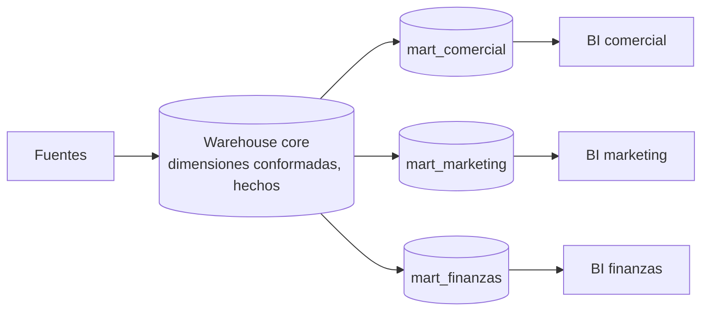

## 1. Resumen

Un data mart es la porción de datos que necesita un área o proceso de negocio (marketing, finanzas, operaciones), modelada para que la consulte con facilidad. Lo habitual es que dependa del warehouse: toma de ahí sus datos y sus dimensiones, y así las cifras de marketing cuadran con las de finanzas. En las plataformas cloud, un mart no exige copiar datos: puede ser un dataset con vistas autorizadas en BigQuery, un *datashare* en Redshift o un warehouse curado en Fabric.

## 2. Qué es

Es un concepto consolidado. AWS lo define como un almacenamiento con la información específica de una unidad de negocio: una parte pequeña y seleccionada de los datos del sistema mayor, a menudo resumida. Distingue tres tipos:

| Tipo | Alimentación | A favor | En contra |
|---|---|---|---|
| Dependiente | Del warehouse central | Datos ya integrados y gobernados | Hereda el punto único de falla del warehouse |
| Independiente | Directo de las fuentes | Rápido de montar | Difícil de gestionar; las cifras divergen entre marts |
| Híbrido | Warehouse y fuentes externas | Permite probar fuentes nuevas | Requiere catálogo y gobierno claros |

En la arquitectura de bus de Kimball, los marts por proceso de negocio comparten **dimensiones conformadas**, lo que permite combinarlos (*drill across*).

## 3. Problema que resuelve

Un warehouse corporativo tiene cientos de tablas; un área necesita unas pocas, con sus nombres y sus métricas. Darle acceso a todo es confuso y riesgoso: datos que no le corresponden y modelos difíciles de usar. Un mart expone justo lo necesario, con permisos acotados y un modelo pensado para esa área.

## 4. Cómo funciona

1. **Definir el área y sus preguntas:** qué procesos y métricas necesita.
2. **Tomar del warehouse** los hechos y las dimensiones conformadas relevantes (mart dependiente).
3. **Modelar para el área:** estrella, agregados, nombres de negocio.
4. **Publicar con permisos acotados:** el área accede al mart, no al warehouse completo.
   - En BigQuery, una **vista autorizada** deja consultar un subconjunto sin dar acceso al dataset de origen.
   - En Redshift, **data sharing** comparte datos vivos sin copiarlos.
5. **Mantener la consistencia:** las métricas comunes se definen una vez en el warehouse y el mart las reutiliza.

## 5. Cuándo utilizarlo

- Áreas con necesidades de análisis propias y recurrentes.
- Cuando hay que restringir qué datos ve cada área.
- Para simplificar el modelo que consume una herramienta de BI.
- Para compartir datos con otra cuenta, otro equipo o un socio sin dar acceso al warehouse.

## 6. Cuándo no utilizarlo

- Como atajo para evitar el warehouse (marts independientes por área): cada uno define "venta" a su manera y las cifras no cuadran.
- Para copiar tablas que el área podría consultar directamente con permisos adecuados.
- Para un análisis puntual: una vista o una consulta bastan.

## 7. Ejemplo sencillo

`mart_marketing` tiene tres objetos:

- `campanas` (dimensión);
- `conversiones_diarias` (hecho agregado por campaña y día);
- `clientes_segmento` (vista sin columnas de contacto).

Marketing consulta solo ese dataset. Las conversiones usan la misma `dim_fecha` y `dim_cliente` que el resto del warehouse.

## 8. Ejemplo de producción

Una empresa publica cuatro marts dependientes desde su warehouse en BigQuery: comercial, marketing, finanzas y operaciones. Cada uno es un dataset con:

- vistas autorizadas sobre `core` (los usuarios no tienen acceso a `core`);
- agregados materializados para los tableros;
- permisos por grupo.

Las dimensiones conformadas y las métricas oficiales viven en `core`. Para un socio externo, el mismo modelo se publica con vistas filtradas por fila.

## 9. Arquitectura



## 10. Código

```hcl
# Terraform: mart de marketing en BigQuery como vista autorizada sobre core.
# Requiere: provider hashicorp/google; el dataset core existente; el grupo con roles/bigquery.jobUser
# en el proyecto. core no debe gestionar sus accesos con bloques access en google_bigquery_dataset.
terraform {
  required_providers {
    google = {
      source  = "hashicorp/google"
      version = "~> 8.0"
    }
  }
}

variable "project_id" {
  type = string
}

resource "google_bigquery_dataset" "mart_marketing" {
  project    = var.project_id
  dataset_id = "mart_marketing"
  location   = "US"
}

# La vista expone solo las columnas que marketing necesita (sin datos de contacto).
resource "google_bigquery_table" "clientes_segmento" {
  project    = var.project_id
  dataset_id = google_bigquery_dataset.mart_marketing.dataset_id
  table_id   = "clientes_segmento"

  view {
    query          = "SELECT cliente_sk, segmento, region FROM `${var.project_id}.core.dim_cliente` WHERE is_current"
    use_legacy_sql = false
  }
}

# Autoriza la vista sobre core: los usuarios no necesitan acceso a core.
resource "google_bigquery_dataset_access" "autorizar_vista" {
  project    = var.project_id
  dataset_id = "core"

  view {
    project_id = google_bigquery_table.clientes_segmento.project
    dataset_id = google_bigquery_table.clientes_segmento.dataset_id
    table_id   = google_bigquery_table.clientes_segmento.table_id
  }
}

# Lectura de la vista para el grupo de marketing (aditivo: no quita a otros miembros).
resource "google_bigquery_table_iam_member" "marketing_lee_vista" {
  project    = var.project_id
  dataset_id = google_bigquery_table.clientes_segmento.dataset_id
  table_id   = google_bigquery_table.clientes_segmento.table_id
  role       = "roles/bigquery.dataViewer"
  member     = "group:marketing@example.com"
}
```

## 11. GCP

En **BigQuery**, un mart suele ser un dataset propio. Las **vistas autorizadas** permiten que el área consulte un subconjunto (columnas o filas) sin acceso al dataset de origen. Las alternativas, según la documentación, son políticas por fila o columna, tablas separadas o autorizar el dataset completo. Así el mart no duplica almacenamiento, salvo que se materialicen agregados.

## 12. AWS

En **Redshift**, **data sharing** comparte datos vivos entre clústeres, workgroups, cuentas y regiones sin moverlos ni copiarlos, y los consumidores ven siempre lo más reciente. Esto permite que el mart de un área sea un workgroup consumidor con su propio cómputo. A diferencia de las vistas autorizadas de BigQuery, separa también el cómputo de cada área.

## 13. Azure

Microsoft presenta los **data marts corporativos curados** como uno de los casos ideales de **Fabric Data Warehouse**, junto con los esquemas estrella y los modelos semánticos gobernados. Un mart puede ser un warehouse de Fabric propio del área, alimentado desde el warehouse o el lakehouse corporativo, sobre el mismo formato Delta.

## 14. Buenas prácticas

- Marts dependientes: alimentados del warehouse, con dimensiones conformadas y métricas definidas una vez.
- Publicar con vistas o datos compartidos en vez de copias, salvo agregados que convenga materializar.
- Nombres y descripciones en lenguaje del área.
- Un responsable por mart, que valida que responde las preguntas del área.
- **Seguridad:** el mart es una frontera de acceso: exponer solo las columnas y filas que el área necesita; preferir recursos IAM aditivos y no mezclar mecanismos que se pisan.
- **Observabilidad:** frescura del mart frente al warehouse, uso por objeto (para retirar lo que nadie consulta) y cuadratura de métricas comunes entre marts.
- **Costo:** las vistas no duplican almacenamiento, pero cada consulta paga su cómputo; materializar los agregados más consultados puede salir más barato.

## 15. Errores frecuentes

- Marts independientes por área, con métricas que no cuadran entre sí.
- Copiar tablas completas del warehouse en cada mart.
- Dar al área acceso al warehouse completo "para que no falte nada".
- Marts sin dueño que nadie actualiza ni retira.
- Mezclar en Terraform recursos de acceso autoritativos y no autoritativos sobre el mismo dataset.

## 16. Trade-offs

Los marts simplifican el consumo y acotan el acceso, a cambio de más objetos que mantener. Los dependientes dan consistencia a costa de depender del warehouse. Los independientes dan velocidad a costa de divergencia. Publicar con vistas evita copias pero paga cómputo en cada consulta, y materializar acelera a cambio de almacenamiento y de una carga más que mantener.

## 17. Conceptos relacionados

- `data-warehouse`: la fuente de un mart dependiente.
- `star-schema` y `dimension-tables`: el modelo y las dimensiones conformadas.
- `data-lake`: otra posible fuente.

## 18. Preguntas técnicas abiertas

1. ¿Cómo evitarías que dos marts calculen distinto la misma métrica?
2. ¿Cuándo materializarías un mart en lugar de exponerlo con vistas?
3. ¿Qué cambiarías si un socio externo necesita acceso a un mart?

## 19. Laboratorio relacionado

Pendiente (F4).

## 20. Fuentes

- AWS: *What is a Data Mart?* y *Data sharing in Amazon Redshift*.
- Kimball Group: *Enterprise Data Warehouse Bus Architecture* (referencia conceptual, Nivel 4).
- Microsoft Learn: *What is Fabric Data Warehouse?*
- Google Cloud: *Authorized views* (BigQuery).
- HashiCorp: documentación de `google_bigquery_dataset_access` y `google_bigquery_table_iam` (repositorio oficial del provider).

El detalle de cada fuente está en `sources` del frontmatter.

## 21. Fecha de última verificación

2026-10-06. Pasa a `verified`: revisión B-F3.1 del lote F3b-01a aplicada, sin VERIFY pendientes.

## 22. Historial de cambios importantes

- 2026-10-05: creación (lote F3b-01a, dominio 01-fundamentals).
- 2026-10-06: `verification_status: verified` (revisión B-F3.1 del lote F3b-01a aplicada; sin VERIFY pendientes).
