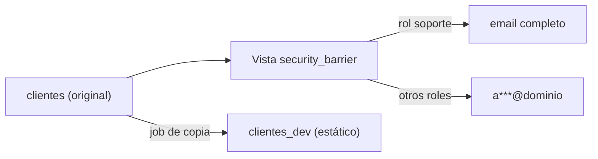

## 1. Resumen

**Enmascarar** es mostrar una versión parcial o sustituida de un dato sensible (`a***@example.com`). Hay dos formas, que no son lo mismo:

- **dinámico:** el dato original no cambia; la máscara se aplica **al consultar**, según quién consulta. Soporte ve el email completo, el analista ve la máscara.
- **estático:** se crea una **copia** con los valores ya reemplazados (por ejemplo, para desarrollo o pruebas). En la copia el original no está.

Una advertencia que dan las propias páginas: el enmascaramiento dinámico limita la exposición, pero no impide que alguien con acceso a la base reconstruya partes del dato con consultas exhaustivas (*Dynamic data masking*, Azure SQL). Se usa junto con otros controles.

## 2. Qué es

| | Dinámico | Estático |
|---|---|---|
| Dónde está la máscara | En la consulta (vista, política) | En los datos de la copia |
| El original | Sigue en la tabla | No está en la copia |
| Para | Usuarios de producción con distintos niveles | Desarrollo, pruebas, terceros |

## 3. Problema que resuelve

El equipo de desarrollo trabaja con una copia de producción y ve correos reales; los analistas necesitan saber el dominio de los correos, no la dirección completa. Con una copia estática enmascarada, desarrollo no tiene los datos reales; con una vista dinámica, los analistas ven la máscara y soporte, el dato.

## 4. Cómo funciona

Dinámico en PostgreSQL:

1. Nadie lee la tabla base; todos leen una **vista**.
2. La vista lleva `security_barrier`: sin ese flag, una vista no oculta de forma confiable lo que no muestra (*39.5. Rules and Privileges*).
3. Un `CASE` muestra el original solo a quien es miembro del rol autorizado.

Estático:

1. Se crea la copia con los valores sensibles reemplazados (constantes, formatos falsos o seudónimos).
2. La copia no tiene el original; se puede entregar a quien no debe verlo.

## 5. Cuándo utilizarlo

- Dinámico: cuando distintos roles necesitan distintos niveles de detalle del mismo dato.
- Estático: para entornos de desarrollo y pruebas, o entregas a terceros.

## 6. Cuándo no utilizarlo

- Dinámico como única protección contra quien tiene acceso directo a la base.
- Estático cuando los valores enmascarados se pueden reconstruir (por ejemplo, un hash simple de un identificador).

## 7. Ejemplo sencillo

| Quién | Ve |
|---|---|
| soporte (dinámico) | `ana.perez@example.com`, `luis@example.org` |
| analista (dinámico) | `a***@example.com`, `l***@example.org` |
| copia de desarrollo (estático) | `cliente1@ejemplo.invalid`, `cliente2@ejemplo.invalid` |
| tabla original | sin cambios |

## 8. Ejemplo de producción

- Vistas con máscara dinámica para las tablas de consumo con datos personales; sin acceso directo a la tabla base.
- La copia de desarrollo se genera cada semana con valores reemplazados; el job de copia es el único que lee producción.
- La clasificación del catálogo decide qué columnas se enmascaran y cómo.
- Pruebas que verifican que la copia no contiene valores reales.

## 9. Arquitectura



## 10. Código

```python
# Python 3.12 y psycopg contra PostgreSQL 17 (ejecutado en la CI con el servicio postgres:17): enmascaramiento.
# Dinámico: una vista security_barrier muestra el email completo solo a quien tiene el rol soporte; los demás ven una
# máscara, y el dato original no cambia. Estático: una copia para desarrollo con los valores ya reemplazados.
# PG_HOST, PG_PORT, PG_USER, PG_PASSWORD y PG_DB: base vacía temporal; los roles llevan sufijo y se borran.
import os

import psycopg

S = os.environ["PG_DB"]
SOPORTE, ANALISTA = f"soporte_{S}", f"analista_{S}"

with psycopg.connect(host=os.environ["PG_HOST"], port=os.environ["PG_PORT"], user=os.environ["PG_USER"],
                     password=os.environ["PG_PASSWORD"], dbname=S, autocommit=True) as conn:
    try:
        conn.execute("CREATE TABLE clientes (id int, email text)")
        conn.execute("INSERT INTO clientes VALUES (1, 'ana.perez@example.com'), (2, 'luis@example.org')")
        for r in (SOPORTE, ANALISTA):
            conn.execute(f"CREATE ROLE {r}")
        conn.execute("CREATE VIEW clientes_v WITH (security_barrier) AS SELECT id, "
                     f"CASE WHEN pg_has_role(current_user, '{SOPORTE}', 'MEMBER') THEN email "
                     "ELSE left(email, 1) || '***@' || split_part(email, '@', 2) END AS email FROM clientes")
        for r in (SOPORTE, ANALISTA):
            conn.execute(f"GRANT SELECT ON clientes_v TO {r}")   # nadie lee la tabla base, solo la vista

        def ve(rol: str) -> list[str]:
            conn.execute(f"SET ROLE {rol}")
            try:
                return [e for (e,) in conn.execute("SELECT email FROM clientes_v ORDER BY id").fetchall()]
            finally:
                conn.execute("RESET ROLE")

        print("dinámico, soporte ve:", ve(SOPORTE))
        print("dinámico, analista ve:", ve(ANALISTA))
        conn.execute("CREATE TABLE clientes_dev AS SELECT id, 'cliente' || id || '@ejemplo.invalid' AS email FROM clientes")
        print("estático, copia de desarrollo:", [e for (e,) in conn.execute("SELECT email FROM clientes_dev ORDER BY id")])
        print("el original no cambió:", [e for (e,) in conn.execute("SELECT email FROM clientes ORDER BY id")])
    finally:
        conn.execute("DROP VIEW IF EXISTS clientes_v")
        conn.execute("DROP TABLE IF EXISTS clientes, clientes_dev")
        for r in (SOPORTE, ANALISTA):
            conn.execute(f"DROP ROLE IF EXISTS {r}")
```

El script se **ejecuta en la CI contra el servicio postgres:17** y pasa `mypy --strict`. Imprime lo que ve soporte (el original), lo que ve el analista (`a***@example.com`, `l***@example.org`), la copia de desarrollo y que el original no cambió.

## 11. GCP

En GCP, **data masking** de BigQuery. Según *39.5. Rules and Privileges* e *Introduction to data masking* (no ejecutado):

| | Vista con máscara (PostgreSQL) | BigQuery |
|---|---|---|
| Base | Una vista `security_barrier` | Sobre el control de acceso por columna (policy tags) |
| Niveles | Original o máscara | Un rango por grupo, de completo a ninguno (por ejemplo, contabilidad completo, analistas enmascarado, ventas sin acceso) |

## 12. AWS

En AWS, **dynamic data masking** de Amazon Redshift. Según *39.5. Rules and Privileges* y *Dynamic data masking* (Redshift) (no ejecutado):

| | Vista con máscara (PostgreSQL) | Redshift |
|---|---|---|
| Objeto | Una vista | Masking policies adjuntas a la tabla, por columna |
| A quién | Según la membresía de rol | A usuarios o roles indicados |
| Qué hacen | Ocultar parte | Ocultar, ofuscar o seudonimizar, sin cambiar los datos de base |

## 13. Azure

En Azure, **dynamic data masking** de Azure SQL. Según *39.5. Rules and Privileges* y *Dynamic data masking* (Azure SQL) (no ejecutado):

| | Vista con máscara (PostgreSQL) | Azure SQL |
|---|---|---|
| Ver sin máscara | Ser miembro del rol | El permiso `UNMASK`; los administradores con `CONTROL` siempre |
| Límite | Quien lee la tabla base ve todo | La página: no impide consultas exhaustivas de usuarios de la base que expongan partes del dato |

## 14. Buenas prácticas

- Dinámico: nadie lee la tabla base, solo la vista; `security_barrier` en PostgreSQL.
- Estático: valores que no se puedan revertir; probar que la copia no tiene datos reales.
- Combinar con control de acceso, auditoría y cifrado.
- **Seguridad:** la máscara no es cifrado; quien tiene el original o acceso directo lo ve.
- **Observabilidad:** registrar quién ve sin máscara.
- **Costo:** la copia estática ocupa espacio y hay que refrescarla; la máscara dinámica cuesta cómputo por consulta.

## 15. Errores frecuentes

- Vistas sin `security_barrier`.
- Dar acceso a la tabla base «por si acaso».
- Copias estáticas con valores reversibles.
- Tratar la máscara dinámica como si impidiera toda inferencia.

## 16. Trade-offs

Dinámico mantiene una sola copia y depende de que nadie lea la tabla base. Estático protege la copia por completo y hay que regenerarla. Máscaras más parciales son más útiles para el negocio y revelan más.

## 17. Conceptos relacionados

- `column-level-security`: negar en lugar de enmascarar.
- `data-classification`: qué enmascarar.
- `bigquery-policy-tags`: BigQuery.
- `row-level-security`: filas.

## 18. Preguntas técnicas abiertas

1. ¿Tu entorno de desarrollo tiene datos reales?
2. ¿Quién puede leer la tabla base debajo de tus vistas?
3. ¿Tus máscaras se pueden revertir?

## 19. Laboratorio relacionado

Pendiente (F4).

## 20. Fuentes

- PostgreSQL 17: *39.5. Rules and Privileges*.
- Google Cloud: *Introduction to data masking*.
- AWS: *Dynamic data masking* (Amazon Redshift).
- Microsoft Learn: *Dynamic data masking* (Azure SQL).

El detalle de cada fuente está en `sources` del frontmatter.

## 21. Fecha de última verificación

2026-10-21. `review_required`: pendiente de revisión B-F3.1 del lote F3b-18a.

## 22. Historial de cambios importantes

- 2026-10-21: creación (lote F3b-18a).
