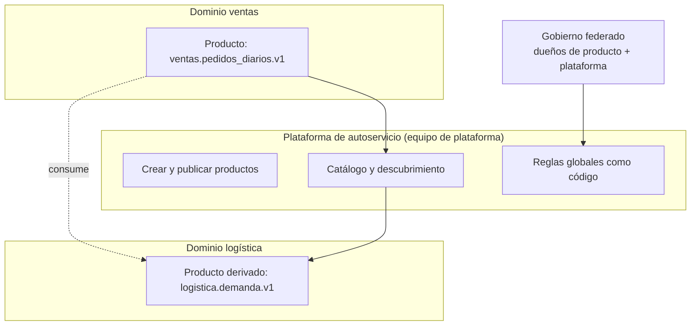

## 1. Resumen

**Data mesh** es un enfoque **sociotécnico**: cambia quién es dueño de los datos analíticos y cómo se organizan los equipos, no solo la tecnología. Zhamak Dehghani, que lo propuso, lo funda en cuatro principios:

1. **Propiedad por dominio:** cada dominio de negocio (ventas, finanzas, logística) es dueño de sus datos analíticos.
2. **El dato como producto:** cada dominio publica sus datos como productos para otros, con un responsable y estándares de calidad.
3. **Plataforma de autoservicio:** un equipo de plataforma da la infraestructura para que los dominios construyan productos sin ser especialistas.
4. **Gobierno computacional federado:** reglas globales, decididas entre dominios y plataforma, que la plataforma aplica automáticamente.

**No es un producto que se compra.** Google Cloud, AWS y Microsoft Fabric ofrecen piezas que ayudan a implementarlo, y cada página las describe a su manera. AWS Prescriptive Guidance recomienda evaluar antes si otra arquitectura, como un data lake centralizado, encaja mejor.

## 2. Qué es

- **Dominio:** una unidad de negocio o función de la empresa. Data mesh sigue esas costuras organizacionales como eje para repartir datos y responsabilidades.
- **Producto de datos:** lo que un dominio publica para otros. Para Dehghani es el *quantum* arquitectónico: junta código, datos e infraestructura en el contexto de un dominio. Ver `data-products`.
- **Plataforma de autoservicio:**
  - capacidades comunes sin lógica de negocio: almacenamiento, esquemas, versionado, control de acceso, logging, linaje;
  - la opera un equipo de plataforma.
- **Gobierno federado y computacional:**
  - lo decide una federación de dueños de productos de los dominios y de la plataforma;
  - las reglas globales (direcciones, metadatos comunes, acceso, datos personales) se aplican como código;
  - lo demás lo decide cada dominio.
- **Funciones que describe Google Cloud:**
  - equipos productores de dominio;
  - equipos consumidores de dominio;
  - un equipo central de gobierno;
  - un equipo central de plataforma;
  - opcionalmente, un centro de excelencia.

## 3. Problema que resuelve

Dehghani describe los modos de falla de una plataforma de datos central y monolítica:

- un solo equipo de especialistas recibe datos de todos los dominios sin conocerlos;
- los pipelines quedan acoplados, y cada cambio en una fuente rompe algo lejos de ella;
- el equipo central se vuelve cuello de botella a medida que crecen las fuentes y los usos.

Data mesh pone la responsabilidad en quienes conocen los datos, y evita que eso termine en silos incompatibles con una plataforma común y reglas globales.

## 4. Cómo funciona

1. Se identifican los dominios a partir de la organización del negocio.
2. Cada dominio forma o asigna un equipo con un **dueño de producto de datos** y data engineers.
3. El equipo de plataforma ofrece autoservicio: crear un producto, publicarlo en el catálogo, dar acceso, observarlo.
4. La federación define reglas globales: convención de direcciones, metadatos obligatorios, clasificación de datos personales, control de acceso. La plataforma las verifica al publicar.
5. Los dominios publican productos con interfaces de consumo (una tabla, una vista, un stream) y un contrato.
6. Los consumidores, que suelen ser otros dominios, descubren los productos en el catálogo y piden acceso. Muchos dominios son a la vez productores y consumidores.

## 5. Cuándo utilizarlo

- Organizaciones grandes, con muchos dominios y fuentes, donde el equipo central de datos ya es un cuello de botella.
- Cuando los dominios tienen, o pueden tener, capacidad técnica para ser dueños de sus datos.
- Cuando hay patrocinio ejecutivo para cambiar responsabilidades: AWS incluye patrocinar la estrategia entre las responsabilidades del liderazgo ejecutivo.

## 6. Cuándo no utilizarlo

- En organizaciones pequeñas o con pocos dominios: el costo organizacional supera el beneficio, y un warehouse o lake central bien operado alcanza.
- Si los dominios no van a asumir la propiedad de sus datos: renombrar tablas como «productos» no cambia nada.
- Como sinónimo de «comprar un catálogo» o «activar dominios» en una herramienta: eso es una pieza, no el enfoque.
- Sin una plataforma de autoservicio: cada dominio reinventaría la infraestructura.

## 7. Ejemplo sencillo

Ventas publica `ventas.pedidos_diarios.v1` con responsable, descripción y columnas declaradas. Al publicarlo, la plataforma verifica las reglas globales: la dirección sigue `<dominio>.<nombre>.v<versión>`, hay responsable, hay descripción y las columnas con datos personales están declaradas.

Clientes intenta publicar `crm_clientes` sin responsable y con una columna `email` no declarada. La plataforma lo rechaza y dice por qué. La regla es global, pero cada dominio decide qué productos publica y cómo los construye.

## 8. Ejemplo de producción

Una empresa con diez unidades de negocio adopta data mesh por etapas:

1. Empieza con tres dominios (ventas, logística y finanzas) y un equipo de plataforma.
2. La plataforma ofrece plantillas para crear un producto (proyecto, dataset, permisos, publicación en el catálogo) y un pipeline que verifica las reglas globales.
3. Un comité federado, con los dueños de producto y la plataforma, decide la convención de direcciones, los metadatos obligatorios y cómo se clasifican los datos personales.
4. Logística consume `ventas.pedidos_diarios.v1` para su planificación y publica a su vez un producto derivado.

Después de un año, el equipo central dejó de recibir pedidos de «una tabla nueva». A cambio, opera la plataforma y el gobierno.

## 9. Arquitectura



## 10. Código

```python
# Python 3.12, solo biblioteca estándar (ejecutado; mypy --strict sin errores): gobierno federado "computacional".
# Las reglas globales se escriben como código y la plataforma las aplica a todos los productos de datos al publicarlos;
# cada dominio decide el resto. El descriptor es ilustrativo, no un formato estándar ni el de un producto de la nube.
import re
from collections.abc import Callable
from dataclasses import dataclass, field


@dataclass(frozen=True)
class ProductoDeDatos:
    direccion: str                      # dirección única según una convención global
    dominio: str
    responsable: str                    # data product owner
    columnas: dict[str, str]            # columna -> tipo
    pii: set[str] = field(default_factory=set)   # columnas con datos personales, declaradas por el dominio
    descripcion: str = ""


Regla = Callable[[ProductoDeDatos], str | None]   # devuelve el problema, o None si cumple


def direccion_global(p: ProductoDeDatos) -> str | None:
    if not re.fullmatch(rf"{p.dominio}\.[a-z_]+\.v[0-9]+", p.direccion):
        return f"la dirección {p.direccion!r} no sigue <dominio>.<nombre>.v<versión>"
    return None


def tiene_responsable(p: ProductoDeDatos) -> str | None:
    return None if p.responsable else "sin responsable"


def se_describe(p: ProductoDeDatos) -> str | None:
    return None if len(p.descripcion) >= 20 else "sin descripción para que otros lo encuentren y entiendan"


def pii_declarada(p: ProductoDeDatos) -> str | None:
    sospechosas = {c for c in p.columnas if c in {"email", "telefono", "rut", "direccion_postal"}}
    faltan = sospechosas - p.pii
    return f"columnas con posibles datos personales sin declarar: {sorted(faltan)}" if faltan else None


REGLAS_GLOBALES: list[Regla] = [direccion_global, tiene_responsable, se_describe, pii_declarada]


def publicar(p: ProductoDeDatos) -> list[str]:
    return [problema for regla in REGLAS_GLOBALES if (problema := regla(p)) is not None]


ventas = ProductoDeDatos("ventas.pedidos_diarios.v1", "ventas", "equipo-ventas@empresa",
                         {"fecha": "DATE", "pedidos": "INT64", "monto": "NUMERIC"},
                         descripcion="Pedidos y monto por día, cerrados a las 02:00.")
clientes = ProductoDeDatos("crm_clientes", "clientes", "", {"cliente_id": "STRING", "email": "STRING"})
print(publicar(ventas))      # []
print(publicar(clientes))
# ["la dirección 'crm_clientes' no sigue <dominio>.<nombre>.v<versión>", 'sin responsable', 'sin descripción para que otros lo encuentren y entiendan', "columnas con posibles datos personales sin declarar: ['email']"]
```

Este script en Python 3.12, solo con biblioteca estándar, está ejecutado y pasa `mypy --strict` sin errores. Muestra la idea de gobierno **computacional**: las reglas globales son funciones que la plataforma aplica a cada producto al publicarlo. El descriptor y las reglas son ilustrativos: no son un formato estándar ni el de un servicio de la nube.

## 11. GCP

**Google Cloud** describe en su Architecture Center un data mesh como un marco arquitectónico y organizacional. Según esa página:

- servicios centrales administran los productos, las políticas, el acceso (grupos de IAM) y el catálogo;
- los dominios exponen productos como tablas, vistas, archivos, temas o streams (en BigQuery, un dataset);
- hay cuatro funciones: productores, consumidores, gobierno central y plataforma central.

Esa página es de 2024 y menciona Data Catalog. La función de productos de datos vive hoy en **Knowledge Catalog**, que desde el 10 de abril de 2026 es el nombre de Dataplex Universal Catalog, según su página; la API, la CLI y los roles de IAM conservan sus nombres. Ver `data-products`.

## 12. AWS

**AWS Prescriptive Guidance** lo trata como un enfoque arquitectónico y organizacional con los mismos cuatro principios. Antes de adoptarlo, pide evaluar si encaja mejor un data lake centralizado o una arquitectura multicuenta hub-and-spoke. Organiza los equipos en liderazgo ejecutivo, dominios, plataforma de autoservicio y equipos habilitadores, y cita la ley de Conway.

Para implementarlo, describe tres opciones que usan sus clientes:

- **Amazon DataZone:** catálogo de negocio y flujo de acceso con aprobación;
- **data.all:** un framework open source;
- **AWS Lake Formation**.

## 13. Azure

**Microsoft Fabric** define data mesh como una arquitectura descentralizada que organiza los datos por dominios de negocio. Según su página de dominios, Fabric hoy soporta principalmente:

- agrupar workspaces en dominios y subdominios;
- filtrar por dominio en el OneLake catalog;
- delegar a nivel de dominio algunas configuraciones del tenant (gobierno federado).

La asignación de dominio no cambia quién ve o accede a los datos: eso depende de los roles de workspace y de los permisos de cada ítem.

## 14. Buenas prácticas

- Empezar con pocos dominios con capacidad y un caso de negocio claro, y ampliar después.
- Plataforma antes que dominios: sin autoservicio, cada dominio reinventa la infraestructura.
- Pocas reglas globales, escritas como código y verificadas al publicar; el resto, decisión de cada dominio.
- Un dueño de producto con objetivos medibles por producto (calidad, tiempo hasta el consumo, satisfacción de los consumidores, como plantea Dehghani).
- Evaluar alternativas centralizadas antes de adoptarlo, como recomienda AWS.
- **Seguridad:** el control de acceso se aplica por producto, con políticas definidas de forma central y aplicadas al acceder; los datos personales se clasifican con una regla global, no a criterio de cada dominio.
- **Observabilidad:** la plataforma mide por producto su frescura, su calidad y su uso; un producto sin consumidores o desactualizado es una señal para el dueño.
- **Costo:** data mesh agrega costo organizacional (equipos de dominio, plataforma, gobierno); conviene asignar el costo de infraestructura por dominio o producto para que cada dueño lo vea.

## 15. Errores frecuentes

- Presentar data mesh como una herramienta o un servicio que se activa.
- Descentralizar sin plataforma ni reglas globales, y terminar con silos incompatibles.
- Llamar «producto de datos» a cualquier tabla, sin dueño, contrato ni descripción.
- Imponerlo en una organización pequeña donde un equipo central funcionaba bien.
- Suponer que asignar workspaces a dominios en Fabric cambia el acceso a los datos.

## 16. Trade-offs

Data mesh escala la responsabilidad y quita el cuello de botella central. A cambio:

- exige equipos de dominio con capacidad de datos, una plataforma de autoservicio y un gobierno que funcione;
- mueve complejidad de la tecnología a la organización;
- equilibrar lo central y lo local es, como dice Dehghani, el trabajo difícil del gobierno federado.

Un warehouse o lake central es más simple de operar y gobernar, y suficiente para muchas organizaciones.

## 17. Conceptos relacionados

- `data-products`: la unidad que publica cada dominio.
- `data-contracts`: lo que un producto promete a sus consumidores.
- `data-lake` y `data-warehouse`: las arquitecturas centralizadas frente a las que se plantea.
- Del blueprint, pendiente de ficha: `data-platform-engineering`.

## 18. Preguntas técnicas abiertas

1. ¿Qué dominios de tu organización podrían ser dueños de sus datos hoy, y cuáles no?
2. ¿Qué tres reglas globales pondrías como código antes que cualquier otra?
3. ¿Qué parte del trabajo de tu equipo central desaparecería con data mesh, y qué parte nueva aparecería?

## 19. Laboratorio relacionado

Pendiente (F4).

## 20. Fuentes

- Zhamak Dehghani (martinfowler.com): *Data Mesh Principles and Logical Architecture* (2020) y *How to Move Beyond a Monolithic Data Lake to a Distributed Data Mesh* (2019), como referencia conceptual (Nivel 4).
- Google Cloud: *Architecture and functions in a data mesh* (Architecture Center) y *About data products* (Knowledge Catalog).
- AWS Prescriptive Guidance: *Strategies for building a data mesh-based enterprise solution on AWS* y *AWS offerings for data mesh*.
- Microsoft Learn: *Fabric domains*.

El detalle de cada fuente está en `sources` del frontmatter.

## 21. Fecha de última verificación

2026-10-11. `review_required`: pendiente de revisión B-F3.1 del lote F3b-07a.

## 22. Historial de cambios importantes

- 2026-10-11: creación (lote F3b-07a).
