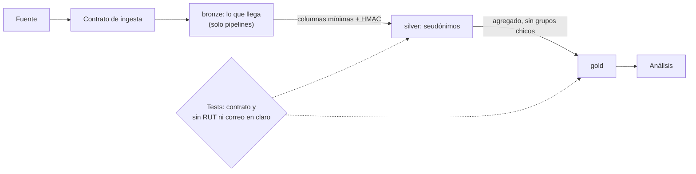

## 1. Resumen

Esta ficha no es asesoría legal: cubre cómo se aplica técnicamente la minimización en una arquitectura por capas. La finalidad, la base y los plazos los definen y aprueban las áreas responsables.

**Cómo leerla.** *Comprender* (§1–6): las cuatro dimensiones de la minimización y en qué se distingue de enmascarar, seudonimizar y anonimizar. *Aplicar* (§7–13): qué columnas, detalle y accesos tiene cada capa y cómo se comprueba. *Demostrar*: la evidencia del §8, el test del §10 y los criterios del §18.

La minimización evita que una plataforma recoja, replique o exponga datos personales que una actividad no necesita. No es una regla universal del tipo «bronze completo, silver seudonimizado, gold anónimo»: cada zona responde a una **finalidad concreta**, con columnas, detalle, plazo y accesos justificados. En el ejemplo de esta ficha, **cada capa tiene menos datos personales que la anterior**:

- **bronze:** lo que llega, con acceso solo para las cuentas de los pipelines;
- **silver:** el identificador reemplazado por un HMAC y solo las columnas que se usan;
- **gold:** agregados, sin grupos tan chicos que identifiquen;
- **análisis:** lee solo gold.

**Pregunta guía:** ¿se puede entregar el mismo resultado de negocio con menos datos, menos detalle, menos tiempo o menos accesos?

## 2. Qué es

- **[Obligación legal · art. 3]** Proporcionalidad: los datos deben limitarse a los necesarios, adecuados y pertinentes para el fin, y conservarse solo el tiempo necesario.
- **[Obligación legal · art. 14 quáter]** Por defecto, solo se tratan los datos específicos y estrictamente necesarios, considerando cuántos datos, la extensión del tratamiento, el plazo y la accesibilidad.
- **[Buena práctica]** En ingeniería eso se traduce en cuatro dimensiones:

| Dimensión | Qué se limita | Técnica típica | Etiqueta |
|---|---|---|---|
| Cantidad | Atributos y registros | Proyección de columnas, filtros | **[Buena práctica]** |
| Granularidad | Dato individual frente a tramo o agregado | Generalización, agregación | **[Buena práctica]** |
| Tiempo | Plazo de conservación | Expiración de particiones, purga | **[Buena práctica]** |
| Accesibilidad | Personas, servicios y destinos | Permisos por capa y por columna | **[Buena práctica]** |

- **[Buena práctica]** **No es lo mismo que:** enmascarar (oculta una representación al mostrar; el dato sigue en la tabla), seudonimizar (sustituye el identificador; sigue siendo dato personal) ni anonimizar (exige evaluar que la persona no sea identificable por medios razonables).
- **[Decisión de arquitectura]** La minimización se implementa como una propiedad de cada capa, comprobable con un test y con un contrato de columnas versionado.

## 3. Problema que resuelve

**[Buena práctica]** Un dashboard de ventas por comuna necesita cantidad de clientes y montos agregados. El pipeline copia `bronze.clientes` completa a silver y a gold «por si acaso», y cada analista con acceso a gold ve RUT, nombre y correo de todos los clientes, que el indicador no necesita. Cada copia multiplica accesos, costo de gobierno y superficie de exposición.

## 4. Cómo funciona

1. **[Buena práctica]** **Definir el producto y su finalidad:** qué decisión o proceso habilita y quién aprobó sus necesidades (`processing-activities-inventory`).
2. **[Decisión de arquitectura]** **Contrato de entrada:** lista explícita de campos con su justificación; un campo nuevo no aprobado se rechaza o se aísla.
3. **[Decisión de arquitectura]** **Bronze** recibe los datos tal como llegan, con retención y acceso restringidos; solo las cuentas de servicio lo leen. Bronze no es una excepción permanente a la minimización.
4. **[Obligación legal · art. 3]** Silver extrae solo las columnas necesarias para el fin (letra c)). **[Decisión de arquitectura]** El RUT pasa a un HMAC con clave, la edad a un tramo, y el nombre y el correo no pasan.
5. **[Decisión de arquitectura]** Gold agrega por comuna y suprime los grupos de menos de 2 clientes. El umbral es una decisión interna: la ley no fija un mínimo de personas por grupo, y un umbral solo no garantiza anonimato.
6. **[Buena práctica]** El rol de análisis tiene permiso solo sobre gold; se prueba con la identidad del consumidor, no solo leyendo la configuración.
7. **[Buena práctica]** Un test recorre silver y gold y falla si encuentra un RUT o un correo en claro; otro compara el esquema real con el contrato de columnas de cada capa.

## 5. Cuándo utilizarlo

- En toda arquitectura por capas con datos personales.
- Al diseñar una ingesta, una migración o un producto analítico nuevo, o al incorporar una fuente externa.
- Al crear una tabla o agregar una columna: decidir en qué capa puede estar cada columna personal.
- Al cambiar la finalidad o sumar un consumidor.

## 6. Cuándo no utilizarlo

- Como sustituto del control de acceso: bronze sigue teniendo los datos y necesita sus propios controles.
- Si un proceso necesita de verdad el dato en claro (por ejemplo, el despacho): ese proceso lee de una zona controlada, no de gold.
- Como regla para borrar automáticamente datos que exigen una obligación legal, una auditoría o la defensa de un derecho: el plazo lo decide la actividad (`retention-and-erasure`).

## 7. Ejemplo sencillo

| Capa | Columnas | RUT o correo en claro | Decisión |
|---|---|---|---|
| bronze | `rut`, `nombre`, `email`, `comuna`, `edad`, `monto` | 10 valores | Lo que llega, con acceso solo para pipelines y retención corta |
| silver | `cliente_key`, `comuna`, `tramo_edad`, `monto` | 0 | Sin nombre ni correo; RUT como HMAC; edad en tramos |
| gold | `comuna`, `clientes`, `monto_total` | 0 | Agregado por comuna, sin grupos de un cliente |

Temuco tiene un solo cliente y no aparece en gold. El analista lee gold y no lee bronze. **Ojo:** un agregado con pocos registros o una combinación singular todavía puede permitir inferencias; `HAVING count(*) >= 2` no basta para declarar anonimato (`k-anonymity`).

## 8. Ejemplo de producción

Escenario genérico: una aerolínea ingesta reservas a BigQuery; el producto analítico solo necesita rutas, mes y volumen de reservas.

- **Contrato:** lista de campos aprobados; un cambio de esquema pasa por revisión.
- **Bronze restringido** en un proyecto o cuenta aparte: solo lo necesario para conciliar y reprocesar, con retención corta.
- **Silver:** normaliza ruta y mes, reemplaza el identificador por un HMAC con la clave en un KMS y no guarda los datos de contacto.
- **Gold:** métricas agregadas, umbral mínimo por grupo y vistas por finalidad.
- **Operación:** el test de «sin identificadores en claro» y la comparación con el contrato corren en la CI y en un escaneo periódico.

### Evidencia de cumplimiento

| Evidencia | Dónde queda | Quién la produce | Qué demuestra | Qué no demuestra |
|---|---|---|---|---|
| Contrato de columnas por capa, versionado | Repositorio o catálogo | Equipo de datos y dueño del producto | Qué columnas se aprobaron y para qué | Que la finalidad sea legítima |
| Comparación del esquema real con el contrato | Log de la CI | CI | Que no hay columnas fuera del contrato | Que una columna aprobada no traiga datos indebidos en texto libre |
| Resultado del test «sin RUT ni correo en claro fuera de bronze» | Log de la CI | CI | Que no hay esos patrones en silver y gold | Que no haya identificadores indirectos |
| Permisos efectivos del rol de análisis | Política de acceso versionada y prueba con la identidad | Plataforma | Que el análisis no lee bronze | Que nadie más tenga acceso |

## 9. Arquitectura



Las capas son un patrón de arquitectura, no categorías legales. Transversalmente van el catálogo, la actividad de tratamiento, las políticas de acceso, la retención y la evidencia.

## 10. Código

```python
# Python 3.12 y psycopg contra PostgreSQL 17 (ejecutado en la CI con el servicio postgres:17): minimización por
# capa. Bronze guarda lo que llega; silver reemplaza el RUT por un HMAC y deja solo lo necesario; gold agrega y
# suprime los grupos chicos. El analista lee solo gold. Un contrato de columnas por capa detecta un campo nuevo no
# aprobado. PG_HOST, PG_PORT, PG_USER, PG_PASSWORD y PG_DB: base vacía temporal; el rol lleva sufijo y se borra al
# terminar.
import hashlib
import hmac
import os
import re
import secrets

import psycopg
from psycopg import errors

S = os.environ["PG_DB"]
ANALISTA = f"analista_{S}"
CLAVE = secrets.token_bytes(32)  # en producción, en un KMS o gestor de secretos
EN_CLARO = re.compile(r"\d{1,2}\.?\d{3}\.?\d{3}-[\dK]|[^@\s]+@[^@\s]+\.[a-z]{2,}", re.I)  # RUT o correo
CONTRATO = {"silver": {"cliente_key", "comuna", "tramo_edad", "monto"},  # columnas aprobadas por capa (versionado)
            "gold": {"comuna", "clientes", "monto_total"}}

# Valores ficticios: RUT de dígitos repetidos y correos en dominios reservados.
CLIENTES = [("11.111.111-1", "Ana", "ana@example.com", "Ñuñoa", 34, 120), ("22.222.222-2", "Luis", "luis@example.org", "Ñuñoa", 41, 80),
            ("33.333.333-3", "Bea", "bea@example.net", "Maipú", 29, 45), ("44.444.444-4", "Ciro", "ciro@example.com", "Maipú", 52, 60),
            ("55.555.555-5", "Dani", "dani@example.org", "Temuco", 38, 90)]


def clave_cliente(rut: str) -> str:
    return hmac.new(CLAVE, rut.encode(), hashlib.sha256).hexdigest()[:16]


with psycopg.connect(host=os.environ["PG_HOST"], port=os.environ["PG_PORT"], user=os.environ["PG_USER"],
                     password=os.environ["PG_PASSWORD"], dbname=S, autocommit=True) as conn:
    try:
        for capa in ("bronze", "silver", "gold"):
            conn.execute(f"CREATE SCHEMA {capa}")
        conn.execute("CREATE TABLE bronze.clientes (rut text, nombre text, email text, comuna text, edad int, monto int)")
        conn.cursor().executemany("INSERT INTO bronze.clientes VALUES (%s, %s, %s, %s, %s, %s)", CLIENTES)
        conn.execute("CREATE TABLE silver.clientes (cliente_key text, comuna text, tramo_edad text, monto int)")
        filas = conn.execute("SELECT rut, comuna, edad, monto FROM bronze.clientes").fetchall()  # solo lo necesario
        conn.cursor().executemany("INSERT INTO silver.clientes VALUES (%s, %s, %s, %s)",
                                  [(clave_cliente(r), c, f"{e // 10 * 10}-{e // 10 * 10 + 9}", m) for r, c, e, m in filas])
        conn.execute("CREATE TABLE gold.ventas_por_comuna AS SELECT comuna, count(*) AS clientes, sum(monto) AS monto_total "
                     "FROM silver.clientes GROUP BY comuna HAVING count(*) >= 2")  # sin grupos de un cliente
        conn.execute(f"CREATE ROLE {ANALISTA}")
        conn.execute(f"GRANT USAGE ON SCHEMA gold TO {ANALISTA}")
        conn.execute(f"GRANT SELECT ON ALL TABLES IN SCHEMA gold TO {ANALISTA}")

        def columnas(capa: str) -> list[str]:
            return [c for (c,) in conn.execute("SELECT column_name FROM information_schema.columns WHERE table_schema = %s "
                                               "ORDER BY ordinal_position", (capa,)).fetchall()]

        def en_claro(capa: str) -> int:
            tabla = conn.execute("SELECT table_name FROM information_schema.tables WHERE table_schema = %s", (capa,)).fetchone()
            assert tabla is not None
            filas = conn.execute(f"SELECT * FROM {capa}.{tabla[0]}").fetchall()
            return sum(1 for fila in filas for valor in fila if EN_CLARO.fullmatch(str(valor)))

        def lee(tabla: str) -> str:
            conn.execute(f"SET ROLE {ANALISTA}")
            try:
                return f"ok ({len(conn.execute(f'SELECT * FROM {tabla}').fetchall())} filas)"
            except errors.InsufficientPrivilege as exc:
                return f"denegado ({exc.sqlstate})"
            finally:
                conn.execute("RESET ROLE")

        def fuera_de_contrato() -> dict[str, list[str]]:
            return {capa: sorted(set(columnas(capa)) - aprobadas) for capa, aprobadas in CONTRATO.items()
                    if set(columnas(capa)) - aprobadas}

        for capa in ("bronze", "silver", "gold"):
            print(f"{capa}: {columnas(capa)}; valores con RUT o correo en claro: {en_claro(capa)}")
        print("gold:", conn.execute("SELECT comuna, clientes FROM gold.ventas_por_comuna ORDER BY comuna").fetchall())
        print(f"analista lee gold: {lee('gold.ventas_por_comuna')}; lee bronze: {lee('bronze.clientes')}")
        print("contrato:", fuera_de_contrato() or "sin columnas fuera del contrato")
        conn.execute("ALTER TABLE silver.clientes ADD COLUMN email text")  # un cambio de esquema sin aprobar
        print("tras agregar email a silver, fuera del contrato:", fuera_de_contrato())
    finally:
        conn.execute("DROP SCHEMA IF EXISTS bronze, silver, gold CASCADE")
        conn.execute(f"DROP OWNED BY {ANALISTA}")
        conn.execute(f"DROP ROLE IF EXISTS {ANALISTA}")
```

El script se **ejecuta en la CI contra el servicio postgres:17** y pasa `mypy --strict`. Los RUT y correos son ficticios. Imprime las columnas de cada capa, 10 valores en claro en bronze y 0 en silver y gold, las dos comunas que quedan en gold, que el analista lee gold pero no bronze (`42501`), y el contrato antes y después de un cambio de esquema:

```text
contrato: sin columnas fuera del contrato
tras agregar email a silver, fuera del contrato: {'silver': ['email']}
```

En una CI real esa segunda línea hace fallar el despliegue. **Limitaciones:** el test de patrones no ve identificadores indirectos ni texto libre dentro de una columna aprobada, y el contrato no dice si la finalidad es legítima.

## 11. GCP

En GCP, **BigQuery** con control de acceso por columna. Según *Introduction to column-level access control* (no ejecutado):

| | Capas (este ejemplo) | BigQuery | Etiqueta |
|---|---|---|---|
| Restringir columnas | Silver no tiene las columnas | Policy tags sobre columnas sensibles, verificados en tiempo de consulta | **[Decisión de arquitectura]** |
| Acceso del análisis | `GRANT` solo sobre gold | IAM sobre datasets y el rol Fine-Grained Reader en el policy tag | **[Buena práctica]** |
| Diferencia | Los datos no están | Los datos están; el policy tag limita quién lee la columna | **[Buena práctica]** |

## 12. AWS

En AWS, **Lake Formation**. Según *Data filtering and cell-level security in Lake Formation* (no ejecutado):

| | Capas (este ejemplo) | Lake Formation | Etiqueta |
|---|---|---|---|
| Restringir columnas | Silver no tiene las columnas | Filtros de datos a nivel de columna, fila y celda al dar permisos | **[Decisión de arquitectura]** |
| Diferencia | Los datos no están | Los datos están; el filtro limita lo que se ve | **[Buena práctica]** |

## 13. Azure

En Azure, **Azure SQL** con enmascaramiento dinámico. Según *Dynamic data masking* (no ejecutado):

| | Capas (este ejemplo) | Dynamic data masking | Etiqueta |
|---|---|---|---|
| Qué hace | Quita las columnas de la capa | Enmascara para usuarios sin privilegio, sin cambiar los datos | **[Buena práctica]** |
| Límite | — | La página aclara que no impide consultas exhaustivas que expongan partes del dato | **[Decisión de arquitectura]** |

**Criterio común:** una etiqueta de catálogo no equivale a un permiso aplicado. Comprobar el control en el servicio que ejecuta las consultas, con la identidad del consumidor.

## 14. Buenas prácticas

- **[Obligación legal · art. 3]** Solo los datos necesarios, adecuados y pertinentes para el fin (letra c)). **[Buena práctica]** Decidir por capa qué columnas personales son necesarias, para qué fin y cuándo dejan de serlo.
- **[Obligación legal · art. 14 quáter]** Por defecto, solo los datos específicos y estrictamente necesarios, según número de datos, extensión, plazo y accesibilidad. **[Decisión de arquitectura]** Una tabla nueva parte sin columnas personales y cada una se agrega con su finalidad.
- **[Buena práctica]** Listas explícitas de columnas en lugar de `SELECT *` en productos con datos personales; minimizar desde la fuente cuando se pueda.
- **[Buena práctica]** Revisar cambios de esquema y finalidades nuevas antes de desplegar.
- **[Buena práctica]** **Seguridad:** la clave del HMAC fuera de la plataforma de datos, en un KMS.
- **[Buena práctica]** **Observabilidad:** el test de identificadores en claro y la comparación con el contrato también corren programados sobre los datos reales.
- **[Buena práctica]** **Costo:** menos columnas personales en silver y gold reducen el alcance de cada control y de cada borrado.

## 15. Errores frecuentes

- **`SELECT *` de bronze a silver:** toda columna nueva de la fuente llega sola a silver.
- **Hash del RUT sin clave en silver:** se revierte probando todos los RUT (`chilean-identifier-pseudonymization`).
- **Dar acceso a bronze «para depurar» y no quitarlo:** el control de capas queda anulado para esa persona.
- **Tratar bronze como excepción permanente:** guarda todo sin plazo y se vuelve la copia más expuesta.
- **Confundir HMAC, máscara o agregado con anonimato:** el dato sigue siendo personal y el control se relaja.
- **Revisar solo RUT y correo:** los identificadores indirectos y el texto libre pasan.
- **Quitar columnas de gold y dejarlas en exportaciones o ambientes de prueba:** la exposición se traslada, no se reduce.

## 16. Trade-offs

- **Quitar frente a enmascarar:** quitar columnas en silver protege más, y obliga a volver a bronze cuando aparece un uso nuevo legítimo; enmascarar es más flexible y deja los datos en la tabla.
- **Menos datos frente a auditoría:** reduce exposición y puede limitar conciliación o casos nuevos; la salida no es conservar todo, sino separar finalidades, documentar excepciones y fijar retención.
- **Agregar frente a utilidad:** más agregación protege más y responde menos preguntas; evaluar el nivel mínimo de detalle que cada consumidor necesita.

## 17. Conceptos relacionados

- `pseudonymization-vs-anonymization`: silver seudonimiza.
- `keyed-hashing`: el HMAC de silver.
- `k-anonymity`: gold sin grupos chicos.
- `medallion-architecture`: las capas bronze, silver y gold (pendiente de ficha).
- `pii-identification`: qué columnas son personales.
- `chile-data-protection`: ficha padre.
- `processing-activities-inventory`: la finalidad de cada capa.
- `chilean-identifier-pseudonymization`: el seudónimo de silver.
- `retention-and-erasure`: la dimensión de tiempo.
- `privacy-controls-as-code`: la regla de la CI.

## 18. Preguntas técnicas abiertas

1. ¿Qué columnas personales llegan hoy a tu capa gold?
2. ¿Quién tiene acceso a bronze, por qué y por cuánto tiempo se conserva?
3. ¿Tienes un test que falle si aparece un RUT en claro en análisis?
4. ¿Qué evidencia muestra que una columna nueva no llega sin aprobación a silver o gold?

**Criterio de dominio:** dominas esta ficha si puedes explicar las cuatro dimensiones de la minimización, por qué seudonimizar o agregar no es anonimizar, qué decide el contrato de columnas de cada capa y qué no detecta el test de patrones.

## 19. Laboratorio relacionado

Propuesta para F4: un contrato de columnas por capa, un pipeline que lo respeta, una prueba de CI que rechaza un campo nuevo y la verificación de permisos con la identidad del consumidor. Datos ficticios.

## 20. Fuentes

- BCN Ley Chile: *Ley 19628 SOBRE PROTECCION DE LOS DATOS PERSONALES* (versión con vigencia diferida desde 2026-12-01).
- PostgreSQL 17: *GRANT*.
- Google Cloud: *Introduction to column-level access control*.
- AWS: *Data filtering and cell-level security in Lake Formation*.
- Microsoft Learn: *Dynamic data masking*.

El detalle de cada fuente está en `sources` del frontmatter.

## 21. Fecha de última verificación

2026-10-25: textos legales vueltos a consultar en BCN, sin cambios. Antes, 2026-10-21: texto legal consultado ese día en BCN. `review_required`: pasa a `verified` solo con la aprobación explícita de Felipe (`owner_approved_at`). Revisión mensual.

## 22. Historial de cambios importantes

- 2026-10-21: creación (lote F3b-19a).
- 2026-10-22: upgrade de 19: pasa a ser ficha hija de `chile-data-protection`; relaciones con `chilean-identifier-pseudonymization` y `privacy-controls-as-code`. Sin cambios de contenido legal ni de código.
- 2026-10-24: `PART_OF` hacia `chile-data-protection` (ADR-024) e `implication` por artículo en `legal_basis` (enmienda de ADR-023). Sin cambios de contenido legal ni de código.
- 2026-10-25: revisión del upgrade (`docs/reviews/cards-f3b-19-upgrade.md`) y auditoría de las etiquetas «Obligación legal»: cada una afirma solo lo que dice su artículo; lo demás pasa a buena práctica o decisión de arquitectura. Textos de BCN y del Senado consultados el 2026-10-25, sin cambios desde el 2026-10-22.
- 2026-10-28: mejora de contenido (lote P1) con tres niveles de lectura: §1 (sin regla universal por capa; pregunta guía), §2 (cuatro dimensiones y distinción con enmascarar, seudonimizar y anonimizar), §3, §4 (contrato de entrada y prueba con la identidad del consumidor), §5, §6 (no borrar lo que exige una obligación legal), §7 (columna de decisión; un umbral no basta para declarar anonimato), §8 (escenario y evidencia «qué demuestra y qué no»), §9 (contrato de ingesta), §10 (contrato de columnas por capa que detecta un campo nuevo, sobre el mismo ejemplo en PostgreSQL), §11–13 (criterio común), §14–16, §17 (relaciones con `processing-activities-inventory` y `retention-and-erasure`), §18 (criterio de dominio) y §19 (laboratorio para F4). Sin cambios en `legal_basis`, etiquetas, aviso ni vigencia.
- 2026-10-28: pasa al dominio 24-privacy-engineering, tramo `diseno-protegido` (ADR-027), desde 19-compliance; sin cambios de contenido. La URL de la ficha (`/concepts/data-minimization-by-layer/`) no cambia.
- 2026-10-28: mismos errores que la revisión de P2: el art. 14 quáter nombra sus cuatro factores en el §14 y en `legal_basis`.
