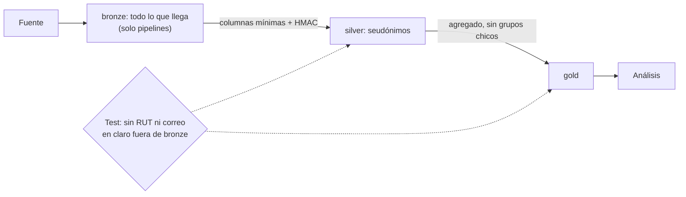

## 1. Resumen

Esta ficha no es asesoría legal: cubre cómo se aplica técnicamente la minimización en una arquitectura por capas.

La ley pide tratar solo los datos necesarios y, por defecto, solo los estrictamente necesarios. En una arquitectura por capas eso significa que **cada capa tiene menos datos personales que la anterior**:

- **bronze:** lo que llega, con acceso solo para las cuentas de los pipelines;
- **silver:** el identificador reemplazado por un HMAC y solo las columnas que se usan;
- **gold:** agregados, sin grupos tan chicos que identifiquen;
- **análisis:** lee solo gold.

Un test en la CI comprueba que no hay RUT ni correo en claro fuera de bronze.

## 2. Qué es

- **[Obligación legal · art. 3]** Proporcionalidad: los datos deben limitarse a los necesarios, adecuados y pertinentes para el fin, y conservarse solo el tiempo necesario.
- **[Obligación legal · art. 14 quáter]** Por defecto, solo se tratan los datos específicos y estrictamente necesarios, considerando cuántos datos, la extensión del tratamiento, el plazo y la accesibilidad.
- **[Decisión de arquitectura]** La minimización se implementa como una propiedad de cada capa, comprobable con un test.

## 3. Problema que resuelve

**[Buena práctica]** El pipeline copia `bronze.clientes` completa a silver y a gold «por si acaso». Cada analista con acceso a gold ve RUT, nombre y correo de todos los clientes para calcular ventas por comuna, que no los necesita.

## 4. Cómo funciona

1. **[Decisión de arquitectura]** Bronze recibe los datos tal como llegan; solo las cuentas de servicio lo leen.
2. **[Obligación legal · art. 3]** Silver extrae solo las columnas necesarias: el RUT pasa a un HMAC con clave, la edad a un tramo, y el nombre y el correo no pasan.
3. **[Obligación legal · art. 14 quáter]** Gold agrega por comuna y suprime los grupos de menos de 2 clientes.
4. **[Buena práctica]** El rol de análisis tiene permiso solo sobre gold.
5. **[Buena práctica]** Un test recorre silver y gold y falla si encuentra un RUT o un correo en claro.

## 5. Cuándo utilizarlo

- En toda arquitectura por capas con datos personales.
- Al crear una tabla nueva: decidir en qué capa puede tener cada columna personal.

## 6. Cuándo no utilizarlo

- Como sustituto del control de acceso: bronze sigue teniendo los datos y necesita sus propios controles.
- Si un proceso necesita de verdad el dato en claro (por ejemplo, el despacho): ese proceso lee de una zona controlada, no de gold.

## 7. Ejemplo sencillo

| Capa | Columnas | RUT o correo en claro |
|---|---|---|
| bronze | `rut`, `nombre`, `email`, `comuna`, `edad`, `monto` | 10 valores |
| silver | `cliente_key`, `comuna`, `tramo_edad`, `monto` | 0 |
| gold | `comuna`, `clientes`, `monto_total` | 0 |

Temuco tiene un solo cliente y no aparece en gold. El analista lee gold y no lee bronze.

## 8. Ejemplo de producción

- Bronze en un proyecto o cuenta aparte, con retención corta y acceso solo para pipelines.
- La clave del HMAC en un KMS; silver no guarda el RUT.
- Gold con umbral mínimo por grupo y vistas por finalidad.
- El test de «sin identificadores en claro» corre en la CI y en un escaneo periódico.

### Evidencia de cumplimiento

| Evidencia | Dónde queda | Quién la produce |
|---|---|---|
| Columnas por capa | Catálogo y esquema versionado | Pipeline |
| Resultado del test «sin RUT ni correo en claro fuera de bronze» | Log de la CI | CI |
| Permisos del rol de análisis | Política de acceso versionada | Plataforma |

## 9. Arquitectura



## 10. Código

```python
# Python 3.12 y psycopg contra PostgreSQL 17 (ejecutado en la CI con el servicio postgres:17): minimización por
# capa. Bronze guarda lo que llega; silver reemplaza el RUT por un HMAC y deja solo lo necesario; gold agrega y
# suprime los grupos chicos. El analista lee solo gold. PG_HOST, PG_PORT, PG_USER, PG_PASSWORD y PG_DB: base
# vacía temporal; el rol lleva sufijo y se borra al terminar.
import hashlib
import hmac
import os
import re
import secrets

import psycopg
from psycopg import errors

S = os.environ["PG_DB"]
ANALISTA = f"analista_{S}"
CLAVE = secrets.token_bytes(32)  # en producción, en un KMS o gestor de secretos
EN_CLARO = re.compile(r"\d{1,2}\.?\d{3}\.?\d{3}-[\dK]|[^@\s]+@[^@\s]+\.[a-z]{2,}", re.I)  # RUT o correo

# Valores ficticios: RUT de dígitos repetidos y correos en dominios reservados.
CLIENTES = [("11.111.111-1", "Ana", "ana@example.com", "Ñuñoa", 34, 120), ("22.222.222-2", "Luis", "luis@example.org", "Ñuñoa", 41, 80),
            ("33.333.333-3", "Bea", "bea@example.net", "Maipú", 29, 45), ("44.444.444-4", "Ciro", "ciro@example.com", "Maipú", 52, 60),
            ("55.555.555-5", "Dani", "dani@example.org", "Temuco", 38, 90)]


def clave_cliente(rut: str) -> str:
    return hmac.new(CLAVE, rut.encode(), hashlib.sha256).hexdigest()[:16]


with psycopg.connect(host=os.environ["PG_HOST"], port=os.environ["PG_PORT"], user=os.environ["PG_USER"],
                     password=os.environ["PG_PASSWORD"], dbname=S, autocommit=True) as conn:
    try:
        for capa in ("bronze", "silver", "gold"):
            conn.execute(f"CREATE SCHEMA {capa}")
        conn.execute("CREATE TABLE bronze.clientes (rut text, nombre text, email text, comuna text, edad int, monto int)")
        conn.cursor().executemany("INSERT INTO bronze.clientes VALUES (%s, %s, %s, %s, %s, %s)", CLIENTES)
        conn.execute("CREATE TABLE silver.clientes (cliente_key text, comuna text, tramo_edad text, monto int)")
        filas = conn.execute("SELECT rut, comuna, edad, monto FROM bronze.clientes").fetchall()  # solo lo necesario
        conn.cursor().executemany("INSERT INTO silver.clientes VALUES (%s, %s, %s, %s)",
                                  [(clave_cliente(r), c, f"{e // 10 * 10}-{e // 10 * 10 + 9}", m) for r, c, e, m in filas])
        conn.execute("CREATE TABLE gold.ventas_por_comuna AS SELECT comuna, count(*) AS clientes, sum(monto) AS monto_total "
                     "FROM silver.clientes GROUP BY comuna HAVING count(*) >= 2")  # sin grupos de un cliente
        conn.execute(f"CREATE ROLE {ANALISTA}")
        conn.execute(f"GRANT USAGE ON SCHEMA gold TO {ANALISTA}")
        conn.execute(f"GRANT SELECT ON ALL TABLES IN SCHEMA gold TO {ANALISTA}")

        def columnas(capa: str) -> list[str]:
            return [c for (c,) in conn.execute("SELECT column_name FROM information_schema.columns WHERE table_schema = %s "
                                               "ORDER BY ordinal_position", (capa,)).fetchall()]

        def en_claro(capa: str) -> int:
            tabla = conn.execute("SELECT table_name FROM information_schema.tables WHERE table_schema = %s", (capa,)).fetchone()
            assert tabla is not None
            filas = conn.execute(f"SELECT * FROM {capa}.{tabla[0]}").fetchall()
            return sum(1 for fila in filas for valor in fila if EN_CLARO.fullmatch(str(valor)))

        def lee(tabla: str) -> str:
            conn.execute(f"SET ROLE {ANALISTA}")
            try:
                return f"ok ({len(conn.execute(f'SELECT * FROM {tabla}').fetchall())} filas)"
            except errors.InsufficientPrivilege as exc:
                return f"denegado ({exc.sqlstate})"
            finally:
                conn.execute("RESET ROLE")

        for capa in ("bronze", "silver", "gold"):
            print(f"{capa}: {columnas(capa)}; valores con RUT o correo en claro: {en_claro(capa)}")
        print("gold:", conn.execute("SELECT comuna, clientes FROM gold.ventas_por_comuna ORDER BY comuna").fetchall())
        print(f"analista lee gold: {lee('gold.ventas_por_comuna')}; lee bronze: {lee('bronze.clientes')}")
    finally:
        conn.execute("DROP SCHEMA IF EXISTS bronze, silver, gold CASCADE")
        conn.execute(f"DROP OWNED BY {ANALISTA}")
        conn.execute(f"DROP ROLE IF EXISTS {ANALISTA}")
```

El script se **ejecuta en la CI contra el servicio postgres:17** y pasa `mypy --strict`. Los RUT y correos son ficticios. Imprime las columnas de cada capa, 10 valores en claro en bronze y 0 en silver y gold, las dos comunas que quedan en gold, y que el analista lee gold pero no bronze (`42501`).

## 11. GCP

En GCP, **BigQuery** con control de acceso por columna. Según *Ley 19628 SOBRE PROTECCION DE LOS DATOS PERSONALES* e *Introduction to column-level access control* (no ejecutado):

| | Capas (este ejemplo) | BigQuery | Etiqueta |
|---|---|---|---|
| Restringir columnas | Silver no tiene las columnas | Policy tags sobre columnas sensibles, verificados en tiempo de consulta | **[Decisión de arquitectura]** |
| Acceso del análisis | `GRANT` solo sobre gold | IAM sobre datasets y el rol Fine-Grained Reader en el policy tag | **[Buena práctica]** |

## 12. AWS

En AWS, **Lake Formation**. Según *Ley 19628 SOBRE PROTECCION DE LOS DATOS PERSONALES* y *Data filtering and cell-level security in Lake Formation* (no ejecutado):

| | Capas (este ejemplo) | Lake Formation | Etiqueta |
|---|---|---|---|
| Restringir columnas | Silver no tiene las columnas | Filtros de datos a nivel de columna, fila y celda al dar permisos | **[Decisión de arquitectura]** |
| Diferencia | Los datos no están | Los datos están; el filtro limita lo que se ve | **[Buena práctica]** |

## 13. Azure

En Azure, **Azure SQL** con enmascaramiento dinámico. Según *Ley 19628 SOBRE PROTECCION DE LOS DATOS PERSONALES* y *Dynamic data masking* (no ejecutado):

| | Capas (este ejemplo) | Dynamic data masking | Etiqueta |
|---|---|---|---|
| Qué hace | Quita las columnas de la capa | Enmascara para usuarios sin privilegio, sin cambiar los datos | **[Buena práctica]** |
| Límite | — | La página aclara que no impide consultas exhaustivas que expongan partes del dato | **[Decisión de arquitectura]** |

## 14. Buenas prácticas

- **[Obligación legal · art. 3]** Decidir por capa qué columnas personales son necesarias y para qué fin.
- **[Obligación legal · art. 14 quáter]** Que la opción por defecto de una tabla nueva sea no incluir columnas personales.
- **[Buena práctica]** **Seguridad:** la clave del HMAC fuera de la plataforma de datos, en un KMS.
- **[Buena práctica]** **Observabilidad:** el test de identificadores en claro también corre programado sobre los datos reales.
- **[Buena práctica]** **Costo:** menos columnas personales en silver y gold reducen el alcance de cada control y de cada borrado.

## 15. Errores frecuentes

- `SELECT *` de bronze a silver.
- Hash del RUT sin clave en silver (se revierte probando todos los RUT).
- Dar acceso a bronze «para depurar» y no quitarlo.

## 16. Trade-offs

Quitar columnas en silver protege más que enmascararlas, y obliga a volver a bronze cuando aparece un uso nuevo legítimo. Enmascarar es más flexible y deja los datos en la tabla.

## 17. Conceptos relacionados

- `pseudonymization-vs-anonymization`: silver seudonimiza.
- `keyed-hashing`: el HMAC de silver.
- `k-anonymity`: gold sin grupos chicos.
- `medallion-architecture`: las capas bronze, silver y gold (pendiente de ficha).
- `pii-identification`: qué columnas son personales.

## 18. Preguntas técnicas abiertas

1. ¿Qué columnas personales llegan hoy a tu capa gold?
2. ¿Quién tiene acceso a bronze y por qué?
3. ¿Tienes un test que falle si aparece un RUT en claro en análisis?

## 19. Laboratorio relacionado

Pendiente (F4).

## 20. Fuentes

- BCN Ley Chile: *Ley 19628 SOBRE PROTECCION DE LOS DATOS PERSONALES* (versión con vigencia diferida desde 2026-12-01).
- PostgreSQL 17: *GRANT*.
- Google Cloud: *Introduction to column-level access control*.
- AWS: *Data filtering and cell-level security in Lake Formation*.
- Microsoft Learn: *Dynamic data masking*.

El detalle de cada fuente está en `sources` del frontmatter.

## 21. Fecha de última verificación

2026-10-21: texto legal consultado ese día en BCN. `review_required`: pendiente de revisión B-F3.1 del lote F3b-19a; pasa a `verified` solo con la aprobación explícita de Felipe (`owner_approved_at`). Revisión mensual.

## 22. Historial de cambios importantes

- 2026-10-21: creación (lote F3b-19a).
