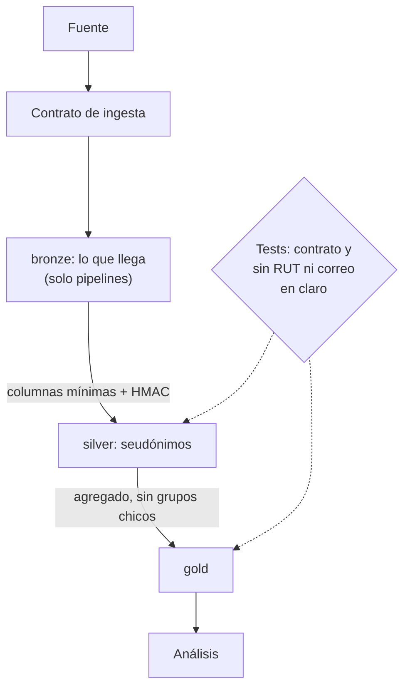

## 1. Resumen

Esta ficha no es asesoría legal: cubre cómo se aplica técnicamente la minimización en una arquitectura por capas. La finalidad, la base y los plazos los definen y aprueban las áreas responsables.

La minimización evita que una plataforma recoja, replique o exponga datos personales que una actividad no necesita. No es una regla universal del tipo «bronze completo, silver seudonimizado, gold anónimo»: cada zona responde a una **finalidad concreta**, con columnas, detalle, plazo y accesos justificados. En el ejemplo de esta ficha, **cada capa tiene menos datos personales que la anterior**:

- **bronze:** lo que llega, con acceso solo para las cuentas de los pipelines;
- **silver:** el identificador reemplazado por un HMAC y solo las columnas que se usan;
- **gold:** agregados, sin grupos tan chicos que identifiquen;
- **análisis:** lee solo gold.

**Pregunta guía:** ¿se puede entregar el mismo resultado de negocio con menos datos, menos detalle, menos tiempo o menos accesos?

## 2. Qué es

- **[Obligación legal · art. 3]** Proporcionalidad: los datos deben limitarse a los necesarios, adecuados y pertinentes para el fin, y conservarse solo el tiempo necesario.
- **[Obligación legal · art. 14 quáter]** Por defecto, solo se tratan los datos específicos y estrictamente necesarios, considerando cuántos datos, la extensión del tratamiento, el plazo y la accesibilidad.
- **[Buena práctica]** En ingeniería eso se traduce en cuatro dimensiones:

| Dimensión | Qué se limita | Técnica típica |
|---|---|---|
| Cantidad | Atributos y registros | Proyección de columnas, filtros |
| Granularidad | Dato individual frente a tramo o agregado | Generalización, agregación |
| Tiempo | Plazo de conservación | Expiración de particiones, purga |
| Accesibilidad | Personas, servicios y destinos | Permisos por capa y por columna |

- **[Buena práctica]** **No es lo mismo que:** enmascarar (oculta una representación al mostrar; el dato sigue en la tabla), seudonimizar (sustituye el identificador; sigue siendo dato personal) ni anonimizar (exige evaluar que la persona no sea identificable por medios razonables).
- **[Decisión de arquitectura]** La minimización se implementa como una propiedad de cada capa, comprobable con un test y con un contrato de columnas versionado.

## 3. Problema que resuelve

**[Buena práctica]** Un dashboard de ventas por comuna necesita cantidad de clientes y montos agregados. El pipeline copia `bronze.clientes` completa a silver y a gold «por si acaso», y cada analista con acceso a gold ve RUT, nombre y correo de todos los clientes, que el indicador no necesita. Cada copia multiplica accesos, costo de gobierno y superficie de exposición.

## 4. Cómo funciona

1. **[Buena práctica]** **Definir el producto y su finalidad:** qué decisión o proceso habilita y quién aprobó sus necesidades (`processing-activities-inventory`).
2. **[Decisión de arquitectura]** **Contrato de entrada:** lista explícita de campos con su justificación; un campo nuevo no aprobado se rechaza o se aísla.
3. **[Decisión de arquitectura]** **Bronze** recibe los datos tal como llegan, con retención y acceso restringidos; solo las cuentas de servicio lo leen. Bronze no es una excepción permanente a la minimización.
4. **[Obligación legal · art. 3]** Silver extrae solo las columnas necesarias para el fin (**proporcionalidad**). **[Decisión de arquitectura]** El RUT pasa a un HMAC con clave, la edad a un tramo, y el nombre y el correo no pasan.
5. **[Decisión de arquitectura]** Gold agrega por comuna y suprime los grupos de menos de 2 clientes. El umbral es una decisión interna: la ley no fija un mínimo de personas por grupo, y un umbral solo no garantiza anonimato.
6. **[Buena práctica]** El rol de análisis tiene permiso solo sobre gold; se prueba con la identidad del consumidor, no solo leyendo la configuración.
7. **[Buena práctica]** Un test recorre silver y gold y falla si encuentra un RUT o un correo en claro; otro compara el esquema real con el contrato de columnas de cada capa.

## 5. Cuándo utilizarlo

- En toda arquitectura por capas con datos personales.
- Al diseñar una ingesta, una migración o un producto analítico nuevo, o al incorporar una fuente externa.
- Al crear una tabla o agregar una columna: decidir en qué capa puede estar cada columna personal.
- Al cambiar la finalidad o sumar un consumidor.

## 6. Cuándo no utilizarlo

- Como sustituto del control de acceso: bronze sigue teniendo los datos y necesita sus propios controles.
- Si un proceso necesita de verdad el dato en claro (por ejemplo, el despacho): ese proceso lee de una zona controlada, no de gold.
- Como regla para borrar automáticamente datos que exigen una obligación legal, una auditoría o la defensa de un derecho: el plazo lo decide la actividad (`retention-and-erasure`).

## 7. Ejemplo sencillo

| Capa | Columnas | RUT o correo en claro | Decisión |
|---|---|---|---|
| bronze | `rut`, `nombre`, `email`, `comuna`, `edad`, `monto` | 10 valores | Lo que llega, con acceso solo para pipelines y retención corta |
| silver | `cliente_key`, `comuna`, `tramo_edad`, `monto` | 0 | Sin nombre ni correo; RUT como HMAC; edad en tramos |
| gold | `comuna`, `clientes`, `monto_total` | 0 | Agregado por comuna, sin grupos de un cliente |

Temuco tiene un solo cliente y no aparece en gold. El analista lee gold y no lee bronze. **Ojo:** un agregado con pocos registros o una combinación singular todavía puede permitir inferencias; `HAVING count(*) >= 2` no basta para declarar anonimato (`k-anonymity`).

## 8. Ejemplo de producción

Escenario genérico: una aerolínea ingesta reservas a BigQuery; el producto analítico solo necesita rutas, mes y volumen de reservas.

- **Contrato:** lista de campos aprobados; un cambio de esquema pasa por revisión.
- **Bronze restringido** en un proyecto o cuenta aparte: solo lo necesario para conciliar y reprocesar, con retención corta.
- **Silver:** normaliza ruta y mes, reemplaza el identificador por un HMAC con la clave en un KMS y no guarda los datos de contacto.
- **Gold:** métricas agregadas, umbral mínimo por grupo y vistas por finalidad.
- **Operación:** el test de «sin identificadores en claro» y la comparación con el contrato corren en la CI y en un escaneo periódico.

### Evidencia de cumplimiento

| Evidencia | Dónde queda | Quién la produce | Qué demuestra | Qué no demuestra |
|---|---|---|---|---|
| Contrato de columnas por capa, versionado | Repositorio o catálogo | Equipo de datos y dueño del producto | Qué columnas se aprobaron y para qué | Que la finalidad sea legítima |
| Comparación del esquema real con el contrato | Log de la CI | CI | Que no hay columnas fuera del contrato | Que una columna aprobada no traiga datos indebidos en texto libre |
| Resultado del control «sin datos personales en claro fuera de bronze» | Log de la CI | CI | Que silver y gold no tienen columnas que el catálogo clasifica como personales en claro | Que no haya columnas personales sin clasificar ni identificadores indirectos |
| Purga de bronze y control de filas vencidas | Log de la CI o del job | Pipeline de la capa | Que bronze no conserva filas fuera del plazo de retención | Que no queden copias en respaldos o exportaciones |
| Permisos efectivos del rol de análisis | Política de acceso versionada y prueba con la identidad | Plataforma | Que el análisis no lee bronze | Que nadie más tenga acceso |

## 9. Arquitectura



Las capas son un patrón de arquitectura, no categorías legales. Transversalmente van el catálogo, la actividad de tratamiento, las políticas de acceso, la retención y la evidencia.

## 10. Código

```python
# Python 3.12 y psycopg contra PostgreSQL 17 (ejecutado en la CI con el servicio postgres:17): minimización por capa
# en sus cuatro dimensiones. Cantidad: un contrato de columnas por capa. Granularidad: silver generaliza (tramo de
# edad, comuna, coordenadas redondeadas, HMAC del RUT) y gold agrega y suprime grupos chicos. Accesibilidad: el
# analista lee solo gold. Tiempo: bronze guarda ingested_at y purga lo vencido. Una puerta sale con 1 si un control
# falla o si una columna queda sin clasificar (UNKNOWN nunca cuenta como aprobado). Uso: python minimizacion.py
# correcto | deriva-esquema | select-star | sin-purga | sin-clasificar. PG_DSN: base vacía temporal; las capas y el
# rol se borran al terminar. Datos ficticios.
import hashlib
import hmac
import os
import re
import secrets
import sys
from datetime import date, timedelta

import psycopg
from psycopg import errors

# @paso 1 Capas
REFERENCIA = date(2026, 11, 3)    # fecha fija: resultado reproducible
RETENCION_BRONZE = timedelta(days=30)   # política interna ilustrativa, no un plazo legal
# Contrato de columnas aprobadas por capa (versionado).
CONTRATO = {"silver": {"cliente_key", "tramo_edad", "comuna", "lat", "lon", "monto", "segmento"},
            "gold": {"comuna", "clientes", "monto_total"}}
# Clasificación del catálogo (la que produce pii-identification): columnas con datos personales en claro.
PERSONALES = {"rut", "nombre", "email", "telefono", "fecha_nacimiento", "direccion"}
# El resto de lo que el catálogo clasifica, sin datos personales en claro (cliente_key es un seudónimo: sigue siendo
# dato personal, pero no en claro). Una columna fuera de las dos listas no está clasificada: queda UNKNOWN y bloquea.
CLASIFICADAS = PERSONALES | {"cliente_key", "tramo_edad", "comuna", "lat", "lon", "monto", "ingested_at", "clientes",
                             "monto_total"}
RESPALDO = re.compile(r"[^@\s]+@[^@\s]+\.[a-z]{2,}|\d{1,2}\.?\d{3}\.?\d{3}-[\dK]", re.I)   # solo para texto libre
BRONZE = [   # rut, nombre, email, telefono, fecha_nacimiento, direccion, lat, lon, monto, ingested_at
    ("11.111.111-1", "Ana", "ana@example.test", "+56 9 1111 1111", date(1991, 4, 2), "Irarrázaval 100, Ñuñoa",
     -33.45612, -70.59751, 120, date(2026, 10, 20)),
    ("22.222.222-2", "Luis", "luis@example.test", "+56 9 2222 2222", date(1984, 7, 9), "Grecia 200, Ñuñoa",
     -33.46177, -70.60034, 80, date(2026, 10, 21)),
    ("33.333.333-3", "Bea", "bea@example.test", "+56 9 3333 3333", date(1997, 1, 15), "Pajaritos 300, Maipú",
     -33.50941, -70.75602, 45, date(2026, 10, 22)),
    ("44.444.444-4", "Ciro", "ciro@example.test", "+56 9 4444 4444", date(1973, 11, 30), "Rinconada 400, Maipú",
     -33.51288, -70.76114, 60, date(2026, 10, 25)),
    ("55.555.555-5", "Dani", "dani@example.test", "+56 9 5555 5555", date(1988, 3, 3), "Prat 500, Temuco",
     -38.73965, -72.59842, 90, date(2026, 10, 28)),
    ("66.666.666-6", "Eva", "eva@example.test", "+56 9 6666 6666", date(1990, 6, 6), "Grecia 600, Ñuñoa",
     -33.46001, -70.60212, 70, date(2026, 9, 1)),   # vencida: ingresó hace más de 30 días
]


def crear_capas(conn: psycopg.Connection, rol: str) -> None:
    for capa in ("bronze", "silver", "gold"):
        conn.execute(f"CREATE SCHEMA {capa}")
    conn.execute("CREATE TABLE bronze.clientes (rut text, nombre text, email text, telefono text,"
                 " fecha_nacimiento date, direccion text, lat double precision, lon double precision, monto int,"
                 " ingested_at date)")
    conn.cursor().executemany("INSERT INTO bronze.clientes VALUES (%s, %s, %s, %s, %s, %s, %s, %s, %s, %s)", BRONZE)
    conn.execute(f"CREATE ROLE {rol}")


def purgar_bronze(conn: psycopg.Connection, hoy: date) -> int:
    """Tiempo: lo que pasó el plazo de retención se borra de bronze."""
    return conn.execute("DELETE FROM bronze.clientes WHERE ingested_at < %s", (hoy - RETENCION_BRONZE,)).rowcount


# @paso 2 Transformación
def tramo_edad(nacimiento: date, hoy: date) -> str:
    edad = hoy.year - nacimiento.year - ((hoy.month, hoy.day) < (nacimiento.month, nacimiento.day))
    return f"{edad // 10 * 10}-{edad // 10 * 10 + 9}"


def construir_silver(conn: psycopg.Connection, clave: bytes, hoy: date) -> None:
    """Cantidad y granularidad: solo las columnas del contrato, con el dato generalizado; el teléfono no pasa."""
    conn.execute("CREATE TABLE silver.clientes (cliente_key text, tramo_edad text, comuna text, lat double precision,"
                 " lon double precision, monto int)")
    filas = conn.execute("SELECT rut, fecha_nacimiento, direccion, lat, lon, monto FROM bronze.clientes").fetchall()
    conn.cursor().executemany("INSERT INTO silver.clientes VALUES (%s, %s, %s, %s, %s, %s)", [
        (hmac.new(clave, rut.encode(), hashlib.sha256).hexdigest()[:16], tramo_edad(nac, hoy),
         direccion.rsplit(",", 1)[1].strip(), round(lat, 2), round(lon, 2), monto)
        for rut, nac, direccion, lat, lon, monto in filas])


def construir_silver_copiando_todo(conn: psycopg.Connection) -> None:
    """El antipatrón: SELECT * de bronze a silver, más la comuna que gold necesita."""
    conn.execute("CREATE TABLE silver.clientes AS SELECT *, split_part(direccion, ', ', 2) AS comuna"
                 " FROM bronze.clientes")


def construir_gold(conn: psycopg.Connection, rol: str) -> None:
    """Granularidad y accesibilidad: agregado por comuna sin grupos de un cliente; el analista lee solo gold."""
    conn.execute("CREATE TABLE gold.ventas_por_comuna AS SELECT comuna, count(*) AS clientes, sum(monto) AS monto_total"
                 " FROM silver.clientes GROUP BY comuna HAVING count(*) >= 2")
    conn.execute(f"GRANT USAGE ON SCHEMA gold TO {rol}")
    conn.execute(f"GRANT SELECT ON ALL TABLES IN SCHEMA gold TO {rol}")


# @paso 3 Controles
def columnas(conn: psycopg.Connection, capa: str) -> list[str]:
    filas = conn.execute("SELECT column_name FROM information_schema.columns WHERE table_schema = %s"
                         " ORDER BY table_name, ordinal_position", (capa,)).fetchall()
    return [c for (c,) in filas]


def fuera_de_contrato(conn: psycopg.Connection) -> dict[str, list[str]]:
    """Cantidad: columnas que una capa tiene y su contrato no aprueba."""
    sobran = {capa: sorted(set(columnas(conn, capa)) - aprobadas) for capa, aprobadas in CONTRATO.items()}
    return {capa: cols for capa, cols in sobran.items() if cols}


def en_claro(conn: psycopg.Connection, capa: str) -> list[str]:
    """Datos personales en claro en todas las tablas de la capa: columnas que el catálogo clasifica como personales y,
    de respaldo, correos o RUT dentro del texto libre."""
    hallazgos = []
    tablas = conn.execute("SELECT table_name FROM information_schema.tables WHERE table_schema = %s ORDER BY 1",
                          (capa,)).fetchall()
    for (tabla,) in tablas:
        consulta = ("SELECT column_name FROM information_schema.columns WHERE table_schema = %s AND table_name = %s"
                    " ORDER BY ordinal_position")
        nombres = [c for (c,) in conn.execute(consulta, (capa, tabla))]
        hallazgos += [f"{capa}.{tabla}.{c}" for c in nombres if c in PERSONALES]
        for c in (c for c in nombres if c not in PERSONALES):
            valores = conn.execute(f"SELECT {c}::text FROM {capa}.{tabla}").fetchall()
            if any(v is not None and RESPALDO.search(v) for (v,) in valores):
                hallazgos.append(f"{capa}.{tabla}.{c} (patrón en el texto)")
    return hallazgos


def sin_clasificar(conn: psycopg.Connection, capa: str) -> list[str]:
    """UNKNOWN: columnas que el catálogo no clasifica. Sin clasificación no se sabe si son personales."""
    return [f"{capa}.{c}" for c in columnas(conn, capa) if c not in CLASIFICADAS]


def vencidas_en_bronze(conn: psycopg.Connection, hoy: date) -> int:
    """Tiempo: filas de bronze que pasaron el plazo y siguen ahí."""
    corte = hoy - RETENCION_BRONZE
    fila = conn.execute("SELECT count(*) FROM bronze.clientes WHERE ingested_at < %s", (corte,)).fetchone()
    return int(fila[0]) if fila else 0


def lee(conn: psycopg.Connection, rol: str, tabla: str) -> str:
    """Accesibilidad, probada con la identidad del consumidor y no leyendo la configuración."""
    conn.execute(f"SET ROLE {rol}")
    try:
        return f"ok ({len(conn.execute(f'SELECT * FROM {tabla}').fetchall())} filas)"
    except errors.InsufficientPrivilege as exc:
        return f"denegado ({exc.sqlstate})"
    finally:
        conn.execute("RESET ROLE")


# @paso 4 Puerta y reporte
def construir(conn: psycopg.Connection, escenario: str, rol: str) -> int:
    crear_capas(conn, rol)
    purgadas = 0 if escenario == "sin-purga" else purgar_bronze(conn, REFERENCIA)
    if escenario == "select-star":
        construir_silver_copiando_todo(conn)
    else:
        construir_silver(conn, secrets.token_bytes(32), REFERENCIA)   # la clave del HMAC, en producción en un KMS
    if escenario == "deriva-esquema":
        conn.execute("ALTER TABLE silver.clientes ADD COLUMN email text")   # cambio de esquema sin aprobar
    if escenario == "sin-clasificar":   # el contrato aprobó la columna, pero el catálogo todavía no la clasifica
        conn.execute("ALTER TABLE silver.clientes ADD COLUMN segmento text DEFAULT 'frecuente'")
    construir_gold(conn, rol)
    return purgadas


def reporte(conn: psycopg.Connection, escenario: str, rol: str, purgadas: int) -> int:
    print(f"purga de bronze (plazo {RETENCION_BRONZE.days} días): {purgadas} fila(s)")
    print(f"silver: {columnas(conn, 'silver')}")
    print("gold:", conn.execute("SELECT comuna, clientes FROM gold.ventas_por_comuna ORDER BY comuna").fetchall())
    lectura_bronze = lee(conn, rol, "bronze.clientes")
    print(f"analista lee gold: {lee(conn, rol, 'gold.ventas_por_comuna')}; lee bronze: {lectura_bronze}")
    fallas = []
    if contrato := fuera_de_contrato(conn):
        fallas.append(f"columnas fuera del contrato: {contrato}")
    if claros := en_claro(conn, "silver") + en_claro(conn, "gold"):
        fallas.append(f"datos personales en claro fuera de bronze: {claros}")
    if vencidas := vencidas_en_bronze(conn, REFERENCIA):
        fallas.append(f"bronze conserva {vencidas} fila(s) vencida(s)")
    if not lectura_bronze.startswith("denegado"):
        fallas.append("el analista lee bronze")
    desconocidas = sin_clasificar(conn, "silver") + sin_clasificar(conn, "gold")
    for falla in fallas:
        print(f"FALLA {falla}")
    for columna in desconocidas:
        print(f"UNKNOWN {columna}: sin clasificar en el catálogo, no cuenta como aprobada")
    if fallas or desconocidas:
        extra = f", {len(desconocidas)} columna(s) UNKNOWN" if desconocidas else ""
        print(f"puerta: rechazada (1): {len(fallas)} control(es) fallan{extra}")
        return 1
    print("puerta: aprobada (0): cantidad, granularidad, accesibilidad y tiempo en regla")
    return 0


def main(escenario: str) -> int:
    rol = f"analista_{os.environ['PG_DB']}"
    with psycopg.connect(os.environ["PG_DSN"], autocommit=True) as conn:
        try:
            return reporte(conn, escenario, rol, construir(conn, escenario, rol))
        finally:
            conn.execute("DROP SCHEMA IF EXISTS bronze, silver, gold CASCADE")
            conn.execute(f"DROP OWNED BY {rol}")
            conn.execute(f"DROP ROLE IF EXISTS {rol}")


if __name__ == "__main__":
    sys.exit(main(sys.argv[1] if len(sys.argv) > 1 else "correcto"))
```

El script se **ejecuta en la CI contra el servicio postgres:17** y pasa `mypy --strict`. Recorre cuatro pasos: las capas (bronze con `ingested_at` y su purga), la transformación, los controles y la puerta. Las funciones son de nivel superior y reciben la conexión. Los datos son ficticios. Cubre las cuatro dimensiones del §2:

- **Cantidad:** un contrato de columnas por capa; silver y gold no pueden tener columnas que el contrato no apruebe.
- **Granularidad:** silver pasa la fecha de nacimiento a tramo de edad, la dirección a comuna y las coordenadas a 2 decimales; el teléfono no pasa y el RUT se reemplaza por un HMAC con clave. Gold agrega por comuna y suprime los grupos de un cliente.
- **Accesibilidad:** el analista lee gold y no bronze (`42501`), probado con su identidad.
- **Tiempo:** bronze purga lo que ingresó hace más de 30 días, y un control falla si quedan filas vencidas.

El control de «sin datos personales en claro fuera de bronze» recorre todas las tablas de silver y gold. Se basa en la clasificación del catálogo, las columnas marcadas como personales, como las que produce `pii-identification`. El patrón de correo o RUT queda solo de respaldo para el texto libre. Una columna que el catálogo no clasifica queda `UNKNOWN` y bloquea la puerta, como en `chile-data-protection` y `processing-activities-inventory`: la falta de clasificación no aprueba.

En el escenario correcto, la purga borra la fila vencida, silver queda con las columnas del contrato y la puerta aprueba con código 0:

```text
$ python minimizacion.py correcto
purga de bronze (plazo 30 días): 1 fila(s)
silver: ['cliente_key', 'tramo_edad', 'comuna', 'lat', 'lon', 'monto']
gold: [('Maipú', 2), ('Ñuñoa', 2)]
analista lee gold: ok (2 filas); lee bronze: denegado (42501)
puerta: aprobada (0): cantidad, granularidad, accesibilidad y tiempo en regla
```

Si alguien agrega `email` a silver sin aprobarlo, fallan el contrato y el control de datos en claro. Código 1:

```text
$ python minimizacion.py deriva-esquema
purga de bronze (plazo 30 días): 1 fila(s)
silver: ['cliente_key', 'tramo_edad', 'comuna', 'lat', 'lon', 'monto', 'email']
gold: [('Maipú', 2), ('Ñuñoa', 2)]
analista lee gold: ok (2 filas); lee bronze: denegado (42501)
FALLA columnas fuera del contrato: {'silver': ['email']}
FALLA datos personales en claro fuera de bronze: ['silver.clientes.email']
puerta: rechazada (1): 2 control(es) fallan
```

Si silver se construye copiando todo desde bronze, llegan el RUT, el nombre, el correo, el teléfono, la fecha de nacimiento y la dirección en claro. Código 1:

```text
$ python minimizacion.py select-star
purga de bronze (plazo 30 días): 1 fila(s)
silver: ['rut', 'nombre', 'email', 'telefono', 'fecha_nacimiento', 'direccion', 'lat', 'lon', 'monto', 'ingested_at', 'comuna']
gold: [('Maipú', 2), ('Ñuñoa', 2)]
analista lee gold: ok (2 filas); lee bronze: denegado (42501)
FALLA columnas fuera del contrato: {'silver': ['direccion', 'email', 'fecha_nacimiento', 'ingested_at', 'nombre', 'rut', 'telefono']}
FALLA datos personales en claro fuera de bronze: ['silver.clientes.rut', 'silver.clientes.nombre', 'silver.clientes.email', 'silver.clientes.telefono', 'silver.clientes.fecha_nacimiento', 'silver.clientes.direccion']
puerta: rechazada (1): 2 control(es) fallan
```

Si bronze no se purga, conserva la fila vencida y gold la cuenta (Ñuñoa sube a 3). Código 1:

```text
$ python minimizacion.py sin-purga
purga de bronze (plazo 30 días): 0 fila(s)
silver: ['cliente_key', 'tramo_edad', 'comuna', 'lat', 'lon', 'monto']
gold: [('Maipú', 2), ('Ñuñoa', 3)]
analista lee gold: ok (2 filas); lee bronze: denegado (42501)
FALLA bronze conserva 1 fila(s) vencida(s)
puerta: rechazada (1): 1 control(es) fallan
```

Si el contrato aprueba una columna nueva, `segmento`, pero el catálogo todavía no la clasifica, ningún control falla y aun así la puerta no aprueba: la columna queda `UNKNOWN`. Código 1:

```text
$ python minimizacion.py sin-clasificar
purga de bronze (plazo 30 días): 1 fila(s)
silver: ['cliente_key', 'tramo_edad', 'comuna', 'lat', 'lon', 'monto', 'segmento']
gold: [('Maipú', 2), ('Ñuñoa', 2)]
analista lee gold: ok (2 filas); lee bronze: denegado (42501)
UNKNOWN silver.segmento: sin clasificar en el catálogo, no cuenta como aprobada
puerta: rechazada (1): 0 control(es) fallan, 1 columna(s) UNKNOWN
```

Limitaciones:

- **Clasificación:** el control confía en el catálogo. Una columna sin clasificar bloquea (`UNKNOWN`), pero una columna personal mal clasificada como no personal pasa, salvo que su texto traiga un correo o un RUT que el respaldo reconozca.
- **Identificación indirecta:** tramo de edad, comuna y coordenadas a 2 decimales siguen siendo datos personales si se combinan; el umbral de gold reduce el riesgo, no garantiza anonimato.
- **Finalidad:** el contrato dice qué columnas se aprobaron, no si la finalidad es legítima.
- **Plazo:** los 30 días de bronze son una política interna de ejemplo, no un plazo legal; la purga borra filas, no copias en respaldos (`privacy-backup-and-recovery`).

## 11. GCP

En GCP, **BigQuery** con control de acceso por columna. Según *Introduction to column-level access control* (no ejecutado):

|  | Capas (este ejemplo) | BigQuery |
|---|---|---|
| Restringir columnas | Silver no tiene las columnas | Policy tags sobre columnas sensibles, verificados en tiempo de consulta |
| Acceso del análisis | `GRANT` solo sobre gold | IAM sobre datasets y el rol Fine-Grained Reader en el policy tag |
| Diferencia | Los datos no están | Los datos están; el policy tag limita quién lee la columna |

## 12. AWS

En AWS, **Lake Formation**. Según *Data filtering and cell-level security in Lake Formation* (no ejecutado):

|  | Capas (este ejemplo) | Lake Formation |
|---|---|---|
| Restringir columnas | Silver no tiene las columnas | Filtros de datos a nivel de columna, fila y celda al dar permisos |
| Diferencia | Los datos no están | Los datos están; el filtro limita lo que se ve |

## 13. Azure

En Azure, **Azure SQL** con enmascaramiento dinámico. Según *Dynamic data masking* (no ejecutado):

|  | Capas (este ejemplo) | Dynamic data masking |
|---|---|---|
| Qué hace | Quita las columnas de la capa | Enmascara para usuarios sin privilegio, sin cambiar los datos |
| Límite | — | La página aclara que no impide consultas exhaustivas que expongan partes del dato |

**Criterio común:** una etiqueta de catálogo no equivale a un permiso aplicado. Comprobar el control en el servicio que ejecuta las consultas, con la identidad del consumidor.

## 14. Buenas prácticas

- **[Obligación legal · art. 3]** Solo los datos necesarios, adecuados y pertinentes para el fin (**proporcionalidad**). **[Buena práctica]** Decidir por capa qué columnas personales son necesarias, para qué fin y cuándo dejan de serlo.
- **[Obligación legal · art. 14 quáter]** Por defecto, solo los datos específicos y estrictamente necesarios, según número de datos, extensión, plazo y accesibilidad. **[Decisión de arquitectura]** Una tabla nueva parte sin columnas personales y cada una se agrega con su finalidad.
- **[Buena práctica]** Listas explícitas de columnas en lugar de `SELECT *` en productos con datos personales; minimizar desde la fuente cuando se pueda.
- **[Buena práctica]** Revisar cambios de esquema y finalidades nuevas antes de desplegar.
- **[Buena práctica]** **Seguridad:** la clave del HMAC fuera de la plataforma de datos, en un KMS.
- **[Buena práctica]** **Observabilidad:** el test de identificadores en claro y la comparación con el contrato también corren programados sobre los datos reales.
- **[Buena práctica]** **Costo:** menos columnas personales en silver y gold reducen el alcance de cada control y de cada borrado.

## 15. Errores frecuentes

- **Copiar todas las columnas de bronze a silver** (`SELECT *`): toda columna nueva de la fuente llega sola a silver.
- **Hash del RUT sin clave en silver:** se revierte probando todos los RUT (`chilean-identifier-pseudonymization`).
- **Dar acceso a bronze «para depurar» y no quitarlo:** el control de capas queda anulado para esa persona.
- **Tratar bronze como excepción permanente:** guarda todo sin plazo y se vuelve la copia más expuesta.
- **Confundir HMAC, máscara o agregado con anonimato:** el dato sigue siendo personal y el control se relaja.
- **Revisar solo RUT y correo:** los identificadores indirectos y el texto libre pasan.
- **Quitar columnas de gold y dejarlas en exportaciones o ambientes de prueba:** la exposición se traslada, no se reduce.

## 16. Trade-offs

- **Quitar frente a enmascarar:** quitar columnas en silver protege más, y obliga a volver a bronze cuando aparece un uso nuevo legítimo; enmascarar es más flexible y deja los datos en la tabla.
- **Menos datos frente a auditoría:** reduce exposición y puede limitar conciliación o casos nuevos; la salida no es conservar todo, sino separar finalidades, documentar excepciones y fijar retención.
- **Agregar frente a utilidad:** más agregación protege más y responde menos preguntas; evaluar el nivel mínimo de detalle que cada consumidor necesita.

## 17. Conceptos relacionados

- `pseudonymization-vs-anonymization`: silver seudonimiza.
- `keyed-hashing`: el HMAC de silver.
- `k-anonymity`: gold sin grupos chicos.
- `medallion-architecture`: las capas bronze, silver y gold.
- `pii-identification`: qué columnas son personales.
- `chile-data-protection`: ficha padre.
- `processing-activities-inventory`: la finalidad de cada capa.
- `chilean-identifier-pseudonymization`: el seudónimo de silver.
- `retention-and-erasure`: la dimensión de tiempo.
- `privacy-backup-and-recovery`: la purga y los respaldos.
- `privacy-controls-as-code`: la regla de la CI.

## 18. Preguntas técnicas abiertas

1. ¿Qué columnas personales llegan hoy a tu capa gold?
2. ¿Quién tiene acceso a bronze, por qué y por cuánto tiempo se conserva?
3. ¿Tienes un test que falle si aparece un RUT en claro en análisis?
4. ¿Qué evidencia muestra que una columna nueva no llega sin aprobación a silver o gold?

**Criterio de dominio:** dominas esta ficha si puedes explicar las cuatro dimensiones de la minimización, por qué seudonimizar o agregar no es anonimizar, qué decide el contrato de columnas de cada capa y qué no detecta el test de patrones.

## 19. Laboratorio relacionado

Propuesta para F4: un contrato de columnas por capa, un pipeline que lo respeta, una prueba de CI que rechaza un campo nuevo y la verificación de permisos con la identidad del consumidor. Datos ficticios.

## 20. Fuentes

- BCN Ley Chile: *Ley 19628 SOBRE PROTECCION DE LOS DATOS PERSONALES* (versión con vigencia diferida desde 2026-12-01).
- PostgreSQL 17: *GRANT*.
- Google Cloud: *Introduction to column-level access control*.
- AWS: *Data filtering and cell-level security in Lake Formation*.
- Microsoft Learn: *Dynamic data masking*.

El detalle de cada fuente está en `sources` del frontmatter.

## 21. Fecha de última verificación

2026-10-25: textos legales vueltos a consultar en BCN, sin cambios. Antes, 2026-10-21: texto legal consultado ese día en BCN. `review_required` desde el 2026-11-04: revisión P10 aplicada al §10; vuelve a `verified` cuando Felipe la apruebe (`owner_approved_at`). Revisión mensual.

## 22. Historial de cambios importantes

- 2026-10-21: creación (lote F3b-19a).
- 2026-10-22: upgrade de 19: pasa a ser ficha hija de `chile-data-protection`; relaciones con `chilean-identifier-pseudonymization` y `privacy-controls-as-code`. Sin cambios de contenido legal ni de código.
- 2026-10-24: `PART_OF` hacia `chile-data-protection` (ADR-024) e `implication` por artículo en `legal_basis` (enmienda de ADR-023). Sin cambios de contenido legal ni de código.
- 2026-10-25: revisión del upgrade (`docs/reviews/cards-f3b-19-upgrade.md`) y auditoría de las etiquetas «Obligación legal»: cada una afirma solo lo que dice su artículo; lo demás pasa a buena práctica o decisión de arquitectura. Textos de BCN y del Senado consultados el 2026-10-25, sin cambios desde el 2026-10-22.
- 2026-10-28: mejora de contenido (lote P1) con tres niveles de lectura: §1 (sin regla universal por capa; pregunta guía), §2 (cuatro dimensiones y distinción con enmascarar, seudonimizar y anonimizar), §3, §4 (contrato de entrada y prueba con la identidad del consumidor), §5, §6 (no borrar lo que exige una obligación legal), §7 (columna de decisión; un umbral no basta para declarar anonimato), §8 (escenario y evidencia «qué demuestra y qué no»), §9 (contrato de ingesta), §10 (contrato de columnas por capa que detecta un campo nuevo, sobre el mismo ejemplo en PostgreSQL), §11–13 (criterio común), §14–16, §17 (relaciones con `processing-activities-inventory` y `retention-and-erasure`), §18 (criterio de dominio) y §19 (laboratorio para F4). Sin cambios en `legal_basis`, etiquetas, aviso ni vigencia.
- 2026-10-28: pasa al dominio 24-privacy-engineering, tramo `diseno-protegido` (ADR-027), desde 19-compliance; sin cambios de contenido. La URL de la ficha (`/concepts/data-minimization-by-layer/`) no cambia.
- 2026-10-28: mismos errores que la revisión de P2: el art. 14 quáter nombra sus cuatro factores en el §14 y en `legal_basis`.
- 2026-10-30: Enmienda 4 de ADR-023: 4 tabla(s) sin columna ni línea «Etiqueta»; la fila con origen legal lleva «Obligación legal» al inicio de su primera celda. Sin cambios de contenido.
- 2026-11-01: revisión `docs/reviews/p1.md` aplicada: el bloque `text` del §10 trae la salida completa que imprime el script, con todas las líneas que exige la CI; §9 en TB (cadena de 6 nodos) y etiqueta del nodo de tests en líneas de 4 palabras o menos.
- 2026-11-01: aprobada por Felipe con lista explícita (`owner_approved_at: 2026-11-01`); pasa a `verified` (ADR-023).
- 2026-11-01: `medallion-architecture` ya tiene ficha (lote 07a): se enlaza en `relations` y en el §17 (cambio mínimo). Sin cambios de contenido.
- 2026-11-03: a pedido de Felipe se quita del §1 el párrafo «Cómo leerla» (guía de lectura por tramos de secciones). Sin cambios de fondo; el estado no cambia.
- 2026-11-03: a pedido de Felipe, los principios del art. 3 se nombran (en negrita en el texto) en vez de por su letra. Sin cambios de fondo; el estado no cambia.
- 2026-11-04: §10 reescrito de punta a punta (pedido de Felipe), con PostgreSQL 17: funciones de nivel superior que reciben la conexión, sin `assert`; las cuatro dimensiones (contrato de columnas; tramo de edad, comuna, coordenadas a 2 decimales, teléfono que no pasa, HMAC del RUT y agregado con supresión; rol del analista con `42501`; `ingested_at`, purga y control de filas vencidas); el control «sin datos personales en claro fuera de bronze» usa la clasificación del catálogo y deja el patrón como respaldo para texto libre; marcadores `# @paso 1–4` y cuatro escenarios (`correcto`, `deriva-esquema`, `select-star`, `sin-purga`) con su línea `$ python minimizacion.py <escenario>`, iguales a la salida de la CI. §8 con la evidencia nueva y §15 con el código inline correcto. Vuelve a `review_required` hasta la aprobación de Felipe.
- 2026-11-04: aprobada por Felipe con el §10 nuevo (`owner_approved_at: 2026-11-04`); vuelve a `verified` (ADR-023).
- 2026-11-04: revisión `docs/reviews/p10.md` aplicada (pedido de Felipe): una columna que el catálogo no clasifica queda `UNKNOWN` y bloquea la puerta, como en las otras fichas; escenario `sin-clasificar` (1) igual a la salida de la CI; limitación «Clasificación» ajustada. Vuelve a `review_required`.
