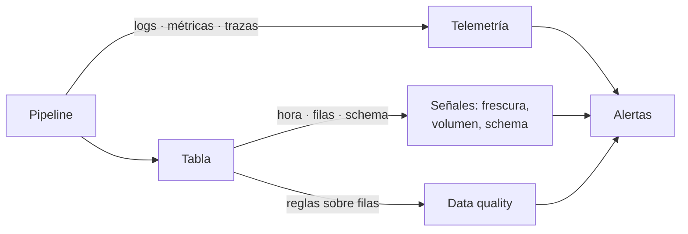

## 1. Resumen

**Data observability** es aplicar a los datos lo que la observabilidad aplica a los sistemas: emitir y vigilar señales para poder responder «¿por qué pasa esto?» sin haber previsto el problema (*Observability primer*). Hay dos grupos de señales:

- **sobre los datos:** frescura, volumen y cambios de schema de cada tabla;
- **sobre los pipelines:** logs, métricas y trazas de cada corrida.

**No es lo mismo que data quality.** Data quality evalúa reglas definidas de antemano sobre el contenido («`monto >= 0`», «`id` único»), por dimensión (`data-quality-dimensions`), y un `quality-gate` decide con ellas. La observabilidad vigila cómo se comportan los datos y los procesos en el tiempo y avisa de lo que nadie escribió como regla: una tabla que dejó de actualizarse, una carga con la mitad de filas, una columna nueva. Se complementan: una regla de calidad no ve que el lote llegó tarde, y una señal de volumen no ve que un monto es negativo.

## 2. Qué es

| | Data quality | Data observability |
|---|---|---|
| Pregunta | ¿El contenido cumple las reglas? | ¿Los datos y los pipelines se comportan como siempre? |
| Base | Reglas definidas de antemano, por dimensión | Señales medidas en cada carga y su historia |
| Ejemplos | No nulos, únicos, rangos, integridad referencial | Frescura, volumen, cambios de schema, duración y errores de las corridas |
| Qué detecta | Lo que se previó | También lo que no se previó |
| Acción típica | Bloquear o avisar (quality gate) | Alertar e investigar |

Los nombres cruzan: Knowledge Catalog tiene dimensiones de calidad llamadas Freshness y Volume (*Auto data quality overview*). Lo que separa a las dos prácticas es el método (regla fija o señal en el tiempo), no el nombre.

## 3. Problema que resuelve

Una tabla de ventas pasa todos sus tests cada mañana. Un día el origen cambia y manda solo una región: las filas que llegan son válidas, los tests pasan, y el tablero muestra la mitad de las ventas. Una señal de volumen contra la historia detecta la caída el mismo día; ninguna regla de calidad lo hubiera hecho, porque cada fila cumple.

## 4. Cómo funciona

1. En cada carga se guardan metadatos de la tabla: hora, filas, columnas.
2. Cada señal compara el valor de hoy con lo esperado: la frescura contra un acuerdo, el volumen contra la historia, el schema contra la foto anterior.
3. Los pipelines emiten logs, métricas y trazas, con un identificador de corrida que los une.
4. Una alerta avisa cuando una señal sale de lo esperado; la persona que la recibe investiga con la telemetría.
5. Las reglas de calidad siguen corriendo aparte, sobre el contenido.

## 5. Cuándo utilizarlo

- En tablas que otros consumen todos los días.
- Cuando los problemas frecuentes son de llegada (tarde, incompleto, cambiado), no de contenido.
- Para investigar incidentes: qué cambió, cuándo y en qué etapa.

## 6. Cuándo no utilizarlo

- Como reemplazo de las reglas de calidad: no ve valores incorrectos en filas que llegan a tiempo y en cantidad normal.
- Con tablas sin historia suficiente: la señal de volumen necesita varias cargas para saber qué es normal.
- Alertando por cada variación: hay que acordar qué es «fuera de lo esperado».

## 7. Ejemplo sencillo

Cuatro cargas de una tabla, la última hoy a las 06:03, con 410 filas y una columna nueva `canal`:

| Señal o regla | Resultado |
|---|---|
| Frescura (máximo 4 h) | Última carga hace 2:57 → ok |
| Volumen (±30 % de la media) | 410 frente a 1007 (−59 %) → anómalo |
| Schema | Agregada `canal` |
| Calidad: `monto >= 0` | 2/3 filas cumplen |

Las tres primeras son observabilidad; la última, calidad.

## 8. Ejemplo de producción

Una plataforma con 200 tablas:

- cada carga registra hora, filas y schema en una tabla de metadatos;
- frescura, volumen y schema se evalúan después de cada carga, con umbrales por tabla;
- los pipelines emiten logs JSON, métricas por tabla y una traza por corrida, con el `run_id` en todo;
- las reglas de calidad corren en dbt; los resultados de las dos prácticas van al mismo canal de alertas, con su origen.

## 9. Arquitectura



## 10. Código

```python
"""Señales de observabilidad de una tabla (frescura, volumen, schema) frente a una regla de calidad sobre su contenido."""
from datetime import datetime, timedelta

# Lo que un proceso de observabilidad guarda de cada carga: metadatos de la tabla, no reglas sobre las filas.
CARGAS = [
    {"cargada": "2026-10-17T06:05", "filas": 1000, "columnas": ["id", "monto", "tienda"]},
    {"cargada": "2026-10-18T06:02", "filas": 1040, "columnas": ["id", "monto", "tienda"]},
    {"cargada": "2026-10-19T06:04", "filas": 980, "columnas": ["id", "monto", "tienda"]},
    {"cargada": "2026-10-20T06:03", "filas": 410, "columnas": ["id", "monto", "tienda", "canal"]},
]
AHORA = datetime.fromisoformat("2026-10-20T09:00")
FILAS_HOY = [{"id": 1, "monto": 10.0}, {"id": 2, "monto": -3.0}, {"id": 3, "monto": 7.5}]


def frescura(cargas: list[dict[str, object]], max_retraso: timedelta) -> str:
    retraso = AHORA - datetime.fromisoformat(str(cargas[-1]["cargada"]))
    return f"frescura: última carga hace {retraso} -> {'ok' if retraso <= max_retraso else 'ATRASADA'}"


def volumen(cargas: list[dict[str, object]], tolerancia: float) -> str:
    previas = [int(str(c["filas"])) for c in cargas[:-1]]
    media, hoy = sum(previas) / len(previas), int(str(cargas[-1]["filas"]))
    variacion = (hoy - media) / media
    return f"volumen: {hoy} filas vs media {media:.0f} ({variacion:+.0%}) -> {'ok' if abs(variacion) <= tolerancia else 'ANÓMALO'}"


def schema(cargas: list[dict[str, object]]) -> str:
    antes, ahora = set(cargas[-2]["columnas"]), set(cargas[-1]["columnas"])  # type: ignore[call-overload]
    return f"schema: agregadas {sorted(ahora - antes)}, quitadas {sorted(antes - ahora)}"


print(frescura(CARGAS, timedelta(hours=4)))
print(volumen(CARGAS, 0.3))
print(schema(CARGAS))
# Data quality: una regla definida de antemano sobre el contenido de las filas.
print(f"calidad (monto >= 0): {sum(f['monto'] >= 0 for f in FILAS_HOY)}/{len(FILAS_HOY)} filas cumplen")
```

El script se **ejecuta en la CI** y pasa `mypy --strict`. Imprime `frescura: última carga hace 2:57:00 -> ok`, `volumen: 410 filas vs media 1007 (-59%) -> ANÓMALO`, `schema: agregadas ['canal'], quitadas []` y `calidad (monto >= 0): 2/3 filas cumplen`.

## 11. GCP

En GCP, **Knowledge Catalog** mide calidad con dimensiones que incluyen Freshness y Volume. Según *Observability primer* y *Auto data quality overview* (no ejecutado):

| | Data observability (este concepto) | Knowledge Catalog |
|---|---|---|
| Método | Señales comparadas con la historia y con acuerdos | Reglas de calidad asociadas a una dimensión, entre ellas Freshness y Volume |
| Qué no previste | Lo busca la observabilidad | Las reglas miden lo que se configuró |

## 12. AWS

En AWS, **AWS Glue Data Quality** agrega detección de anomalías a sus reglas. Según *Observability primer* y *Anomaly detection in AWS Glue Data Quality* (no ejecutado):

| | Data observability (este concepto) | AWS Glue Data Quality |
|---|---|---|
| Reglas | Aparte, en data quality | Rulesets DQDL |
| Lo que las reglas no ven | Señales en el tiempo | Detección de anomalías con machine learning, con al menos tres puntos de datos; detecta patrones estacionales que las reglas no detectan |

## 13. Azure

En Azure, **Azure Monitor**. Según *Signals* y *Azure Monitor overview* (no ejecutado):

| | Data observability (este concepto) | Azure Monitor |
|---|---|---|
| Señales de pipeline | Logs, métricas y trazas | Reúne métricas, logs, trazas y eventos en una experiencia |
| Señales sobre los datos | Frescura, volumen, schema | La página no las trata: se calculan en el pipeline y se envían como métricas o logs |

## 14. Buenas prácticas

- Medir frescura, volumen y schema en cada carga de las tablas importantes.
- Un identificador de corrida en todos los logs, métricas y trazas.
- Umbrales por tabla, acordados con quien consume.
- Mantener las reglas de calidad: la observabilidad no las reemplaza.
- **Seguridad:** las señales usan metadatos; si se guardan muestras de filas, con los permisos de los datos.
- **Observabilidad:** guardar la historia de cada señal, no solo el último valor.
- **Costo:** medir con metadatos (conteos, hora de carga, `information_schema`) es barato; escanear tablas enteras no.

## 15. Errores frecuentes

- Llamar observabilidad a un conjunto de tests de calidad.
- Señales sin historia: no hay con qué comparar.
- Alertar por todo y que nadie mire las alertas.
- Observar los pipelines y no los datos (o al revés).

## 16. Trade-offs

Más señales detectan más y generan más alertas que atender. Comparar con la historia detecta lo imprevisto, a cambio de falsos positivos en días atípicos. Las reglas de calidad son precisas y solo ven lo que se previó.

## 17. Conceptos relacionados

- `data-quality-dimensions`: dimensiones y reglas de calidad.
- `quality-gate`: decidir con las reglas.
- `data-freshness`, `volume-anomalies`, `schema-change-detection`: señales sobre los datos.
- `observability-logs`, `observability-metrics`, `observability-traces`: telemetría del pipeline.
- `orchestration-observability`: lo que muestra el orquestador.

## 18. Preguntas técnicas abiertas

1. ¿Qué problema de tus datos pasó todos los tests?
2. ¿Guardas filas, hora y schema de cada carga?
3. ¿Quién recibe hoy las alertas de tus pipelines?

## 19. Laboratorio relacionado

Pendiente (F4).

## 20. Fuentes

- OpenTelemetry: *Observability primer* y *Signals*.
- *The Government Data Quality Framework* (GOV.UK, 2020).
- Google Cloud: *Auto data quality overview*.
- AWS: *Anomaly detection in AWS Glue Data Quality*.
- Microsoft Learn: *Azure Monitor overview*.

El detalle de cada fuente está en `sources` del frontmatter.

## 21. Fecha de última verificación

2026-10-20. Pasa a `verified`: revisión B-F3.1 del lote F3b-16a sin hallazgos en esta ficha, sin VERIFY pendientes.

## 22. Historial de cambios importantes

- 2026-10-20: creación (lote F3b-16a).
- 2026-10-20: revisión B-F3.1 del lote F3b-16a (docs/reviews/cards-f3b-16a.md), sin hallazgos que corregir.
- 2026-10-20: `verification_status: verified` (sin VERIFY pendientes).
