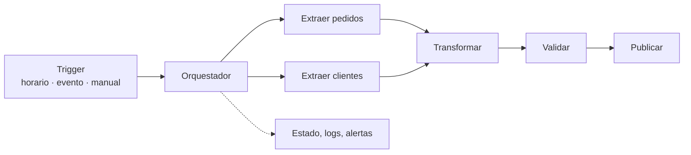

## 1. Resumen

Orquestar es coordinar las tareas de los pipelines: **qué** corre, **cuándo** (horario o evento), **en qué orden** (dependencias), **cuántas veces se reintenta**, **qué pasa si falla** y **cómo se reprocesa un período pasado**. El orquestador no transforma datos: dirige a los sistemas que lo hacen y registra el estado de cada ejecución. Esta ficha es la visión general; el detalle (Airflow, Dags, scheduler, catchup) está en el dominio 06.

## 2. Qué es

Es una pieza consolidada de toda plataforma de datos. Las opciones más comunes:

| Herramienta | Modelo | Dónde |
|---|---|---|
| Apache Airflow | Dags en Python con tareas y dependencias | Autogestionado, Managed Airflow (Cloud Composer) en GCP, MWAA en AWS |
| AWS Step Functions | Máquinas de estados dirigidas por eventos | AWS |
| Azure Data Factory | Pipelines de actividades con triggers | Azure y Fabric |
| Dataform / dbt | Orden por dependencias de modelos SQL | Dentro del warehouse |

Las herramientas de transformación como Dataform o dbt ordenan sus modelos, pero no reemplazan al orquestador cuando hay que coordinar sistemas distintos.

## 3. Problema que resuelve

Un pipeline real son muchas tareas: extraer de varias fuentes, validar, transformar, publicar y notificar. Con cron y scripts sueltos:

- no hay dependencias, y la transformación corre aunque la extracción haya fallado;
- no hay reintentos ni historial;
- no hay forma simple de reprocesar la semana pasada.

El orquestador hace explícitas las dependencias y el estado de cada ejecución.

## 4. Cómo funciona

1. **Definición:** el pipeline se declara como grafo de tareas (Dag, máquina de estados o pipeline de actividades).
2. **Disparo:** por horario (diario, cada hora), por evento (llegó un archivo, terminó otro pipeline) o manual.
3. **Ejecución:** cada disparo crea una ejecución con su período lógico (por ejemplo, el día 2026-10-04). Las tareas corren cuando sus dependencias terminaron bien.
4. **Fallos:** reintentos con espera; si se agotan, la tarea falla, las dependientes no corren y se alerta.
5. **Reproceso:** backfill de un rango de períodos, que reutiliza las mismas tareas parametrizadas por fecha.
6. **Registro:** estado, duración y logs de cada tarea, base de la observabilidad.

## 5. Cuándo utilizarlo

- Pipelines con varias tareas y dependencias.
- Procesos recurrentes que necesitan reintentos, alertas y reprocesos.
- Coordinación entre sistemas distintos (ingesta en un servicio, transformación en otro, publicación en un tercero).

## 6. Cuándo no utilizarlo

- Para una sola tarea simple y aislada: un trigger programado del propio servicio puede bastar (una consulta programada o una transferencia).
- Para mover o transformar datos dentro del orquestador: sus workers no son un motor de procesamiento; delegar en BigQuery, Spark o Dataflow.
- Para procesamiento de streaming continuo: eso lo hace un motor de streaming; el orquestador coordina lo batch alrededor.

## 7. Ejemplo sencillo

Cada día a las 02:00:

1. `extraer_pedidos` y `extraer_clientes` corren en paralelo;
2. `transformar` corre cuando las dos terminan;
3. `validar` y luego `publicar`.

Si `extraer_pedidos` falla tres veces, `transformar` no corre y se envía una alerta.

## 8. Ejemplo de producción

Un equipo usa Managed Airflow (Cloud Composer):

- un Dag por dominio de datos, todos parametrizados por `ds`;
- las tareas invocan BigQuery, Dataform y Cloud Run, y no procesan datos en el worker;
- reintentos con espera y alertas a un canal con responsable;
- los backfills se lanzan por rango de fechas desde la CLI;
- la observabilidad mide duración, tareas fallidas y frescura de las tablas publicadas.

Los Dags están en git y se despliegan con CI.

## 9. Arquitectura



## 10. Código

```python
# Airflow 3 (TaskFlow): la estructura del ejemplo sencillo. Requiere: un módulo pipeline con las funciones
# extraer, transformar, validar y publicar, idempotentes y parametrizadas por fecha (ds).
from datetime import datetime

from airflow.sdk import dag, task

import pipeline  # funciones que delegan el trabajo en BigQuery, Dataform, Cloud Run, etc.


@dag(schedule="@daily", start_date=datetime(2026, 10, 1), catchup=False)
def ventas_diarias():
    @task(retries=3)
    def extraer_pedidos(*, ds: str) -> str:
        return pipeline.extraer("pedidos", ds)

    @task(retries=3)
    def extraer_clientes(*, ds: str) -> str:
        return pipeline.extraer("clientes", ds)

    @task(retries=2)
    def transformar(pedidos: str, clientes: str, *, ds: str) -> str:
        return pipeline.transformar(pedidos, clientes, ds)

    @task
    def validar(tabla: str, *, ds: str) -> str:
        pipeline.validar(tabla, ds)          # lanza una excepción si la validación falla
        return tabla

    @task
    def publicar(tabla: str, *, ds: str) -> None:
        pipeline.publicar(tabla, ds)

    publicar(validar(transformar(extraer_pedidos(), extraer_clientes())))


ventas_diarias()
```

Las dependencias salen de pasar el resultado de una tarea a la siguiente: las dos extracciones corren en paralelo y `transformar` espera a ambas. La ficha `dag` tiene un ejemplo completo con BigQuery.

## 11. GCP

**Managed Airflow** (Cloud Composer) es Airflow totalmente administrado, para crear, programar, monitorear y gestionar pipelines que pueden abarcar varias nubes y centros de datos propios. Para tareas simples, BigQuery tiene consultas programadas y Data Transfer Service, que no requieren un orquestador. Dataform ordena por dependencias los modelos SQL dentro de BigQuery.

## 12. AWS

AWS ofrece dos modelos: **MWAA** (Airflow administrado) y **Step Functions**, basado en máquinas de estados con pasos dirigidos por eventos, donde cada estado invoca un servicio de AWS. Step Functions encaja con arquitecturas serverless y orientadas a eventos. Airflow encaja con pipelines batch parametrizados por fecha y con backfills.

## 13. Azure

En **Data Factory** (y en Fabric), un **pipeline** agrupa actividades (copia, data flows, notebooks) y se inicia con **triggers** programados o manuales, con relación de muchos a muchos entre triggers y pipelines. Orquestación y movimiento de datos conviven en el mismo servicio. Fabric también ofrece Apache Airflow jobs (ver `airflow-architecture`).

## 14. Buenas prácticas

- Tareas idempotentes y parametrizadas por período: reintentos y backfills seguros.
- Delegar el procesamiento en el motor adecuado; el orquestador coordina.
- Dependencias explícitas en el grafo, no esperas por horario ("la extracción suele terminar a las 03:00").
- Reintentos con espera para errores transitorios; fallo rápido para errores de datos.
- Pipelines en código versionado, desplegados con CI.
- **Seguridad:** las tareas usan cuentas de servicio con permisos mínimos y secretos de un gestor, nunca en el código del Dag.
- **Observabilidad:** alertas por tarea fallida y por SLA de frescura, con un responsable que las atienda.
- **Costo:** el orquestador administrado tiene costo fijo por entorno; para pocas tareas simples, los programadores nativos de cada servicio pueden ser más baratos.

## 15. Errores frecuentes

- Encadenar tareas por horario en vez de por dependencia.
- Procesar datos pesados dentro del worker del orquestador.
- Tareas no idempotentes que duplican al reintentar.
- Alertas que nadie lee.
- Calcular la fecha con el reloj dentro de la tarea en vez de recibir el período lógico.

## 16. Trade-offs

Un orquestador da control, visibilidad y reprocesos, a cambio de una pieza más que operar y pagar. Airflow es flexible y estándar para batch. Step Functions y los triggers de eventos encajan mejor con flujos serverless. Data Factory integra orquestación y copia en un servicio. Los programadores nativos son más simples, pero no coordinan sistemas distintos.

## 17. Conceptos relacionados

- `dag` y `scheduler`: los conceptos centrales del orquestador.
- `airflow-architecture`: la herramienta más usada, en detalle.
- `retries` y `backfill`: funciones clave del orquestador.
- `data-pipeline`: lo que se orquesta.

## 18. Preguntas técnicas abiertas

1. ¿Qué tareas de tu plataforma podrían prescindir de un orquestador?
2. ¿Cómo reprocesarías un mes completo sin duplicar datos?
3. ¿Cuándo elegirías Step Functions en lugar de Airflow?

## 19. Laboratorio relacionado

Pendiente (F4).

## 20. Fuentes

- Apache Airflow: *Dags* y *TaskFlow* (tutorial).
- Google Cloud: *Managed Airflow overview* (Cloud Composer) y *What is BigQuery Data Transfer Service?*
- AWS: *What is Amazon MWAA?* y *What is Step Functions?*
- Microsoft Learn: *Pipelines and activities* (Azure Data Factory).

El detalle de cada fuente está en `sources` del frontmatter.

## 21. Fecha de última verificación

2026-10-06. Pasa a `verified`: revisión B-F3.1 del lote F3b-01a aplicada, sin VERIFY pendientes.

## 22. Historial de cambios importantes

- 2026-10-05: creación (lote F3b-01a, dominio 01-fundamentals).
- 2026-10-06: `verification_status: verified` (revisión B-F3.1 del lote F3b-01a aplicada; sin VERIFY pendientes).
- 2026-10-13: `page_title` en cada cita, con el título de la página citada (ADR-012); sin cambios de contenido.
