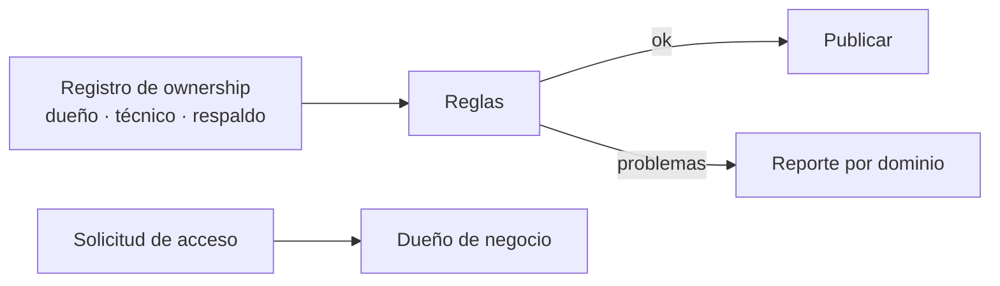

## 1. Resumen

**Ownership** es que cada dataset tenga un **dueño**: una persona o un equipo de negocio que decide qué significa el dato, quién puede usarlo, qué calidad necesita y cuándo se borra. Se separa del **equipo técnico** que lo produce y lo opera, y conviene que tenga un **respaldo**.

La separación importa. Purview lo dice así: a menudo TI guarda y mantiene activos que poseen y usan los equipos de negocio, y eso abre una brecha (*Governance domains in Unified Catalog*). Data mesh lleva el ownership a los dominios de negocio y trata los datos como producto, con un dueño responsable (*Data Mesh Principles and Logical Architecture*, Nivel 4).

## 2. Qué es

| Rol | Decide | Ejemplo |
|---|---|---|
| Dueño de negocio | Significado, acceso, calidad necesaria, retención | Comercial, para `ventas.pedidos` |
| Dueño técnico (custodio) | Cómo se produce, se opera y se protege | Plataforma de datos |
| Respaldo | Lo mismo que el dueño, si falta | Otra persona del mismo equipo |

## 3. Problema que resuelve

Un analista pide acceso a `ventas.devoluciones`. Plataforma dice «no somos los dueños, solo la cargamos»; comercial dice «eso lo maneja datos». La solicitud queda dos semanas sin respuesta. Con un dueño registrado, la solicitud va a quien decide.

## 4. Cómo funciona

1. Cada dataset publicado tiene en el registro (o en el catálogo) un dueño de negocio, uno técnico y un respaldo.
2. El dueño debe ser un equipo registrado, no un nombre suelto.
3. Si el equipo técnico figura como dueño de negocio, se revisa: suele ser un dataset sin dueño real.
4. Accesos, cambios de significado y retención los aprueba el dueño.
5. Un reporte periódico lista los datasets con problemas de ownership.

## 5. Cuándo utilizarlo

- En todo dataset que consumen otros equipos.
- Antes de publicar un data product.
- Cuando las solicitudes de acceso o de corrección no tienen a quién ir.

## 6. Cuándo no utilizarlo

- Para tablas temporales de un pipeline: su dueño es el equipo del pipeline y no necesitan más.
- Como formalidad: un dueño que no decide nada no resuelve el problema.

## 7. Ejemplo sencillo

| Dataset | Problemas |
|---|---|
| `ventas.pedidos` | ninguno |
| `finanzas.facturas` | sin respaldo |
| `ventas.devoluciones` | sin dueño de negocio; sin respaldo |
| `marketing.campanias` | el dueño no es un equipo registrado |
| `tmp.cargas_manuales` | el equipo técnico figura como dueño de negocio; sin respaldo |

4 de 5 datasets con problemas.

## 8. Ejemplo de producción

- El registro de ownership vive en el catálogo y se valida en la CI del repositorio de datos.
- Publicar en la capa de consumo exige dueño de negocio y respaldo.
- Las solicitudes de acceso se enrutan al dueño.
- Un reporte mensual por dominio: datasets sin dueño, sin respaldo o con dueño técnico como único responsable.

## 9. Arquitectura



## 10. Código

```python
"""Un registro de ownership por dataset y las reglas que lo mantienen sano: dueño de negocio, dueño técnico y respaldo."""
from dataclasses import dataclass


@dataclass(frozen=True)
class Dataset:
    nombre: str
    dueno_negocio: str | None     # quién decide qué significa y quién lo usa
    dueno_tecnico: str | None     # quién lo produce y lo opera
    respaldo: str | None          # una segunda persona, por si falta la primera


EQUIPOS = {"comercial", "finanzas", "plataforma-datos"}
REGISTRO = [
    Dataset("ventas.pedidos", "comercial", "plataforma-datos", "comercial"),
    Dataset("finanzas.facturas", "finanzas", "plataforma-datos", None),
    Dataset("ventas.devoluciones", None, "plataforma-datos", None),
    Dataset("marketing.campanias", "marketing", "plataforma-datos", "marketing"),
    Dataset("tmp.cargas_manuales", "plataforma-datos", "plataforma-datos", None),
]


def problemas(d: Dataset) -> list[str]:
    salida = []
    if d.dueno_negocio is None:
        salida.append("sin dueño de negocio")
    elif d.dueno_negocio not in EQUIPOS:
        salida.append(f"dueño '{d.dueno_negocio}' no es un equipo registrado")
    elif d.dueno_negocio == d.dueno_tecnico:
        salida.append("el equipo técnico figura como dueño de negocio")
    if d.respaldo is None:
        salida.append("sin respaldo")
    return salida


for d in REGISTRO:
    p = problemas(d)
    print(f"{d.nombre}: {'ok' if not p else '; '.join(p)}")
print(f"datasets con problemas: {sum(bool(problemas(d)) for d in REGISTRO)}/{len(REGISTRO)}")
```

El script se **ejecuta en la CI** y pasa `mypy --strict`. Imprime el estado de cada dataset (por ejemplo, `ventas.devoluciones: sin dueño de negocio; sin respaldo`) y `datasets con problemas: 4/5`.

## 11. GCP

En GCP, los **data products de Knowledge Catalog** tienen dueños. Según *Data Mesh Principles and Logical Architecture* y *About data products* (no ejecutado):

| | Ownership (este concepto) | Knowledge Catalog |
|---|---|---|
| Qué tiene dueño | Cada dataset | El data product, colección curada de activos |
| Qué hace el dueño | Decide significado, acceso, calidad y retención | Configura grupos de acceso y puede asignar un rol de IAM por defecto para los activos del producto |

## 12. AWS

En AWS, los **dominios de Amazon SageMaker Unified Studio**. Según *Data Mesh Principles and Logical Architecture* y *Domains in Amazon SageMaker Unified Studio* (no ejecutado):

| | Ownership (este concepto) | SageMaker Unified Studio |
|---|---|---|
| Organización | Dueño por dataset, agrupado por dominio | El domain organiza activos, usuarios y proyectos; uno para la empresa o varios por unidad de negocio |
| Dueño por dataset | En el registro | La página citada describe el dominio, no un dueño por dataset |

## 13. Azure

En Azure, los **roles de Purview Unified Catalog**. Según *Governance domains in Unified Catalog* y *Data governance roles and permissions in Microsoft Purview* (no ejecutado):

| | Ownership (este concepto) | Purview |
|---|---|---|
| Dueño | Dueño de negocio por dataset | Governance Domain Owner por dominio; Data Product Owner por data product |
| Respaldo | Una segunda persona | Se recomienda asignar al menos dos governance domain owners |
| Qué decide | Acceso, calidad, retención | Delegar permisos del dominio, alertas y programación de calidad, políticas de acceso del dominio |

## 14. Buenas prácticas

- Dueño de negocio, dueño técnico y respaldo, por dataset publicado.
- Dueños que sean equipos registrados, no nombres sueltos.
- Validar el registro en la CI.
- **Seguridad:** las solicitudes de acceso las aprueba el dueño, no quien opera la plataforma.
- **Observabilidad:** datasets sin dueño o sin respaldo, medidos y publicados.
- **Costo:** sin dueño, nadie decide borrar; el almacenamiento crece.

## 15. Errores frecuentes

- El equipo de plataforma como dueño de todo.
- Dueños que se fueron de la empresa.
- Ownership escrito en un documento que nadie actualiza.

## 16. Trade-offs

Exigir dueño antes de publicar ordena y frena la publicación. Dueños de negocio deciden mejor el significado y necesitan apoyo técnico (stewards, plataforma) para cumplir.

## 17. Conceptos relacionados

- `data-products`: el dueño de un producto de datos.
- `data-stewardship`: quien cuida en nombre del dueño.
- `data-domains`: ownership por dominio.
- `data-catalog`: donde figura el dueño.
- `data-mesh`: ownership de dominio.

## 18. Preguntas técnicas abiertas

1. ¿Quién aprueba hoy el acceso a tu tabla más pedida?
2. ¿Cuántos de tus datasets tienen al equipo técnico como único responsable?
3. ¿Qué pasa con un dataset cuando su dueño se va?

## 19. Laboratorio relacionado

Pendiente (F4).

## 20. Fuentes

- Zhamak Dehghani: *Data Mesh Principles and Logical Architecture* (Nivel 4).
- Microsoft Learn: *Governance domains in Unified Catalog* y *Data governance roles and permissions in Microsoft Purview*.
- Google Cloud: *About data products*.
- AWS: *Domains in Amazon SageMaker Unified Studio*.

El detalle de cada fuente está en `sources` del frontmatter.

## 21. Fecha de última verificación

2026-10-21. `review_required`: pendiente de revisión B-F3.1 del lote F3b-17b.

## 22. Historial de cambios importantes

- 2026-10-21: creación (lote F3b-17b).
