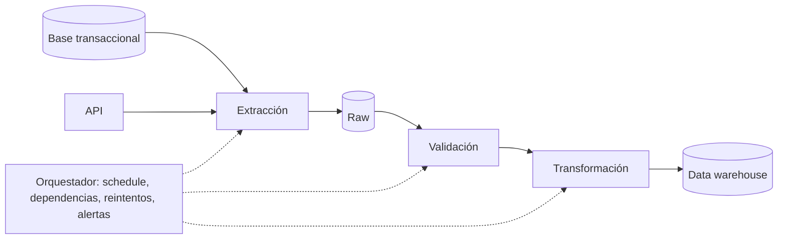

## 1. Resumen

Un data pipeline es una secuencia automatizada de pasos que lee datos de una o más fuentes, los transforma y los escribe en un destino. Lo que lo distingue de un script suelto es que tiene dependencias explícitas, se ejecuta según una programación o un evento, y está pensado para fallar de forma controlada y poder reejecutarse.

## 2. Qué es

Es la unidad de trabajo de la ingeniería de datos. Tiene cuatro partes:

- **fuentes**: bases de datos, APIs, archivos, streams;
- **transformaciones**: limpieza, uniones, agregaciones, validaciones;
- **destino**: data warehouse, data lake, otra aplicación;
- **control**: programación, dependencias, reintentos, alertas y registro de ejecuciones.

## 3. Problema que resuelve

Sin pipelines, mover datos es manual o depende de scripts sin orden ni monitoreo: nadie sabe si la carga de ayer terminó, qué pasó cuando falló ni cómo repetirla. El pipeline convierte ese trabajo en un proceso repetible, observable y recuperable.

## 4. Cómo funciona

1. Un **disparador** inicia la ejecución: un horario, la llegada de un archivo o un evento.
2. Las **tareas** corren en el orden que marcan sus dependencias (normalmente un grafo dirigido acíclico, DAG).
3. Cada tarea lee su entrada, la procesa y escribe su salida, idealmente de forma idempotente.
4. El orquestador registra el estado de cada tarea, reintenta los fallos transitorios y alerta cuando algo falla de forma definitiva.

En **Airflow**, un Dag encapsula todo lo necesario para ejecutar un workflow: cuándo corre (schedule), qué tareas tiene y en qué orden y con qué condiciones se ejecutan.

## 5. Cuándo utilizarlo

- Cargas recurrentes de datos entre sistemas.
- Transformaciones que alimentan reportes, modelos o aplicaciones.
- Cualquier movimiento de datos que tenga que repetirse, auditarse o recuperarse.

## 6. Cuándo no utilizarlo

- Consultas exploratorias de una sola vez: un notebook o una consulta ad hoc es suficiente.
- Integraciones de baja latencia entre aplicaciones que no necesitan transformar datos: una API o una cola directa puede ser más simple.

## 7. Ejemplo sencillo

Cada noche, un pipeline lee las ventas del día desde la base transaccional, calcula totales por tienda y los escribe en una tabla del data warehouse. Si la lectura falla, reintenta; si sigue fallando, avisa.

## 8. Ejemplo de producción

Un Dag diario con cuatro tareas: extraer pedidos a la capa raw del lake, validar volumen y esquema, transformar en el warehouse (reemplazando la partición del día) y publicar métricas. Cada tarea usa la fecha lógica del período, así que la ejecución de un día se puede repetir o hacer backfill sin duplicar. Las alertas llegan al equipo si una tarea queda fallida o si la ejecución se retrasa respecto de su SLA.

## 9. Arquitectura



## 10. Código

```python
# Airflow 3 (TaskFlow) + google-cloud-bigquery: validar el staging y reemplazar la partición del día lógico.
from datetime import datetime

from airflow.sdk import dag, task
from google.cloud import bigquery

COUNT_STAGING = """
SELECT COUNT(*) AS filas FROM `proyecto.staging.ventas` WHERE fecha = CAST(@dia AS DATE)
"""

REPLACE_PARTITION = """
BEGIN TRANSACTION;
DELETE FROM `proyecto.dwh.ventas` WHERE fecha = CAST(@dia AS DATE);
INSERT INTO `proyecto.dwh.ventas`
SELECT * FROM `proyecto.staging.ventas` WHERE fecha = CAST(@dia AS DATE);
COMMIT TRANSACTION;
"""


def day_config(ds: str) -> bigquery.QueryJobConfig:
    return bigquery.QueryJobConfig(query_parameters=[bigquery.ScalarQueryParameter("dia", "STRING", ds)])


@dag(schedule="@daily", start_date=datetime(2026, 9, 1), catchup=False)
def ventas_diarias():
    @task(retries=3)
    def validar_staging(*, ds: str) -> int:
        rows = list(bigquery.Client().query_and_wait(COUNT_STAGING, job_config=day_config(ds)))
        filas = rows[0].filas
        if filas == 0:
            raise ValueError(f"staging vacío para {ds}: no se reemplaza la partición")
        return filas

    @task(retries=3)
    def reemplazar_particion(filas: int, *, ds: str) -> None:
        bigquery.Client().query_and_wait(REPLACE_PARTITION, job_config=day_config(ds))

    reemplazar_particion(validar_staging())


ventas_diarias()
```

El Dag tiene dos tareas: `validar_staging` cuenta las filas del día lógico en staging y falla si no hay ninguna, para que una extracción vacía no borre la partición buena; `reemplazar_particion` depende de ella y ejecuta el `DELETE` + `INSERT` del día en una transacción de BigQuery. Si algo falla antes del `COMMIT`, la partición queda como estaba, y reintentar o reejecutar el día da el mismo resultado.

`ds` es la fecha lógica de la ejecución y solo existe cuando el DagRun tiene `logical_date` (las ejecuciones programadas la tienen). El día se pasa como parámetro de consulta (`@dia`), no concatenado en el SQL.

Requiere Apache Airflow 3.x con `google-cloud-bigquery`, credenciales con `roles/bigquery.jobUser` en el proyecto y `roles/bigquery.dataEditor` en los datasets, y las tablas `staging.ventas` y `dwh.ventas` con una columna `fecha`. Es el código del snippet `airflow-daily-partition-dag`, que detalla requisitos, riesgos y cómo ejecutarlo.

## 11. GCP

**Dataflow** ejecuta pipelines de procesamiento unificado batch y streaming: leen de una o más fuentes, transforman y escriben en un destino. La orquestación de varios pasos suele hacerse con **Managed Service for Apache Airflow (ex Cloud Composer)**: Google renombró Cloud Composer y lo describe como un servicio totalmente administrado de orquestación de workflows construido sobre Apache Airflow, así que ejecuta Dags como el de §10.

## 12. AWS

**AWS Glue** es un servicio serverless de integración de datos para descubrir, preparar, mover e integrar datos de múltiples fuentes. A diferencia de Dataflow, su centro es la integración (ETL y catálogo) más que un modelo de programación unificado de batch y streaming.

## 13. Azure

**Azure Data Factory** es el servicio cloud de ETL e integración de datos. Su pipeline es un contenedor de *activities* que se conecta a los datos mediante *datasets* y *linked services*, y se ejecuta sobre *integration runtimes*. Es principalmente un orquestador de movimiento y transformación, no un motor de procesamiento de propósito general.

## 14. Buenas prácticas

- Hacer cada tarea idempotente y parametrizada por la fecha lógica.
- Dividir en tareas con una responsabilidad clara, para reintentar solo lo que falló.
- Validar los datos entre pasos, no solo al final.
- Versionar el código del pipeline y desplegarlo con CI.
- **Seguridad:** ejecutar con una cuenta de servicio de mínimos privilegios y guardar credenciales en un gestor de secretos, nunca en el código.
- **Observabilidad:** registrar duración, filas leídas y escritas y estado por tarea, y alertar por fallo y por retraso respecto del SLA.
- **Costo:** dimensionar el cómputo por tarea y evitar reprocesar datos completos cuando basta un incremento.

## 15. Errores frecuentes

- Usar la fecha actual en lugar de la fecha lógica del período.
- Tareas no idempotentes que duplican datos al reintentar.
- Un único paso gigante que, si falla, obliga a repetir todo.
- Pipelines sin alertas: el fallo se descubre cuando el usuario reclama.

## 16. Trade-offs

Más tareas pequeñas dan más control y reintentos finos, a cambio de más sobrecarga de orquestación. Menos tareas grandes son más simples, pero más costosas de repetir cuando fallan.

## 17. Conceptos relacionados

- `etl-vs-elt`: dónde se transforma dentro del pipeline.
- `batch-vs-streaming`: el modo de procesamiento.
- `idempotency`: requisito para reejecutar sin duplicar.
- `retries`: control de fallos transitorios.
- Del blueprint, pendientes de ficha: `dag`, `orchestration`, `data-contracts`.

## 18. Preguntas técnicas abiertas

1. ¿Cómo dividirías en tareas un pipeline que hoy es un solo script de 800 líneas?
2. ¿Qué información debería registrar cada ejecución para poder diagnosticar un fallo días después?
3. ¿Cómo harías que el pipeline pueda reejecutar cualquier día del último año sin cambios de código?

## 19. Laboratorio relacionado

Pendiente (F4): primer pipeline batch de extremo a extremo (lab de tipo A).

## 20. Fuentes

- Apache Airflow: *Dags*, *Pythonic Dags with the TaskFlow API* y *Templates reference*.
- Google Cloud: *Dataflow overview*, *Managed Airflow overview* (Managed Service for Apache Airflow) y *Multi-statement transactions*, *Run parameterized queries*, *Work with multi-statement queries* y *BigQuery IAM roles and permissions* (BigQuery).
- AWS: *What is AWS Glue?*.
- Microsoft Learn: *Introduction to Azure Data Factory*.

El detalle de cada fuente está en `sources` del frontmatter.

## 21. Fecha de última verificación

2026-10-01. El código de §10 coincide con el tutorial de TaskFlow y la referencia de templates de Airflow 3.3.2. Pasa a `verified`: revisión B-F3.1 del lote 2 aplicada, sin VERIFY pendientes.

## 22. Historial de cambios importantes

- 2026-09-30: creación (lote 2 de F3).
- 2026-09-30: revisión B-F3.1 aplicada: transacción de `replace_partition` a la vista; nombre y fuente de Managed Service for Apache Airflow.
- 2026-09-30: `verification_status: verified` (revisión B-F3.1 del lote 2 aplicada; sin VERIFY pendientes).
- 2026-10-01: §10 alineada con el snippet ejecutable `airflow-daily-partition-dag`: el código anterior llamaba a funciones no definidas (`extract_orders`, `validate_volume_and_schema`, `replace_partition`).
