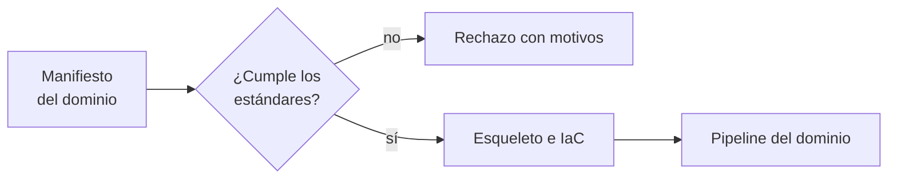

## 1. Resumen

Cuando cada equipo de dominio arma sus pipelines a su manera, la plataforma termina con diez formas de hacer lo mismo y ningún estándar que se cumpla. La respuesta es tratar la plataforma de datos como un **producto**: un equipo de plataforma ofrece a los dominios un **camino recomendado de autoservicio** (plantillas, infraestructura como código y estándares validados), y los dominios lo usan para crear sus pipelines y productos de datos.

AWS llama a esos caminos *golden paths* y los considera la capacidad más fundamental de una plataforma interna (*Principles of building an internal developer platform*). Google Cloud describe la plataforma de datos de un data mesh como componentes componibles con infraestructura como código (*Design a self-service data platform for a data mesh*).

## 2. Qué es

- **Producto interno:** la plataforma tiene usuarios (los equipos de dominio), roadmap y medición de uso.
- **Camino recomendado:** la forma soportada de crear un pipeline; usarlo es lo fácil, salir de él es posible pero justificado.
- **Manifiesto:** el equipo declara qué quiere (dueño, dominio, clasificación, frescura, retención, tests).
- **Validación antes de crear:** los estándares se verifican en la CI, no en una revisión manual (`ci-cd-for-data`).
- **Esqueleto generado:** la plataforma crea los archivos y recursos con infraestructura como código (`infrastructure-as-code`).

## 3. Problema que resuelve

Un pipeline nuevo tarda tres semanas: pedir permisos, copiar un repositorio viejo, adivinar las convenciones y esperar una revisión. Y aun así llega sin dueño ni política de retención. Con un camino recomendado, el equipo declara el manifiesto, la CI lo valida y el esqueleto queda listo con los estándares incluidos.

## 4. Cómo funciona

1. El equipo de dominio escribe el manifiesto del pipeline.
2. La CI lo valida contra los estándares de la plataforma.
3. Si falla, se rechaza con todos los motivos.
4. Si pasa, la plataforma genera el esqueleto y los recursos con infraestructura como código.
5. El equipo de plataforma mide cuántos pipelines usan el camino y dónde se traban.

## 5. Cuándo utilizarlo

- Varios equipos de dominio que crean pipelines o productos de datos (`data-mesh`, `data-products`).
- Estándares de seguridad o clasificación que hoy se cumplen a mano.
- Cuando crear un pipeline nuevo tarda semanas.

## 6. Cuándo no utilizarlo

- Un solo equipo con pocos pipelines: la plataforma cuesta más que lo que ahorra.
- Para imponer un camino que nadie pidió sin escuchar a los usuarios internos.

## 7. Ejemplo sencillo

| Manifiesto | Resultado |
|---|---|
| `ventas_diarias` | Aceptado; esqueleto con DAG, modelos, tests, README y política de retención (dato personal) |
| `Reporte-Final` | Rechazado: falta `retention_days`, sin dueño, clasificación «secreto» desconocida, nombre fuera de la convención, sin tests |

## 8. Ejemplo de producción

Plataforma de datos corporativa:

- manifiesto por pipeline en el repositorio del dominio;
- validación en la CI con los estándares versionados de la plataforma;
- módulos de infraestructura como código para datasets, buckets y permisos;
- catálogo de los pipelines creados, con dueño y clasificación (`data-classification`);
- métricas de la plataforma: tiempo hasta el primer pipeline y uso del camino;
- en la nube (no ejecutado): plataforma de autoservicio del data mesh de Google Cloud, internal developer platform de AWS o platform engineering de Microsoft.

## 9. Arquitectura



## 10. Código

```python
# Python 3.12, biblioteca estándar (ejecutado en la CI): el camino recomendado de una plataforma de datos como
# producto. Un equipo declara su pipeline en un manifiesto; la plataforma lo valida contra sus estándares (dueño,
# dominio, clasificación, objetivo de frescura, retención, tests y nombres) y, si cumple, genera el esqueleto. Lo que
# no cumple se rechaza con todos los motivos, antes de crear recursos.
import json
import re

REQUIRED = ("owner", "domain", "classification", "freshness_hours", "retention_days", "tests")
CLASSIFICATIONS = {"public", "internal", "confidential", "personal"}
NAME = re.compile(r"^[a-z]+_[a-z_]+$")

MANIFESTS = [
    json.loads('{"name": "ventas_diarias", "owner": "equipo-ventas", "domain": "ventas", "classification": "personal",'
               ' "freshness_hours": 6, "retention_days": 365, "tests": ["unique(id)", "not_null(monto)"]}'),
    json.loads('{"name": "Reporte-Final", "owner": "", "domain": "finanzas", "classification": "secreto",'
               ' "freshness_hours": 24, "tests": []}'),
]


def validate(m: dict[str, object]) -> list[str]:
    errors = [f"falta {k}" for k in REQUIRED if k not in m]
    if not m.get("owner"):
        errors.append("sin dueño")
    if m.get("classification") not in CLASSIFICATIONS:
        errors.append(f"clasificación desconocida: {m.get('classification')}")
    if not NAME.match(str(m.get("name", ""))):
        errors.append(f"nombre fuera de la convención: {m.get('name')}")
    if not m.get("tests"):
        errors.append("sin tests")
    return errors


def scaffold(m: dict[str, object]) -> list[str]:
    name, domain = m["name"], m["domain"]
    files = [f"pipelines/{domain}/{name}/{f}" for f in ("dag.py", "models.sql", "tests.yml", "README.md")]
    if m["classification"] == "personal":
        files.append(f"pipelines/{domain}/{name}/retention_policy.yml")   # la plataforma exige la política
    return files


for m in MANIFESTS:
    errors = validate(m)
    if errors:
        print(f"{m.get('name')}: rechazado: {errors}")
    else:
        print(f"{m['name']}: aceptado; esqueleto: {scaffold(m)}")
```

El script se **ejecuta en la CI** con la biblioteca estándar y pasa `mypy --strict`. Imprime el manifiesto aceptado con sus cinco archivos y el rechazado con sus cinco motivos. Los manifiestos son fijos; la plataforma real generaría además los recursos con infraestructura como código.

## 11. GCP

En GCP, la **plataforma de autoservicio para un data mesh**. Según *Design a self-service data platform for a data mesh* (no ejecutado):

| | Este concepto | Google Cloud |
|---|---|---|
| Quién la construye | Equipo de plataforma | Equipo de plataforma de datos |
| Cómo | Manifiesto validado y esqueleto | Componentes componibles con infraestructura como código (ejemplos con Terraform) |

## 12. AWS

En AWS, la **internal developer platform**. Según *Principles of building an internal developer platform* (no ejecutado):

| | Este concepto | AWS Prescriptive Guidance |
|---|---|---|
| Enfoque | Plataforma como producto | Tratar la plataforma interna como un producto |
| Camino | Camino recomendado | Golden paths alineados con los estándares de seguridad |

## 13. Azure

En Azure, la guía de **platform engineering** de Microsoft. Según *What is platform engineering?* (no ejecutado):

| | Este concepto | Microsoft |
|---|---|---|
| Camino | Camino recomendado | Paved paths y golden path |
| Objetivo | Estándares sin frenar | Guiar por los requisitos críticos sin sacrificar velocidad, con autoservicio |

## 14. Buenas prácticas

- Empezar por un camino para el caso más común.
- Estándares versionados y validados en la CI.
- Medir el uso del camino y escuchar a los equipos de dominio.
- **Seguridad:** el camino incluye clasificación, mínimo privilegio y política de retención desde el inicio.
- **Observabilidad:** cada pipeline creado sale con alertas de frescura y dueño.
- **Costo:** etiquetas de equipo en todo recurso creado (`finops-for-data`).

## 15. Errores frecuentes

- Construir la plataforma completa antes de tener un usuario.
- Estándares que solo viven en un documento.
- Un camino tan rígido que todos lo esquivan.
- No medir si la plataforma acorta el tiempo hasta el primer pipeline.

## 16. Trade-offs

Un camino recomendado acelera y unifica, a cambio de un equipo que lo mantiene y de casos que no encajan. Más estándares en el camino dan cumplimiento por defecto y más fricción para lo excepcional.

## 17. Conceptos relacionados

- `data-mesh` y `data-products`: quién usa la plataforma.
- `ci-cd-for-data`: la validación.
- `infrastructure-as-code`: los recursos.
- `data-classification`: un estándar del camino.
- `finops-for-data`: las etiquetas de costo.

## 18. Preguntas técnicas abiertas

1. ¿Cuánto tarda hoy un equipo en tener su primer pipeline en producción?
2. ¿Qué estándar se cumple hoy solo por revisión manual?
3. ¿Cuál sería el primer camino recomendado de tu plataforma?

## 19. Laboratorio relacionado

Pendiente (F4).

## 20. Fuentes

- Google Cloud: *Design a self-service data platform for a data mesh*.
- AWS: *Principles of building an internal developer platform*.
- Microsoft Learn: *What is platform engineering?*.

El detalle de cada fuente está en `sources` del frontmatter.

## 21. Fecha de última verificación

2026-10-26. `review_required`: pendiente de revisión B-F3.1 del lote F3b-22a.

## 22. Historial de cambios importantes

- 2026-10-26: creación (lote F3b-22a).
