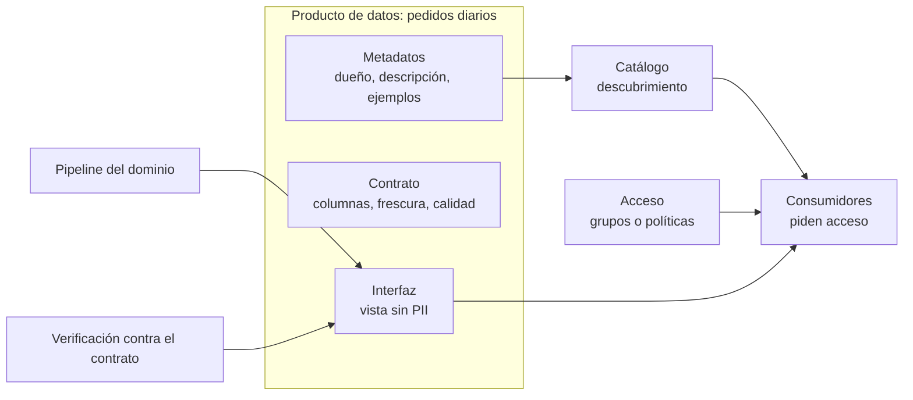

## 1. Resumen

Un **producto de datos** es un conjunto de datos que un equipo publica para que otros lo usen, **con el compromiso de un producto**:

- un dueño responsable;
- una descripción para encontrarlo y entenderlo;
- una interfaz de consumo estable (una tabla, una vista, un stream);
- un **contrato** con sus consumidores: qué columnas entrega, cada cuánto se actualiza, con qué calidad.

La idea viene de data mesh: Zhamak Dehghani pide tratar los datos analíticos de cada dominio como producto y a sus consumidores como clientes. El término también aparece en herramientas de catálogo con significados cercanos pero no idénticos: Knowledge Catalog en Google Cloud, Amazon DataZone en AWS, Purview Unified Catalog en Microsoft. Cada uno se describe con su propia página.

## 2. Qué es

Como referencia conceptual, Dehghani propone que un producto de datos sea:

- **Descubrible:** está en un catálogo con su dueño, su origen, su linaje y ejemplos.
- **Direccionable:** tiene una dirección única según una convención global.
- **Confiable:** el dueño garantiza la calidad en el origen, no un equipo de limpieza aguas abajo.
- **Autodescriptivo:** trae esquema, semántica y ejemplos.
- **Interoperable:** sigue estándares globales (formatos, metadatos comunes) para combinarse con otros.
- **Seguro:** tiene control de acceso por producto, con políticas comunes.

Además, tiene un **dueño de producto de datos**. Esa persona decide la hoja de ruta, mide la satisfacción de los consumidores y responde por el ciclo de vida: cuándo cambiar, revisar o retirar datos y esquemas.

## 3. Problema que resuelve

Sin productos de datos, los consumidores encuentran tablas sin dueño, sin descripción y sin garantías. Tienen que preguntar quién las mantiene, pedir acceso a cada una por separado y descubrir por las malas que una columna cambió o que la tabla dejó de actualizarse. Con productos:

- se descubre una unidad con sentido de negocio, no tablas sueltas;
- hay a quién reclamar y un contrato que dice qué esperar;
- el acceso se pide una vez, al producto;
- los cambios que rompen el contrato se ven antes de publicarlos.

## 4. Cómo funciona

1. Un equipo decide qué datos publicar para un caso de uso, por ejemplo «pedidos diarios».
2. Define la **interfaz**: qué tablas o vistas expone, sin datos personales que el consumidor no necesite.
3. Escribe el **contrato**: columnas y tipos que promete, frecuencia de actualización, criterios de calidad.
4. Lo publica en un **catálogo** con descripción, dueño y documentación.
5. Configura el **acceso**: grupos o políticas, y quién aprueba.
6. Antes de cada publicación verifica el producto contra su contrato, y lo **observa**: frescura, calidad y uso.
7. Si necesita un cambio incompatible, publica una versión nueva y retira la anterior con aviso (ver `schema-evolution`).

## 5. Cuándo utilizarlo

- Datos que consumen otros equipos con regularidad.
- Cuando el mismo conjunto de tablas se pide una y otra vez y cada consumidor lo arma distinto.
- Como pieza de data mesh, pero también sin data mesh: un equipo central puede publicar productos con dueño y contrato.

## 6. Cuándo no utilizarlo

- Para tablas internas de un pipeline (staging, temporales) que nadie consume fuera del equipo.
- Para análisis exploratorios de un solo uso.
- No llamar «producto» a algo que no tiene dueño ni contrato: es solo una tabla con otro nombre.

## 7. Ejemplo sencillo

El equipo de ventas publica «pedidos diarios» con este contrato:

- columnas `fecha DATE`, `pedidos INT64` y `monto NUMERIC`;
- actualización cada 26 horas como máximo.

Una mañana, la verificación detecta tres problemas: falta `pedidos`, `monto` pasó a `FLOAT64` y la última actualización fue hace más de dos días. El producto no se anuncia como al día hasta corregirlo. Agregar una columna nueva, como `canal`, no rompe el contrato.

## 8. Ejemplo de producción

En Google Cloud, un equipo de comercio electrónico publica en Knowledge Catalog el producto «Ecommerce Business Data», como en el ejemplo de su documentación:

- **Assets:** dos tablas de BigQuery y una vista de datos demográficos sin PII.
- **Acceso:** grupos Reader y Writer.
- **Contrato:** actualización semanal.
- **Documentación:** consultas de ejemplo.

Un data scientist encuentra el producto como una sola unidad y pide acceso al grupo Reader, en vez de buscar tres tablas y pedir permiso a cada dueño. En la CI del equipo, una verificación como la de §10 compara cada versión contra el contrato antes de publicarla.

## 9. Arquitectura



## 10. Código

```python
# Python 3.12, solo biblioteca estándar (ejecutado; mypy --strict sin errores): un producto de datos se publica con un
# contrato hacia sus consumidores (qué columnas entrega y cada cuánto se actualiza) y se verifica contra él antes de
# anunciarlo. El formato del contrato es ilustrativo, no el de un producto de la nube.
import datetime
from dataclasses import dataclass


@dataclass(frozen=True)
class Contrato:
    columnas: dict[str, str]                # lo que el producto promete entregar
    actualizacion_maxima: datetime.timedelta  # cada cuánto se actualiza, como máximo


@dataclass(frozen=True)
class EstadoActual:
    columnas: dict[str, str]
    ultima_actualizacion: datetime.datetime


def verificar(contrato: Contrato, estado: EstadoActual, ahora: datetime.datetime) -> list[str]:
    problemas = []
    for columna, tipo in contrato.columnas.items():
        if columna not in estado.columnas:
            problemas.append(f"falta la columna prometida {columna}")
        elif estado.columnas[columna] != tipo:
            problemas.append(f"{columna}: el contrato dice {tipo}, el producto tiene {estado.columnas[columna]}")
    atraso = ahora - estado.ultima_actualizacion
    if atraso > contrato.actualizacion_maxima:
        problemas.append(f"desactualizado: {atraso} sin actualizar (máximo {contrato.actualizacion_maxima})")
    return problemas                         # columnas nuevas no rompen el contrato: no se revisan


contrato = Contrato({"fecha": "DATE", "pedidos": "INT64", "monto": "NUMERIC"}, datetime.timedelta(hours=26))
ahora = datetime.datetime(2026, 10, 11, 9, 0)
al_dia = EstadoActual({"fecha": "DATE", "pedidos": "INT64", "monto": "NUMERIC", "canal": "STRING"},
                      datetime.datetime(2026, 10, 11, 2, 0))
roto = EstadoActual({"fecha": "DATE", "monto": "FLOAT64"}, datetime.datetime(2026, 10, 9, 2, 0))
print(verificar(contrato, al_dia, ahora))    # []
print(verificar(contrato, roto, ahora))
# ['falta la columna prometida pedidos', 'monto: el contrato dice NUMERIC, el producto tiene FLOAT64', 'desactualizado: 2 days, 7:00:00 sin actualizar (máximo 1 day, 2:00:00)']
```

Este script en Python 3.12, solo con biblioteca estándar, está ejecutado y pasa `mypy --strict` sin errores. Verifica un producto contra su contrato: columnas prometidas, tipos y frescura. Las columnas nuevas no rompen el contrato. El formato del contrato es ilustrativo, no el de Knowledge Catalog, DataZone ni Purview. Para contratos de esquema aplicados con herramientas, ver `data-contracts`.

## 11. GCP

**Knowledge Catalog**, el nombre que lleva Dataplex Universal Catalog desde el 10 de abril de 2026 según el aviso de su página; la API, las bibliotecas cliente, la CLI y los nombres de IAM no cambian. En su documentación, un *data product* tiene:

- **assets:** punteros a datasets, tablas o vistas de BigQuery;
- **access groups:** roles como Reader o Analyst, mapeados a Google Groups o cuentas de servicio;
- **un dueño:** gestiona calidad, acceso y documentación;
- **consumidores:** personas, equipos o agentes de IA;
- **un contrato:** con términos como la frecuencia de actualización y los estándares de calidad.

## 12. AWS

**Amazon DataZone**, según AWS Prescriptive Guidance. Los productores publican data products en el catálogo de negocio de su portal, alojado en la cuenta central de gobierno. Los consumidores buscan, filtran y piden acceso, y el dueño de los datos aprueba con un flujo integrado. La misma guía menciona como alternativas data.all y AWS Lake Formation (ver `data-mesh`).

## 13. Azure

**Microsoft Purview Unified Catalog.** Allí un data product es un concepto de negocio con nombre, descripción, dueños y una lista de assets (tablas, archivos, reportes de Power BI) agrupados bajo un caso de uso. Según su página:

- cada producto lo administra un solo *governance domain*, aunque se puede descubrir desde muchos;
- cada producto tiene una política de acceso que define cómo se pide acceso, los términos de uso y quién aprueba.

En el lado de Fabric, los dominios organizan workspaces (ver `data-mesh`).

## 14. Buenas prácticas

- Un dueño con nombre por producto, y un contrato escrito antes de publicar.
- La interfaz expone solo lo necesario: vistas sin datos personales que el consumidor no necesita.
- Verificar el contrato en la CI y antes de anunciar cada versión.
- Cambios incompatibles en una versión nueva, con aviso y fecha de retiro de la anterior.
- Documentación con ejemplos de consulta.
- **Seguridad:** acceso por producto con aprobación del dueño; los datos personales se excluyen o enmascaran en la interfaz, como la vista sin PII del ejemplo de Knowledge Catalog.
- **Observabilidad:** frescura, resultado de la verificación del contrato y uso por consumidor; un producto sin uso es candidato a retirarse.
- **Costo:** el producto concentra el costo de almacenamiento y cómputo de su interfaz; publicar vistas en vez de copias evita duplicar datos, y asignar ese costo al dueño hace visible qué vale la pena mantener.

## 15. Errores frecuentes

- Productos sin dueño, que nadie mantiene.
- Contratos que solo existen en una wiki y no se verifican.
- Cambiar tipos o quitar columnas sin versionar y romper a los consumidores.
- Exponer las tablas internas como interfaz, con datos personales y columnas de trabajo.
- Suponer que «data product» significa lo mismo en Knowledge Catalog, DataZone y Purview: cada uno define sus propios elementos.

## 16. Trade-offs

Un producto de datos da confianza y descubrimiento, pero exige trabajo continuo: un dueño, un contrato, documentación, verificación y soporte a consumidores. Hacer de todo un producto multiplica ese costo. No hacer productos deja a cada consumidor armando su propia versión. Las herramientas de catálogo facilitan publicar y dar acceso, aunque atan la definición del producto a esa herramienta. El contrato y el dueño, en cambio, son decisiones del equipo.

## 17. Conceptos relacionados

- `data-contracts`: contratos de esquema aplicados con herramientas.
- `data-mesh`: el enfoque donde cada dominio publica productos.
- `schema-evolution`: cambiar un producto sin romper a sus consumidores.
- `semantic-models`: otra capa que da significado de negocio a los datos.

## 18. Preguntas técnicas abiertas

1. ¿Qué conjunto de tablas de tu organización se pide tanto que ya debería ser un producto?
2. ¿Qué pondrías en su contrato, y cómo lo verificarías en la CI?
3. ¿Quién sería su dueño, y qué haría cuando un consumidor reporte un problema?

## 19. Laboratorio relacionado

Pendiente (F4).

## 20. Fuentes

- Zhamak Dehghani (martinfowler.com): *How to Move Beyond a Monolithic Data Lake to a Distributed Data Mesh* (2019) y *Data Mesh Principles and Logical Architecture* (2020), como referencia conceptual (Nivel 4).
- Google Cloud: *About data products* (Knowledge Catalog).
- AWS Prescriptive Guidance: *AWS offerings for data mesh*.
- Microsoft Learn: *Data Products in Unified Catalog* (Microsoft Purview).

El detalle de cada fuente está en `sources` del frontmatter.

## 21. Fecha de última verificación

2026-10-11. Pasa a `verified`: revisión B-F3.1 del lote F3b-07a aplicada, sin VERIFY pendientes.

## 22. Historial de cambios importantes

- 2026-10-11: creación (lote F3b-07a).
- 2026-10-11: revisión B-F3.1 del lote F3b-07a aplicada (docs/reviews/cards-f3b-07a.md): §11 alineado al aviso de Knowledge Catalog (API, bibliotecas cliente, CLI y nombres de IAM).
- 2026-10-11: `verification_status: verified` (sin VERIFY pendientes).
