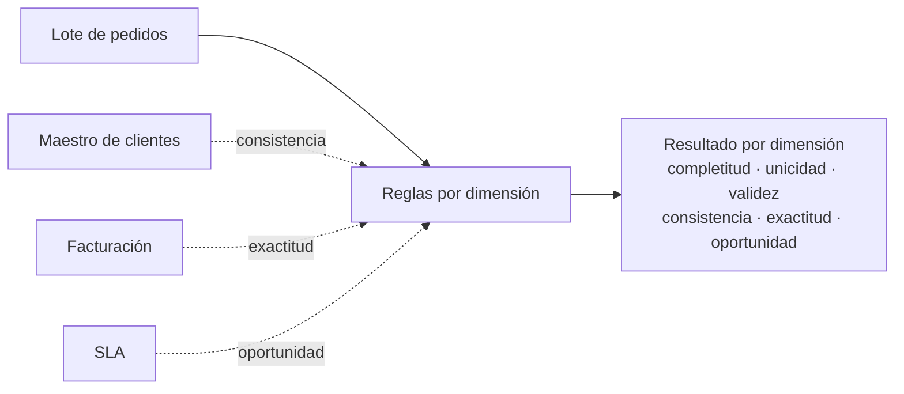

## 1. Resumen

«Los datos están mal» no es un diagnóstico. Una **dimensión de calidad** separa qué está mal: faltan registros, hay duplicados, los valores contradicen otro sistema, llegaron tarde, no tienen el formato esperado o no coinciden con la realidad. Esta ficha usa las **seis dimensiones de DAMA UK** que adopta *The Government Data Quality Framework*:

- **completitud** (completeness);
- **unicidad** (uniqueness);
- **consistencia** (consistency);
- **oportunidad** (timeliness);
- **validez** (validity);
- **exactitud** (accuracy).

El mismo marco aclara que la lista no es prescriptiva y que otras organizaciones la definen algo distinto. Los productos de nube también: lo que importa es que cada regla diga qué dimensión mide.

## 2. Qué es

Según *The Government Data Quality Framework*:

| Dimensión | Pregunta | Se mide contra |
|---|---|---|
| Completitud | ¿Están todos los registros y sus valores esenciales? | Los campos obligatorios y los registros esperados |
| Unicidad | ¿Hay un solo registro por entidad? | La clave de la entidad |
| Consistencia | ¿Los valores contradicen otros de la misma entidad? | El mismo dataset u otro (por ejemplo, un maestro) |
| Oportunidad | ¿Llegaron a tiempo para su uso? | Un acuerdo de desfase (SLA) |
| Validez | ¿Están en el rango y el formato esperados? | Reglas de formato, tipo y rango |
| Exactitud | ¿Coinciden con la realidad? | Una referencia confiable |

Dos distinciones del marco: un dataset **completo** puede tener valores incorrectos (completitud no es exactitud), y un valor **válido** puede ser inexacto (una fecha bien formada puede ser la equivocada).

## 3. Problema que resuelve

Un tablero de ventas muestra menos que el sistema de facturación. El equipo discute horas: unos dicen que faltan pedidos, otros que hay montos mal cargados, otros que el lote llegó tarde. Con una medida por dimensión, el reporte dice: completitud 80 %, unicidad 80 %, exactitud 50 %. La discusión pasa a ser qué regla falló y por qué.

## 4. Cómo funciona

1. Cada regla se asocia a **una** dimensión y a una referencia: los campos obligatorios, la clave, el maestro, el SLA, el rango o la fuente confiable.
2. La regla se mide como proporción: registros que cumplen sobre registros evaluados.
3. Cada dimensión tiene un umbral según el uso: un tablero diario puede aceptar 98 % de completitud y no aceptar un solo duplicado.
4. El resultado se publica por dimensión, no como un único puntaje que oculte qué falló.
5. Las dimensiones compiten: el marco da el ejemplo de oportunidad frente a exactitud o completitud. Publicar antes puede significar publicar menos completo.

## 5. Cuándo utilizarlo

- Al definir los controles de un dataset nuevo: una o más reglas por dimensión relevante.
- Al acordar un SLA con los consumidores: qué dimensión importa más para su uso.
- Al reportar calidad: por dimensión, con su umbral.

## 6. Cuándo no utilizarlo

- Como lista obligatoria: no todas las dimensiones aplican a todo dataset; el marco lo dice.
- Para medir exactitud sin una referencia confiable: sin ella, lo que se mide es validez.
- Como reemplazo de la conversación con los consumidores sobre qué necesitan.

## 7. Ejemplo sencillo

Un lote de cinco pedidos: uno sin cliente, uno duplicado (y con monto negativo), uno en dólares para un cliente que factura en pesos, uno con un monto distinto al de facturación y uno cargado diez horas después de creado.

| Dimensión | Regla | Resultado |
|---|---|---|
| Completitud | `id`, `cliente` y `monto` presentes | 4/5 |
| Unicidad | `id` distintos sobre filas | 4/5 |
| Validez | `monto >= 0` y moneda conocida | 3/5 |
| Consistencia | moneda del pedido igual a la del maestro de clientes | 3/4 (solo filas con cliente) |
| Exactitud | monto igual al del sistema de facturación | 2/4 (por pedido) |
| Oportunidad | cargado a más tardar 2 h después de creado | 4/5 |

## 8. Ejemplo de producción

Una tabla de pedidos que alimenta finanzas:

- completitud: 99,5 % de pedidos con cliente, y conteo diario dentro del ±5 % de la media de 4 semanas;
- unicidad: 0 duplicados por `id`;
- validez: montos no negativos, monedas del catálogo;
- consistencia: moneda igual a la del maestro de clientes;
- exactitud: muestra diaria reconciliada contra facturación;
- oportunidad: el lote del día disponible antes de las 08:00.

Cada regla publica su resultado por dimensión y su umbral; las de unicidad y oportunidad bloquean, las demás avisan.

## 9. Arquitectura



## 10. Código

```python
"""Mide las seis dimensiones de DAMA UK sobre un lote de pedidos, cada una con su regla y su referencia."""
from collections.abc import Callable
from datetime import datetime, timedelta

Pedido = dict[str, str | float | None]

LOTE: list[Pedido] = [
    {"id": "P1", "cliente": "C1", "monto": 120.0, "moneda": "CLP", "creado": "2026-10-20T08:00", "cargado": "2026-10-20T08:30"},
    {"id": "P2", "cliente": None, "monto": 80.0, "moneda": "CLP", "creado": "2026-10-20T08:05", "cargado": "2026-10-20T08:30"},
    {"id": "P3", "cliente": "C2", "monto": -5.0, "moneda": "CLP", "creado": "2026-10-20T08:10", "cargado": "2026-10-20T08:30"},
    {"id": "P3", "cliente": "C2", "monto": -5.0, "moneda": "CLP", "creado": "2026-10-20T08:10", "cargado": "2026-10-20T08:30"},
    {"id": "P4", "cliente": "C9", "monto": 300.0, "moneda": "USD", "creado": "2026-10-19T22:00", "cargado": "2026-10-20T08:30"},
]
MONEDA_DEL_CLIENTE = {"C1": "CLP", "C2": "CLP", "C9": "CLP"}   # maestro de clientes (otro dataset)
FACTURACION = {"P1": 125.0, "P2": 80.0, "P3": 5.0, "P4": 300.0}  # la realidad contra la que se mide la exactitud
SLA = timedelta(hours=2)                                         # acuerdo de oportunidad: cargado a más tardar 2 h después


def completitud(lote: list[Pedido]) -> tuple[int, int]:
    return sum(all(p[c] is not None for c in ("id", "cliente", "monto")) for p in lote), len(lote)


def unicidad(lote: list[Pedido]) -> tuple[int, int]:
    return len({p["id"] for p in lote}), len(lote)


def validez(lote: list[Pedido]) -> tuple[int, int]:
    ok = [isinstance(p["monto"], float) and p["monto"] >= 0 and p["moneda"] in {"CLP", "USD"} for p in lote]
    return sum(ok), len(lote)


def consistencia(lote: list[Pedido]) -> tuple[int, int]:
    con_cliente = [p for p in lote if p["cliente"] is not None]
    return sum(MONEDA_DEL_CLIENTE.get(str(p["cliente"])) == p["moneda"] for p in con_cliente), len(con_cliente)


def exactitud(lote: list[Pedido]) -> tuple[int, int]:
    primero = {str(p["id"]): p["monto"] for p in reversed(lote)}
    return sum(FACTURACION[i] == m for i, m in primero.items()), len(primero)


def oportunidad(lote: list[Pedido]) -> tuple[int, int]:
    lag = [datetime.fromisoformat(str(p["cargado"])) - datetime.fromisoformat(str(p["creado"])) for p in lote]
    return sum(d <= SLA for d in lag), len(lote)


DIMENSIONES: dict[str, Callable[[list[Pedido]], tuple[int, int]]] = {
    "completitud": completitud, "unicidad": unicidad, "validez": validez,
    "consistencia": consistencia, "exactitud": exactitud, "oportunidad": oportunidad,
}

for nombre, medir in DIMENSIONES.items():
    cumple, total = medir(LOTE)
    print(f"{nombre}: {cumple}/{total} = {100 * cumple // total}%")
```

El script se **ejecuta en la CI** y pasa `mypy --strict`. Imprime `completitud: 4/5 = 80%`, `unicidad: 4/5 = 80%`, `validez: 3/5 = 60%`, `consistencia: 3/4 = 75%`, `exactitud: 2/4 = 50%` y `oportunidad: 4/5 = 80%`. Cada dimensión tiene su propia referencia: exactitud usa facturación; consistencia, el maestro de clientes.

## 11. GCP

En GCP, **Knowledge Catalog** (antes Dataplex Universal Catalog) asocia cada regla de calidad a una dimensión. Según *Auto data quality overview* (no ejecutado):

| | DAMA UK (*The Government Data Quality Framework*) | Knowledge Catalog |
|---|---|---|
| Dimensiones | Seis: completitud, unicidad, consistencia, oportunidad, validez y exactitud | Siete: Freshness, Volume, Completeness, Validity, Consistency, Accuracy y Uniqueness |
| Diferencias | Oportunidad incluye que el desfase sea apropiado | Freshness mide cuándo se actualizó; Volume, si están todos los datos esperados, aparte de Completeness |
| Nombres propios | La lista no es prescriptiva | Con gcloud o la API REST se pueden usar nombres propios (por ejemplo, timeliness en lugar de freshness) |

## 12. AWS

En AWS, **AWS Glue Data Quality** escribe reglas en DQDL. Según *Data Quality Definition Language (DQDL) reference* (no ejecutado):

| | DAMA UK (*The Government Data Quality Framework*) | AWS Glue Data Quality |
|---|---|---|
| Unidad | Dimensión | Tipo de regla en un ruleset (`IsComplete`, `IsUnique`, `ColumnValues`, `DataFreshness`, `ReferentialIntegrity`, `CustomSQL`…) |
| Agrupación por dimensión | Es la clasificación | La referencia de DQDL lista tipos de regla y no los agrupa por dimensión: la dimensión la asigna el equipo |

## 13. Azure

En Azure, **Microsoft Purview Unified Catalog**. Según *Overview of data quality in Microsoft Purview Unified Catalog* (no ejecutado):

| | DAMA UK (*The Government Data Quality Framework*) | Microsoft Purview |
|---|---|---|
| Dimensiones | Completitud, unicidad, consistencia, oportunidad, validez y exactitud | completeness, consistency, conformity, accuracy, freshness y uniqueness |
| Diferencias | Validez y oportunidad | La página nombra conformity y freshness y no nombra validity ni timeliness; tampoco define cada dimensión, así que no conviene asumir que son las mismas |
| Resultado | Medida por dimensión | Puntajes por regla, activo, data product y dominio de gobierno, con alertas por umbral |

## 14. Buenas prácticas

- Una regla, una dimensión, una referencia y un umbral.
- Medir exactitud solo contra una fuente confiable; si no la hay, decirlo.
- Publicar el resultado por dimensión, no un solo puntaje.
- Acordar con los consumidores qué dimensión pesa más para su uso.
- **Seguridad:** las referencias (maestros, facturación) suelen tener datos sensibles; el proceso que mide accede solo a las columnas que compara.
- **Observabilidad:** guardar la serie de cada dimensión para ver tendencias, no solo el último valor.
- **Costo:** medir exactitud contra otro sistema cuesta lecturas; una muestra diaria puede bastar.

## 15. Errores frecuentes

- Llamar «exactitud» a lo que es validez de formato.
- Contar completitud sin decir sobre qué campos.
- Un único puntaje de calidad que mezcla dimensiones.
- Tratar la lista de dimensiones como obligatoria para todo dataset.

## 16. Trade-offs

Más dimensiones medidas dan un diagnóstico más preciso y más reglas que mantener. Las dimensiones compiten: publicar antes (oportunidad) puede significar publicar incompleto. Medir exactitud da la señal más útil y es la más cara, porque necesita una referencia externa.

## 17. Conceptos relacionados

- `sql-quality-checks`: reglas en SQL.
- `data-reconciliation`: completitud y exactitud contra el origen.
- `schema-validation`: validez contra un schema.
- `custom-data-validators`: reglas propias.
- `quality-gate`: decidir con las medidas.

## 18. Preguntas técnicas abiertas

1. ¿Qué dimensión pesa más para el consumidor principal de tu tabla?
2. ¿Contra qué referencia podrías medir exactitud?
3. ¿Tus reportes de calidad dicen qué dimensión falló?

## 19. Laboratorio relacionado

Pendiente (F4).

## 20. Fuentes

- *The Government Data Quality Framework* (GOV.UK, 2020), con las dimensiones de DAMA UK.
- Google Cloud: *Auto data quality overview*.
- AWS: *Data Quality Definition Language (DQDL) reference*.
- Microsoft Learn: *Overview of data quality in Microsoft Purview Unified Catalog*.

El detalle de cada fuente está en `sources` del frontmatter.

## 21. Fecha de última verificación

2026-10-20. Pasa a `verified`: revisión B-F3.1 del lote F3b-15a sin hallazgos, sin VERIFY pendientes.

## 22. Historial de cambios importantes

- 2026-10-20: creación (lote F3b-15a).
- 2026-10-20: revisión B-F3.1 del lote F3b-15a (docs/reviews/cards-f3b-15a.md), sin hallazgos que corregir.
- 2026-10-20: `verification_status: verified` (sin VERIFY pendientes).
