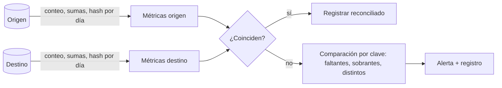

## 1. Resumen

Reconciliar es comparar origen y destino después de una carga para demostrar que no se perdió, duplicó ni alteró nada. Va de lo barato a lo caro: conteos, sumas de control por período, y hashes por fila o por bloque para localizar exactamente qué difiere. Es la diferencia entre "el pipeline terminó en verde" y "los datos están completos".

## 2. Qué es

Es un patrón de control con tres niveles:

- **conteos:** filas por período o por partición en origen y destino;
- **sumas de control:** totales de columnas numéricas (monto, cantidad) por período;
- **hashes:** una huella por fila (o un agregado de huellas por bloque) para detectar diferencias en cualquier columna y localizar qué filas difieren.

Se ejecuta como una tarea más del pipeline, con umbrales explícitos y un resultado registrado.

## 3. Problema que resuelve

Un pipeline puede terminar sin errores y aun así perder filas (un filtro de watermark mal puesto, una página de API saltada), duplicarlas (un reintento sin idempotencia) o alterarlas (una conversión de tipos o de zona horaria). Sin reconciliación, esos errores se descubren cuando un usuario compara con el sistema de origen.

## 4. Cómo funciona

1. **Definir la unidad:** período (día), partición o tabla completa.
2. **Calcular métricas en ambos lados** con la misma definición: conteo, sumas, y opcionalmente un hash agregado.
3. **Comparar** con tolerancias explícitas (cero para conteos de datos financieros; alguna tolerancia si el origen sigue cambiando).
4. **Si difiere, bajar de nivel:** comparar hashes por fila para listar las claves que faltan, sobran o difieren.
5. **Registrar el resultado** y fallar o alertar según la severidad.

Para comparar sin mover todos los datos, se calcula en cada lado un **hash agregado por bloque**: por ejemplo, el XOR de las huellas de todas las filas del día. Si coincide, el bloque es igual (con alta probabilidad); si no, se compara fila por fila solo ese bloque.

## 5. Cuándo utilizarlo

- Al cerrar cada carga incremental o cada período de un backfill.
- En migraciones y replicación por CDC.
- En datos financieros o regulatorios, donde hay que demostrar completitud.

## 6. Cuándo no utilizarlo

- No hace falta una comparación fila a fila en cada carga de datos voluminosos y de bajo riesgo: basta con conteos y sumas, y el detalle solo cuando difieren.
- No sirve como sustituto de la idempotencia: detecta el duplicado, no lo evita.
- Si el origen cambia constantemente y no hay un corte consistente, la comparación exacta dará falsos positivos; hay que reconciliar contra un snapshot o con tolerancia.

## 7. Ejemplo sencillo

Después de cargar las ventas del 29 de septiembre, se compara: origen 10.482 filas y 3.201.554,20 de monto; destino 10.482 filas y 3.201.554,20. Coinciden: el día queda reconciliado.

## 8. Ejemplo de producción

Cada carga diaria termina con una tarea de reconciliación:

- el extractor guarda, junto a los datos, el conteo y la suma de montos que informó el origen para ese día;
- la tarea calcula lo mismo en el destino y, además, un hash agregado por día;
- si el conteo o la suma difieren, la tarea falla y se ejecuta la comparación por clave para listar faltantes y sobrantes;
- el resultado queda en una tabla `reconciliacion` con período, métricas de ambos lados y estado.

## 9. Arquitectura



## 10. Código

```sql
-- BigQuery: reconciliación de un día entre el snapshot del origen y el destino.
-- Requiere: stg_ventas_origen (copia del origen para el día) y dwh.ventas; @dia es el día lógico.
WITH origen AS (
  SELECT COUNT(*) AS filas, SUM(monto) AS monto,
         BIT_XOR(FARM_FINGERPRINT(TO_JSON_STRING(STRUCT(venta_id, monto)))) AS huella
  FROM `proyecto.staging.stg_ventas_origen`
  WHERE fecha = @dia
),
destino AS (
  SELECT COUNT(*) AS filas, SUM(monto) AS monto,
         BIT_XOR(FARM_FINGERPRINT(TO_JSON_STRING(STRUCT(venta_id, monto)))) AS huella
  FROM `proyecto.dwh.ventas`
  WHERE fecha = @dia
)
SELECT
  o.filas AS filas_origen, d.filas AS filas_destino,
  o.monto AS monto_origen, d.monto AS monto_destino,
  o.huella = d.huella AS huella_coincide
FROM origen AS o CROSS JOIN destino AS d;

-- Si no coincide: detalle por clave (faltantes, sobrantes y distintos).
SELECT COALESCE(o.venta_id, d.venta_id) AS venta_id,
       CASE WHEN d.venta_id IS NULL THEN 'falta en destino'
            WHEN o.venta_id IS NULL THEN 'sobra en destino'
            ELSE 'monto distinto' END AS diferencia
FROM (SELECT venta_id, monto FROM `proyecto.staging.stg_ventas_origen` WHERE fecha = @dia) AS o
FULL OUTER JOIN (SELECT venta_id, monto FROM `proyecto.dwh.ventas` WHERE fecha = @dia) AS d
  ON o.venta_id = d.venta_id
WHERE o.venta_id IS NULL OR d.venta_id IS NULL OR o.monto IS DISTINCT FROM d.monto;
```

Son consultas de solo lectura: repetirlas no cambia nada. El SQL de BigQuery no se ejecutó: requiere GCP. Una limitación del XOR: dos filas idénticas duplicadas se anulan entre sí, así que el conteo sigue siendo imprescindible junto a la huella.

La huella se calcula sobre `TO_JSON_STRING(STRUCT(venta_id, monto))` y no sobre una concatenación. Según la documentación de BigQuery, `TO_JSON_STRING` codifica `NULL` como `null` sin comillas y cada `STRING` entre comillas con escape. Eso elimina dos ambigüedades de concatenar texto:

- **el `NULL`:** `CONCAT` devuelve `NULL` si un argumento es `NULL`, y `BIT_XOR` omitiría la fila; un marcador como `'\\N'` choca con un texto real `\N`;
- **el separador:** `('a|b', 'c')` y `('a', 'b|c')` dan la misma cadena con `|`.

```sql
-- PostgreSQL (ejecutado): la misma comparación con los dos lados. fp() toma 60 bits del MD5 como bigint;
-- no es FARM_FINGERPRINT, pero muestra el efecto del NULL y de la entrada. jsonb_build_array es el
-- equivalente documentado de TO_JSON_STRING(STRUCT(...)): NULL → null y texto → cadena JSON con escape.
-- Día 1: origen (1, 100), (2, NULL); destino (1, 100), (3, NULL).
-- Día 2: origen (5, 100), (6, NULL); destino (5, NULL), (6, 100).
SELECT dia, lado, count(*) AS filas, sum(monto) AS suma,
       bit_xor(fp(venta_id::text || '|' || monto::text))                                 AS sin_marcador,
       bit_xor(fp(coalesce(venta_id::text, '\N') || '|' || coalesce(monto::text, '\N'))) AS con_marcador,
       bit_xor(fp(jsonb_build_array(venta_id, monto)::text))                             AS con_json
FROM (SELECT 'origen' AS lado, * FROM origen UNION ALL SELECT 'destino', * FROM destino) AS lados
GROUP BY dia, lado;

-- Detalle por clave de un día: != frente a IS DISTINCT FROM.
SELECT coalesce(o.venta_id, d.venta_id) AS venta_id
FROM (SELECT * FROM origen WHERE dia = 2) AS o
FULL JOIN (SELECT * FROM destino WHERE dia = 2) AS d ON o.venta_id = d.venta_id
WHERE o.venta_id IS NULL OR d.venta_id IS NULL OR o.monto IS DISTINCT FROM d.monto;   -- con != no devuelve nada
```

| Día | Lado | Filas | Suma | Huella sin marcador | Huella con marcador | Huella JSON | Detalle con `!=` | Detalle con `IS DISTINCT FROM` |
|---|---|---|---|---|---|---|---|---|
| 1 | origen | 2 | 100 | igual al destino | distinta | distinta | 2, 3 | 2, 3 |
| 1 | destino | 2 | 100 | igual al origen | distinta | distinta | | |
| 2 | origen | 2 | 100 | distinta | distinta | distinta | (ninguna) | 5, 6 |
| 2 | destino | 2 | 100 | distinta | distinta | distinta | | |

- **Día 1:** conteo, suma y huella sin marcador coinciden aunque las filas son distintas, porque las filas con `monto` nulo quedan fuera de `BIT_XOR`. La huella con marcador y la JSON detectan la diferencia.
- **Día 2:** la suma coincide y la huella la detecta, pero el detalle con `!=` no encuentra ninguna clave, porque comparar un valor con `NULL` da `NULL`. Con `IS DISTINCT FROM` aparecen las ventas 5 y 6.
- **Ambigüedades, en la misma prueba:** `coalesce(NULL, '\N')` y el texto `'\N'` producen la misma cadena, y `'a|b' || '|' || 'c'` es igual a `'a' || '|' || 'b|c'`. Con `jsonb_build_array`, ninguno de los dos pares coincide (`[null, "x"]` frente a `["\\N", "x"]`, y `["a|b", "c"]` frente a `["a", "b|c"]`).

## 11. GCP

En **BigQuery**, `FARM_FINGERPRINT` da una huella `INT64` estable (la misma entrada da siempre la misma salida) y `BIT_XOR` la agrega por bloque. Con ambas se reconcilian bloques grandes comparando un solo número por lado, y se baja a la comparación por clave solo donde difieren.

## 12. AWS

**AWS DMS** trae **validación de datos** integrada:

- compara origen y destino, también durante la replicación continua, fila a fila;
- requiere clave primaria o índice único;
- informa por tabla registros no coincidentes, pendientes y suspendidos, y guarda los fallos en la tabla `awsdms_control.awsdms_validation_failures_v1` del destino;
- agrega carga a ambos extremos y tiempo extra, por eso puede correr como una tarea **solo de validación**, separada de la migración.

Es reconciliación administrada para lo que mueve DMS; para otros pipelines hay que construirla.

## 13. Azure

En **Data Factory**, la actividad Copy tiene **verificación de consistencia** (`validateDataConsistency`):

- en archivos binarios compara tamaño, fecha de modificación y checksum;
- en datos tabulares, la actividad falla si las filas leídas del origen difieren de las copiadas más las incompatibles omitidas.

Es un control de conteo de la copia, no una comparación de contenido fila a fila como la de DMS.

## 14. Buenas prácticas

- Reconciliar por período, no la tabla completa: localiza el problema y escala mejor.
- Guardar las métricas del origen en el momento de la extracción, para comparar contra el mismo corte.
- Empezar por conteos y sumas; usar hashes por fila solo cuando difieren.
- Registrar cada reconciliación (período, métricas, estado) en una tabla consultable.
- **Seguridad:** las consultas de detalle pueden exponer datos sensibles en los logs; registrar claves y tipos de diferencia, no el contenido de las filas.
- **Observabilidad:** alertar ante cualquier diferencia en conteos y ante una tasa creciente de períodos no reconciliados.
- **Costo:** los hashes por fila leen todas las columnas incluidas; limitar la entrada del hash a las columnas que importan y reconciliar al detalle solo los bloques que difieren.

## 15. Errores frecuentes

- Comparar contra el origen "ahora", cuando ya cambió desde la extracción.
- Confiar solo en el XOR de huellas: filas duplicadas idénticas se anulan.
- Definir las métricas distinto en cada lado (zona horaria, redondeo, filtros).
- Reconciliar pero no fallar ni alertar cuando hay diferencias.

## 16. Trade-offs

Los conteos y sumas son baratos, pero no detectan cambios que se compensan. Los hashes por fila detectan cualquier diferencia, a cambio de leer más datos y de requerir una normalización idéntica en ambos lados. La validación administrada (DMS) evita construirla, pero solo cubre lo que mueve ese servicio.

## 17. Conceptos relacionados

- `incremental-load`: cada carga incremental cierra con una reconciliación.
- `backfill`: cada período reprocesado se reconcilia.
- `change-data-capture`: la replicación por CDC se valida contra el origen.
- Con ficha: `sql-quality-checks`, `change-detection`.
- `data-quality-dimensions`: la reconciliación mide completitud y exactitud contra el origen.

## 18. Preguntas técnicas abiertas

1. ¿Qué tolerancia aceptarías al reconciliar una tabla cuyo origen sigue recibiendo cambios durante la extracción?
2. ¿Cómo reconciliarías una tabla de miles de millones de filas sin compararla fila a fila cada día?
3. ¿Qué harías si la reconciliación falla solo en los días de cambio de horario?

## 19. Laboratorio relacionado

Pendiente (F4): lab de tipo B sobre duplicados tras un reproceso (§25).

## 20. Fuentes

- Google Cloud: *Hash functions* y *Aggregate functions* (BigQuery).
- AWS: *AWS DMS data validation*.
- Microsoft Learn: *Data consistency verification in copy activity* (Data Factory).

El detalle de cada fuente está en `sources` del frontmatter.

## 21. Fecha de última verificación

2026-10-01. Pasa a `verified`: revisión B-F3.1 del lote 3 aplicada, sin VERIFY pendientes.

## 22. Historial de cambios importantes

- 2026-09-30: creación (lote 3 de F3).
- 2026-10-01: `verification_status: verified` (revisión B-F3.1 del lote 3 aplicada; sin VERIFY pendientes).
- 2026-10-07: la sección de conceptos relacionados ya no lista como pendientes de ficha a `sql-quality-checks`, `change-detection`, que ya tienen ficha.
- 2026-10-07: cambio mínimo (aprobado por Felipe): la huella usa un marcador de NULL (`IFNULL(…, '\\N')`, el de `change-detection`) porque `CONCAT` de BigQuery devuelve NULL con un argumento NULL y `BIT_XOR` omitía esas filas; el detalle por clave compara con `IS DISTINCT FROM` en lugar de `!=`. Sigue `verified`, pendiente de revisión de Cursor. §10 agrega un caso con `monto` NULL probado en PostgreSQL.
- 2026-10-07: revisión de los cambios mínimos de NULL aplicada (docs/reviews/fixes-null-concat.md, aprobada por Felipe): la huella pasa de `CONCAT` con marcador `'\\N'` a `FARM_FINGERPRINT(TO_JSON_STRING(STRUCT(...)))`, respaldado por la tabla de codificaciones JSON de BigQuery (NULL → `null`; texto entre comillas con escape), que elimina la ambigüedad del marcador y la del separador. Sigue `verified`. §10 publica el caso completo en PostgreSQL (dos lados, conteo, suma, tres huellas y `!=` frente a `IS DISTINCT FROM`) con `jsonb_build_array`, el equivalente documentado.
- 2026-10-13: `page_title` en cada cita, con el título de la página citada (ADR-012); sin cambios de contenido.
- 2026-10-14: lote F3b-rel (regla del §17): relations incluye `change-detection`, `sql-quality-checks`.
- 2026-10-20: lote F3b-15a (regla del §17): relations y el §17 enlazan `data-quality-dimensions`, que ya tiene ficha; antes figuraba como pendiente de ficha.
