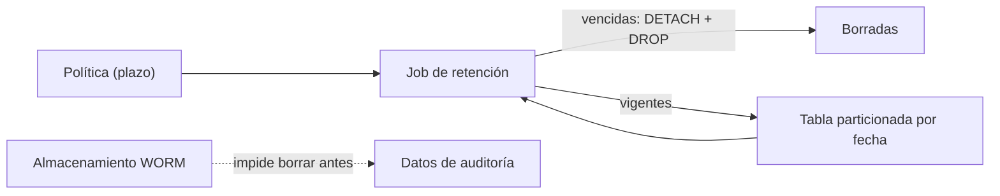

## 1. Resumen

La **retención** es conservar los datos el tiempo que corresponde y borrarlos después. Esta ficha trata **solo los mecanismos técnicos**: cuánto tiempo se conserva cada dato lo decide otra política (de la organización, legal o regulatoria), y esta ficha no da asesoría legal. Lo normativo va en el dominio 19.

Hay dos familias de mecanismos:

- **para borrar a tiempo:** particiones vencidas que se quitan, expiración de tablas o particiones, reglas de expiración de objetos;
- **para impedir que se borre antes:** almacenamiento inmutable (WORM), con períodos de retención y legal holds.

## 2. Qué es

- **Plazo de retención:** cuánto se conserva; viene de otra política.
- **Borrado por partición:** quitar la partición vencida entera (`DETACH` y `DROP`), más rápido que un `DELETE` masivo (*5.12. Table Partitioning*).
- **Expiración:** el sistema borra solo cuando vence el plazo (particiones de BigQuery, reglas de objetos).
- **WORM:** write once, read many; no se modifica ni se borra durante el período.
- **Legal hold:** inmutable hasta que alguien lo quita explícitamente.

## 3. Problema que resuelve

Una tabla de eventos guarda todo desde hace seis años. Pesa cada vez más, los respaldos tardan, y nadie sabe si se puede borrar lo viejo. Con un plazo fijado por la política (por ejemplo, 3 meses) y particiones mensuales, cada mes se separa y se borra la partición vencida en segundos, sin `DELETE` masivo.

## 4. Cómo funciona

Para borrar a tiempo con particiones:

1. La tabla se particiona por la columna de fecha que define la retención.
2. Un job lista las particiones y calcula la diferencia en meses calendario con la fecha actual.
3. Las que superan el plazo se separan (`DETACH PARTITION`) y se borran (`DROP TABLE`).
4. Re-ejecutar no borra nada más: la operación es idempotente.

Para impedir el borrado antes de tiempo, la retención se configura en el almacenamiento (Bucket Lock, Object Lock, immutable storage), y ningún usuario la puede saltar mientras dure.

## 5. Cuándo utilizarlo

- En todo dataset con un plazo de conservación definido.
- Con particiones por fecha, cuando el plazo se cuenta desde la fecha del dato.
- WORM, cuando la política exige que los datos no se puedan alterar.

## 6. Cuándo no utilizarlo

- Inventando un plazo: si la política no existe, primero se define (fuera de esta ficha).
- Borrando sin mirar qué depende de la tabla (`data-lineage`).
- Activando el modo más estricto de WORM sin estar seguro del plazo: en compliance mode de S3 no se puede acortar.

## 7. Ejemplo sencillo

Tabla `eventos` con particiones de mayo a octubre de 2026; hoy es 20 de octubre; plazo de 3 meses calendario:

| Corrida | Particiones borradas | Quedan |
|---|---|---|
| Primera | `eventos_2026_05`, `eventos_2026_06` | julio a octubre, 4 filas |
| Segunda | ninguna | igual |

Julio queda porque la diferencia es de 3 meses calendario, no más.

## 8. Ejemplo de producción

- Cada dataset tiene su plazo en el catálogo, con el origen de esa decisión.
- En BigQuery, expiración de particiones según el plazo; en el lake, reglas de expiración de objetos.
- Los datos de auditoría, en un bucket con política de retención bloqueada.
- Un reporte mensual compara plazos con lo que realmente queda.

## 9. Arquitectura



## 10. Código

```python
# Python 3.12 y psycopg contra PostgreSQL 17 (ejecutado en la CI con el servicio postgres:17): retención por partición.
# Las particiones mensuales más viejas que la retención se separan (DETACH) y se borran; las demás quedan. Re-ejecutar
# no borra nada más. PG_HOST, PG_PORT, PG_USER, PG_PASSWORD y PG_DB apuntan a una base vacía temporal.
import os
from datetime import date

import psycopg

HOY, RETENCION_MESES = date(2026, 10, 20), 3


def meses_entre(a: date, b: date) -> int:
    return (b.year - a.year) * 12 + b.month - a.month


def aplicar(conn: psycopg.Connection[tuple[str]]) -> list[str]:
    borradas = []
    for (nombre,) in conn.execute("SELECT c.relname FROM pg_inherits i JOIN pg_class c ON c.oid = i.inhrelid "
                                  "WHERE i.inhparent = 'eventos'::regclass ORDER BY c.relname").fetchall():
        anio, mes = int(nombre[-7:-3]), int(nombre[-2:])
        if meses_entre(date(anio, mes, 1), HOY) > RETENCION_MESES:
            conn.execute(f"ALTER TABLE eventos DETACH PARTITION {nombre}")
            conn.execute(f"DROP TABLE {nombre}")
            borradas.append(nombre)
    return borradas


with psycopg.connect(host=os.environ["PG_HOST"], port=os.environ["PG_PORT"], user=os.environ["PG_USER"],
                     password=os.environ["PG_PASSWORD"], dbname=os.environ["PG_DB"], autocommit=True) as conn:
    conn.execute("CREATE TABLE eventos (id int, ocurrido date NOT NULL) PARTITION BY RANGE (ocurrido)")
    for anio, mes in [(2026, 5), (2026, 6), (2026, 7), (2026, 8), (2026, 9), (2026, 10)]:
        siguiente = (anio + mes // 12, mes % 12 + 1)
        conn.execute(f"CREATE TABLE eventos_{anio}_{mes:02d} PARTITION OF eventos "
                     f"FOR VALUES FROM ('{anio}-{mes:02d}-01') TO ('{siguiente[0]}-{siguiente[1]:02d}-01')")
        conn.execute(f"INSERT INTO eventos VALUES ({mes}, '{anio}-{mes:02d}-15')")
    print("primera corrida, borradas:", aplicar(conn))
    print("segunda corrida, borradas:", aplicar(conn))
    quedan = conn.execute("SELECT min(ocurrido), max(ocurrido), count(*) FROM eventos").fetchone()
print("quedan:", quedan)
```

El script se **ejecuta en la CI contra el servicio postgres:17**, en una base vacía que el test crea y borra, y pasa `mypy --strict`. Imprime `primera corrida, borradas: ['eventos_2026_05', 'eventos_2026_06']`, `segunda corrida, borradas: []` y que quedan 4 filas, de julio a octubre.

## 11. GCP

En GCP, **BigQuery** y **Cloud Storage**. Según *5.12. Table Partitioning*, *Manage partitioned tables* y *Bucket Lock* (no ejecutado):

| | Borrado de particiones (PostgreSQL) | BigQuery | Cloud Storage Bucket Lock |
|---|---|---|---|
| Mecanismo | Job propio: `DETACH` + `DROP` | Vencimiento de particiones, calculado desde su límite en UTC | Política de retención del bucket, que se puede bloquear |
| Qué hace | Borra lo vencido | BigQuery empieza a borrar los datos de la partición vencida | Impide borrar antes del plazo; bloqueada, no se reduce ni se quita |
| Detalles | — | Sin vencimiento de particiones en tablas por rango de enteros; el vencimiento de la tabla prevalece | La página nombra FINRA, SEC y CFTC como requisitos con los que puede ayudar |

## 12. AWS

En AWS, **Amazon S3 Object Lock**. Según *5.12. Table Partitioning* y *Locking objects with Object Lock* (no ejecutado):

| | Borrado de particiones (PostgreSQL) | S3 Object Lock |
|---|---|---|
| Objetivo | Borrar lo vencido | Impedir sobrescribir o borrar antes de tiempo (WORM) |
| Formas | — | Retention periods y legal holds, por versión de objeto |
| Rigidez | — | En compliance mode, nadie puede borrar ni acortar el período, ni el root |
| Regulación | — | La página dice que fue evaluado por Cohasset Associates para SEC 17a-4, CFTC y FINRA |

## 13. Azure

En Azure, **immutable storage** de Blob Storage. Según *5.12. Table Partitioning* y *Store business-critical blob data with immutable storage in a write once, read many (WORM) state* (no ejecutado):

| | Borrado de particiones (PostgreSQL) | Immutable storage |
|---|---|---|
| Políticas | — | Time-based retention y legal hold, combinables |
| Al vencer | Se borra | Se puede borrar, pero no sobrescribir |
| Regulación | — | La página dice que ayuda con SEC 17a-4(f), CFTC 1.31(d), FINRA y otras |

## 14. Buenas prácticas

- El plazo viene de una política escrita; el pipeline solo lo aplica.
- Particionar por la fecha que define la retención.
- Borrado idempotente y registrado.
- Revisar el linaje antes de borrar.
- **Seguridad:** borrar a tiempo reduce la exposición de datos que ya no se necesitan; WORM protege contra borrados indebidos.
- **Observabilidad:** registrar qué se borró, cuándo y por qué plazo.
- **Costo:** conservar menos cuesta menos; WORM con plazos largos impide borrar aunque ya no se necesite.

## 15. Errores frecuentes

- `DELETE` masivo en lugar de borrar particiones.
- Un plazo que nadie sabe de dónde salió.
- WORM en compliance mode con un plazo equivocado.
- Borrar y descubrir después que un reporte dependía de esos datos.

## 16. Trade-offs

Un plazo corto cuesta menos y reduce el riesgo, y limita los análisis históricos. WORM protege contra borrados y quita flexibilidad: no se corrige un error de plazo. Borrar por partición es barato y exige particionar por la fecha correcta.

## 17. Conceptos relacionados

- `data-lifecycle-management`: la política completa.
- `partitioning`: particionar por fecha.
- `gcs-storage-classes-and-lifecycle`: ciclo de vida en Cloud Storage.
- `data-lineage`: qué depende de lo que se borra.
- `idempotency`: re-ejecutar sin efecto extra.

## 18. Preguntas técnicas abiertas

1. ¿Qué plazo de retención tiene tu tabla más grande y quién lo decidió?
2. ¿Se borra hoy algo automáticamente?
3. ¿Qué datos tuyos deberían ser inmutables?

## 19. Laboratorio relacionado

Pendiente (F4).

## 20. Fuentes

- PostgreSQL 17: *5.12. Table Partitioning*.
- Google Cloud: *Manage partitioned tables* (BigQuery) y *Bucket Lock* (Cloud Storage).
- AWS: *Locking objects with Object Lock*.
- Microsoft Learn: *Store business-critical blob data with immutable storage in a write once, read many (WORM) state*.

El detalle de cada fuente está en `sources` del frontmatter.

## 21. Fecha de última verificación

2026-10-21. Pasa a `verified`: revisión B-F3.1 del lote F3b-17a aplicada, sin VERIFY pendientes.

## 22. Historial de cambios importantes

- 2026-10-20: creación (lote F3b-17a).
- 2026-10-21: revisión B-F3.1 del lote F3b-17a aplicada (docs/reviews/cards-f3b-17a.md), sin hallazgos en esta ficha.
- 2026-10-21: `verification_status: verified` (sin VERIFY pendientes).
