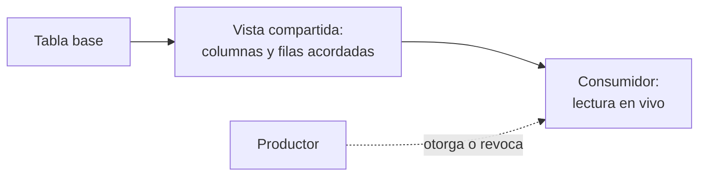

## 1. Resumen

Compartir datos con otra área o con un socio solía significar exportar un archivo: una copia que se desactualiza, que nadie puede revocar y que circula sin control. **Compartir sin copiar** invierte eso: el productor publica un recurso con las columnas y filas acordadas, el consumidor lo lee **en vivo y en solo lectura**, y el productor **revoca** cuando termina el acuerdo. Las tres nubes lo ofrecen así: BigQuery crea un linked dataset que apunta al compartido sin replicar (*Introduction to BigQuery sharing*), Redshift comparte datos en vivo sin moverlos (*Data sharing in Amazon Redshift*) y Fabric crea un shortcut hacia el tenant del productor (*External data sharing in Microsoft Fabric*).

Es distinto de un producto de datos (`data-products`), que define **qué** se ofrece y con qué garantías. Esta ficha es el **cómo** se da acceso.

## 2. Qué es

- **Productor y consumidor:** quien publica y quien lee; el productor controla el acceso.
- **Recurso compartido:** una vista, un dataset o un listing con lo acordado (`data-contracts`).
- **Columnas y filas acordadas:** se excluyen columnas sensibles (`column-level-security`) y se filtran filas por consumidor (`row-level-security`).
- **En vivo y solo lectura:** el consumidor ve los datos actuales y no puede modificarlos.
- **Revocación:** el productor quita el acceso y el consumidor deja de ver los datos.

## 3. Problema que resuelve

Un socio logístico necesita los pedidos de su región. Hoy recibe un CSV semanal con todas las columnas, incluido el RUT de los clientes, y nadie sabe cuántas copias circulan. Con una vista compartida, el socio lee solo sus pedidos y solo las columnas acordadas, ve los pedidos nuevos al instante y, si el contrato termina, el acceso se revoca en una línea.

## 4. Cómo funciona

1. El productor define con el consumidor qué columnas y filas comparte.
2. Publica un recurso que expone solo eso.
3. Da acceso de lectura al consumidor sobre ese recurso, no sobre las tablas base.
4. El consumidor consulta en vivo.
5. Al terminar el acuerdo, el productor revoca el acceso.

## 5. Cuándo utilizarlo

- Socios, filiales u otras áreas que necesitan datos actuales.
- Cuando hoy se envían exportaciones periódicas.
- Cuando hay que poder revocar el acceso.

## 6. Cuándo no utilizarlo

- Si el consumidor necesita modificar los datos: compartir es solo lectura.
- Para datos personales sin base ni contrato que lo permitan: compartir también es comunicar datos (`processors-and-international-transfers`).
- Cuando el consumidor no está en la misma plataforma y no hay mecanismo compatible.

## 7. Ejemplo sencillo

| Paso | Resultado |
|---|---|
| El socio lee la vista | `[(1, 'norte', 100), (2, 'norte', 50)]`, sin la columna del RUT |
| El socio lee la tabla base | Denegado (42501) |
| Llega un pedido nuevo del norte | La vista muestra 3 filas, sin copiar nada |
| El productor revoca | Denegado (42501) |

## 8. Ejemplo de producción

Datos para un socio logístico:

- vista compartida con las columnas del contrato y filtro por región;
- rol del socio con lectura sobre la vista y nada más (`least-privilege`);
- registro de quién consulta;
- revisión trimestral de los accesos y revocación al terminar el contrato;
- en la nube (no ejecutado): un listing de BigQuery sharing, un datashare de Redshift o un external data share de Fabric.

## 9. Arquitectura



## 10. Código

```python
# Python 3.12 y psycopg contra PostgreSQL 17 (ejecutado en la CI con el servicio postgres:17): compartir datos con un
# socio sin copiarlos. El productor publica una vista con security_barrier que deja solo las columnas acordadas y las
# filas del socio; el socio lee la vista, no la tabla base, y el productor revoca el acceso cuando termina el acuerdo.
# PG_DSN apunta a una base vacía; el rol del socio lleva como sufijo el nombre de la base y se borra al terminar.
import os

import psycopg
from psycopg import errors

SOCIO = f"socio_norte_{os.environ['PG_DB']}"


def as_partner(conn: psycopg.Connection[tuple[object, ...]], sql: str) -> str:
    conn.execute(f"SET ROLE {SOCIO}")
    try:
        return str(conn.execute(sql).fetchall())
    except errors.InsufficientPrivilege as exc:
        return f"denegado ({exc.sqlstate})"
    finally:
        conn.execute("RESET ROLE")


with psycopg.connect(os.environ["PG_DSN"], autocommit=True) as conn:
    try:
        conn.execute(f"CREATE ROLE {SOCIO}")
        conn.execute("CREATE TABLE pedidos (id int, region text, monto int, cliente_rut text)")
        conn.execute("INSERT INTO pedidos VALUES (1, 'norte', 100, '11.111.111-1'), (2, 'norte', 50, '22.222.222-2'),"
                     " (3, 'sur', 70, '33.333.333-3')")
        conn.execute("CREATE SCHEMA share_norte")
        conn.execute("CREATE VIEW share_norte.pedidos WITH (security_barrier) AS "
                     "SELECT id, region, monto FROM public.pedidos WHERE region = 'norte'")
        conn.execute(f"GRANT USAGE ON SCHEMA share_norte TO {SOCIO}")
        conn.execute(f"GRANT SELECT ON share_norte.pedidos TO {SOCIO}")

        print("socio lee la vista:", as_partner(conn, "SELECT * FROM share_norte.pedidos ORDER BY id"))
        print("socio lee la tabla base:", as_partner(conn, "SELECT * FROM public.pedidos"))
        conn.execute("INSERT INTO pedidos VALUES (4, 'norte', 30, '44.444.444-4')")
        print("dato nuevo visible sin copiar:", as_partner(conn, "SELECT count(*) FROM share_norte.pedidos"))
        conn.execute(f"REVOKE SELECT ON share_norte.pedidos FROM {SOCIO}")
        print("tras revocar:", as_partner(conn, "SELECT * FROM share_norte.pedidos"))
    finally:
        conn.execute("DROP SCHEMA IF EXISTS share_norte CASCADE")
        conn.execute("DROP TABLE IF EXISTS pedidos")
        conn.execute(f"DROP OWNED BY {SOCIO}")
        conn.execute(f"DROP ROLE IF EXISTS {SOCIO}")
```

El script se **ejecuta en la CI** contra el PostgreSQL de la CI (una base temporal) y pasa `mypy --strict`. Imprime las cuatro líneas del §7. El rol del socio lleva como sufijo el nombre de la base temporal y se borra al terminar.

## 11. GCP

En GCP, **BigQuery sharing**. Según *Introduction to BigQuery sharing* (no ejecutado):

| | Este concepto | BigQuery sharing |
|---|---|---|
| Recurso | Vista compartida | Listing; el suscriptor recibe un linked dataset |
| Copia | Ninguna | Sin replicar; consulta en tiempo real |
| Control extra | Revocar | Restricción de salida: sin copiar, clonar, exportar ni snapshots |

## 12. AWS

En AWS, **Amazon Redshift data sharing**. Según *Data sharing in Amazon Redshift* (no ejecutado):

| | Este concepto | Redshift data sharing |
|---|---|---|
| Alcance | Otra organización | Clusters, workgroups, cuentas y regiones de AWS |
| Acceso | En vivo, solo lectura | Datos en vivo, solo lectura, sin mover ni copiar |

## 13. Azure

En Azure, **external data sharing** de Microsoft Fabric. Según *External data sharing in Microsoft Fabric* (no ejecutado):

| | Este concepto | Fabric |
|---|---|---|
| Mecanismo | Vista | Shortcut de OneLake en el otro tenant que apunta a los datos originales |
| Acceso | En vivo, solo lectura | En vivo; solo lectura entre tenants |

## 14. Buenas prácticas

- Compartir vistas o recursos dedicados, nunca las tablas base.
- Columnas y filas acordadas por escrito.
- Revisión periódica de accesos y fecha de término.
- **Seguridad:** sin columnas sensibles por defecto; `security_barrier` en vistas que filtran filas.
- **Observabilidad:** quién consulta qué y con qué frecuencia.
- **Costo:** quién paga el cómputo de las consultas del consumidor depende de cada plataforma; acordarlo.

## 15. Errores frecuentes

- Dar acceso a la tabla base «solo por ahora».
- Compartir con columnas personales que el socio no necesita.
- No revocar al terminar el acuerdo.
- Seguir enviando exportaciones además del recurso compartido.

## 16. Trade-offs

Compartir sin copiar da datos actuales y control de revocación a cambio de que el consumidor dependa de la disponibilidad del productor. Una exportación desacopla, pero se desactualiza y no se puede recuperar. Los mecanismos administrados funcionan mejor dentro de la misma plataforma.

## 17. Conceptos relacionados

- `data-products` y `data-contracts`: qué se comparte.
- `row-level-security` y `column-level-security`: qué filas y columnas.
- `least-privilege`: el acceso mínimo.
- `processors-and-international-transfers`: compartir datos personales.

## 18. Preguntas técnicas abiertas

1. ¿Qué exportación periódica podría ser un recurso compartido?
2. ¿Qué columnas de esa exportación no necesita el consumidor?
3. ¿Quién revoca el acceso cuando termina el acuerdo?

## 19. Laboratorio relacionado

Pendiente (F4).

## 20. Fuentes

- Google Cloud: *Introduction to BigQuery sharing*.
- AWS: *Data sharing in Amazon Redshift*.
- Microsoft Learn: *External data sharing in Microsoft Fabric*.
- PostgreSQL 17: *CREATE VIEW*.

El detalle de cada fuente está en `sources` del frontmatter.

## 21. Fecha de última verificación

2026-10-26. `review_required`: pendiente de revisión B-F3.1 del lote F3b-22b.

## 22. Historial de cambios importantes

- 2026-10-26: creación (lote F3b-22b).
