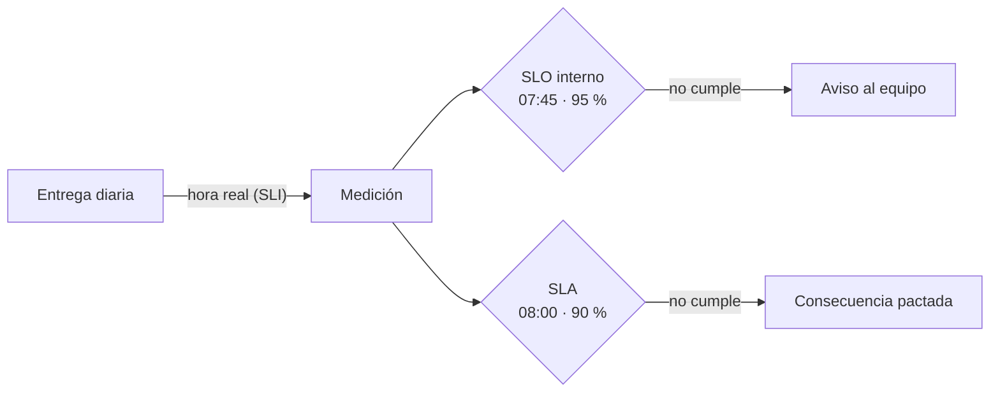

## 1. Resumen

Un **SLA** (service level agreement) es un **acuerdo** con quien consume, que incluye **consecuencias** si no se cumplen sus objetivos. Sin consecuencia explícita, lo que hay es un SLO (*Service Level Objectives*, libro de SRE de Google). En datos, un SLA suele ser de entrega o de frescura: «el reporte diario antes de las 08:00 en el 90 % de los días hábiles; si no, revisión con finanzas y plan de corrección».

Tres distinciones:

- **SLA frente a SLO:** el SLA es lo acordado con consecuencia; el SLO, el objetivo interno, más estricto, que avisa antes (`data-slo`).
- **SLA de datos frente a SLA del proveedor:** los SLA de BigQuery, S3 o Azure son de disponibilidad del servicio (Monthly Uptime Percentage), no de que tus datos lleguen a tiempo.
- **«SLA» en Airflow:** era una función de Airflow 2 que se quitó en 3.0; desde 3.1 la reemplazan las **Deadline Alerts** (*Tasks*, Airflow 3.3.2).

## 2. Qué es

| | SLA | SLO |
|---|---|---|
| Qué es | Acuerdo con consecuencias | Objetivo medido por un SLI |
| Con quién | Con los consumidores | Interno del equipo |
| Si no se cumple | La consecuencia pactada | Se prioriza la confiabilidad |
| Exigencia | Lo que se puede prometer | Más estricta que el SLA |

## 3. Problema que resuelve

Finanzas dice que «el reporte siempre llega tarde». El equipo dice que «casi siempre llega bien». No hay número acordado ni consecuencia: cada retraso es una discusión. Con un SLA (hora, porcentaje y consecuencia), el cumplimiento del mes es un dato, y un SLO interno más estricto avisa antes de llegar al límite.

## 4. Cómo funciona

1. Se acuerda con el consumidor: qué se entrega, a qué hora, en qué porcentaje de días y qué pasa si no.
2. El equipo fija un SLO más estricto (más temprano o más alto).
3. Se mide cada día con un SLI (la hora real de entrega).
4. Al cierre del período se calcula el cumplimiento del SLO y del SLA.
5. Si se incumple el SLA, se aplica la consecuencia; si se incumple el SLO, el equipo actúa antes.

## 5. Cuándo utilizarlo

- Con consumidores que toman decisiones a una hora fija (cierres, reportes regulatorios).
- Cuando los retrasos generan discusiones sin dato.
- Para priorizar: qué tablas tienen compromisos y cuáles no.

## 6. Cuándo no utilizarlo

- Para todas las tablas: un SLA sin consumidor que lo pida es solo papeleo.
- Sin poder medir el SLI.
- Con un SLA más estricto que el SLO interno.

## 7. Ejemplo sencillo

Las 22 entregas de octubre, con el SLO interno (antes de 07:45 en el 95 %) y el SLA (antes de 08:00 en el 90 %):

| Objetivo | Cumplimiento | Resultado |
|---|---|---|
| SLO interno | 86,4 % | no cumple |
| SLA | 90,9 % | cumple, sin consecuencia |

El SLO avisó antes de que el SLA se incumpliera.

## 8. Ejemplo de producción

- Un documento por SLA: dato, hora, porcentaje, período, consecuencia, contacto y excepciones (feriados, caídas del proveedor).
- El SLI se mide automáticamente (hora de publicación de la tabla).
- Un tablero mensual con SLO y SLA; una alerta cuando el SLO se acerca al límite.
- En Airflow 3.1 o posterior, una Deadline Alert sobre la corrida avisa en el momento en que se pasa el plazo (experimental en 3.3.2).

## 9. Arquitectura



## 10. Código

```python
"""Un SLA de datos con su consecuencia y un SLO interno más estricto, medidos sobre las entregas de un mes."""
from datetime import time

# Hora de entrega del reporte diario a finanzas en los 22 días hábiles de octubre.
ENTREGAS = [time(7, 10)] * 17 + [time(7, 55), time(8, 20), time(7, 40), time(9, 5), time(7, 30)]
SLA_HORA, SLA_META = time(8, 0), 0.90       # acordado con finanzas, con consecuencia
SLA_CONSECUENCIA = "revisión con finanzas y plan de corrección"
SLO_HORA, SLO_META = time(7, 45), 0.95      # objetivo interno, más estricto que lo acordado


def cumplimiento(hora: time) -> float:
    return sum(e <= hora for e in ENTREGAS) / len(ENTREGAS)


slo, sla = cumplimiento(SLO_HORA), cumplimiento(SLA_HORA)
print(f"SLO interno (antes de 07:45 en el 95 %): {slo:.1%} -> {'cumple' if slo >= SLO_META else 'no cumple'}")
print(f"SLA (antes de 08:00 en el 90 %): {sla:.1%} -> {'cumple' if sla >= SLA_META else 'no cumple'}")
print(f"consecuencia: {SLA_CONSECUENCIA}" if sla < SLA_META else "sin consecuencia del SLA; el SLO avisó antes")
```

El script se **ejecuta en la CI** y pasa `mypy --strict`. Imprime `SLO interno (antes de 07:45 en el 95 %): 86.4% -> no cumple`, `SLA (antes de 08:00 en el 90 %): 90.9% -> cumple` y `sin consecuencia del SLA; el SLO avisó antes`.

## 11. GCP

En GCP, el **SLA de BigQuery** es un compromiso del proveedor. Según *Service Level Objectives* y *BigQuery Service Level Agreement (SLA)* (no ejecutado):

| | SLA de datos (este concepto) | SLA de BigQuery |
|---|---|---|
| Qué promete | Que tus datos lleguen a tiempo | Monthly Uptime Percentage del servicio (>= 99.99 %, o >= 99.9 % en la edición Standard); Data Transfer Service, un Data Delivery SLO de 24 h o menos para corridas programadas |
| Consecuencia | La que acuerdes | Financial Credits, el único remedio del cliente |
| Período | El que acuerdes | Mes calendario, por proyecto |

Que BigQuery cumpla su SLA no dice nada de si tu pipeline entregó a tiempo.

## 12. AWS

En AWS, el **SLA de Amazon S3**. Según *Service Level Objectives* y *Amazon S3 Service Level Agreement* (no ejecutado):

| | SLA de datos (este concepto) | SLA de Amazon S3 |
|---|---|---|
| Qué promete | Entrega o frescura de tus datos | Monthly Uptime Percentage del servicio en cada ciclo de facturación |
| Consecuencia | La que acuerdes | Service Credit, como porcentaje de lo pagado por la clase de almacenamiento afectada |

## 13. Azure

En Azure, los **SLA for Online Services**. Según *Service Level Objectives* y *Service Level Agreements (SLA) for Online Services* (no ejecutado):

| | SLA de datos (este concepto) | SLA de Microsoft |
|---|---|---|
| Qué promete | Entrega o frescura de tus datos | Disponibilidad y conectividad de los servicios en línea |
| Dónde está | En un acuerdo con tus consumidores | En documentos descargables, actuales y archivados, que cubren Azure, Dynamics 365, Office 365 e Intune |

## 14. Buenas prácticas

- Pocos SLA, solo donde un consumidor los necesita.
- Siempre con un SLO interno más estricto.
- Consecuencia y excepciones por escrito.
- **Seguridad:** el documento del SLA no debe incluir credenciales ni detalles de acceso.
- **Observabilidad:** el SLI se mide automáticamente; nunca a mano al cierre del mes.
- **Costo:** un SLA más estricto exige más redundancia y más guardias; acordar lo que se puede sostener.

## 15. Errores frecuentes

- Llamar SLA a un objetivo sin consecuencia.
- Prometer en el SLA lo mismo que el SLO interno: no queda margen.
- Confundir el SLA del proveedor con el de los datos.
- Buscar la función de SLA en Airflow 3: se quitó en 3.0.

## 16. Trade-offs

Un SLA da claridad a los consumidores y compromete al equipo. Más estricto exige más inversión en confiabilidad. Sin SLA, cada retraso se discute; con demasiados, el equipo vive cumpliendo acuerdos de bajo valor.

## 17. Conceptos relacionados

- `data-slo`: el objetivo interno.
- `data-freshness`: la frescura como SLI.
- `orchestration-observability`: plazos y callbacks en el orquestador.
- `data-contracts`: el nivel de servicio en el contrato.

## 18. Preguntas técnicas abiertas

1. ¿Qué consumidor tuyo necesita un SLA y cuál le basta con un SLO?
2. ¿Qué consecuencia tendría no cumplirlo?
3. ¿Tu SLO interno es más estricto que lo que prometiste?

## 19. Laboratorio relacionado

Pendiente (F4).

## 20. Fuentes

- Google, *Site Reliability Engineering*: *Service Level Objectives*.
- Apache Airflow 3.3.2: *Tasks* y *Deadline Alerts*.
- Google Cloud: *BigQuery Service Level Agreement (SLA)*.
- AWS: *Amazon S3 Service Level Agreement*.
- Microsoft: *Service Level Agreements (SLA) for Online Services*.

El detalle de cada fuente está en `sources` del frontmatter.

## 21. Fecha de última verificación

2026-10-20. `review_required`: pendiente de revisión B-F3.1 del lote F3b-16b.

## 22. Historial de cambios importantes

- 2026-10-20: creación (lote F3b-16b).
