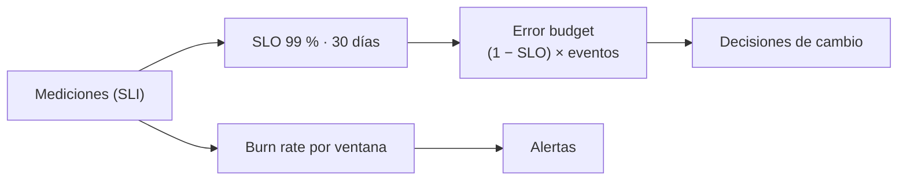

## 1. Resumen

Un **SLO** (service level objective) es un **objetivo** para un nivel de servicio medido por un **SLI** (service level indicator), sobre un **período** (*Service Level Objectives*, libro de SRE de Google; *Concepts in service monitoring*). En datos: «el 99 % de las mediciones horarias del mes con la tabla `pedidos` al día (retraso ≤ 1 h)».

Dos ideas lo vuelven operativo:

- **error budget:** cuánto se permite fallar en el período, `(1 − SLO) × eventos` (*Alerting on your burn rate*); sirve para decidir si conviene arriesgar cambios o priorizar confiabilidad (*Embracing Risk*);
- **burn rate:** qué tan rápido se consume ese budget; 1 es el ritmo que lo agota justo al final del período, y más de 1 lo agota antes.

## 2. Qué es

| Término | En el ejemplo |
|---|---|
| SLI | Proporción de horas con la tabla al día |
| SLO | 99 % en 30 días |
| Eventos del período | 720 mediciones horarias |
| Error budget | (1 − 0,99) × 720 = 7,2 horas malas |
| Burn rate | (tasa de error en una ventana) / (1 − SLO) |

## 3. Problema que resuelve

Un equipo de datos quiere «que la tabla esté siempre al día». Con 100 % como meta, cualquier atraso es un fracaso y nadie se anima a cambiar nada. Con un SLO de 99 %, el equipo sabe que tiene 7,2 horas malas por mes: si quedan pocas, frena cambios riesgosos; si sobra, puede migrar el pipeline.

## 4. Cómo funciona

1. Se elige el SLI: algo medible desde el punto de vista del consumidor (frescura, entrega a tiempo, proporción de filas válidas).
2. Se fija el SLO y el período de cumplimiento.
3. Error budget = (1 − SLO) × eventos del período.
4. En cada momento: consumido = eventos malos; queda = budget − consumido.
5. Burn rate de una ventana = (malos / eventos de la ventana) / (1 − SLO). Un burn rate alto en una ventana corta indica un problema activo (`alerting`).

## 5. Cuándo utilizarlo

- En tablas con consumidores que dependen de ellas a diario.
- Como base para alertar por síntomas en lugar de por causas.
- Para decidir entre velocidad de cambio y confiabilidad con un dato.

## 6. Cuándo no utilizarlo

- Con un SLI que no refleja lo que vive el consumidor (CPU del cluster, por ejemplo).
- Con 100 % como meta.
- Con demasiados SLO por tabla: dos o tres bastan.

## 7. Ejemplo sencillo

30 días de mediciones horarias, con un incidente de 3 h el día 12 y uno de 2 h en las últimas 24 h:

| Medida | Valor |
|---|---|
| SLI | 0,9931 → cumple el SLO de 0,99 |
| Error budget | 7,2 horas; consumidas 5; quedan 2,2 |
| Burn rate 30 días | 0,69 |
| Burn rate últimas 24 h | 8,33 |

En el mes se cumple, pero el último día se consume el budget ocho veces más rápido de lo permitido.

## 8. Ejemplo de producción

- Un SLO de frescura y uno de entrega por cada tabla crítica, con período móvil de 30 días.
- El SLI se calcula de la métrica de retraso que publica el pipeline.
- Un tablero con SLI, budget restante y burn rate.
- Política acordada: con menos del 25 % de budget, solo cambios que mejoren la confiabilidad.

## 9. Arquitectura



## 10. Código

```python
"""Un SLO de frescura: SLI, error budget y burn rate sobre 30 días de mediciones horarias."""
SLO = 0.99                        # 99 % de las mediciones horarias con la tabla al día (retraso <= 1 h)
HORAS = 30 * 24
# Horas en las que la tabla estuvo atrasada: un incidente de 3 h el día 12 y uno de 2 h en las últimas 24 h.
MALAS = {12 * 24 + h for h in range(3)} | {HORAS - 5, HORAS - 4}


def burn_rate(desde: int, hasta: int) -> float:
    eventos = hasta - desde
    errores = sum(desde <= h < hasta for h in MALAS)
    return (errores / eventos) / (1 - SLO)   # 1 = se consume el budget justo al ritmo que lo permite el SLO


sli = 1 - len(MALAS) / HORAS
budget = (1 - SLO) * HORAS                    # errores permitidos en el período
print(f"SLI: {sli:.4f} (SLO {SLO}) -> {'cumple' if sli >= SLO else 'no cumple'}")
print(f"error budget: {budget:.1f} horas malas permitidas; consumidas {len(MALAS)}; quedan {budget - len(MALAS):.1f}")
print(f"burn rate 30 días: {burn_rate(0, HORAS):.2f}")
print(f"burn rate últimas 24 h: {burn_rate(HORAS - 24, HORAS):.2f}")
```

El script se **ejecuta en la CI** y pasa `mypy --strict`. Imprime `SLI: 0.9931 (SLO 0.99) -> cumple`, `error budget: 7.2 horas malas permitidas; consumidas 5; quedan 2.2`, `burn rate 30 días: 0.69` y `burn rate últimas 24 h: 8.33`.

## 11. GCP

En GCP, **Cloud Monitoring** tiene SLO de servicios. Según *Service Level Objectives* y *Concepts in service monitoring* (no ejecutado):

| | SLO de datos (este concepto) | Cloud Monitoring |
|---|---|---|
| SLI | Lo calcula el equipo (frescura, entrega) | Métricas del servicio (conteo de solicitudes, latencias), con SLIs creados desde métricas |
| Error budget | (1 − SLO) × eventos | Empieza en 1 − SLO y baja con el desempeño real |
| Período | El que se fije | Compliance period: ventana móvil o calendario |

## 12. AWS

En AWS, **CloudWatch Application Signals**. Según *Embracing Risk* y *Service level objectives (SLOs)* (no ejecutado):

| | SLO de datos (este concepto) | CloudWatch Application Signals |
|---|---|---|
| A qué se aplica | Tablas y entregas de datos | Servicios u operaciones |
| Qué calcula | SLI, budget y burn rate en el código | Error budget y cumplimiento por período o por solicitudes, burn rates y alarmas de burn rate |

## 13. Azure

En Azure, **Azure Monitor** alerta sobre métricas y logs. Según *Service Level Objectives* y *What are Azure Monitor alerts?* (no ejecutado):

| | SLO de datos (este concepto) | Azure Monitor |
|---|---|---|
| Objeto SLO | El SLO con su budget | La página citada describe reglas de alerta sobre métricas y logs, no un objeto SLO |
| Cómo se arma | Cálculo propio | El SLI se publica como métrica o log y se alerta sobre él |

## 14. Buenas prácticas

- SLI desde el punto de vista del consumidor.
- SLO por debajo de 100 %, con período explícito.
- Una política escrita sobre qué hacer cuando el budget se agota.
- **Seguridad:** el SLI usa metadatos y mediciones, no datos sensibles.
- **Observabilidad:** budget restante y burn rate visibles en el tablero.
- **Costo:** cada nueve adicional cuesta más redundancia y más guardias; elegir el SLO por lo que necesita el consumidor.

## 15. Errores frecuentes

- 100 % como meta.
- Un SLI que nadie fuera del equipo entiende.
- Medir el SLO solo al cierre del período.
- No acordar qué se hace cuando el budget se agota.

## 16. Trade-offs

Un SLO más alto protege más a los consumidores y deja menos margen para cambiar. Un período largo suaviza los picos y avisa más tarde; uno corto avisa antes y es más ruidoso.

## 17. Conceptos relacionados

- `data-sla`: el acuerdo con consecuencias.
- `data-freshness`: el SLI más común en datos.
- `alerting`: alertar por burn rate.
- `observability-metrics`: de dónde sale el SLI.

## 18. Preguntas técnicas abiertas

1. ¿Qué SLI usarías para tu tabla más consumida?
2. ¿Cuántas horas malas por mes acepta su consumidor?
3. ¿Qué harías si el budget se agota a mitad de mes?

## 19. Laboratorio relacionado

Pendiente (F4).

## 20. Fuentes

- Google, *Site Reliability Engineering*: *Service Level Objectives* y *Embracing Risk*.
- Google Cloud: *Concepts in service monitoring* y *Alerting on your burn rate*.
- AWS: *Service level objectives (SLOs)* (CloudWatch).
- Microsoft Learn: *What are Azure Monitor alerts?*.

El detalle de cada fuente está en `sources` del frontmatter.

## 21. Fecha de última verificación

2026-10-20. `review_required`: pendiente de revisión B-F3.1 del lote F3b-16b.

## 22. Historial de cambios importantes

- 2026-10-20: creación (lote F3b-16b).
