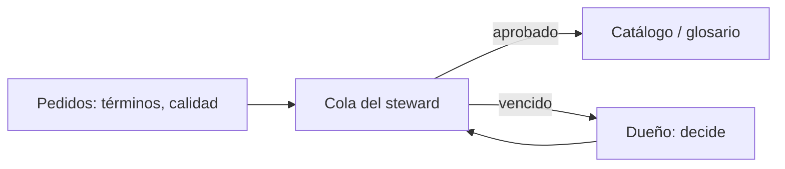

## 1. Resumen

**Stewardship** es el trabajo cotidiano de cuidar los datos en nombre del dueño: definir y aprobar términos de negocio, atender pedidos de calidad, mantener la metadata y escalar lo que no se resuelve a tiempo. La división es simple:

- el **dueño** decide (qué significa el dato, quién lo usa, qué calidad necesita);
- el **steward** ejecuta y sigue: redacta la definición, coordina la corrección, actualiza el catálogo.

En Purview es un rol con nombre: **Data Steward** puede crear, actualizar y leer artefactos y políticas dentro de su dominio (*Data governance roles and permissions in Microsoft Purview*).

## 2. Qué es

- **Término de negocio:** una definición acordada («cliente activo»), con estado (borrador, aprobado).
- **Pedido de calidad:** un problema reportado en un dataset, con plazo.
- **Plazo:** el tiempo acordado para resolver cada tipo de pedido.
- **Escalamiento:** lo vencido sube al dueño.

## 3. Problema que resuelve

«Cliente activo» significa una cosa en marketing y otra en finanzas. Hace tres meses alguien abrió la discusión y nadie la cerró. Con un steward a cargo y un plazo, el término queda en su cola, vence a los 30 días y se escala al dueño para que decida.

## 4. Cómo funciona

1. Cada término y cada pedido de calidad tiene un steward asignado.
2. Los plazos los fija el gobierno (por ejemplo, 30 días para un término, 5 para un pedido de calidad).
3. El steward trabaja su cola; lo aprobado se publica en el catálogo.
4. Lo que vence se escala al dueño.
5. Se mide la carga por steward para repartirla.

## 5. Cuándo utilizarlo

- Con glosarios de negocio que hay que mantener.
- Cuando los pedidos de calidad no tienen quién los siga.
- En dominios grandes, donde el dueño no puede ocuparse de cada detalle.

## 6. Cuándo no utilizarlo

- Como reemplazo del dueño: el steward no decide significado ni acceso por su cuenta.
- Con una sola persona como steward de toda la organización.

## 7. Ejemplo sencillo

Hoy, 21 de octubre de 2026; plazos de 30 días para términos y 5 para calidad:

| Steward | Pendiente | Días | Estado |
|---|---|---|---|
| ana | término «cliente activo» | 81 | vencido: escalar al dueño |
| ana | término «margen bruto» | 11 | en plazo |
| luis | calidad: montos negativos en pedidos | 8 | vencido: escalar al dueño |
| ana | calidad: clientes duplicados | 2 | en plazo |

Pendientes por steward: ana 3, luis 1.

## 8. Ejemplo de producción

- Un steward por dominio, con un respaldo.
- La cola vive en la herramienta de gobierno (catálogo o tickets), con plazos por tipo.
- Una revisión semanal de lo vencido con los dueños.
- Los términos aprobados se vinculan a columnas en el catálogo.

## 9. Arquitectura



## 10. Código

```python
"""La cola de un steward: términos de glosario sin definición aprobada y pedidos de calidad abiertos, con su plazo."""
from datetime import date

HOY = date(2026, 10, 21)
PLAZO_DIAS = {"termino": 30, "calidad": 5}   # plazos acordados por el comité de gobierno
COLA = [  # (tipo, qué, steward, abierto el, estado)
    ("termino", "cliente activo", "ana", date(2026, 8, 1), "borrador"),
    ("termino", "margen bruto", "ana", date(2026, 10, 10), "borrador"),
    ("termino", "ticket promedio", "luis", date(2026, 9, 1), "aprobado"),
    ("calidad", "montos negativos en pedidos", "luis", date(2026, 10, 13), "abierto"),
    ("calidad", "clientes duplicados", "ana", date(2026, 10, 19), "abierto"),
]

pendientes = [c for c in COLA if c[4] in ("borrador", "abierto")]
for tipo, que, steward, abierto, _ in sorted(pendientes, key=lambda c: c[3]):
    dias = (HOY - abierto).days
    estado = "VENCIDO: escalar al dueño" if dias > PLAZO_DIAS[tipo] else "en plazo"
    print(f"{steward} · {tipo} · {que}: {dias} días -> {estado}")
por_steward = {s: sum(c[2] == s for c in pendientes) for s in sorted({c[2] for c in pendientes})}
print("pendientes por steward:", por_steward)
```

El script se **ejecuta en la CI** y pasa `mypy --strict`. Imprime cada pendiente con sus días y su estado (`VENCIDO: escalar al dueño` o `en plazo`) y `pendientes por steward: {'ana': 3, 'luis': 1}`.

## 11. GCP

En GCP, **Knowledge Catalog** guarda la metadata que mantiene un steward. Según *Data governance roles and permissions in Microsoft Purview* y *About metadata in Knowledge Catalog* (no ejecutado):

| | Stewardship (este concepto) | Knowledge Catalog |
|---|---|---|
| Rol con nombre | Steward | La página citada no define un rol de steward; describe quién llena los aspects: sistemas, escaneos, usuarios, pipelines o agentes |
| Qué mantiene | Términos, descripciones, pedidos | Aspects (por ejemplo, Contacts), glosarios y entry links |

## 12. AWS

En AWS, la **curación de activos** en Amazon SageMaker Catalog. Según *Data governance roles and permissions in Microsoft Purview* y *Catalog in IDC-based domains* (no ejecutado):

| | Stewardship (este concepto) | SageMaker Catalog |
|---|---|---|
| Quién cura | El steward | La página habla de los data owners, que curan el inventario de su proyecto |
| Qué se agrega | Términos y descripciones | Nombres de negocio, descripciones, read me, términos de glosario y metadata forms |

## 13. Azure

En Azure, el rol **Data Steward** de Purview Unified Catalog. Según *Data governance roles and permissions in Microsoft Purview* y *Governance domains in Unified Catalog* (no ejecutado):

| | Stewardship (este concepto) | Purview |
|---|---|---|
| Rol | Steward, en nombre del dueño | Data Steward: crea, actualiza y lee artefactos y políticas en su dominio; lee artefactos de otros dominios |
| Calidad | Pedidos con plazo | Subroles como Data Quality Steward para reglas, escaneos y alertas de calidad |

## 14. Buenas prácticas

- Un steward por dominio, con respaldo y carga medida.
- Plazos por tipo de pedido, acordados.
- Escalar lo vencido al dueño, no dejarlo en la cola.
- **Seguridad:** el steward necesita permisos sobre la metadata, no siempre sobre los datos.
- **Observabilidad:** pedidos vencidos y tiempo de resolución por steward.
- **Costo:** stewardship es tiempo de personas; priorizar los dominios más consumidos.

## 15. Errores frecuentes

- Stewards sin tiempo asignado para el rol.
- Confundir steward con dueño.
- Colas sin plazos, que crecen sin fin.

## 16. Trade-offs

Más stewards reparten la carga y cuestan más horas. Plazos cortos resuelven antes y escalan más al dueño.

## 17. Conceptos relacionados

- `data-ownership`: el dueño.
- `metadata-management`: la metadata que mantiene.
- `data-quality-dimensions`: los pedidos de calidad.
- `data-catalog`: donde publica.

## 18. Preguntas técnicas abiertas

1. ¿Quién mantiene hoy tu glosario de negocio?
2. ¿Cuánto tarda en resolverse un pedido de calidad?
3. ¿Qué términos de negocio siguen sin definición acordada?

## 19. Laboratorio relacionado

Pendiente (F4).

## 20. Fuentes

- Microsoft Learn: *Data governance roles and permissions in Microsoft Purview* y *Governance domains in Unified Catalog*.
- Google Cloud: *About metadata in Knowledge Catalog*.
- AWS: *Catalog in IDC-based domains*.

El detalle de cada fuente está en `sources` del frontmatter.

## 21. Fecha de última verificación

2026-10-21. `review_required`: pendiente de revisión B-F3.1 del lote F3b-17b.

## 22. Historial de cambios importantes

- 2026-10-21: creación (lote F3b-17b).
