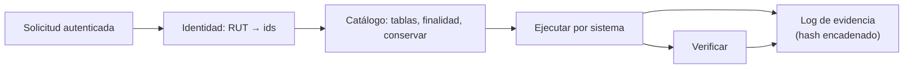

## 1. Resumen

Esta ficha no es asesoría legal: cubre la capacidad técnica para atender solicitudes de titulares.

La ley reconoce al titular seis derechos sobre sus datos: acceso, rectificación, supresión, oposición, portabilidad y bloqueo, y fija un plazo de respuesta de 30 días corridos, prorrogable una vez. El área legal decide si una solicitud procede; ingeniería de datos tiene que poder **ejecutarla en todos los sistemas** dentro del plazo. Eso pide un orquestador listo antes de la primera solicitud:

1. resolver la identidad (RUT → identificadores internos);
2. ubicar los datos con el catálogo;
3. ejecutar por sistema;
4. verificar con una nueva consulta;
5. dejar evidencia que no se pueda alterar sin que se note.

## 2. Qué es

- **[Obligación legal · art. 4]** Los derechos son acceso, rectificación, supresión, oposición, portabilidad y bloqueo.
- **[Obligación legal · art. 5]** El acceso incluye los datos, su origen, las finalidades, los destinatarios y el período de tratamiento.
- **[Obligación legal · art. 6]** La rectificación se comunica a quienes recibieron los datos, y los datos sin rectificar no se vuelven a tratar.
- **[Obligación legal · art. 7]** La supresión procede por las causales de la ley y tiene excepciones, como una obligación legal o la ejecución de un contrato.
- **[Obligación legal · art. 8 ter]** El bloqueo suspende el tratamiento mientras se resuelve una solicitud, sin borrar los datos.
- **[Obligación legal · art. 9]** La portabilidad entrega una copia en formato electrónico estructurado, genérico y de uso común, cuando el tratamiento es automatizado y se basa en el consentimiento.
- **[Obligación legal · art. 11]** La respuesta va en 30 días corridos, prorrogables una vez, y el responsable guarda respaldos que demuestran qué respondió y cuándo.

## 3. Problema que resuelve

**[Buena práctica]** Llega la primera solicitud de supresión y el equipo descubre que el cliente está en el CRM, en los pedidos, en la lista de marketing y en tres exports, con identificadores distintos. Armar la consulta a mano toma semanas, el plazo es de 30 días, y no queda registro de lo que se hizo.

## 4. Cómo funciona

1. **[Obligación legal · art. 11]** Registrar la solicitud con identidad autenticada por el área responsable y calcular el plazo.
2. **[Decisión de arquitectura]** Resolver el RUT a los identificadores internos con una tabla maestra de identidad.
3. **[Decisión de arquitectura]** Ubicar en el catálogo cada tabla con datos del titular, su finalidad, su plazo y si debe conservarse.
4. **[Obligación legal · art. 8 ter]** Si hay una solicitud pendiente y el titular pide bloqueo, marcarlo: los pipelines lo excluyen sin borrar.
5. **[Buena práctica]** Ejecutar por sistema: consulta (acceso, portabilidad), actualización (rectificación), borrado (supresión).
6. **[Buena práctica]** Verificar con una nueva consulta y registrar cada paso en un log encadenado por hash.

## 5. Cuándo utilizarlo

- Antes de la primera solicitud: construirlo después no cabe en el plazo.
- En toda plataforma con datos de clientes en más de un sistema.

## 6. Cuándo no utilizarlo

- Para decidir si la solicitud procede o si una excepción aplica: lo decide el área legal.
- Como sustituto de la autenticación del titular, que hace el área responsable.

## 7. Ejemplo sencillo

| Solicitud | Resultado |
|---|---|
| Acceso | Filas por tabla, con finalidad y plazo |
| Portabilidad | JSON de 3 tablas |
| Rectificación | Correo actualizado |
| Bloqueo | El pipeline procesa 1 de 2 clientes; los datos siguen guardados |
| Supresión | Borrado en `clientes` y `optin`; `pedidos` se conserva por obligación legal |
| Evidencia | Log íntegro; tras alterar un registro, deja de serlo |
| Plazo (ingreso 2026-12-02) | 2027-01-01; con prórroga, 2027-01-31 |

## 8. Ejemplo de producción

- Tabla maestra de identidad mantenida por el sistema de clientes.
- El catálogo marca, por tabla, la columna del titular, la finalidad, el plazo y si se conserva (decisión del área legal).
- Un job por tipo de solicitud, idempotente, que corre en días y no en semanas.
- Log de evidencia en un almacenamiento de solo anexar, encadenado por hash.

### Evidencia de cumplimiento

| Evidencia | Dónde queda | Quién la produce |
|---|---|---|
| Solicitud, fecha de ingreso y plazo | Sistema de solicitudes | Área responsable |
| Acciones por tabla, con hash encadenado | Log de evidencia | Orquestador |
| Verificación posterior | Log de evidencia | Orquestador |
| Copia de la respuesta enviada | Respaldo de respuestas | Área responsable |

## 9. Arquitectura



## 10. Código

```python
# Python 3.12 y psycopg contra PostgreSQL 17 (ejecutado en la CI con el servicio postgres:17): orquestador de
# solicitudes de titulares. Resuelve la identidad (RUT -> cliente_id), ubica los datos con el catálogo, ejecuta
# acceso, portabilidad, rectificación, bloqueo y supresión, y deja un log de evidencia encadenado por hash.
# PG_HOST, PG_PORT, PG_USER, PG_PASSWORD y PG_DB: base vacía temporal.
import datetime as dt
import hashlib
import json
import os
from typing import Any

import psycopg

S = os.environ["PG_DB"]
CATALOGO: dict[str, dict[str, Any]] = {  # lo mantienen el dueño del dato y el área legal
    "clientes": {"finalidad": "venta y despacho", "plazo": "5 años desde la última compra", "conservar": None},
    "optin": {"finalidad": "envío de ofertas", "plazo": "hasta retirar el consentimiento", "conservar": None},
    "pedidos": {"finalidad": "venta y despacho", "plazo": "6 años", "conservar": "obligación legal (decisión del área legal)"},
}


def plazo(ingreso: dt.date, prorroga: bool = False) -> dt.date:
    """Plazo de respuesta: 30 días corridos, prorrogable una vez por 30 más."""
    return ingreso + dt.timedelta(days=60 if prorroga else 30)


with psycopg.connect(host=os.environ["PG_HOST"], port=os.environ["PG_PORT"], user=os.environ["PG_USER"],
                     password=os.environ["PG_PASSWORD"], dbname=S, autocommit=True) as conn:
    conn.execute("CREATE TABLE identidad (rut text PRIMARY KEY, cliente_id int)")  # tabla maestra de identidad
    conn.execute("CREATE TABLE clientes (cliente_id int, nombre text, email text, bloqueado bool DEFAULT false)")
    conn.execute("CREATE TABLE optin (cliente_id int, canal text)")
    conn.execute("CREATE TABLE pedidos (pedido_id int, cliente_id int, monto int)")
    conn.execute("CREATE TABLE evidencia (n serial, solicitud text, accion text, detalle text, hash text)")
    conn.execute("INSERT INTO identidad VALUES ('11111111-1', 1), ('22222222-2', 2)")  # RUT ficticios
    conn.execute("INSERT INTO clientes (cliente_id, nombre, email) VALUES (1, 'Ana', 'ana@viejo.invalid'), (2, 'Luis', 'luis@example.org')")
    conn.execute("INSERT INTO optin VALUES (1, 'correo'), (2, 'correo')")
    conn.execute("INSERT INTO pedidos VALUES (10, 1, 120), (11, 1, 80), (12, 2, 45)")

    def evidencia(solicitud: str, accion: str, detalle: str) -> None:
        previo = conn.execute("SELECT hash FROM evidencia ORDER BY n DESC LIMIT 1").fetchone()
        h = hashlib.sha256(f"{previo[0] if previo else ''}|{solicitud}|{accion}|{detalle}".encode()).hexdigest()
        conn.execute("INSERT INTO evidencia (solicitud, accion, detalle, hash) VALUES (%s, %s, %s, %s)", (solicitud, accion, detalle, h))

    def integra() -> bool:
        previo = ""
        for solicitud, accion, detalle, h in conn.execute("SELECT solicitud, accion, detalle, hash FROM evidencia ORDER BY n"):
            if hashlib.sha256(f"{previo}|{solicitud}|{accion}|{detalle}".encode()).hexdigest() != h:
                return False
            previo = h
        return True

    def cliente(rut: str) -> int:
        fila = conn.execute("SELECT cliente_id FROM identidad WHERE rut = %s", (rut,)).fetchone()
        assert fila is not None
        return int(fila[0])

    def datos(cid: int) -> dict[str, Any]:
        out: dict[str, Any] = {}
        for tabla, meta in CATALOGO.items():
            cur = conn.execute(f"SELECT * FROM {tabla} WHERE cliente_id = %s", (cid,))
            cols = [c.name for c in cur.description or []]
            out[tabla] = {"filas": [dict(zip(cols, f)) for f in cur.fetchall()], "finalidad": meta["finalidad"], "plazo": meta["plazo"]}
        return out

    ana = cliente("11111111-1")
    acceso = datos(ana)
    evidencia("S-1 acceso", "entregar copia", ",".join(f"{t}:{len(v['filas'])}" for t, v in acceso.items()))
    print("acceso:", {t: (len(v["filas"]), v["finalidad"]) for t, v in acceso.items()})
    portable = json.dumps({t: v["filas"] for t, v in acceso.items()}, default=str)
    print("portabilidad: JSON de", len(json.loads(portable)), "tablas,", len(portable), "bytes")

    conn.execute("UPDATE clientes SET email = 'ana@nuevo.invalid' WHERE cliente_id = %s", (ana,))
    evidencia("S-2 rectificación", "update clientes.email", "1 fila; comunicar a destinatarios")
    print("rectificación:", conn.execute("SELECT email FROM clientes WHERE cliente_id = %s", (ana,)).fetchone())

    conn.execute("UPDATE clientes SET bloqueado = true WHERE cliente_id = %s", (ana,))
    evidencia("S-3 bloqueo", "bloqueado = true", "mientras se resuelve la supresión")
    procesables = conn.execute("SELECT count(*) FROM clientes WHERE NOT bloqueado").fetchone()
    guardados = conn.execute("SELECT count(*) FROM clientes").fetchone()
    print(f"bloqueo: el pipeline procesa {procesables[0] if procesables else 0} de {guardados[0] if guardados else 0} clientes; los datos siguen guardados")

    borradas = {}
    for tabla, meta in CATALOGO.items():
        if meta["conservar"]:
            evidencia("S-4 supresión", f"conservar {tabla}", meta["conservar"])
            continue
        borradas[tabla] = conn.execute(f"DELETE FROM {tabla} WHERE cliente_id = %s", (ana,)).rowcount
        evidencia("S-4 supresión", f"delete {tabla}", f"{borradas[tabla]} filas")
    print("supresión:", borradas, "| se conserva: pedidos (obligación legal)")
    print("verificación:", {t: len(v["filas"]) for t, v in datos(ana).items()})

    registros = conn.execute("SELECT count(*) FROM evidencia").fetchone()
    print("log de evidencia íntegro:", integra(), f"({registros[0] if registros else 0} registros)")
    conn.execute("UPDATE evidencia SET detalle = '0 filas' WHERE accion = 'delete optin'")
    print("tras alterar un registro, íntegro:", integra())
    ingreso = dt.date(2026, 12, 2)
    print(f"plazo de respuesta: {plazo(ingreso)}; con prórroga: {plazo(ingreso, prorroga=True)}")
```

El script se **ejecuta en la CI contra el servicio postgres:17** y pasa `mypy --strict`. Los RUT y correos son ficticios. Imprime el acceso con finalidades, la portabilidad en JSON, la rectificación, el bloqueo que excluye al titular sin borrar, la supresión que conserva `pedidos`, la verificación, el log íntegro que deja de serlo al alterar un registro, y el plazo con y sin prórroga.

## 11. GCP

En GCP, **Knowledge Catalog** para ubicar los datos. Según *Ley 19628 SOBRE PROTECCION DE LOS DATOS PERSONALES* y *About metadata in Knowledge Catalog* (no ejecutado):

| | Orquestador (este ejemplo) | Knowledge Catalog | Etiqueta |
|---|---|---|---|
| Ubicar los datos | Diccionario `CATALOGO` | Entries con aspect types propios (por ejemplo, clasificación de PII) | **[Decisión de arquitectura]** |
| Ejecutar la solicitud | Jobs propios | Esta ficha no cita un servicio para eso; lo hace el orquestador | **[Buena práctica]** |

## 12. AWS

En AWS, **Amazon SageMaker Catalog**. Según *Ley 19628 SOBRE PROTECCION DE LOS DATOS PERSONALES* y *Catalog in IDC-based domains* (no ejecutado):

| | Orquestador (este ejemplo) | SageMaker Catalog | Etiqueta |
|---|---|---|---|
| Ubicar los datos | Diccionario `CATALOGO` | Assets con contexto de negocio | **[Decisión de arquitectura]** |
| Ejecutar la solicitud | Jobs propios | Esta ficha no cita un servicio para eso | **[Buena práctica]** |

## 13. Azure

En Azure, **Purview Unified Catalog**. Según *Ley 19628 SOBRE PROTECCION DE LOS DATOS PERSONALES* y *Learn about Microsoft Purview Unified Catalog* (no ejecutado):

| | Orquestador (este ejemplo) | Purview Unified Catalog | Etiqueta |
|---|---|---|---|
| Ubicar los datos | Diccionario `CATALOGO` | Inventario de activos, metadata y linaje | **[Decisión de arquitectura]** |
| Ejecutar la solicitud | Jobs propios | Esta ficha no cita un servicio para eso | **[Buena práctica]** |

## 14. Buenas prácticas

- **[Obligación legal · art. 11]** Calcular y vigilar el plazo desde el ingreso; la prórroga es una sola vez.
- **[Obligación legal · art. 6]** Al rectificar, comunicar el cambio a los destinatarios que figuran en el catálogo.
- **[Buena práctica]** **Seguridad:** el orquestador tiene permisos amplios; cuenta de servicio propia, auditada, sin uso humano.
- **[Buena práctica]** **Observabilidad:** alertar por solicitudes cerca del vencimiento y por verificaciones fallidas.
- **[Buena práctica]** **Costo:** automatizar los derechos más frecuentes primero; los raros pueden empezar semiautomáticos.

## 15. Errores frecuentes

- Borrar solo en la base principal y olvidar marketing, exports y respaldos.
- Bloquear borrando (el bloqueo no afecta el almacenamiento).
- No guardar evidencia de lo que se hizo.

## 16. Trade-offs

Un orquestador completo cuesta construirlo y mantener el catálogo al día; sin él, cada solicitud es un proyecto manual con riesgo de no cumplir el plazo. Un log encadenado detecta alteraciones, pero no impide borrar el log entero: va en un almacenamiento de solo anexar.

## 17. Conceptos relacionados

- `data-catalog`: ubicar los datos.
- `processing-activities-inventory`: finalidades y destinatarios.
- `chilean-identifier-pseudonymization`: el RUT y los identificadores internos.
- `erasure-across-copies`: la supresión en todas las copias.

## 18. Preguntas técnicas abiertas

1. ¿Cuánto tardarías hoy en encontrar todos los datos de un cliente por su RUT?
2. ¿Tus pipelines respetan una marca de bloqueo?
3. ¿Qué evidencia guardas de una supresión?

## 19. Laboratorio relacionado

Pendiente (F4).

## 20. Fuentes

- BCN Ley Chile: *Ley 19628 SOBRE PROTECCION DE LOS DATOS PERSONALES* (versión con vigencia diferida desde 2026-12-01).
- PostgreSQL 17: *GRANT*.
- Google Cloud: *About metadata in Knowledge Catalog*.
- AWS: *Catalog in IDC-based domains*.
- Microsoft Learn: *Learn about Microsoft Purview Unified Catalog*.

El detalle de cada fuente está en `sources` del frontmatter.

## 21. Fecha de última verificación

2026-10-21: texto legal consultado ese día en BCN. `review_required`: pendiente de revisión B-F3.1 del lote F3b-19b; pasa a `verified` solo con la aprobación explícita de Felipe (`owner_approved_at`). Revisión mensual.

## 22. Historial de cambios importantes

- 2026-10-21: creación (lote F3b-19b).
