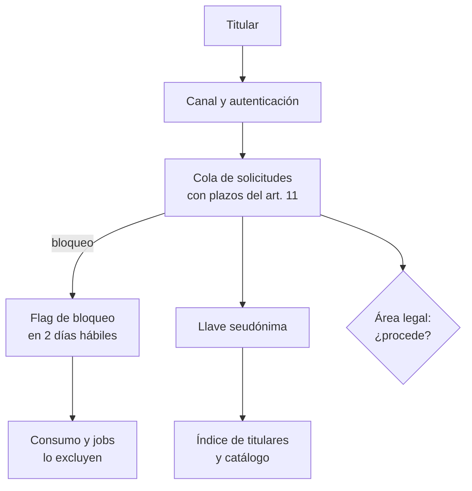
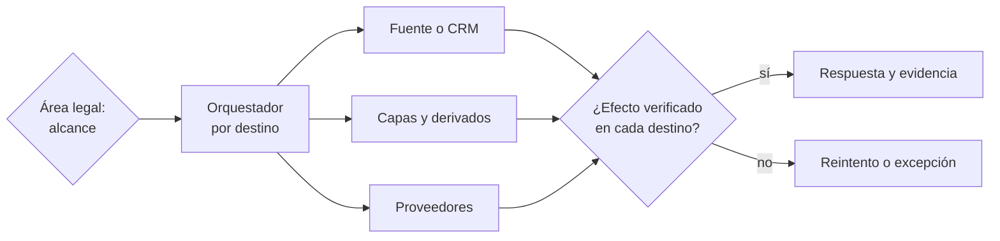

## 1. Resumen

Esta ficha no es asesoría legal: si una solicitud procede, con qué alcance y con qué excepciones lo decide el responsable con el área legal; aquí se explica la plataforma que permite responder a tiempo, completo y con evidencia.

**Cómo leerla.** *Comprender* (§1–6): los seis derechos, los plazos y por qué responderlos es un flujo con estado. *Aplicar* (§7–13): localizar al titular, ejecutar por destino y verificar el efecto. *Demostrar*: la evidencia del §8, el código del §10 y los criterios del §18.

Desde la vigencia de la ley, cualquier titular puede pedir qué datos se tienen de él, corregirlos, borrarlos, oponerse, bloquearlos o llevárselos. Responder es un **flujo transversal**, no una consulta SQL: recibir, verificar identidad, localizar los tratamientos y sistemas afectados, ejecutar solo lo aprobado, comprobar el efecto y responder con evidencia. El desafío de ingeniería es la **cobertura**: los datos están en fuentes operacionales, capas, derivados, modelos, exportaciones y proveedores, y una acción en una tabla no asegura el efecto en todas. Sin un índice de titulares y un catálogo por actividad, el plazo de 30 días es difícil de cumplir.

## 2. Qué es

- **[Obligación legal · art. 4]** Seis derechos: acceso, rectificación, supresión, oposición, portabilidad y bloqueo; son irrenunciables.
- **[Obligación legal · art. 11]** Respuesta en 30 días corridos, prorrogables una vez; el bloqueo temporal fundado se responde en 2 días hábiles y, mientras no se resuelva, no se tratan esos datos.
- **[Obligación legal · art. 5]** Acceso: los datos y su origen, las finalidades, los destinatarios, el período de tratamiento, los intereses legítimos si esa es la base, y la lógica de las decisiones automatizadas.
- **[Obligación legal · art. 6]** Rectificación: los datos rectificados se comunican a quienes los recibieron, salvo que sea imposible o desproporcionado, y no se vuelven a tratar sin rectificar.
- **[Obligación legal · art. 7]** Supresión: procede por las causales del artículo, con excepciones.
- **[Obligación legal · art. 8]** Oposición: si la base es el interés legítimo, si el fin es exclusivamente marketing directo (incluidos los perfiles) o si los datos vienen de una fuente de acceso público sin otro fundamento.
- **[Obligación legal · art. 9]** Portabilidad: copia de lo que el titular facilitó, en formato estructurado, genérico y de uso común, si el tratamiento es automatizado y se basa en su consentimiento.
- **[Obligación legal · art. 10]** Mecanismos tecnológicos expeditos; rectificación, supresión y oposición siempre gratuitas; acceso gratuito al menos trimestralmente.
- **[Decisión de arquitectura]** Cinco elementos que conviene modelar por separado:

| Elemento | Qué guarda | Quién lo produce | Etiqueta |
|---|---|---|---|
| Solicitud | Qué pide el titular, cuándo ingresó y en qué estado está | Pipeline de derechos | **[Decisión de arquitectura]** |
| Decisión autorizada | Procedencia, alcance, excepciones y fecha límite | Área legal (no el pipeline) | **[Decisión de arquitectura]** |
| Índice de titulares | Llave seudónima → tablas, actividades y sistemas donde aparece | Ingesta y linaje | **[Decisión de arquitectura]** |
| Acción por destino | Operación, reintentos y resultado verificable | Conectores de cada sistema | **[Decisión de arquitectura]** |
| Evidencia | Quién autorizó, qué se ejecutó, qué falló y qué se comunicó | Pipeline de derechos | **[Decisión de arquitectura]** |

- **[Decisión de arquitectura]** **Pipeline de solicitudes:** recepción → autenticación → decisión del área legal → localización → ejecución por destino → verificación → respuesta → cierre.

## 3. Problema que resuelve

**[Buena práctica]** Una persona pide rectificar su correo. Se actualiza `silver.clientes`, pero la siguiente carga desde el CRM restaura el valor anterior, y el correo incorrecto sigue en la plataforma de campañas. No falta una actualización: faltan la fuente autorizada, la propagación, el control de reprocesos y la verificación de los destinos.

**[Buena práctica]** Sin esta capacidad: búsquedas manuales del RUT en decenas de tablas, respuestas incompletas (faltan derivados o terceros), plazos vencidos, un bloqueo que no se aplica a tiempo, o una rectificación que el próximo backfill revierte.

## 4. Cómo funciona

1. **[Obligación legal · art. 11]** La solicitud llega al correo, formulario o medio electrónico dispuesto, con la autenticación del titular que fije la Agencia, y el responsable acusa recibo. **[Buena práctica]** Registrar `request_id`, derecho, canal y fecha de ingreso, y calcular los plazos; sin datos del titular en logs abiertos.
2. **[Buena práctica]** Verificar identidad y alcance con un mecanismo proporcional al riesgo, antes de revelar datos o ejecutar acciones.
3. **[Buena práctica]** Calcular la llave seudónima (HMAC) y consultar el índice de titulares, el catálogo y el registro de actividades. El linaje ayuda a encontrar dependencias, pero no ubica las filas de un titular.
4. **[Obligación legal · art. 8 ter]** El bloqueo suspende temporalmente el tratamiento sin afectar el almacenamiento. **[Decisión de arquitectura]** Un flag del titular que las vistas de consumo y los jobs excluyen, sin borrar.
5. **[Decisión de arquitectura]** El área legal decide si la solicitud procede y su alcance; ingeniería ejecuta según el tipo:

Etiqueta: **[Decisión de arquitectura]**

| Derecho | Ejecución técnica | Riesgo principal |
|---|---|---|
| Acceso | Consolidar datos por actividad con finalidad, base, destinatarios, plazo y lógica automatizada desde el catálogo | Respuesta incompleta, o entregada a quien no es el titular |
| Rectificación | Corregir en la fuente o en una capa de correcciones que gane en cada recálculo; propagar a destinatarios | Un backfill que restaura el valor antiguo |
| Supresión | `retention-and-erasure` | Réplicas, respaldos, derivados y reingesta |
| Oposición | Excluir al titular de la actividad objetada (por ejemplo, marketing directo o perfiles) | Excluir de más o dejar un uso residual |
| Bloqueo | Flag de exclusión en consumo y en jobs | Consumidores que no pasan por el filtro |
| Portabilidad | Export estructurado de lo que corresponde según el art. 9 | Incluir datos que el derecho no comprende |

6. **[Buena práctica]** Ejecutar por destino con operaciones idempotentes (`request_id` + destino + operación) y registrar resultados parciales y fallos.
7. **[Buena práctica]** Verificar el efecto en cada destino (fuentes, capas, vistas, reingesta y terceros) con una prueba, no con el estado que declara el job; el caso no se cierra con destinos pendientes.
8. **[Obligación legal · art. 11]** Responder por escrito y guardar respaldo de la respuesta: fecha, destino y contenido.
9. **[Buena práctica]** Registrar evidencia con id de solicitud, llave seudónima, acciones y fechas, sin datos del titular, con acceso restringido y un plazo de conservación propio.

**[Buena práctica]** Los plazos se modelan como configuración versionada (calendario de feriados, regla de días hábiles, prórroga y su fundamento), no como `ingreso + 30` repetido en cada proceso; las pruebas cubren fines de semana, feriados y solicitudes incompletas.

## 5. Cuándo utilizarlo

- En cualquier plataforma que trate datos de personas identificables, aunque reciba pocas solicitudes: el plazo no cambia por volumen.
- Antes de la primera solicitud, y de nuevo al sumar fuentes, pipelines, modelos o proveedores: cada uno es un destino más.

## 6. Cuándo no utilizarlo

- Para decidir si una solicitud procede o si aplica una excepción: lo decide el área legal.
- Como garantía de cobertura total solo por tener linaje, ni como sinónimo de «borrar todo» ante cualquier petición.
- Los órganos públicos tienen reglas propias (arts. 22 y 23); esta ficha se centra en el sector privado.

## 7. Ejemplo sencillo

Solicitud de supresión ingresada el jueves 2026-10-29, con pedido de bloqueo:

| Hito | Fecha |
|---|---|
| Responder el bloqueo (2 días hábiles) | lunes 2026-11-02 |
| Responder la solicitud (30 días corridos) | 2026-11-28 |
| Con prórroga única | 2026-12-28 |

Rectificación del correo de una clienta, por etapas:

| Etapa | Acción | Comprobación |
|---|---|---|
| Verificación | Confirmar identidad y solicitud | Caso validado |
| Decisión | Aprobar la rectificación y los destinos | Alcance autorizado |
| Fuente | Corregir en el CRM o en la capa de correcciones | El valor nuevo persiste |
| Datos | Recalcular silver y gold | El valor antiguo no reaparece tras un backfill |
| Terceros | Comunicar a la plataforma de campañas | Acuse o resultado documentado |
| Cierre | Responder y guardar evidencia | Ningún destino pendiente |

## 8. Ejemplo de producción

Escenario genérico: una aerolínea en GCP.

| Componente | Implementación posible | Precaución |
|---|---|---|
| Canal | Formulario web con autenticación | Acuse de recibo con fecha |
| Gestión de casos | Servicio de solicitudes con base transaccional | Datos y permisos segregados |
| Índice de titulares | Tabla `governance.indice_titulares` (llave, tabla, actividad, sistema), actualizada por la ingesta y el linaje | Medir cobertura y desfase |
| Orquestación | Airflow (Cloud Composer) o Workflows | Reintentos idempotentes |
| Flag de bloqueo | Tabla `governance.bloqueos`; filtros de fila en las vistas de consumo | Jobs y exportaciones también lo leen |
| Correcciones | Tabla de correcciones aplicada en silver | Test de que el backfill no las revierte |
| Export de portabilidad | JSON o CSV con esquema publicado | Solo lo que cubre el art. 9 |
| Plazos | Tablero de solicitudes por estado y días restantes | Alertas antes del vencimiento |

### Evidencia de cumplimiento

| Evidencia | Dónde queda | Quién la produce | Qué demuestra | Qué no demuestra |
|---|---|---|---|---|
| Ingreso, acuse de recibo y plazos | Log de solicitudes | Pipeline de derechos | Cuándo llegó y cuándo vence | Que la autenticación fuera suficiente |
| Decisión y alcance | Registro del área legal | Área legal | Qué se aprobó y con qué excepciones | Que los destinos listados sean todos |
| Acciones por destino y su verificación | Log de ejecución, sin datos del titular | Ingeniería | Qué se ejecutó, qué falló y qué se comprobó | Que no existan destinos fuera del índice |
| Prueba de backfill | Log de la CI | CI | Que una rectificación sobrevive al recálculo | Que otros procesos no reintroduzcan el valor |
| Respaldo de la respuesta | Archivo de respuestas | Pipeline de derechos | Qué se respondió y cuándo | Que la respuesta fuera completa |

## 9. Arquitectura

**Recepción.**



**Ejecución y cierre.**



## 10. Código

```python
# Python 3.12+, biblioteca estándar. Pipeline de derechos del titular (Ley 19.628 mod. por Ley 21.719):
# calcula plazos (art. 11), localiza al titular con un índice de ubicaciones, arma la respuesta de acceso
# con lo que pide el art. 5 desde el catálogo, filtra la portabilidad a lo que exige el art. 9, comprueba que una
# rectificación sobreviva al recálculo desde bronze y no deja cerrar un caso con destinos pendientes.
import json
from dataclasses import dataclass
from datetime import date, timedelta

FERIADOS: set[date] = {date(2026, 10, 31)}  # en producción: calendario oficial de feriados, versionado


def mas_dias_habiles(inicio: date, n: int) -> date:
    d = inicio
    while n:
        d += timedelta(days=1)
        if d.weekday() < 5 and d not in FERIADOS:
            n -= 1
    return d


@dataclass(frozen=True)
class Actividad:          # actividad de tratamiento en el catálogo
    nombre: str
    finalidad: str
    base: str             # "consentimiento", "contrato", "obligación legal", "interés legítimo"
    plazo: str
    destinatarios: str
    decision_automatizada: str | None


@dataclass(frozen=True)
class Ubicacion:          # entrada del índice titular → ubicaciones
    tabla: str
    actividad: str
    facilitado_por_titular: bool   # art. 9: portabilidad solo de lo que el titular entregó
    automatizado: bool


@dataclass(frozen=True)
class Resultado:          # resultado de una acción en un destino
    destino: str
    estado: str           # "verificado" (con una prueba), "pendiente" o "fallido"


CATALOGO = {
    "venta_pasajes": Actividad("venta_pasajes", "emitir y gestionar pasajes", "contrato",
                               "5 años desde el vuelo", "aerolíneas socias del itinerario", None),
    "riesgo_fraude": Actividad("riesgo_fraude", "prevenir fraude en pagos", "interés legítimo",
                               "2 años", "procesador de pagos",
                               "puntaje de riesgo; transacciones sobre el umbral pasan a revisión humana"),
}

INDICE = {  # llave seudónima del titular → dónde están sus datos
    "c3d3a94d7560c6ae": [
        Ubicacion("silver.pasajeros", "venta_pasajes", True, True),
        Ubicacion("silver.reservas", "venta_pasajes", True, True),
        Ubicacion("gold.score_fraude", "riesgo_fraude", False, True),
    ]
}


def plazos(ingreso: date, derecho: str) -> dict[str, str]:
    p = {"respuesta": str(ingreso + timedelta(days=30)),
         "con_prorroga": str(ingreso + timedelta(days=60))}
    if derecho in {"rectificación", "supresión", "oposición"}:
        p["bloqueo_si_se_pide"] = str(mas_dias_habiles(ingreso, 2))   # art. 11: dos días hábiles
    return p


def acceso(titular: str) -> dict[str, object]:
    """Art. 5: datos y origen, finalidades, destinatarios, período, interés legítimo y lógica automatizada."""
    salida: list[dict[str, object]] = []
    for nombre in sorted({u.actividad for u in INDICE[titular]}):
        a = CATALOGO[nombre]
        salida.append({
            "actividad": a.nombre, "finalidad": a.finalidad, "base": a.base, "plazo": a.plazo,
            "destinatarios": a.destinatarios,
            "tablas": [u.tabla for u in INDICE[titular] if u.actividad == nombre],
            "interes_legitimo": a.finalidad if a.base == "interés legítimo" else None,
            "logica_automatizada": a.decision_automatizada,
        })
    return {"titular": titular, "tratamientos": salida}


def portabilidad(titular: str) -> list[str]:
    """Art. 9: datos facilitados por el titular, tratados en forma automatizada y basados en consentimiento.
    Aquí la base es contrato: el resultado vacío muestra por qué el filtro se calcula y no se asume."""
    return [u.tabla for u in INDICE[titular]
            if u.facilitado_por_titular and u.automatizado and CATALOGO[u.actividad].base == "consentimiento"]


def recalcular(bronze: dict[str, str], correcciones: dict[str, str]) -> dict[str, str]:
    """Silver desde bronze: la capa de correcciones gana en cada recálculo, también en un backfill."""
    return {titular: correcciones.get(titular, valor) for titular, valor in bronze.items()}


def cierre(aprobada: bool, destinos: set[str], resultados: list[Resultado]) -> list[str]:
    """Lo que impide cerrar el caso: sin aprobación, o destinos sin efecto verificado."""
    pendientes = [] if aprobada else ["sin decisión aprobada"]
    estados = {r.destino: r.estado for r in resultados}
    pendientes += [f"{d}: {estados.get(d, 'sin resultado')}" for d in sorted(destinos) if estados.get(d) != "verificado"]
    return pendientes


def main() -> None:
    t = "c3d3a94d7560c6ae"
    print("plazos supresión:", plazos(date(2026, 10, 29), "supresión"))
    print(json.dumps(acceso(t), ensure_ascii=False, indent=1))
    print("tablas portables:", portabilidad(t))

    bronze = {t: "antiguo@example.com"}           # la próxima carga desde el CRM trae el valor anterior
    correcciones = {t: "nuevo@example.com"}
    print("tras el backfill, ¿sigue rectificado?:", recalcular(bronze, correcciones)[t] == correcciones[t])
    resultados = [Resultado("crm", "verificado"), Resultado("silver.clientes", "verificado"),
                  Resultado("plataforma_campanas", "pendiente")]
    bloqueos = cierre(True, {"crm", "silver.clientes", "plataforma_campanas"}, resultados)
    print("cierre de la rectificación:", "permitido" if not bloqueos else f"no permitido: {bloqueos}")


if __name__ == "__main__":
    main()
```

El script se **ejecuta en la CI** con la biblioteca estándar y pasa `mypy --strict`. Imprime los plazos de una supresión ingresada el 2026-10-29 (respuesta el 2026-11-28, con prórroga el 2026-12-28, bloqueo el 2026-11-02), la respuesta de acceso armada desde el catálogo por actividad, `tablas portables: []`, y el caso de rectificación:

```text
tras el backfill, ¿sigue rectificado?: True
cierre de la rectificación: no permitido: ['plataforma_campanas: pendiente']
```

Cuatro lecciones: el acceso sale del **catálogo por actividad**, no de un `SELECT *`; la portabilidad no aplica a todo (aquí la base es contrato, así que el art. 9 no la exige); la corrección vive en una capa que gana en cada recálculo; y un caso no se cierra mientras un destino no tenga su efecto verificado. Cómo contar los días hábiles (feriados, sábados) es un supuesto a confirmar con el área legal. **Limitaciones:** «verificado» debe salir de una prueba sobre el destino, no de un valor declarado; el ejemplo no decide la procedencia ni demuestra cumplimiento.

## 11. GCP

En GCP, **BigQuery** con seguridad a nivel de fila. Según *Introduction to BigQuery row-level security* (no ejecutado):

| Necesidad | Servicio | Etiqueta |
|---|---|---|
| Bloqueo en consumo | Row access policies que filtran filas según el usuario | **[Buena práctica]** |
| Índice de titulares | Tabla propia en BigQuery | **[Decisión de arquitectura]** |
| Límite | El filtro protege las lecturas de esa tabla; lo que ya se exportó o copió a otro sistema necesita su propio control | **[Buena práctica]** |

## 12. AWS

En AWS, **Lake Formation**. Según *Data filtering and cell-level security in Lake Formation* (no ejecutado):

| Necesidad | Servicio | Etiqueta |
|---|---|---|
| Bloqueo en consumo | Filtros de datos a nivel de fila al dar permisos | **[Buena práctica]** |
| Índice de titulares | Tabla propia | **[Decisión de arquitectura]** |
| Límite | El filtro protege las lecturas con esos permisos; lo que ya se exportó o copió a otro sistema necesita su propio control | **[Buena práctica]** |

## 13. Azure

En Azure, **Unity Catalog** de Azure Databricks. Según *Row filters and column masks* (no ejecutado):

| Necesidad | Servicio | Etiqueta |
|---|---|---|
| Bloqueo en consumo | Filtros de fila de Unity Catalog contra la tabla de bloqueos | **[Buena práctica]** |
| Índice de titulares | Tabla propia en el lakehouse | **[Decisión de arquitectura]** |
| Límite | El filtro protege las consultas a esa tabla; lo que ya se exportó o copió a otro sistema necesita su propio control | **[Buena práctica]** |

**Criterio común:** ningún servicio implementa por sí solo los derechos del titular; el filtro de fila es una pieza del bloqueo, no el pipeline.

## 14. Buenas prácticas

- **[Decisión de arquitectura]** Una sola llave seudónima del titular en todas las capas: es lo que hace posible el índice.
- **[Buena práctica]** El índice se alimenta automáticamente desde la ingesta y el linaje; uno mantenido a mano queda incompleto. Medir su cobertura: porcentaje de sistemas con datos personales integrados al índice y al ejecutor.
- **[Buena práctica]** Corrección duradera: que CDC, backfills y reconstrucciones no reviertan rectificaciones ni supresiones aprobadas.
- **[Decisión de arquitectura]** Separar los roles de solicitante, operador, aprobador y ejecutor técnico.
- **[Buena práctica]** **Seguridad:** autenticar antes de buscar; un acceso respondido a un impostor es una vulneración.
- **[Buena práctica]** **Observabilidad:** tablero de solicitudes por días restantes, alertas antes del vencimiento y destinos pendientes por caso.
- **[Buena práctica]** **Costo:** automatizar acceso, bloqueo y supresión, que son los más frecuentes y los de plazo más duro.

## 15. Errores frecuentes

| Error | Consecuencia |
|---|---|
| Buscar solo por RUT en tablas SQL | Se omiten otros identificadores, archivos y servicios |
| Confundir el linaje con el índice de titulares | El linaje no ubica las filas de una persona |
| Responder acceso con un volcado de tablas | No entrega lo que pide el art. 5 (finalidades, destinatarios, lógica) |
| No incluir derivados, features ni terceros | La respuesta queda incompleta |
| Bloqueo implementado como borrado, o solo en una vista | Se pierde el dato, o los demás consumidores siguen tratándolo |
| Rectificar en silver sin capa de correcciones | El siguiente recálculo desde bronze restaura el error |
| Cerrar el caso cuando el job termina | No demuestra el efecto en destinos y terceros |
| Logs de solicitudes con RUT, nombre o correo | La evidencia se vuelve otra copia de datos personales |
| Asumir que la portabilidad aplica a todos los datos | Se entregan datos que el derecho no comprende |

## 16. Trade-offs

| Opción | A favor | En contra |
|---|---|---|
| Índice de titulares materializado | Respuesta rápida, medible | Mantenerlo sincronizado |
| Búsqueda bajo demanda por linaje | Sin tabla extra | Lenta y frágil en plataformas grandes |
| Orquestación central | Seguimiento en un solo lugar | Conectores para cada sistema |
| Ejecución federada | Cada sistema aplica con su propia autoridad | Contrato de operación y evidencia por destino |
| Bloqueo por filtro de fila | Inmediato, sin mover datos | Cada consumidor debe pasar por la capa controlada |
| Borrado físico frente a restricción temporal | No son equivalentes: dependen del derecho y la decisión aprobada | Cada sistema soporta operaciones distintas |

## 17. Conceptos relacionados

- `chile-data-protection`: ficha padre.
- `processing-activities-inventory`: el catálogo por actividad.
- `retention-and-erasure`: la supresión.
- `chilean-identifier-pseudonymization`: la llave seudónima.
- `dpia-and-automated-decisions`: la lógica de las decisiones automatizadas.
- `row-level-security`: el filtro de fila del bloqueo.
- `privacy-controls-as-code`: control de cierre y pruebas de backfill.

## 18. Preguntas técnicas abiertas

1. ¿En cuánto tiempo puedes listar todas las tablas donde aparece una persona?
2. ¿Tu capa de consumo puede excluir a un titular en menos de 2 días hábiles?
3. ¿Tus rectificaciones sobreviven a un reproceso completo?
4. ¿Qué pasa si un conector falla o se reintenta a mitad de una supresión?

**Criterio de dominio:** dominas esta ficha si puedes explicar qué sistemas y derivados están en el alcance aprobado, cómo se ubica al titular sin exponer su identificador a cada consumidor, qué operación ejecuta cada destino y cómo confirma su efecto, y cómo se impide cerrar una solicitud con destinos pendientes.

## 19. Laboratorio relacionado

Propuesta para F4: simular una rectificación en CRM → silver → gold → plataforma de campañas, con un backfill que trae el dato antiguo y un proveedor que falla. Se aprueba si la corrección persiste, el caso no cierra con destinos pendientes y queda evidencia de cada intento. Datos ficticios.

## 20. Fuentes

- BCN Ley Chile: *Ley 19628 SOBRE PROTECCION DE LOS DATOS PERSONALES* (versión con vigencia diferida desde 2026-12-01).
- Google Cloud: *Introduction to BigQuery row-level security*.
- AWS: *Data filtering and cell-level security in Lake Formation*.
- Microsoft Learn: *Row filters and column masks*.

El detalle de cada fuente está en `sources` del frontmatter.

## 21. Fecha de última verificación

2026-10-25: textos legales vueltos a consultar en BCN, sin cambios. Antes, 2026-10-22: arts. 4 a 11 consultados ese día en BCN. `review_required`: pasa a `verified` solo con la aprobación explícita de Felipe (`owner_approved_at`). Revisión mensual.

## 22. Historial de cambios importantes

- 2026-10-22: creación (upgrade de 19); reemplaza a `data-subject-requests`, que queda como alias.
- 2026-10-24: `PART_OF` hacia `chile-data-protection` (ADR-024) e `implication` por artículo en `legal_basis` (enmienda de ADR-023). Sin cambios de contenido legal ni de código.
- 2026-10-25: revisión del upgrade (`docs/reviews/cards-f3b-19-upgrade.md`) y auditoría de las etiquetas «Obligación legal»: cada una afirma solo lo que dice su artículo; lo demás pasa a buena práctica o decisión de arquitectura. Textos de BCN y del Senado consultados el 2026-10-25, sin cambios desde el 2026-10-22.
- 2026-10-25: §9 con el estándar de diagramas (máximo 8 nodos, CLAUDE.md): dos diagramas: recepción y ejecución; los cinco derechos convergen en la respuesta.
- 2026-10-28: mejora de contenido (lote P1) con tres niveles de lectura: §1 (flujo con estado y cobertura), §2 (solicitud, decisión autorizada, índice, acción por destino y evidencia), §3 (rectificación revertida por la carga del CRM), §4 (verificación de identidad, idempotencia, verificación del efecto, cierre sin destinos pendientes, riesgo principal por derecho y plazos como configuración versionada), §5, §6, §7 (rectificación por etapas), §8 (escenario y evidencia «qué demuestra y qué no»), §9 (ejecución por destino y cierre), §10 (rectificación que sobrevive al backfill y control de cierre, sobre el mismo ejemplo), §11–13 (límites de los filtros de fila y criterio común), §14–16, §18 (criterio de dominio) y §19 (laboratorio para F4). Los plazos verificados del art. 11 se mantienen. Sin cambios en `legal_basis`, etiquetas, aviso ni vigencia.
- 2026-10-28: pasa al dominio 24-privacy-engineering, tramo `derechos-ciclo-vida` (ADR-027), desde 19-compliance; sin cambios de contenido. La URL de la ficha (`/concepts/data-subject-rights-pipeline/`) no cambia.
- 2026-10-30: Enmienda 3 de ADR-023: en §4, la tabla con la misma etiqueta en todas sus filas pasa a la línea «Etiqueta: […]» antes de la tabla, sin columna. Sin cambios de contenido.
