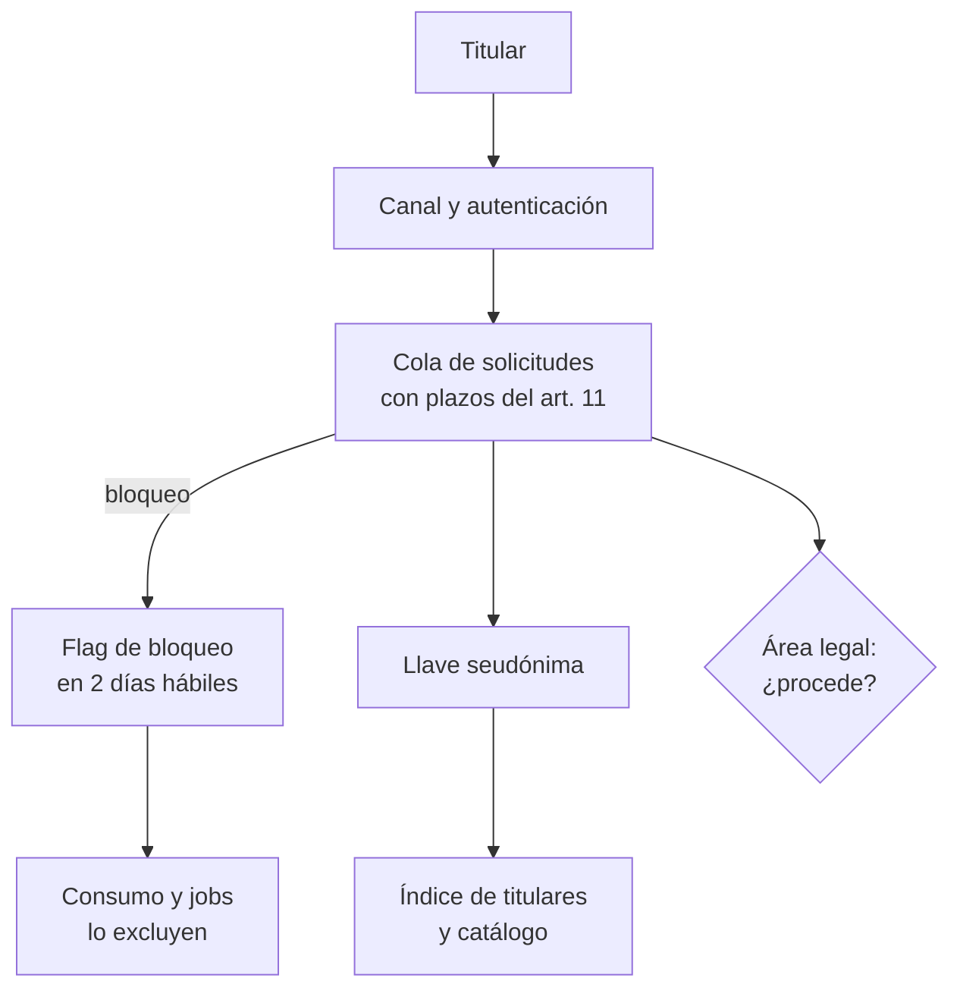
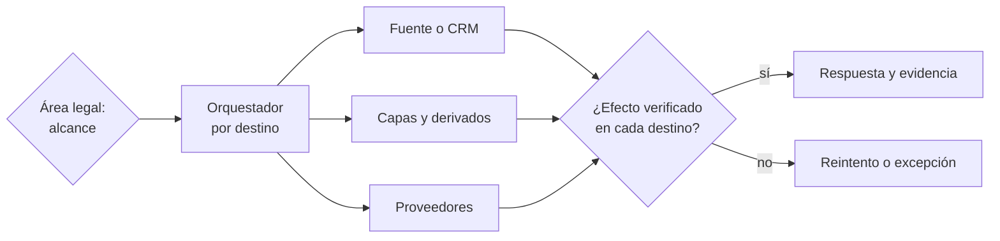

## 1. Resumen

Esta ficha no es asesoría legal: si una solicitud procede, con qué alcance y con qué excepciones lo decide el responsable con el área legal; aquí se explica la plataforma que permite responder a tiempo, completo y con evidencia.

Desde la vigencia de la ley, cualquier titular puede pedir qué datos se tienen de él, corregirlos, borrarlos, oponerse, bloquearlos o llevárselos. Responder es un **flujo transversal**, no una consulta SQL: recibir, verificar identidad, localizar los tratamientos y sistemas afectados, ejecutar solo lo aprobado, comprobar el efecto y responder con evidencia. El desafío de ingeniería es la **cobertura**: los datos están en fuentes operacionales, capas, derivados, modelos, exportaciones y proveedores, y una acción en una tabla no asegura el efecto en todas. Sin un índice de titulares y un catálogo por actividad, el plazo de 30 días es difícil de cumplir.

## 2. Qué es

- **[Obligación legal · art. 4]** Seis derechos: acceso, rectificación, supresión, oposición, portabilidad y bloqueo; son personales, intransferibles e irrenunciables.
- **[Obligación legal · art. 11]** Respuesta en 30 días corridos, prorrogables una vez; el bloqueo temporal fundado se responde en 2 días hábiles y, mientras no se resuelva, no se tratan esos datos.
- **[Obligación legal · art. 5]** Acceso: los datos y su origen, las finalidades, los destinatarios, el período de tratamiento, los intereses legítimos si esa es la base, y la lógica de las decisiones automatizadas.
- **[Obligación legal · art. 6]** Rectificación: los datos rectificados se comunican a quienes los recibieron, salvo que sea imposible o desproporcionado, y no se vuelven a tratar sin rectificar.
- **[Obligación legal · art. 7]** Supresión: procede por las causales del artículo, con excepciones.
- **[Obligación legal · art. 8]** Oposición: si la base es el interés legítimo, si el fin es exclusivamente marketing directo (incluidos los perfiles) o si los datos vienen de una fuente de acceso público sin otro fundamento. En la letra a), el tratamiento sigue si el responsable acredita «motivos legítimos imperiosos para el tratamiento que prevalezcan sobre los intereses, los derechos y las libertades del titular, o para la formulación, el ejercicio o la defensa de reclamaciones». Y «no procederá la oposición al tratamiento cuando éste se realice con fines de investigación científica o histórica o fines estadísticos, y siempre que fueran necesarios para el cumplimiento de una función pública o para el ejercicio de una actividad de interés público».
- **[Obligación legal · art. 9]** Portabilidad: copia de lo que el titular facilitó, en formato estructurado, genérico y de uso común, si el tratamiento es automatizado y se basa en su consentimiento.
- **[Obligación legal · art. 10]** Mecanismos tecnológicos expeditos. «El ejercicio de los derechos de rectificación, supresión y oposición siempre serán gratuitos para el titular. El derecho de acceso también se ejercerá en forma gratuita, al menos trimestralmente.» El responsable «sólo puede exigir el pago de los costos directos en que incurra, cuando el titular ejerza su derecho de acceso y derecho a la portabilidad más de una vez en el trimestre»; ese cobro no se exige en los casos del inciso cuarto del art. 28.
- **[Decisión de arquitectura]** Cinco elementos que conviene modelar por separado:

| Elemento | Qué guarda | Quién lo produce |
|---|---|---|
| Solicitud | Qué pide el titular, cuándo ingresó y en qué estado está | Pipeline de derechos |
| Decisión autorizada | Procedencia, alcance, excepciones y fecha límite | Área legal (no el pipeline) |
| Índice de titulares | Llave seudónima → tablas, actividades y sistemas donde aparece | Ingesta y linaje |
| Acción por destino | Operación, reintentos y resultado verificable | Conectores de cada sistema |
| Evidencia | Quién autorizó, qué se ejecutó, qué falló y qué se comunicó | Pipeline de derechos |

- **[Decisión de arquitectura]** **Pipeline de solicitudes:** recepción → autenticación → decisión del área legal → localización → ejecución por destino → verificación → respuesta → cierre.

## 3. Problema que resuelve

**[Buena práctica]** Una persona pide rectificar su correo. Se actualiza `silver.clientes`, pero la siguiente carga desde el CRM restaura el valor anterior, y el correo incorrecto sigue en la plataforma de campañas. No falta una actualización: faltan la fuente autorizada, la propagación, el control de reprocesos y la verificación de los destinos.

**[Buena práctica]** Sin esta capacidad: búsquedas manuales del RUT en decenas de tablas, respuestas incompletas (faltan derivados o terceros), plazos vencidos, un bloqueo que no se aplica a tiempo, o una rectificación que el próximo backfill revierte.

## 4. Cómo funciona

1. **[Obligación legal · art. 11]** La solicitud llega al correo, formulario o medio electrónico dispuesto, con la autenticación del titular que fije la Agencia, y el responsable acusa recibo. **[Buena práctica]** Registrar `request_id`, derecho, canal y fecha de ingreso, y calcular los plazos; sin datos del titular en logs abiertos.
2. **[Buena práctica]** Verificar identidad y alcance con un mecanismo proporcional al riesgo, antes de revelar datos o ejecutar acciones.
3. **[Buena práctica]** Calcular la llave seudónima (HMAC) y consultar el índice de titulares, el catálogo y el registro de actividades. El linaje ayuda a encontrar dependencias, pero no ubica las filas de un titular.
4. **[Obligación legal · art. 8 ter]** El bloqueo suspende temporalmente el tratamiento sin afectar el almacenamiento. **[Decisión de arquitectura]** Un flag del titular que las vistas de consumo y los jobs excluyen, sin borrar.
5. **[Decisión de arquitectura]** El área legal decide si la solicitud procede y su alcance; ingeniería ejecuta según el tipo:

| Derecho | Ejecución técnica | Riesgo principal |
|---|---|---|
| Acceso | Consolidar datos por actividad con finalidad, base, destinatarios, plazo y lógica automatizada desde el catálogo | Respuesta incompleta, o entregada a quien no es el titular |
| Rectificación | Corregir en la fuente o en una capa de correcciones que gane en cada recálculo; propagar a destinatarios | Un backfill que restaura el valor antiguo |
| Supresión | `retention-and-erasure` | Réplicas, respaldos, derivados y reingesta |
| Oposición | Excluir al titular de la actividad objetada (por ejemplo, marketing directo o perfiles) | Excluir de más o dejar un uso residual |
| Bloqueo | Flag de exclusión en consumo y en jobs | Consumidores que no pasan por el filtro |
| Portabilidad | Export estructurado de lo que corresponde según el art. 9 | Incluir datos que el derecho no comprende |

6. **[Buena práctica]** Ejecutar por destino con operaciones idempotentes (`request_id` + destino + operación) y registrar resultados parciales y fallos.
7. **[Buena práctica]** Verificar el efecto en cada destino (fuentes, capas, vistas, reingesta y terceros) con una prueba, no con el estado que declara el job; el caso no se cierra con destinos pendientes.
8. **[Obligación legal · art. 11]** Responder por escrito y guardar respaldo de la respuesta: fecha, destino y contenido.
9. **[Buena práctica]** Registrar evidencia con id de solicitud, llave seudónima, acciones y fechas, sin datos del titular, con acceso restringido y un plazo de conservación propio.

**[Buena práctica]** Los plazos se modelan como configuración versionada (calendario de feriados, regla de días hábiles, prórroga y su fundamento), no como `ingreso + 30` repetido en cada proceso; las pruebas cubren fines de semana, feriados y solicitudes incompletas.

## 5. Cuándo utilizarlo

- En cualquier plataforma que trate datos de personas identificables, aunque reciba pocas solicitudes: el plazo no cambia por volumen.
- Antes de la primera solicitud, y de nuevo al sumar fuentes, pipelines, modelos o proveedores: cada uno es un destino más.

## 6. Cuándo no utilizarlo

- Para decidir si una solicitud procede o si aplica una excepción: lo decide el área legal.
- Como garantía de cobertura total solo por tener linaje, ni como sinónimo de «borrar todo» ante cualquier petición.
- Los órganos públicos tienen reglas propias (arts. 22 y 23); esta ficha se centra en el sector privado.

## 7. Ejemplo sencillo

Solicitud de supresión ingresada el lunes 2026-12-07, con pedido fundado de bloqueo temporal:

| Hito | Fecha |
|---|---|
| Responder el bloqueo (2 días hábiles; el martes 2026-12-08 es feriado) | jueves 2026-12-10 |
| Responder la solicitud (30 días corridos) | 2027-01-06 |
| Con prórroga única | 2027-02-05 |

Rectificación del correo de una clienta, por etapas:

| Etapa | Acción | Comprobación |
|---|---|---|
| Verificación | Confirmar identidad y solicitud | Caso validado |
| Decisión | Aprobar la rectificación y los destinos | Alcance autorizado |
| Fuente | Corregir en el CRM o en la capa de correcciones | El valor nuevo persiste |
| Datos | Recalcular silver y gold | El valor antiguo no reaparece tras un backfill |
| Terceros | Comunicar a la plataforma de campañas | Acuse o resultado documentado |
| Cierre | Responder y guardar evidencia | Ningún destino pendiente |

## 8. Ejemplo de producción

Escenario genérico: una aerolínea en GCP.

| Componente | Implementación posible | Precaución |
|---|---|---|
| Canal | Formulario web con autenticación | Acuse de recibo con fecha |
| Gestión de casos | Servicio de solicitudes con base transaccional | Datos y permisos segregados |
| Índice de titulares | Tabla `governance.indice_titulares` (llave, tabla, actividad, sistema), actualizada por la ingesta y el linaje | Medir cobertura y desfase |
| Orquestación | Airflow (Cloud Composer) o Workflows | Reintentos idempotentes |
| Flag de bloqueo | Tabla `governance.bloqueos`; filtros de fila en las vistas de consumo | Jobs y exportaciones también lo leen |
| Correcciones | Tabla de correcciones aplicada en silver | Test de que el backfill no las revierte |
| Export de portabilidad | JSON o CSV con esquema publicado | Solo lo que cubre el art. 9 |
| Plazos | Tablero de solicitudes por estado y días restantes | Alertas antes del vencimiento |

### Evidencia de cumplimiento

| Evidencia | Dónde queda | Quién la produce | Qué demuestra | Qué no demuestra |
|---|---|---|---|---|
| Ingreso, acuse de recibo y plazos | Log de solicitudes | Pipeline de derechos | Cuándo llegó y cuándo vence | Que la autenticación fuera suficiente |
| Decisión y alcance | Registro del área legal | Área legal | Qué se aprobó y con qué excepciones | Que los destinos listados sean todos |
| Acciones por destino y su verificación | Log de ejecución, sin datos del titular | Ingeniería | Qué se ejecutó, qué falló y qué se comprobó | Que no existan destinos fuera del índice |
| Prueba de backfill | Log de la CI | CI | Que una rectificación sobrevive al recálculo | Que otros procesos no reintroduzcan el valor |
| Respaldo de la respuesta | Archivo de respuestas | Pipeline de derechos | Qué se respondió y cuándo | Que la respuesta fuera completa |

## 9. Arquitectura

**Recepción.**



**Ejecución y cierre.**



## 10. Código

```python
# Python 3.12+, biblioteca estándar. Pipeline de derechos del titular (Ley 19.628 mod. por Ley 21.719), de punta a
# punta: ingreso y plazos (art. 11) → localizar con el índice y el catálogo → ejecutar por derecho → verificar con una
# sonda que lee cada destino y cerrar → código de salida (0 responde o cierra, 1 queda abierto). Uso: python derechos.py
# acceso | rectificacion | bloqueo | reintento. Las funciones reciben catálogo, índice, configuración y plataforma; no
# hay estado global. Titulares con llave seudónima (chilean-identifier-pseudonymization) y datos ficticios.
import sys
from dataclasses import dataclass, field, replace
from datetime import date, timedelta
from typing import Literal

Derecho = Literal["acceso", "rectificación", "supresión", "oposición", "portabilidad", "bloqueo"]
Estado = Literal["verificado", "pendiente"]


# @paso 1 Ingreso y plazos
@dataclass(frozen=True)
class ConfigPlazos:   # versionada: cada resultado dice con qué versión se calculó
    version: str
    feriados: frozenset[date]   # calendario de ejemplo; en producción, el oficial
    regla_habiles: str
    dias_respuesta: int         # corridos
    dias_prorroga: int          # corridos, una sola vez
    dias_bloqueo: int           # hábiles


@dataclass(frozen=True)
class Solicitud:
    request_id: str
    titular: str
    derecho: Derecho
    ingreso: date
    destinos: tuple[str, ...] = ()   # alcance que aprobó el área legal
    actividad: str | None = None     # oposición: la actividad objetada
    bloqueo_temporal: bool = False   # art. 11: pedido fundado junto a una rectificación, supresión u oposición


def configuracion() -> ConfigPlazos:
    return ConfigPlazos("plazos-2026.2", frozenset({date(2026, 12, 8)}),
                        "lunes a viernes, sin feriados (supuesto a confirmar con el área legal)", 30, 30, 2)


def mas_dias_habiles(cfg: ConfigPlazos, inicio: date, n: int) -> date:
    d = inicio
    while n:
        d += timedelta(days=1)
        if d.weekday() < 5 and d not in cfg.feriados:
            n -= 1
    return d


def plazos(cfg: ConfigPlazos, s: Solicitud) -> dict[str, date]:
    respuesta = s.ingreso + timedelta(days=cfg.dias_respuesta)
    p = {"respuesta": respuesta, "con prórroga": respuesta + timedelta(days=cfg.dias_prorroga)}
    if s.bloqueo_temporal and s.derecho in {"rectificación", "supresión", "oposición"}:
        p["bloqueo temporal"] = mas_dias_habiles(cfg, s.ingreso, cfg.dias_bloqueo)
    return p


def efecto_feriados(cfg: ConfigPlazos, s: Solicitud) -> str:
    """Muestra cuánto corre el plazo de bloqueo el calendario de feriados de la configuración."""
    con = plazos(cfg, s).get("bloqueo temporal")
    sin = plazos(replace(cfg, feriados=frozenset()), s).get("bloqueo temporal")
    return f" (sin feriados sería {sin})" if con != sin else ""


# @paso 2 Localizar
@dataclass(frozen=True)
class Actividad:   # actividad de tratamiento en el catálogo (processing-activities-inventory)
    nombre: str
    finalidad: str
    base: str
    datos: str          # categorías de datos tratados (art. 5 a)), no los valores del titular
    origen: str
    destinatarios: str
    plazo: str
    automatizada: bool  # hay decisiones automatizadas: la lógica es obligatoria en la respuesta
    logica: str | None


@dataclass(frozen=True)
class Ubicacion:   # entrada del índice titular → ubicaciones
    destino: str
    actividad: str
    facilitado_por_titular: bool   # art. 9: portabilidad solo de lo que el titular entregó
    automatizado: bool


def catalogo() -> dict[str, Actividad]:
    actividades = [
        Actividad("venta_pasajes", "emitir y gestionar pasajes", "contrato", "identificación, contacto e itinerario",
                  "formulario de compra", "aerolíneas socias del itinerario", "5 años desde el vuelo", False, None),
        Actividad("riesgo_fraude", "prevenir fraude en pagos", "interés legítimo", "monto y medio de pago",
                  "procesador de pagos", "procesador de pagos", "2 años", True,
                  "puntaje de riesgo; sobre el umbral pasa a revisión humana"),
        Actividad("marketing_directo", "ofertas personalizadas", "consentimiento", "contacto y preferencias",
                  "centro de preferencias", "plataforma de email", "hasta retirar el consentimiento", False, None),
    ]
    return {a.nombre: a for a in actividades}


def indice() -> dict[str, list[Ubicacion]]:
    return {
        "c3d3a94d7560c6ae": [Ubicacion("crm", "venta_pasajes", True, True),
                             Ubicacion("silver.clientes", "venta_pasajes", True, True),
                             Ubicacion("gold.score_fraude", "riesgo_fraude", False, True)],
        "7e1f04b2a9d35c18": [Ubicacion("crm", "venta_pasajes", True, True),
                             Ubicacion("silver.clientes", "venta_pasajes", True, True),
                             Ubicacion("silver.preferencias", "marketing_directo", True, True)],
        "a90b5c2e1d7f3346": [Ubicacion("crm", "venta_pasajes", True, True),
                             Ubicacion("silver.clientes", "venta_pasajes", True, True)],
    }


# @paso 3 Ejecutar por derecho
def acceso(cat: dict[str, Actividad], idx: dict[str, list[Ubicacion]], titular: str) -> list[str]:
    """Art. 5: datos y origen, finalidades, destinatarios, período, interés legítimo y lógica automatizada."""
    lineas = []
    for nombre in sorted({u.actividad for u in idx[titular]}):
        a = cat[nombre]
        n = sum(1 for u in idx[titular] if u.actividad == nombre)
        extra = (f" · interés legítimo: {a.finalidad}" if a.base == "interés legítimo" else "") + (
            f" · lógica: {a.logica}" if a.automatizada else "")
        lineas.append(f"{a.nombre}: {a.finalidad} · base {a.base} · datos {a.datos} (origen {a.origen}) · "
                      f"{a.destinatarios} · {a.plazo} · {n} ubicación(es){extra}")
    return lineas


def faltantes_art5(cat: dict[str, Actividad], idx: dict[str, list[Ubicacion]], titular: str) -> list[str]:
    """Actividades del índice que no están en el catálogo o a las que les falta un dato del art. 5: datos tratados y
    origen (a)), finalidad, destinatarios, período y, si hay decisiones automatizadas, la lógica aplicada."""
    faltan = []
    for u in idx[titular]:
        a = cat.get(u.actividad)
        if a is None or not all((a.datos, a.origen, a.finalidad, a.destinatarios, a.plazo)) or (
                a.automatizada and not a.logica):
            faltan.append(f"{u.destino}: {u.actividad}")
    return faltan


def portabilidad(cat: dict[str, Actividad], idx: dict[str, list[Ubicacion]], titular: str) -> list[str]:
    """Art. 9: datos facilitados por el titular, tratados en forma automatizada y basados en consentimiento."""
    return [u.destino for u in idx[titular]
            if u.facilitado_por_titular and u.automatizado and cat[u.actividad].base == "consentimiento"]


@dataclass
class Plataforma:   # lo que los destinos guardan de verdad: lo que una sonda puede leer
    bronze: dict[str, str]                                   # titular → valor de la fuente (lo que trae un backfill)
    datos: dict[str, dict[str, str]]                         # destino → titular → valor
    terceros: set[str] = field(default_factory=set)          # destinos que no se pueden leer directamente
    confirmados: set[str] = field(default_factory=set)       # terceros que confirmaron el efecto
    correcciones: dict[str, str] = field(default_factory=dict)
    bloqueados: set[str] = field(default_factory=set)
    oposiciones: set[tuple[str, str]] = field(default_factory=set)        # (titular, actividad)
    aplicadas: dict[tuple[str, str, str], int] = field(default_factory=dict)
    fallas: dict[str, int] = field(default_factory=dict)     # destino → fallas que va a dar el conector


def recalcular(bronze: dict[str, str], correcciones: dict[str, str]) -> dict[str, str]:
    """Silver desde bronze: la capa de correcciones gana en cada recálculo, también en un backfill."""
    return {titular: correcciones.get(titular, valor) for titular, valor in bronze.items()}


def ejecutar(p: Plataforma, s: Solicitud, destino: str, operacion: str, valor: str) -> str:
    """Idempotente por (request_id, destino, operación): un reintento no repite lo ya aplicado."""
    clave = (s.request_id, destino, operacion)
    if clave in p.aplicadas:
        return "ya aplicada, no se repite"
    if p.fallas.get(destino, 0):
        p.fallas[destino] -= 1
        return "falló (se reintenta)"
    p.aplicadas[clave] = p.aplicadas.get(clave, 0) + 1
    if destino in p.terceros:
        return "aviso enviado al tercero (art. 6)"
    if destino == "silver.clientes":
        p.correcciones[s.titular] = valor
        p.datos[destino] = recalcular(p.bronze, p.correcciones)
        return "aplicada (capa de correcciones)"
    p.datos[destino][s.titular] = valor
    return "aplicada"


def consumo(p: Plataforma, actividad: str) -> list[str]:
    """Vista de consumo y job de una actividad. La ley suspende el tratamiento sin afectar el almacenamiento (art. 8
    ter); el ejemplo lo modela como un flag que se excluye aquí (decisión de arquitectura), igual que la oposición."""
    return sorted(t for t in p.datos["silver.clientes"]
                  if t not in p.bloqueados and (t, actividad) not in p.oposiciones)


# @paso 4 Verificar y cerrar
def sonda_valor(p: Plataforma, destino: str, titular: str, esperado: str) -> Estado:
    """Lee el destino y compara: el estado no sale de lo que el job declara."""
    if destino in p.terceros:
        return "verificado" if destino in p.confirmados else "pendiente"
    return "verificado" if p.datos[destino].get(titular) == esperado else "pendiente"


def sonda_bloqueo(p: Plataforma, titular: str) -> Estado:
    fuera = all(titular not in consumo(p, a) for a in ("venta_pasajes", "marketing_directo"))
    return "verificado" if fuera and titular in p.datos["silver.clientes"] else "pendiente"


def sonda_oposicion(p: Plataforma, titular: str, actividad: str) -> Estado:
    otras_siguen = titular in consumo(p, "venta_pasajes")
    return "verificado" if titular not in consumo(p, actividad) and otras_siguen else "pendiente"


def cierre(estados: dict[str, Estado]) -> list[str]:
    """Lo que impide cerrar: cualquier destino sin efecto verificado."""
    return [f"{d}: {e}" for d, e in estados.items() if e != "verificado"]


def plataforma() -> Plataforma:
    clientes = {"c3d3a94d7560c6ae": "ana.antiguo@example.com", "7e1f04b2a9d35c18": "luis@example.com",
                "a90b5c2e1d7f3346": "bea.antiguo@example.com"}
    return Plataforma(bronze=dict(clientes), datos={"crm": dict(clientes), "silver.clientes": dict(clientes)},
                      terceros={"aerolinea_socia"})


def ingreso(cfg: ConfigPlazos, s: Solicitud) -> None:
    p = "; ".join(f"{k} {v}" for k, v in plazos(cfg, s).items())
    objeto = (f" a {s.actividad}" if s.actividad else "") + (" con bloqueo temporal" if s.bloqueo_temporal else "")
    print(f"{s.request_id} {s.derecho} de {s.titular}{objeto}, ingreso {s.ingreso} · {cfg.version}: {p}"
          f"{efecto_feriados(cfg, s)}")


def propagar(p: Plataforma, s: Solicitud, valor: str, intentos: int) -> dict[str, Estado]:
    for intento in range(1, intentos + 1):
        pasos = [f"{d} · rectificar: {ejecutar(p, s, d, 'rectificar', valor)}" for d in s.destinos]
        print(f"intento {intento}: " + "; ".join(pasos))
    p.datos["silver.clientes"] = recalcular(p.bronze, p.correcciones)   # backfill desde bronze
    print("backfill desde bronze (trae el valor antiguo): silver.clientes recalculado, la capa de correcciones gana")
    return {d: sonda_valor(p, d, s.titular, valor) for d in s.destinos}


def informar_cierre(estados: dict[str, Estado]) -> int:
    print("sondas: " + "; ".join(f"{d} {e}" for d, e in estados.items()))
    if pendientes := cierre(estados):
        print(f"cierre: bloqueado (1): {', '.join(pendientes)}")
        return 1
    print("cierre: permitido (0): todos los destinos verificados")
    return 0


def main(escenario: str) -> int:
    cfg, cat, idx, p = configuracion(), catalogo(), indice(), plataforma()
    a, b, c = "c3d3a94d7560c6ae", "7e1f04b2a9d35c18", "a90b5c2e1d7f3346"
    if escenario == "acceso":
        ingreso(cfg, Solicitud("SOL-0101", a, "acceso", date(2026, 12, 7)))
        print("respuesta de acceso (art. 5), por actividad:")
        print("\n".join(f"  {linea}" for linea in acceso(cat, idx, a)))
        faltan = faltantes_art5(cat, idx, a)
        print(f"datos del art. 5 sin respaldo en el catálogo: {faltan or 'ninguno'}")
        for t in (a, b):
            print(f"portabilidad (art. 9) de {t}: {portabilidad(cat, idx, t)}")
        print("acceso: " + ("incompleto (1)" if faltan else "respuesta completa: todos los datos del art. 5 (0)"))
        return 1 if faltan else 0
    if escenario == "rectificacion":
        s = Solicitud("SOL-0102", a, "rectificación", date(2026, 12, 7), ("crm", "silver.clientes", "aerolinea_socia"))
        ingreso(cfg, s)
        return informar_cierre(propagar(p, s, "ana@example.com", intentos=1))
    if escenario == "reintento":
        s = Solicitud("SOL-0103", c, "rectificación", date(2026, 12, 7), ("crm", "silver.clientes"))
        ingreso(cfg, s)
        p.fallas["crm"] = 1   # el conector del CRM falla la primera vez
        estados = propagar(p, s, "bea@example.com", intentos=2)
        print("aplicaciones por acción: " + "; ".join(f"{d}/{op} {n}" for (_, d, op), n in p.aplicadas.items()))
        return informar_cierre(estados)
    # rectificación con bloqueo temporal fundado (art. 11), y una oposición acotada a una actividad
    bloqueo = Solicitud("SOL-0104", a, "rectificación", date(2026, 12, 7), bloqueo_temporal=True)
    ingreso(cfg, bloqueo)
    aplicado, limite = date(2026, 12, 9), plazos(cfg, bloqueo)["bloqueo temporal"]
    p.bloqueados.add(a)
    dentro = "dentro del plazo" if aplicado <= limite else "fuera de plazo"
    print(f"flag de bloqueo aplicado el {aplicado}: {dentro} ({limite}); no borra el dato")
    oposicion = Solicitud("SOL-0105", b, "oposición", date(2026, 12, 7), actividad="marketing_directo")
    ingreso(cfg, oposicion)
    p.oposiciones.add((b, "marketing_directo"))
    print(f"consumo venta_pasajes: {consumo(p, 'venta_pasajes')}")
    print(f"job marketing_directo: {consumo(p, 'marketing_directo')}")
    print(f"{a} sigue almacenado en silver.clientes: {'sí' if a in p.datos['silver.clientes'] else 'no'}")
    estados = {"bloqueo": sonda_bloqueo(p, a), "oposición": sonda_oposicion(p, b, "marketing_directo")}
    if aplicado > limite:
        estados["bloqueo"] = "pendiente"
    return informar_cierre(estados)


if __name__ == "__main__":
    sys.exit(main(sys.argv[1] if len(sys.argv) > 1 else "acceso"))
```

El script se **ejecuta en la CI** con la biblioteca estándar y pasa `mypy --strict`. Recorre cuatro pasos:

1. **Ingreso y plazos:** los plazos del art. 11 salen de una configuración versionada (`plazos-2026.2`: feriados, regla de días hábiles, 30 días corridos de respuesta, prórroga única de 30 y 2 días hábiles para el bloqueo temporal), como pide el §4; cada línea de ingreso dice con qué versión se calculó. Los 2 días hábiles solo corren si la rectificación, supresión u oposición trae un pedido fundado de bloqueo temporal. La regla de días hábiles (lunes a viernes, sin feriados) es un supuesto a confirmar con el área legal.
2. **Localizar:** el índice da las ubicaciones del titular por su llave seudónima, y el catálogo, la actividad de cada una.
3. **Ejecutar por derecho:** el acceso arma la respuesta del art. 5 desde el catálogo por actividad: datos tratados y su origen, finalidad, base, destinatarios, plazo, interés legítimo y, si hay decisiones automatizadas, la lógica aplicada. La portabilidad se filtra por el art. 9. La rectificación (**calidad**: datos exactos y actuales) va a una capa de correcciones que gana en cada recálculo y se comunica a los terceros (art. 6). La oposición (art. 8) saca al titular solo de la actividad objetada. Cada acción es idempotente por `request_id` + destino + operación.
   - **[Obligación legal · art. 8 ter]** El bloqueo suspende temporalmente el tratamiento y no afecta el almacenamiento de los datos.
   - **[Decisión de arquitectura]** El ejemplo modela esa suspensión como un flag que la vista de consumo y el job excluyen, sin borrar el dato.
4. **Verificar y cerrar:** el estado «verificado» lo da una sonda que lee el destino y comprueba el efecto, no lo que declara el job. Un caso no se cierra mientras un destino siga pendiente, y el acceso no se da por completo si al catálogo le falta un dato del art. 5.

Las funciones reciben el catálogo, el índice, la configuración y la plataforma; no hay estado global. Los titulares se identifican con su llave seudónima y los correos son `@example.com`.

En el acceso, la respuesta sale del catálogo por actividad, resumida aquí en una línea por actividad, no en el JSON completo. Cada línea trae los datos tratados con su origen, y la de `riesgo_fraude`, la lógica de la decisión automatizada. El primer titular tiene base contrato y no tiene nada portable. El segundo tiene preferencias con base consentimiento, y esas sí lo son. Termina con código 0:

```text
$ python derechos.py acceso
SOL-0101 acceso de c3d3a94d7560c6ae, ingreso 2026-12-07 · plazos-2026.2: respuesta 2027-01-06; con prórroga 2027-02-05
respuesta de acceso (art. 5), por actividad:
  riesgo_fraude: prevenir fraude en pagos · base interés legítimo · datos monto y medio de pago (origen procesador de pagos) · procesador de pagos · 2 años · 1 ubicación(es) · interés legítimo: prevenir fraude en pagos · lógica: puntaje de riesgo; sobre el umbral pasa a revisión humana
  venta_pasajes: emitir y gestionar pasajes · base contrato · datos identificación, contacto e itinerario (origen formulario de compra) · aerolíneas socias del itinerario · 5 años desde el vuelo · 2 ubicación(es)
datos del art. 5 sin respaldo en el catálogo: ninguno
portabilidad (art. 9) de c3d3a94d7560c6ae: []
portabilidad (art. 9) de 7e1f04b2a9d35c18: ['silver.preferencias']
acceso: respuesta completa: todos los datos del art. 5 (0)
```

La rectificación sobrevive al backfill desde bronze, porque la capa de correcciones gana. Pero la aerolínea socia que recibió el dato no confirma la corrección, y el caso no se cierra. No se pidió bloqueo temporal, así que no hay plazo de 2 días hábiles. Termina con código 1:

```text
$ python derechos.py rectificacion
SOL-0102 rectificación de c3d3a94d7560c6ae, ingreso 2026-12-07 · plazos-2026.2: respuesta 2027-01-06; con prórroga 2027-02-05
intento 1: crm · rectificar: aplicada; silver.clientes · rectificar: aplicada (capa de correcciones); aerolinea_socia · rectificar: aviso enviado al tercero (art. 6)
backfill desde bronze (trae el valor antiguo): silver.clientes recalculado, la capa de correcciones gana
sondas: crm verificado; silver.clientes verificado; aerolinea_socia pendiente
cierre: bloqueado (1): aerolinea_socia: pendiente
```

Una rectificación con pedido fundado de bloqueo temporal ingresa el lunes 2026-12-07. El feriado del martes 2026-12-08 corre el plazo al jueves 2026-12-10, y el flag se aplica antes: el titular desaparece de la vista de consumo y del job, y sigue almacenado. La oposición del segundo titular a `marketing_directo` lo saca del job de esa actividad, pero no de `venta_pasajes`. Termina con código 0:

```text
$ python derechos.py bloqueo
SOL-0104 rectificación de c3d3a94d7560c6ae con bloqueo temporal, ingreso 2026-12-07 · plazos-2026.2: respuesta 2027-01-06; con prórroga 2027-02-05; bloqueo temporal 2026-12-10 (sin feriados sería 2026-12-09)
flag de bloqueo aplicado el 2026-12-09: dentro del plazo (2026-12-10); no borra el dato
SOL-0105 oposición de 7e1f04b2a9d35c18 a marketing_directo, ingreso 2026-12-07 · plazos-2026.2: respuesta 2027-01-06; con prórroga 2027-02-05
consumo venta_pasajes: ['7e1f04b2a9d35c18', 'a90b5c2e1d7f3346']
job marketing_directo: ['a90b5c2e1d7f3346']
c3d3a94d7560c6ae sigue almacenado en silver.clientes: sí
sondas: bloqueo verificado; oposición verificado
cierre: permitido (0): todos los destinos verificados
```

En el reintento, el conector del CRM falla la primera vez. El segundo intento aplica solo lo que faltaba (`silver.clientes` no se repite), cada acción queda aplicada una vez y el caso cierra al verificar. Termina con código 0:

```text
$ python derechos.py reintento
SOL-0103 rectificación de a90b5c2e1d7f3346, ingreso 2026-12-07 · plazos-2026.2: respuesta 2027-01-06; con prórroga 2027-02-05
intento 1: crm · rectificar: falló (se reintenta); silver.clientes · rectificar: aplicada (capa de correcciones)
intento 2: crm · rectificar: aplicada; silver.clientes · rectificar: ya aplicada, no se repite
backfill desde bronze (trae el valor antiguo): silver.clientes recalculado, la capa de correcciones gana
aplicaciones por acción: silver.clientes/rectificar 1; crm/rectificar 1
sondas: crm verificado; silver.clientes verificado
cierre: permitido (0): todos los destinos verificados
```

Limitaciones:

- **Procedencia:** el ejemplo no decide si la solicitud procede ni autentica al titular; eso lo hacen el área legal y el canal. Tampoco evalúa las excepciones de la oposición (art. 8) ni el cobro de costos directos (art. 10).
- **Plazos:** la regla de días hábiles y el calendario de feriados (aquí, solo el 8 de diciembre) son supuestos de ejemplo, a confirmar con el área legal; el cómputo no cubre solicitudes incompletas ni la suspensión del plazo.
- **Cobertura:** el índice solo conoce las ubicaciones que la ingesta y el linaje registran; un destino fuera del índice no se ejecuta ni se verifica.
- **Terceros:** una sonda no puede leer un sistema de otro responsable; ahí el estado depende de la confirmación del tercero.
- **Consumidores:** el bloqueo y la oposición solo funcionan para los consumidores que leen la vista o el job; una extracción directa de la tabla no los respeta.

## 11. GCP

En GCP, **BigQuery** con seguridad a nivel de fila. Según *Introduction to BigQuery row-level security* (no ejecutado):

| Necesidad | Servicio |
|---|---|
| Bloqueo en consumo | Row access policies que filtran filas según el usuario |
| Índice de titulares | Tabla propia en BigQuery |
| Límite | El filtro protege las lecturas de esa tabla; lo que ya se exportó o copió a otro sistema necesita su propio control |

## 12. AWS

En AWS, **Lake Formation**. Según *Data filtering and cell-level security in Lake Formation* (no ejecutado):

| Necesidad | Servicio |
|---|---|
| Bloqueo en consumo | Filtros de datos a nivel de fila al dar permisos |
| Índice de titulares | Tabla propia |
| Límite | El filtro protege las lecturas con esos permisos; lo que ya se exportó o copió a otro sistema necesita su propio control |

## 13. Azure

En Azure, **Unity Catalog** de Azure Databricks. Según *Row filters and column masks* (no ejecutado):

| Necesidad | Servicio |
|---|---|
| Bloqueo en consumo | Filtros de fila de Unity Catalog contra la tabla de bloqueos |
| Índice de titulares | Tabla propia en el lakehouse |
| Límite | El filtro protege las consultas a esa tabla; lo que ya se exportó o copió a otro sistema necesita su propio control |

**Criterio común:** ningún servicio implementa por sí solo los derechos del titular; el filtro de fila es una pieza del bloqueo, no el pipeline.

## 14. Buenas prácticas

- **[Decisión de arquitectura]** Una sola llave seudónima del titular en todas las capas: es lo que hace posible el índice.
- **[Buena práctica]** El índice se alimenta automáticamente desde la ingesta y el linaje; uno mantenido a mano queda incompleto. Medir su cobertura: porcentaje de sistemas con datos personales integrados al índice y al ejecutor.
- **[Buena práctica]** Corrección duradera: que CDC, backfills y reconstrucciones no reviertan rectificaciones ni supresiones aprobadas.
- **[Decisión de arquitectura]** Separar los roles de solicitante, operador, aprobador y ejecutor técnico.
- **[Buena práctica]** **Seguridad:** autenticar antes de buscar; un acceso respondido a un impostor es una vulneración.
- **[Buena práctica]** **Observabilidad:** tablero de solicitudes por días restantes, alertas antes del vencimiento y destinos pendientes por caso.
- **[Buena práctica]** **Costo:** automatizar acceso, bloqueo y supresión, que son los más frecuentes y los de plazo más duro.

## 15. Errores frecuentes

| Error | Consecuencia |
|---|---|
| Buscar solo por RUT en tablas SQL | Se omiten otros identificadores, archivos y servicios |
| Confundir el linaje con el índice de titulares | El linaje no ubica las filas de una persona |
| Responder acceso con un volcado de tablas | No entrega lo que pide el art. 5 (finalidades, destinatarios, lógica) |
| No incluir derivados, features ni terceros | La respuesta queda incompleta |
| Bloqueo implementado como borrado, o solo en una vista | Se pierde el dato, o los demás consumidores siguen tratándolo |
| Rectificar en silver sin capa de correcciones | El siguiente recálculo desde bronze restaura el error |
| Cerrar el caso cuando el job termina | No demuestra el efecto en destinos y terceros |
| Logs de solicitudes con RUT, nombre o correo | La evidencia se vuelve otra copia de datos personales |
| Asumir que la portabilidad aplica a todos los datos | Se entregan datos que el derecho no comprende |

## 16. Trade-offs

| Opción | A favor | En contra |
|---|---|---|
| Índice de titulares materializado | Respuesta rápida, medible | Mantenerlo sincronizado |
| Búsqueda bajo demanda por linaje | Sin tabla extra | Lenta y frágil en plataformas grandes |
| Orquestación central | Seguimiento en un solo lugar | Conectores para cada sistema |
| Ejecución federada | Cada sistema aplica con su propia autoridad | Contrato de operación y evidencia por destino |
| Bloqueo por filtro de fila | Inmediato, sin mover datos | Cada consumidor debe pasar por la capa controlada |
| Borrado físico frente a restricción temporal | No son equivalentes: dependen del derecho y la decisión aprobada | Cada sistema soporta operaciones distintas |

## 17. Conceptos relacionados

- `chile-data-protection`: ficha padre.
- `processing-activities-inventory`: el catálogo por actividad.
- `retention-and-erasure`: la supresión.
- `chilean-identifier-pseudonymization`: la llave seudónima.
- `dpia-and-automated-decisions`: la lógica de las decisiones automatizadas.
- `row-level-security`: el filtro de fila del bloqueo.
- `privacy-controls-as-code`: control de cierre y pruebas de backfill.

## 18. Preguntas técnicas abiertas

1. ¿En cuánto tiempo puedes listar todas las tablas donde aparece una persona?
2. ¿Tu capa de consumo puede excluir a un titular en menos de 2 días hábiles?
3. ¿Tus rectificaciones sobreviven a un reproceso completo?
4. ¿Qué pasa si un conector falla o se reintenta a mitad de una supresión?

**Criterio de dominio:** dominas esta ficha si puedes explicar qué sistemas y derivados están en el alcance aprobado, cómo se ubica al titular sin exponer su identificador a cada consumidor, qué operación ejecuta cada destino y cómo confirma su efecto, y cómo se impide cerrar una solicitud con destinos pendientes.

## 19. Laboratorio relacionado

Propuesta para F4: simular una rectificación en CRM → silver → gold → plataforma de campañas, con un backfill que trae el dato antiguo y un proveedor que falla. Se aprueba si la corrección persiste, el caso no cierra con destinos pendientes y queda evidencia de cada intento. Datos ficticios.

## 20. Fuentes

- BCN Ley Chile: *Ley 19628 SOBRE PROTECCION DE LOS DATOS PERSONALES* (versión con vigencia diferida desde 2026-12-01).
- Google Cloud: *Introduction to BigQuery row-level security*.
- AWS: *Data filtering and cell-level security in Lake Formation*.
- Microsoft Learn: *Row filters and column masks*.

El detalle de cada fuente está en `sources` del frontmatter.

## 21. Fecha de última verificación

2026-10-25: textos legales vueltos a consultar en BCN, sin cambios. Antes, 2026-10-22: arts. 4 a 11 consultados ese día en BCN. `review_required` desde el 2026-11-06: el §10 se reescribió de punta a punta y espera la aprobación de Felipe. Revisión mensual.

## 22. Historial de cambios importantes

- 2026-10-22: creación (upgrade de 19); reemplaza a `data-subject-requests`, que queda como alias.
- 2026-10-24: `PART_OF` hacia `chile-data-protection` (ADR-024) e `implication` por artículo en `legal_basis` (enmienda de ADR-023). Sin cambios de contenido legal ni de código.
- 2026-10-25: revisión del upgrade (`docs/reviews/cards-f3b-19-upgrade.md`) y auditoría de las etiquetas «Obligación legal»: cada una afirma solo lo que dice su artículo; lo demás pasa a buena práctica o decisión de arquitectura. Textos de BCN y del Senado consultados el 2026-10-25, sin cambios desde el 2026-10-22.
- 2026-10-25: §9 con el estándar de diagramas (máximo 8 nodos, CLAUDE.md): dos diagramas: recepción y ejecución; los cinco derechos convergen en la respuesta.
- 2026-10-28: mejora de contenido (lote P1) con tres niveles de lectura: §1 (flujo con estado y cobertura), §2 (solicitud, decisión autorizada, índice, acción por destino y evidencia), §3 (rectificación revertida por la carga del CRM), §4 (verificación de identidad, idempotencia, verificación del efecto, cierre sin destinos pendientes, riesgo principal por derecho y plazos como configuración versionada), §5, §6, §7 (rectificación por etapas), §8 (escenario y evidencia «qué demuestra y qué no»), §9 (ejecución por destino y cierre), §10 (rectificación que sobrevive al backfill y control de cierre, sobre el mismo ejemplo), §11–13 (límites de los filtros de fila y criterio común), §14–16, §18 (criterio de dominio) y §19 (laboratorio para F4). Los plazos verificados del art. 11 se mantienen. Sin cambios en `legal_basis`, etiquetas, aviso ni vigencia.
- 2026-10-28: pasa al dominio 24-privacy-engineering, tramo `derechos-ciclo-vida` (ADR-027), desde 19-compliance; sin cambios de contenido. La URL de la ficha (`/concepts/data-subject-rights-pipeline/`) no cambia.
- 2026-10-30: Enmienda 3 de ADR-023: en §4, la tabla con la misma etiqueta en todas sus filas pasa a la línea «Etiqueta: […]» antes de la tabla, sin columna. Sin cambios de contenido.
- 2026-10-30: Enmienda 4 de ADR-023: 5 tabla(s) sin columna ni línea «Etiqueta»; la fila con origen legal lleva «Obligación legal» al inicio de su primera celda. Sin cambios de contenido.
- 2026-11-01: revisión `docs/reviews/p1.md` aplicada: el bloque `text` del §10 trae la salida completa que imprime el script, con todas las líneas que exige la CI.
- 2026-11-01: aprobada por Felipe con lista explícita (`owner_approved_at: 2026-11-01`); pasa a `verified` (ADR-023).
- 2026-11-03: a pedido de Felipe se quita del §1 el párrafo «Cómo leerla» (guía de lectura por tramos de secciones). Sin cambios de fondo; el estado no cambia.
- 2026-11-06: §10 reescrito de punta a punta al estándar de `chile-data-protection` (pedido de Felipe), conservando plazos del art. 11, acceso del art. 5 desde el catálogo, portabilidad del art. 9, rectificación que sobrevive al backfill y cierre bloqueado con destinos pendientes: pasos `# @paso 1–4`; funciones que reciben catálogo, índice, configuración y plataforma; plazos como configuración versionada (`plazos-2026.1`), con la regla de días hábiles como supuesto; bloqueo (art. 8 ter) como flag sin borrar; oposición (art. 8) por actividad; sondas que leen el destino; idempotencia por `request_id` + destino + operación; un segundo titular con base consentimiento y tablas portables; escenarios `acceso` (0), `rectificacion` (1), `bloqueo` (0) y `reintento` (0), iguales a la salida de la CI. Vuelve a `review_required`.
- 2026-11-06: revisión `docs/reviews/dsr.md` aplicada (pedido de Felipe): el feriado de ejemplo pasa al martes 2026-12-08 y los ingresos al lunes 2026-12-07, así que el plazo de bloqueo se corre un día (§7 y §10, `plazos-2026.2`); los 2 días hábiles solo corren con un pedido fundado de bloqueo temporal (art. 11); el acceso incluye los datos tratados y su origen (art. 5 a)) y la lógica automatizada, y no se da por completo si falta uno; §2 con el texto de BCN del art. 4 («personales, intransferibles e irrenunciables»), del art. 8 (letra a) y fines científicos, históricos o estadísticos) y del art. 10 (costos directos del segundo acceso o de la portabilidad en el trimestre, salvo el art. 28); «exclusivamente» en la nota de la fuente; el flag de bloqueo se etiqueta como decisión de arquitectura y el art. 8 ter como la suspensión que no afecta el almacenamiento.
