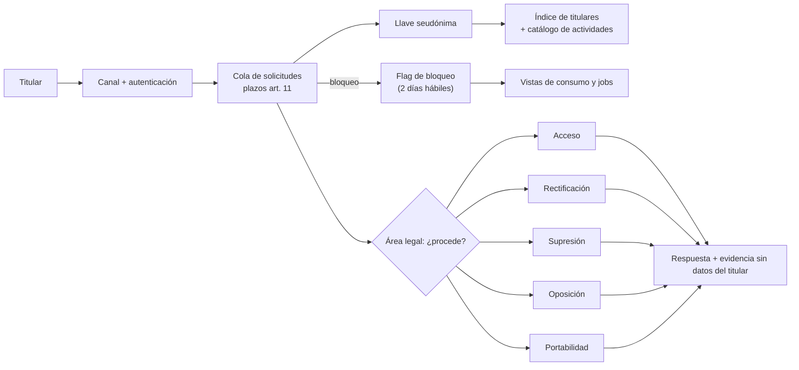

## 1. Resumen

Esta ficha no es asesoría legal: si una solicitud procede, y con qué alcance, lo decide el responsable con el área legal; aquí se explica la plataforma que permite responder a tiempo, completo y con evidencia.

Desde la vigencia de la ley, cualquier titular puede pedir qué datos se tienen de él, corregirlos, borrarlos, oponerse, bloquearlos o llevárselos. Para un equipo de datos, eso significa poder **encontrar a una persona en toda la plataforma** en días, no semanas, y ejecutar la acción en cada lugar donde está. Sin un índice de titulares y un catálogo por actividad de tratamiento, el plazo de 30 días es difícil de cumplir.

## 2. Qué es

- **[Obligación legal · art. 4]** Seis derechos: acceso, rectificación, supresión, oposición, portabilidad y bloqueo; son irrenunciables.
- **[Obligación legal · art. 11]** Respuesta en 30 días corridos, prorrogables una vez; el bloqueo temporal fundado se responde en 2 días hábiles y, mientras no se resuelva, no se tratan esos datos.
- **[Obligación legal · art. 5]** Acceso: los datos y su origen, las finalidades, los destinatarios, el período de tratamiento, los intereses legítimos si esa es la base, y la lógica de las decisiones automatizadas.
- **[Obligación legal · art. 6]** Rectificación: los datos rectificados se comunican a quienes los recibieron, salvo que sea imposible o desproporcionado, y no se vuelven a tratar sin rectificar.
- **[Obligación legal · art. 7]** Supresión: procede por las causales del artículo, con excepciones.
- **[Obligación legal · art. 8]** Oposición: si la base es el interés legítimo, si el fin es exclusivamente marketing directo (incluidos los perfiles) o si los datos vienen de una fuente de acceso público sin otro fundamento.
- **[Obligación legal · art. 9]** Portabilidad: copia de lo que el titular facilitó, en formato estructurado, genérico y de uso común, si el tratamiento es automatizado y se basa en su consentimiento.
- **[Obligación legal · art. 10]** Mecanismos tecnológicos expeditos; rectificación, supresión y oposición siempre gratuitas; acceso gratuito al menos trimestralmente.
- **[Decisión de arquitectura]** **Índice de titulares:** tabla que mapea la llave seudónima de cada titular a las tablas, actividades y sistemas donde aparece; se mantiene desde la ingesta y el linaje.
- **[Decisión de arquitectura]** **Pipeline de solicitudes:** recepción → autenticación → decisión del área legal → ejecución técnica → respuesta → evidencia.

## 3. Problema que resuelve

**[Buena práctica]** Sin esta capacidad: búsquedas manuales del RUT en decenas de tablas, respuestas incompletas (faltan derivados o terceros), plazos vencidos, un bloqueo que no se aplica a tiempo, o una rectificación que el próximo backfill revierte.

## 4. Cómo funciona

1. **[Obligación legal · art. 11]** La solicitud llega al correo, formulario o medio electrónico dispuesto, con la autenticación del titular que fije la Agencia, y el responsable acusa recibo. **[Buena práctica]** Registrar la fecha de ingreso y calcular los plazos.
2. **[Buena práctica]** Calcular la llave seudónima (HMAC) y consultar el índice de titulares.
3. **[Obligación legal · art. 8 ter]** El bloqueo suspende temporalmente el tratamiento sin afectar el almacenamiento. **[Decisión de arquitectura]** Un flag del titular que las vistas de consumo y los jobs excluyen, sin borrar.
4. **[Decisión de arquitectura]** El área legal decide si la solicitud procede y su alcance; ingeniería ejecuta según el tipo:

| Derecho | Ejecución técnica | Etiqueta |
|---|---|---|
| Acceso | Consolidar datos por actividad con finalidad, base, destinatarios, plazo y lógica automatizada desde el catálogo | **[Decisión de arquitectura]** |
| Rectificación | Corregir en la fuente o en una capa de correcciones que gane en cada recálculo; propagar a destinatarios | **[Decisión de arquitectura]** |
| Supresión | `retention-and-erasure` | **[Decisión de arquitectura]** |
| Oposición | Excluir al titular de la actividad objetada (por ejemplo, marketing directo o perfiles) | **[Decisión de arquitectura]** |
| Bloqueo | Flag de exclusión en consumo y en jobs | **[Decisión de arquitectura]** |
| Portabilidad | Export estructurado de lo que corresponde según el art. 9 | **[Decisión de arquitectura]** |

5. **[Obligación legal · art. 11]** Responder por escrito y guardar respaldo de la respuesta: fecha, destino y contenido.
6. **[Buena práctica]** Registrar evidencia con id de solicitud, llave seudónima, acciones y fechas, sin datos del titular.

## 5. Cuándo utilizarlo

- En cualquier plataforma que trate datos de personas identificables, aunque reciba pocas solicitudes: el plazo no cambia por volumen.

## 6. Cuándo no utilizarlo

- Para decidir si una solicitud procede o si aplica una excepción: lo decide el área legal.
- Los órganos públicos tienen reglas propias (arts. 22 y 23); esta ficha se centra en el sector privado.

## 7. Ejemplo sencillo

Solicitud de supresión ingresada el jueves 2026-10-29, con pedido de bloqueo:

| Hito | Fecha |
|---|---|
| Responder el bloqueo (2 días hábiles) | lunes 2026-11-02 |
| Responder la solicitud (30 días corridos) | 2026-11-28 |
| Con prórroga única | 2026-12-28 |

## 8. Ejemplo de producción

| Componente | Implementación posible | Evidencia |
|---|---|---|
| Canal | Formulario web con autenticación | Acuse de recibo con fecha |
| Índice de titulares | Tabla `governance.indice_titulares` (llave, tabla, actividad, sistema), actualizada por la ingesta y el linaje | Cobertura: % de tablas con datos personales indexadas |
| Flag de bloqueo | Tabla `governance.bloqueos`; filtros de fila en las vistas de consumo | Test que verifica que el titular bloqueado no aparece |
| Correcciones | Tabla de correcciones aplicada en silver | Test de que el backfill no las revierte |
| Export de portabilidad | JSON o CSV con esquema publicado | Hash del archivo entregado |
| Plazos | Tablero de solicitudes por estado y días restantes | Alertas antes del vencimiento |

### Evidencia de cumplimiento

| Evidencia | Dónde queda | Quién la produce |
|---|---|---|
| Ingreso, acuse de recibo y plazos | Log de solicitudes | Pipeline de derechos |
| Decisión y alcance | Registro del área legal | Área legal |
| Acciones técnicas por tabla | Log de ejecución, sin datos del titular | Ingeniería |
| Respaldo de la respuesta | Archivo de respuestas | Pipeline de derechos |

## 9. Arquitectura



## 10. Código

```python
# Python 3.12+, biblioteca estándar. Pipeline de derechos del titular (Ley 19.628 mod. por Ley 21.719):
# calcula plazos (art. 11), localiza al titular con un índice de ubicaciones, arma la respuesta de acceso
# con lo que pide el art. 5 desde el catálogo, y filtra la portabilidad a lo que exige el art. 9.
import json
from dataclasses import dataclass
from datetime import date, timedelta

FERIADOS: set[date] = {date(2026, 10, 31)}  # en producción: calendario oficial de feriados


def mas_dias_habiles(inicio: date, n: int) -> date:
    d = inicio
    while n:
        d += timedelta(days=1)
        if d.weekday() < 5 and d not in FERIADOS:
            n -= 1
    return d


@dataclass(frozen=True)
class Actividad:          # actividad de tratamiento en el catálogo
    nombre: str
    finalidad: str
    base: str             # "consentimiento", "contrato", "obligación legal", "interés legítimo"
    plazo: str
    destinatarios: str
    decision_automatizada: str | None


@dataclass(frozen=True)
class Ubicacion:          # entrada del índice titular → ubicaciones
    tabla: str
    actividad: str
    facilitado_por_titular: bool   # art. 9: portabilidad solo de lo que el titular entregó
    automatizado: bool


CATALOGO = {
    "venta_pasajes": Actividad("venta_pasajes", "emitir y gestionar pasajes", "contrato",
                               "5 años desde el vuelo", "aerolíneas socias del itinerario", None),
    "riesgo_fraude": Actividad("riesgo_fraude", "prevenir fraude en pagos", "interés legítimo",
                               "2 años", "procesador de pagos",
                               "puntaje de riesgo; transacciones sobre el umbral pasan a revisión humana"),
}

INDICE = {  # llave seudónima del titular → dónde están sus datos
    "c3d3a94d7560c6ae": [
        Ubicacion("silver.pasajeros", "venta_pasajes", True, True),
        Ubicacion("silver.reservas", "venta_pasajes", True, True),
        Ubicacion("gold.score_fraude", "riesgo_fraude", False, True),
    ]
}


def plazos(ingreso: date, derecho: str) -> dict[str, str]:
    p = {"respuesta": str(ingreso + timedelta(days=30)),
         "con_prorroga": str(ingreso + timedelta(days=60))}
    if derecho in {"rectificación", "supresión", "oposición"}:
        p["bloqueo_si_se_pide"] = str(mas_dias_habiles(ingreso, 2))   # art. 11: dos días hábiles
    return p


def acceso(titular: str) -> dict[str, object]:
    """Art. 5: datos y origen, finalidades, destinatarios, período, interés legítimo y lógica automatizada."""
    salida: list[dict[str, object]] = []
    for nombre in sorted({u.actividad for u in INDICE[titular]}):
        a = CATALOGO[nombre]
        salida.append({
            "actividad": a.nombre, "finalidad": a.finalidad, "base": a.base, "plazo": a.plazo,
            "destinatarios": a.destinatarios,
            "tablas": [u.tabla for u in INDICE[titular] if u.actividad == nombre],
            "interes_legitimo": a.finalidad if a.base == "interés legítimo" else None,
            "logica_automatizada": a.decision_automatizada,
        })
    return {"titular": titular, "tratamientos": salida}


def portabilidad(titular: str) -> list[str]:
    """Art. 9: datos facilitados por el titular, tratados en forma automatizada y basados en consentimiento.
    Aquí la base es contrato: el resultado vacío muestra por qué el filtro se calcula y no se asume."""
    return [u.tabla for u in INDICE[titular]
            if u.facilitado_por_titular and u.automatizado and CATALOGO[u.actividad].base == "consentimiento"]


def main() -> None:
    t = "c3d3a94d7560c6ae"
    print("plazos supresión:", plazos(date(2026, 10, 29), "supresión"))
    print(json.dumps(acceso(t), ensure_ascii=False, indent=1))
    print("tablas portables:", portabilidad(t))


if __name__ == "__main__":
    main()
```

El script se **ejecuta en la CI** con la biblioteca estándar y pasa `mypy --strict`. Imprime los plazos de una supresión ingresada el 2026-10-29 (respuesta el 2026-11-28, con prórroga el 2026-12-28, bloqueo el 2026-11-02), la respuesta de acceso armada desde el catálogo por actividad y `tablas portables: []`. Dos lecciones: el acceso sale del **catálogo por actividad**, no de un `SELECT *`; y la portabilidad no aplica a todo: aquí la base es contrato, así que el art. 9 no la exige. Cómo contar los días hábiles (feriados, sábados) es un supuesto a confirmar con el área legal.

## 11. GCP

En GCP, **BigQuery** con seguridad a nivel de fila. Según *Ley 19628 SOBRE PROTECCION DE LOS DATOS PERSONALES* e *Introduction to BigQuery row-level security* (no ejecutado):

| Necesidad | Servicio | Etiqueta |
|---|---|---|
| Bloqueo en consumo | Row access policies que filtran filas según el usuario | **[Buena práctica]** |
| Índice de titulares | Tabla propia en BigQuery | **[Decisión de arquitectura]** |

## 12. AWS

En AWS, **Lake Formation**. Según *Ley 19628 SOBRE PROTECCION DE LOS DATOS PERSONALES* y *Data filtering and cell-level security in Lake Formation* (no ejecutado):

| Necesidad | Servicio | Etiqueta |
|---|---|---|
| Bloqueo en consumo | Filtros de datos a nivel de fila al dar permisos | **[Buena práctica]** |
| Índice de titulares | Tabla propia | **[Decisión de arquitectura]** |

## 13. Azure

En Azure, **Unity Catalog** de Azure Databricks. Según *Ley 19628 SOBRE PROTECCION DE LOS DATOS PERSONALES* y *Row filters and column masks* (no ejecutado):

| Necesidad | Servicio | Etiqueta |
|---|---|---|
| Bloqueo en consumo | Filtros de fila de Unity Catalog contra la tabla de bloqueos | **[Buena práctica]** |
| Índice de titulares | Tabla propia en el lakehouse | **[Decisión de arquitectura]** |

## 14. Buenas prácticas

- **[Decisión de arquitectura]** Una sola llave seudónima del titular en todas las capas: es lo que hace posible el índice.
- **[Buena práctica]** El índice se alimenta automáticamente desde la ingesta y el linaje; uno mantenido a mano queda incompleto.
- **[Buena práctica]** **Seguridad:** autenticar antes de buscar; un acceso respondido a un impostor es una vulneración.
- **[Buena práctica]** **Observabilidad:** tablero de solicitudes por días restantes y alertas antes del vencimiento.
- **[Buena práctica]** **Costo:** automatizar acceso, bloqueo y supresión, que son los más frecuentes y los de plazo más duro.

## 15. Errores frecuentes

- Responder acceso con un volcado de tablas en lugar de lo que pide el art. 5.
- No incluir derivados, features ni terceros en la búsqueda.
- Bloqueo implementado como borrado, o no implementado.
- Rectificar en silver y que el siguiente recálculo desde bronze restaure el error.
- Logs de solicitudes con RUT, nombre o correo del titular.
- Asumir que la portabilidad aplica a todos los datos.

## 16. Trade-offs

| Opción | A favor | En contra |
|---|---|---|
| Índice de titulares materializado | Respuesta rápida, medible | Mantenerlo sincronizado |
| Búsqueda bajo demanda por linaje | Sin tabla extra | Lenta y frágil en plataformas grandes |
| Bloqueo por filtro de fila | Inmediato, sin mover datos | Cada consumidor debe pasar por la capa controlada |

## 17. Conceptos relacionados

- `chile-data-protection`: ficha padre.
- `processing-activities-inventory`: el catálogo por actividad.
- `retention-and-erasure`: la supresión.
- `chilean-identifier-pseudonymization`: la llave seudónima.
- `dpia-and-automated-decisions`: la lógica de las decisiones automatizadas.
- `row-level-security`: el filtro de fila del bloqueo.

## 18. Preguntas técnicas abiertas

1. ¿En cuánto tiempo puedes listar todas las tablas donde aparece una persona?
2. ¿Tu capa de consumo puede excluir a un titular en menos de 2 días hábiles?
3. ¿Tus rectificaciones sobreviven a un reproceso completo?

## 19. Laboratorio relacionado

Pendiente (F4). Propuesta: índice de titulares desde el linaje y filtro de bloqueo en vistas.

## 20. Fuentes

- BCN Ley Chile: *Ley 19628 SOBRE PROTECCION DE LOS DATOS PERSONALES* (versión con vigencia diferida desde 2026-12-01).
- Google Cloud: *Introduction to BigQuery row-level security*.
- AWS: *Data filtering and cell-level security in Lake Formation*.
- Microsoft Learn: *Row filters and column masks*.

El detalle de cada fuente está en `sources` del frontmatter.

## 21. Fecha de última verificación

2026-10-25: textos legales vueltos a consultar en BCN, sin cambios. Antes, 2026-10-22: arts. 4 a 11 consultados ese día en BCN. `review_required`: pasa a `verified` solo con la aprobación explícita de Felipe (`owner_approved_at`). Revisión mensual.

## 22. Historial de cambios importantes

- 2026-10-22: creación (upgrade de 19); reemplaza a `data-subject-requests`, que queda como alias.
- 2026-10-24: `PART_OF` hacia `chile-data-protection` (ADR-024) e `implication` por artículo en `legal_basis` (enmienda de ADR-023). Sin cambios de contenido legal ni de código.
- 2026-10-25: revisión del upgrade (`docs/reviews/cards-f3b-19-upgrade.md`) y auditoría de las etiquetas «Obligación legal»: cada una afirma solo lo que dice su artículo; lo demás pasa a buena práctica o decisión de arquitectura. Textos de BCN y del Senado consultados el 2026-10-25, sin cambios desde el 2026-10-22.
