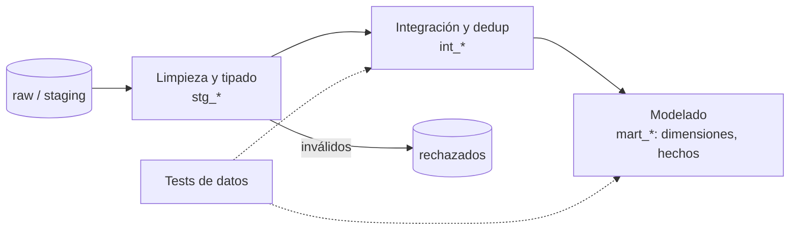

## 1. Resumen

Transformar es convertir datos crudos en datos útiles y confiables:

- **limpiar y tipar** (texto a fecha, montos a número);
- **deduplicar**;
- **integrar** fuentes (unir pedidos con clientes);
- **enriquecer**;
- **modelar** para el consumo (estrella, agregados).

En las plataformas cloud se transforma sobre todo **dentro del warehouse con SQL** (ELT), con herramientas como Dataform o dbt que versionan, ordenan por dependencias y prueban las transformaciones. Spark y los flujos visuales cubren lo que el SQL no resuelve bien.

## 2. Qué es

Es la etapa de procesamiento del ciclo de vida del dato. Tipos habituales:

| Tipo | Ejemplo |
|---|---|
| Limpieza y tipado | Quitar espacios, convertir `'1.250'` a número, normalizar mayúsculas |
| Validación | Rechazar montos negativos o fechas imposibles |
| Deduplicación | Una fila por clave con la versión más reciente |
| Integración | Unir pedidos, clientes y productos |
| Enriquecimiento | Agregar región a partir de un código postal |
| Modelado | Dimensiones, hechos, agregados para BI |

Se hace en tres lugares: antes de cargar (ETL), dentro del destino (ELT, el patrón dominante en warehouses cloud) o en un motor intermedio (Spark), según volumen, lenguaje y requisitos.

## 3. Problema que resuelve

Los datos crudos llegan con tipos inconsistentes, duplicados, códigos que solo entiende el sistema de origen y en estructuras pensadas para la operación. Consumirlos así obliga a cada analista a repetir la limpieza a su manera, con resultados distintos. La transformación centralizada y versionada produce una única versión limpia y documentada.

## 4. Cómo funciona

1. **Capas:** raw o staging (como llega), luego curated (limpio e integrado), luego marts (modelado para consumo).
2. **Declarar en código:** cada transformación es una consulta o un modelo versionado. Dataform y dbt resuelven el orden por dependencias y compilan a SQL.
3. **Transformaciones tolerantes:** `SAFE_CAST` en lugar de `CAST` cuando un valor puede venir mal, para no abortar todo el lote; los inválidos se apartan.
4. **Idempotencia:** reemplazar la tabla o la partición, o fusionar por clave, para que reejecutar no duplique.
5. **Incremental cuando conviene:** procesar solo lo nuevo en tablas grandes (ver `dataform-incremental-tables`).
6. **Tests de datos:** unicidad, no nulos y relaciones, ejecutados junto con la transformación.

## 5. Cuándo utilizarlo

- Siempre que un dato crudo vaya a consumirse más de una vez.
- Para centralizar reglas de negocio (qué es una venta neta) en un solo lugar.
- Para preparar datos para modelos de ML con features consistentes.

## 6. Cuándo no utilizarlo

- Para transformar "por las dudas" datos que nadie consume.
- Para mover lógica de negocio cambiante a decenas de consultas copiadas: una regla, un modelo.
- Para sobrescribir el crudo: la transformación produce una capa nueva y deja el original para reprocesar.

## 7. Ejemplo sencillo

`raw.pedidos` tiene el monto como texto con separador de miles y algunos pedidos repetidos. `curated.pedidos` tiene el monto como `NUMERIC`, una fila por pedido con la versión más reciente, y los pedidos con monto inválido van a una tabla de rechazados.

## 8. Ejemplo de producción

Un repositorio de Dataform tiene unos 80 modelos:

- `stg_*`, uno por tabla de origen, con tipado y limpieza;
- `int_*`, con integración y deduplicación;
- `mart_*`, con dimensiones, hechos y agregados.

Cada modelo declara sus dependencias y sus aserciones de unicidad y no nulos. Los cambios pasan por revisión y CI; la ejecución diaria compila, corre en orden y se detiene antes de publicar si falla una aserción. Las tablas grandes son incrementales.

## 9. Arquitectura



## 10. Código

```sql
-- BigQuery: de raw a curated. Tipado tolerante, deduplicación y separación de inválidos.
-- Requiere: raw.pedidos(pedido_id STRING, monto_txt STRING, creado_en STRING, cargado_en TIMESTAMP).
CREATE OR REPLACE TABLE `proyecto.curated.pedidos` AS
SELECT
  pedido_id,
  SAFE_CAST(REPLACE(TRIM(monto_txt), '.', '') AS NUMERIC) AS monto,  -- NULL si no es número
  SAFE_CAST(creado_en AS TIMESTAMP) AS creado_en,
  cargado_en
FROM `proyecto.raw.pedidos`
WHERE SAFE_CAST(REPLACE(TRIM(monto_txt), '.', '') AS NUMERIC) >= 0
QUALIFY ROW_NUMBER() OVER (PARTITION BY pedido_id ORDER BY cargado_en DESC) = 1;

-- Los que no pasaron el tipado o la regla, aparte y con motivo (no se descartan en silencio).
CREATE OR REPLACE TABLE `proyecto.curated.pedidos_rechazados` AS
SELECT *, 'monto inválido o negativo' AS motivo
FROM `proyecto.raw.pedidos`
WHERE SAFE_CAST(REPLACE(TRIM(monto_txt), '.', '') AS NUMERIC) IS NULL
   OR SAFE_CAST(REPLACE(TRIM(monto_txt), '.', '') AS NUMERIC) < 0;
```

`CREATE OR REPLACE` hace la transformación repetible. En Dataform, cada `CREATE OR REPLACE` sería un modelo `type: "table"` con sus aserciones.

## 11. GCP

**BigQuery** transforma con SQL y DML, con vistas materializadas (que incorporan solas los cambios de las tablas base) y con consultas continuas (en Preview) para streaming. **Dataform** organiza los modelos SQL en un repositorio con dependencias, tests, versiones y documentación, y es la base de los pipelines de BigQuery, que admiten ELT o ETL.

## 12. AWS

**AWS Glue** transforma, prepara y limpia datos con jobs de Spark. El editor visual genera el código de extracción, transformación y carga, y los jobs corren programados, bajo demanda o por eventos. Para ELT dentro de Redshift se usa SQL, a menudo con dbt. A diferencia de GCP, la herramienta nativa de transformación de AWS está centrada en Spark (Glue), no en SQL versionado.

## 13. Azure

En **Data Factory**, los *mapping data flows* son transformaciones visuales, sin código, que corren como actividades de pipelines sobre clústeres de Spark. En Fabric, la documentación remite a **Dataflow Gen2** y, para código, a notebooks de Spark o T-SQL en el Warehouse. dbt cubre el enfoque SQL versionado.

## 14. Buenas prácticas

- Separar capas (staging, intermedia, marts) y no sobrescribir el crudo.
- Transformaciones en código versionado, con revisión y CI.
- Tipado tolerante (`SAFE_CAST`) más separación de inválidos con su motivo.
- Tests de datos en cada ejecución: unicidad, no nulos, relaciones.
- Incremental solo cuando el volumen lo justifica; si no, reconstruir completo es más simple.
- **Seguridad:** aplicar enmascaramiento o exclusión de datos personales en las capas que se publican; la capa cruda suele necesitar acceso más restringido.
- **Observabilidad:** filas de entrada y salida por modelo, rechazados por motivo y duración; alertar ante saltos.
- **Costo:** en motores que cobran por datos leídos, leer solo las columnas y particiones necesarias; materializar lo que se consulta mucho.

## 15. Errores frecuentes

- Lógica de negocio repetida en muchas consultas, con variaciones.
- `CAST` estricto que hace fallar el lote entero por un valor mal formado.
- Filtrar inválidos sin registrarlos.
- Transformaciones que solo corren en la máquina de alguien.
- Modelos incrementales donde una reconstrucción completa bastaba.

## 16. Trade-offs

Transformar dentro del warehouse (ELT) simplifica y escala con el motor, a cambio de pagar su cómputo y de depender de SQL. Spark da flexibilidad para lógica compleja y datos no tabulares, a cambio de más infraestructura. Las herramientas visuales bajan la barrera de entrada, pero se versionan y prueban peor que el código.

## 17. Conceptos relacionados

- `etl-vs-elt`: dónde se transforma.
- `data-pipeline`: el sistema completo.
- `deduplication`: una transformación central.
- `star-schema`: el modelo de salida para BI.
- `dataform-incremental-tables`: transformación incremental en BigQuery.

## 18. Preguntas técnicas abiertas

1. ¿Qué transformaciones harías en SQL y cuáles en Spark en tu plataforma?
2. ¿Cómo detectarías que una regla de negocio está implementada distinto en dos modelos?
3. ¿Cuándo preferirías reconstruir una tabla completa en vez de transformarla incrementalmente?

## 19. Laboratorio relacionado

Pendiente (F4).

## 20. Fuentes

- Google Cloud: *Introduction to data transformation*, *Conversion functions* y *Query syntax* (BigQuery); *Dataform overview*.
- dbt: *Add data tests to your DAG*.
- AWS: *What is AWS Glue?*
- Microsoft Learn: *Mapping data flows* (Azure Data Factory).

El detalle de cada fuente está en `sources` del frontmatter.

## 21. Fecha de última verificación

2026-10-05. En `review_required` hasta la revisión B-F3.1 del lote F3b-01a.

## 22. Historial de cambios importantes

- 2026-10-05: creación (lote F3b-01a, dominio 01-fundamentals).
