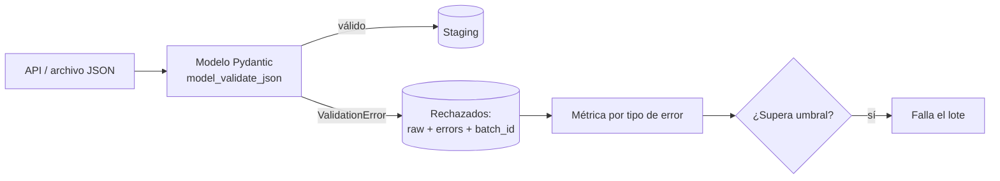

## 1. Resumen

Pydantic convierte una clase con anotaciones de tipo en un validador. En ingesta, sirve para comprobar **cada registro en el borde**, antes de cargarlo: tipos, restricciones (montos no negativos, códigos de moneda de tres letras), campos inesperados. Los inválidos se separan con un error estructurado que dice qué campo falló y por qué. Así, un dato roto no llega a la tabla ni detiene el lote entero.

## 2. Qué es

Pydantic es una biblioteca de validación de datos para Python. Su núcleo de validación está escrito en Rust. Un modelo es una clase que hereda de `BaseModel`: cada atributo anotado es un campo con su tipo, y `Field(...)` agrega restricciones. `model_validate` valida un objeto Python (un `dict`), y `model_validate_json` valida directamente bytes o texto JSON. Si algo no cumple, se lanza un `ValidationError` con **todos** los errores del registro, no solo el primero.

Es una herramienta **modern** del ecosistema Python, no un estándar de la industria de datos: los contratos entre equipos se siguen definiendo con schemas (JSON Schema, Avro, Protobuf), y Pydantic puede emitir JSON Schema desde sus modelos.

## 3. Problema que resuelve

Las APIs y archivos de origen cambian sin aviso: un número llega como texto, falta un campo, aparece uno nuevo, una fecha viene en otro formato. Sin validar, eso se descubre tarde: un `INSERT` que falla a mitad del lote, una columna llena de nulos o un tablero con montos negativos. Validar al entrar convierte esos problemas en errores explícitos, por registro y con ubicación.

## 4. Cómo funciona

1. **Modelo:** tipos y restricciones declarativas (`Field(ge=0)`, `Field(pattern=...)`, `Field(min_length=1)`).
2. **Modo laxo (por defecto):** Pydantic intenta convertir al tipo correcto; `"123"` pasa a `int` 123 y `"10.50"` a `Decimal`.
3. **Modo estricto** (`strict=True` al validar, o configurado en el modelo): solo acepta el tipo exacto; `"123"` para un `int` es un error.
4. **Campos extra:** por defecto se **ignoran** en silencio. Con `ConfigDict(extra="forbid")` son un error; con `"allow"` se guardan aparte.
5. **Errores:** `ValidationError.errors()` devuelve una lista de diccionarios con `loc` (el campo), `type` (identificador estable, apto para métricas), `msg` y, opcionalmente, `input`. `include_input=False` evita copiar el valor recibido, útil si puede contener datos sensibles.

## 5. Cuándo utilizarlo

- Ingesta desde APIs o archivos JSON con Python, antes de escribir en el destino.
- Consumidores de mensajería que reciben JSON sin schema impuesto por la plataforma.
- Configuración y parámetros de pipelines (validar al arrancar, no a mitad de la ejecución).
- Cuando se quiere el mismo modelo para validar y para documentar (JSON Schema).

## 6. Cuándo no utilizarlo

- Validaciones sobre millones de filas ya cargadas en un warehouse: es más barato expresarlas en SQL (aserciones de Dataform o dbt, controles de calidad) que traer los datos a Python.
- Reglas entre registros (unicidad, totales que cuadran): Pydantic valida registro a registro.
- Cuando la plataforma ya impone el schema (un topic de Pub/Sub con schema, un registro de schemas en Kafka): validar de nuevo en el consumidor solo agrega costo, salvo reglas de negocio adicionales.

## 7. Ejemplo sencillo

```python
from pydantic import BaseModel, ValidationError

class Item(BaseModel):
    sku: str
    qty: int

Item.model_validate({"sku": "A1", "qty": "3"})        # modo laxo: qty=3
try:
    Item.model_validate({"sku": "A1", "qty": "tres"})
except ValidationError as exc:
    print(exc.errors()[0]["loc"], exc.errors()[0]["type"])  # ('qty',) int_parsing
```

## 8. Ejemplo de producción

Una ingesta horaria lee pedidos de una API paginada. Cada registro se valida con un modelo con `extra="forbid"`. Los válidos se escriben en staging. Los rechazados van a una tabla `orders_rejected` con el JSON original, la lista de errores (`loc`, `type`) y el `batch_id`. Una métrica cuenta rechazos por `type`: un salto de `extra_forbidden` avisa que el proveedor agregó un campo (cambio de schema) antes de que alguien lo note en un tablero. Si los rechazos superan el 5 % del lote, el pipeline falla en lugar de cargar un lote casi vacío.

## 9. Arquitectura



## 10. Código

```python
# Python 3.12 y pydantic 2: valida cada registro de una API en el borde y separa válidos de rechazados.
from datetime import datetime
from decimal import Decimal
from typing import Any

from pydantic import BaseModel, ConfigDict, Field, ValidationError


class Order(BaseModel):
    model_config = ConfigDict(extra="forbid")  # un campo inesperado es un error, no se ignora

    order_id: str = Field(min_length=1)
    amount: Decimal = Field(ge=0)
    currency: str = Field(pattern=r"^[A-Z]{3}$")
    created_at: datetime


def validate_page(raw_records: list[bytes]) -> tuple[list[Order], list[dict[str, Any]]]:
    valid: list[Order] = []
    rejected: list[dict[str, Any]] = []
    for raw in raw_records:
        try:
            valid.append(Order.model_validate_json(raw))
        except ValidationError as exc:
            # errors() da una lista de dicts con loc, type y msg; include_input=False evita copiar el dato.
            rejected.append({"raw": raw.decode(errors="replace"), "errors": exc.errors(include_input=False)})
    return valid, rejected


ok, bad = validate_page([
    b'{"order_id": "A1", "amount": "10.50", "currency": "CLP", "created_at": "2026-10-01T10:00:00Z"}',
    b'{"order_id": "A2", "amount": -5, "currency": "clp", "created_at": "ayer", "extra": 1}',
])
# ok: un Order. bad[0]["errors"]: extra_forbidden, greater_than_equal, string_pattern_mismatch y un error de datetime.
```

`Decimal` evita errores de redondeo de `float` en montos. Ojo: el JSON crudo de los rechazados puede contener datos personales; la tabla de rechazados necesita el mismo control de acceso que el destino.

## 11. GCP

En **Pub/Sub**, un topic puede tener asociado un **schema** (Avro o Protocol Buffer) y la plataforma rechaza en la publicación los mensajes que no lo cumplen. Es validación de formato en el servicio, antes de que el consumidor reciba nada. Pydantic sigue siendo útil en el consumidor para reglas que el schema no expresa (rangos, patrones) o para fuentes sin schema, como una API externa que alimenta un job en Cloud Run.

## 12. AWS

**AWS Glue Schema Registry** guarda schemas Avro, JSON Schema o Protobuf con modos de compatibilidad entre versiones (`BACKWARD`, `FORWARD`, `FULL`, etc.), y productores y consumidores de Kinesis o MSK serializan contra él. A diferencia de Pub/Sub, el registro no está ligado a un topic del servicio de mensajería sino que lo usan las bibliotecas cliente. Pydantic cubre la validación de negocio en código Python, por ejemplo en una Lambda.

## 13. Azure

**Azure Schema Registry**, parte de Event Hubs, es un repositorio central de schemas que productores y consumidores usan para serializar y validar con la misma definición. Como en AWS, la validación ocurre en los clientes con el schema registrado. Pydantic complementa en funciones o jobs de Python con reglas que el schema no cubre.

## 14. Buenas prácticas

- Validar en el borde, antes de escribir, y nunca descartar en silencio: rechazados a una tabla o cola con sus errores.
- `extra="forbid"` en ingesta, para detectar cambios de la fuente; `"ignore"` solo si se decide explícitamente tolerarlos.
- Elegir conscientemente entre modo laxo y estricto: el laxo acepta `"123"` como número, lo que puede ocultar problemas de la fuente.
- Métricas por `type` de error y un umbral de rechazos que detenga el lote.
- `Decimal` para dinero; `datetime` con zona horaria.
- **Seguridad:** `errors(include_input=False)` y cuidado con registrar el payload crudo; los mensajes de error pueden repetir datos sensibles.
- **Observabilidad:** medir por lote la tasa de rechazo y los rechazos por `type` de error, y alertar ante cambios bruscos: suelen anunciar un cambio de schema en la fuente.
- **Costo:** validar en Python cada registro cuesta CPU; para volúmenes muy grandes, validar la estructura en el origen o con SQL y dejar en Python solo lo que no se puede expresar ahí.

## 15. Errores frecuentes

- Confiar en el comportamiento por defecto con campos extra: un campo renombrado en la fuente se ignora y la columna queda nula.
- Usar `float` para montos.
- Capturar `ValidationError` y seguir sin guardar el registro ni el error.
- Reintentar un registro inválido como si fuera un error transitorio.
- Validar con Pydantic lo que ya valida la plataforma, duplicando costo sin agregar reglas.

## 16. Trade-offs

Validación expresiva y cercana al código, con errores muy detallados, a cambio de CPU por registro y de mantener el modelo sincronizado con el contrato. Frente a un schema en la plataforma (Pub/Sub, registros de schemas): este frena el dato antes de que circule, pero expresa menos reglas de negocio.

## 17. Conceptos relacionados

- `python-api-consumption`: de dónde llegan los registros.
- `schema-evolution`: qué hacer cuando la fuente cambia.
- `dead-letter-queue`: adónde van los rechazados.
- `python-error-handling-and-retries`: por qué un error de validación no se reintenta.
- Con ficha: `data-contracts`.
- `python-typing`: qué verifica un type checker y qué no hace Python en ejecución.

## 18. Preguntas técnicas abiertas

1. ¿Qué umbral de rechazos usarías para detener un lote y cómo lo justificarías ante el negocio?
2. Una API empieza a enviar `amount` como texto con coma decimal. ¿Lo resolverías en el modelo, en la fuente o en un paso previo?
3. ¿Qué reglas dejarías en Pydantic y cuáles moverías a controles SQL en el warehouse?

## 19. Laboratorio relacionado

Pendiente (F4).

## 20. Fuentes

- Pydantic: *Get started*, *Models*, *Strict mode*, *Fields*, *Standard Library Types*, *Error Handling* y *pydantic_core*.
- Google Cloud: *Schema overview* (Pub/Sub).
- AWS: *AWS Glue Schema Registry*.
- Microsoft Learn: *Azure Schema Registry in Event Hubs* y *Schema Registry concepts*.

El detalle de cada fuente está en `sources` del frontmatter.

## 21. Fecha de última verificación

2026-10-04. Pasa a `verified`: revisión B-F3.1 del lote 5 aplicada, sin VERIFY pendientes.

## 22. Historial de cambios importantes

- 2026-10-02: creación (lote 5 de F3).
- 2026-10-04: revisión B-F3.1 del lote 5 aplicada (docs/reviews/cards-lote5.md): viñeta de Observabilidad en §14.
- 2026-10-04: `verification_status: verified` (revisión B-F3.1 del lote 5 aplicada; sin VERIFY pendientes).
- 2026-10-05: §10, cambio mínimo de tipos para pasar `mypy --strict`: `list[dict]` pasa a `list[dict[str, Any]]` (con `from typing import Any`). Sin cambio de comportamiento; pendiente de revisión de Cursor.
- 2026-10-06: la sección de conceptos relacionados ya no lista como pendiente de ficha a `data-contracts`, que ya tiene ficha.
- 2026-10-08: §17 enlaza `python-typing`, que ya tiene ficha (lote F3b-03a); antes figuraba como pendiente de ficha.
- 2026-10-13: `page_title` en cada cita, con el título de la página citada (ADR-012); sin cambios de contenido.
- 2026-10-14: lote F3b-rel (regla del §17): relations incluye `data-contracts`, `python-typing`.
