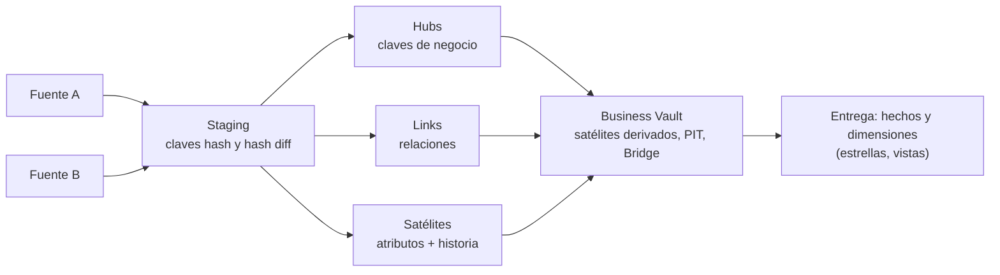

## 1. Resumen

Data Vault es un modelo para la **capa de integración** del warehouse. Separa cada concepto en tres tipos de tabla:

- **hubs:** las claves de negocio;
- **links:** las relaciones entre claves;
- **satélites:** los atributos descriptivos con su historia.

Todo se carga **solo por inserción**, con claves hash derivadas de la clave de negocio, de modo que llegan fuentes nuevas sin rehacer el modelo y se conserva todo el historial. No es un modelo para que el negocio consulte directamente. Sobre él se publican hechos y dimensiones (a menudo estrellas de Kimball), así que no reemplaza al modelo dimensional.

## 2. Qué es

Según la guía de Snowflake, Dan Linstedt lo introdujo a comienzos de los 2000, pensado para cargas por lotes y casi en tiempo real. Sus estructuras, tal como aparecen en el DDL de esa guía:

- **Hub:** clave hash, clave de negocio (`customer_bk`), fecha de carga y fuente. Una fila por clave de negocio, que nunca se actualiza.
- **Link:** clave hash de la combinación y claves hash de los hubs que relaciona (cliente-pedido).
- **Satélite:**
  - clave hash del hub más fecha de carga como clave primaria;
  - un **hash diff** con la huella de los atributos;
  - los atributos descriptivos.

  Se inserta una fila nueva cuando el contenido cambia.
- **Raw Vault y Business Vault:**
  - el Raw Vault guarda los datos como llegan;
  - el Business Vault agrega satélites derivados y estructuras de rendimiento (PIT y Bridge);
  - la entrega a consumidores es con hechos y dimensiones, virtualizados en esa guía.

## 3. Problema que resuelve

Integrar muchas fuentes que cambian a menudo en un modelo dimensional obliga a rehacer dimensiones y hechos cada vez que llega una fuente o cambia una regla. Data Vault desacopla la integración del consumo:

- una fuente nueva agrega hubs, links o satélites sin modificar los existentes;
- la carga solo por inserción guarda la historia completa y auditable de qué llegó y cuándo;
- las reglas de negocio se aplican después, en el Business Vault o en las vistas de entrega.

## 4. Cómo funciona

1. **Staging:** se calculan, por fila de la fuente, la clave hash de cada clave de negocio, la de cada combinación (para links) y el hash diff de los atributos.
2. **Hubs:** se inserta la clave de negocio si su clave hash no existe. Nunca se actualiza.
3. **Links:** se inserta la combinación si su clave hash no existe.
4. **Satélites:** se inserta una fila si el contenido es nuevo. En la guía de Snowflake, si no existe la combinación clave hash + hash diff; en el ejemplo de esta ficha, si difiere del último hash diff.
5. **Idempotencia:** re-ejecutar el mismo lote no agrega nada, porque todo se verifica por existencia.
6. **Entrega:** vistas o tablas con el estado actual o histórico, con forma de hechos y dimensiones para el consumo.

**Hash:** la guía usa `SHA1_BINARY` con delimitador `^` y `-1` para nulos, y aclara que DV2.1 no fija algoritmo ni convención, pero exige aplicarlos de forma consistente. El ejemplo de esta ficha usa la serialización JSON adoptada en `change-detection` para no depender de un delimitador ni de un marcador de nulo.

## 5. Cuándo utilizarlo

- Como capa de integración (silver) con muchas fuentes que cambian. Azure Databricks dice que esa capa a menudo sigue un modelo 3NF o Data Vault.
- Cuando se necesita historia completa y auditable de lo recibido, con fuente y fecha de carga por fila.
- Con cargas paralelas o casi en tiempo real hacia la misma área del warehouse.

## 6. Cuándo no utilizarlo

- Como modelo de consumo directo: muchos joins y tablas que el negocio no reconoce. Se publican estrellas o vistas encima.
- Con pocas fuentes estables y un equipo pequeño: el número de tablas y la disciplina de estándares pesan más que el beneficio.
- Sin acordar y documentar el estándar de hash, nombres y nulos: DV2.1 exige que estén definidos y se apliquen de forma consistente.

## 7. Ejemplo sencillo

El cliente `C1` con un pedido `P1`:

- **Hub:** `hub_cliente(C1)` y `hub_pedido(P1)`.
- **Link:** `lnk_cliente_pedido(C1, P1)`.
- **Satélite:** `sat_cliente(C1, nombre, email)`.

Si cambia el email, el hub y el link no cambian, y el satélite recibe una fila nueva.

## 8. Ejemplo de producción

Una aseguradora integra pólizas desde tres sistemas heredados y un CRM:

- **Hubs:** Póliza, Cliente y Agente, con la clave de negocio de cada sistema.
- **Links:** Póliza–Cliente y Póliza–Agente.
- **Satélites:** uno por sistema de origen, con sus atributos.

Cuando se incorpora un cuarto sistema, se agrega un satélite nuevo sin tocar el resto. Sobre el Raw Vault, el equipo publica estrellas por proceso (emisión, siniestros) para el BI, y una vista de cliente actual. Las cargas corren cada 15 minutos y son idempotentes.

## 9. Arquitectura



## 10. Código

```sql
-- PostgreSQL 17 (ejecutado): hub, link y satélite con claves hash, carga solo de inserción e idempotente,
-- y una vista con el estado actual. Las huellas usan la serialización JSON (jsonb_build_array) de esta base
-- de conocimiento en lugar de concatenar con separador y marcador de NULL.
CREATE TABLE stg_cliente (cliente_id text, nombre text, email text, pedido_id text, fuente text, cargado timestamptz);

CREATE TABLE hub_cliente (cliente_hk text PRIMARY KEY, cliente_id text NOT NULL, cargado timestamptz NOT NULL, fuente text NOT NULL);
CREATE TABLE hub_pedido  (pedido_hk  text PRIMARY KEY, pedido_id  text NOT NULL, cargado timestamptz NOT NULL, fuente text NOT NULL);
CREATE TABLE lnk_cliente_pedido (
  cliente_pedido_hk text PRIMARY KEY,
  cliente_hk text NOT NULL REFERENCES hub_cliente, pedido_hk text NOT NULL REFERENCES hub_pedido,
  cargado timestamptz NOT NULL, fuente text NOT NULL);
CREATE TABLE sat_cliente (
  cliente_hk text NOT NULL REFERENCES hub_cliente, cargado timestamptz NOT NULL,
  hash_diff text NOT NULL, nombre text, email text, fuente text NOT NULL,
  PRIMARY KEY (cliente_hk, cargado));

CREATE FUNCTION hk(VARIADIC partes text[]) RETURNS text LANGUAGE sql IMMUTABLE
  AS $$ SELECT md5(to_jsonb(array(SELECT upper(trim(p)) FROM unnest(partes) AS p))::text) $$;

CREATE PROCEDURE cargar() LANGUAGE sql AS $$
  INSERT INTO hub_cliente
  SELECT DISTINCT ON (hk(cliente_id)) hk(cliente_id), cliente_id, cargado, fuente FROM stg_cliente
  ON CONFLICT (cliente_hk) DO NOTHING;                    -- un hub nunca se actualiza
  INSERT INTO hub_pedido
  SELECT DISTINCT ON (hk(pedido_id)) hk(pedido_id), pedido_id, cargado, fuente FROM stg_cliente
  ON CONFLICT (pedido_hk) DO NOTHING;
  INSERT INTO lnk_cliente_pedido
  SELECT DISTINCT ON (hk(cliente_id, pedido_id)) hk(cliente_id, pedido_id), hk(cliente_id), hk(pedido_id), cargado, fuente
  FROM stg_cliente ON CONFLICT (cliente_pedido_hk) DO NOTHING;
  INSERT INTO sat_cliente                                 -- nueva fila solo si el contenido cambió
  SELECT s.hk, s.cargado, s.hd, s.nombre, s.email, s.fuente
  FROM (SELECT DISTINCT ON (hk(cliente_id)) hk(cliente_id) AS hk, cargado, nombre, email, fuente,
               md5(jsonb_build_array(nombre, email)::text) AS hd
        FROM stg_cliente ORDER BY hk(cliente_id), cargado DESC) s
  LEFT JOIN LATERAL (SELECT hash_diff FROM sat_cliente t WHERE t.cliente_hk = s.hk ORDER BY t.cargado DESC LIMIT 1) u ON true
  WHERE u.hash_diff IS DISTINCT FROM s.hd;
$$;

INSERT INTO stg_cliente VALUES
  ('C1', 'Ana', 'ana@example.com', 'P1', 'crm', '2026-10-07 10:00'),
  ('C1', 'Ana', 'ana@example.com', 'P2', 'crm', '2026-10-07 10:00'),
  ('C2', 'Beto', NULL, 'P3', 'crm', '2026-10-07 10:00');
CALL cargar();
CALL cargar();                                              -- re-ejecutar el mismo lote no agrega nada
SELECT (SELECT count(*) FROM hub_cliente) AS hubs, (SELECT count(*) FROM lnk_cliente_pedido) AS links,
       (SELECT count(*) FROM sat_cliente) AS sats;          -- 2 | 3 | 2

TRUNCATE stg_cliente;
INSERT INTO stg_cliente VALUES ('C1', 'Ana', 'ana.p@example.com', 'P4', 'crm', '2026-10-08 09:00');   -- cambia el email
CALL cargar();
SELECT cliente_hk = hk('c1 ') AS misma_clave, count(*) AS versiones FROM sat_cliente
WHERE cliente_hk = hk('C1') GROUP BY 1;                     -- true | 2: la clave hash normaliza mayúsculas y espacios

CREATE VIEW cliente_actual AS                               -- entrega: la última versión de cada cliente
SELECT h.cliente_id, s.nombre, s.email
FROM hub_cliente h
JOIN LATERAL (SELECT * FROM sat_cliente s WHERE s.cliente_hk = h.cliente_hk ORDER BY s.cargado DESC LIMIT 1) s ON true;
SELECT * FROM cliente_actual ORDER BY cliente_id;
-- C1 | Ana  | ana.p@example.com
-- C2 | Beto |
```

Ejecutado en PostgreSQL 17.11 local, en un esquema desechable:

- La segunda carga del mismo lote no agrega filas (2 hubs, 3 links, 2 satélites).
- El cambio de email agrega una segunda versión del satélite de `C1`.
- La clave hash normaliza mayúsculas y espacios, así que `'c1 '` y `'C1'` dan la misma clave.
- La vista `cliente_actual` entrega la última versión de cada cliente.

El estándar de hash del ejemplo es una decisión de esta base de conocimiento, no del estándar de Data Vault.

## 11. GCP

Esta ficha no cita una fuente de Google Cloud sobre Data Vault.

## 12. AWS

Esta ficha no cita una fuente de nivel 1–2 de AWS sobre Data Vault: los materiales de AWS encontrados son entradas de blog (nivel 3), que esta base de conocimiento no usa.

## 13. Azure

La documentación de **Azure Databricks** sobre arquitectura de data warehousing ubica la integración de fuentes dispares en la capa **silver**, y dice que esos datos a menudo siguen un modelo 3NF o **Data Vault**. El warehouse resultante es la fuente única de verdad para los data marts. Encaja con el uso de esta ficha: Data Vault para integrar, y marts dimensionales para consumir.

## 14. Buenas prácticas

- Estándar escrito de hash, delimitación o serialización, tratamiento de nulos y nombres, aplicado igual en todas las cargas.
- Hubs y links que nunca se actualizan; los cambios van a satélites nuevos.
- Fecha de carga y fuente en cada fila, para auditar.
- Capa de entrega (estrellas o vistas) para el consumo; nadie consulta el Raw Vault directamente.
- **Seguridad:** el Raw Vault guarda todo el historial, incluidos los datos personales que llegaron alguna vez; definir retención y borrado por clave de negocio, que en un modelo solo de inserción requiere un procedimiento explícito.
- **Observabilidad:** conteos por carga de hubs, links y versiones de satélite nuevas; un pico de versiones nuevas sin cambios reales suele indicar un hash diff mal definido (por ejemplo, con espacios o mayúsculas sin normalizar).
- **Costo:** muchas tablas y joins para entregar; las estructuras de rendimiento del Business Vault (PIT, Bridge) y las entregas materializadas compensan el costo de consulta a cambio de almacenamiento.

## 15. Errores frecuentes

- Exponer el Raw Vault a los usuarios de negocio como si fuera el modelo de consumo.
- Calcular el hash diff con atributos sin normalizar y crear versiones por cambios de formato.
- Mezclar algoritmos o convenciones de hash entre cargas.
- Actualizar hubs o satélites en lugar de insertar, y perder la auditabilidad.
- Elegir Data Vault para dos fuentes estables y un mart.

## 16. Trade-offs

Data Vault da flexibilidad para incorporar fuentes, historia completa y cargas paralelas e idempotentes. A cambio:

- tiene muchas tablas;
- las consultas de entrega son más complejas;
- exige disciplina de estándares;
- necesita una capa adicional para el consumo.

No compite con el modelo dimensional: lo alimenta. Frente a una capa de integración 3NF, separa más las piezas y agrega historia por diseño, a costa de más estructura.

## 17. Conceptos relacionados

- `kimball-methodology`: el modelo de consumo que suele publicarse encima.
- `surrogate-key-generation` y `change-detection`: claves hash y hash diff.
- `slowly-changing-dimensions`: historia en las dimensiones de entrega.
- `idempotency`: cargas que se pueden repetir.
- Del blueprint (dominio 07), pendiente de ficha: `medallion-architecture`.

## 18. Preguntas técnicas abiertas

1. ¿Cuántas fuentes y cuántos cambios de fuente al año justificarían Data Vault en tu organización?
2. ¿Cómo implementarías el borrado de un cliente por requerimiento legal en un modelo solo de inserción?
3. ¿Qué atributos excluirías del hash diff para no crear versiones por cambios irrelevantes?

## 19. Laboratorio relacionado

Pendiente (F4).

## 20. Fuentes

- Snowflake: *Building a Real-Time Data Vault in Snowflake* (Snowflake Developer Guides).
- Microsoft Learn: *Data warehousing architecture* (Azure Databricks).
- PostgreSQL 17: *INSERT* (ON CONFLICT).

Data Vault 2.0 de Linstedt no se cita: no se encontró una copia legible y verificable del estándar. Lo que esta ficha afirma de él (año de origen y exigencia de consistencia del hash) viene de la guía de Snowflake.

El detalle de cada fuente está en `sources` del frontmatter.

## 21. Fecha de última verificación

2026-10-10. `review_required`: pendiente de revisión B-F3.1 del lote F3b-04a.

## 22. Historial de cambios importantes

- 2026-10-10: creación (lote F3b-04a).
