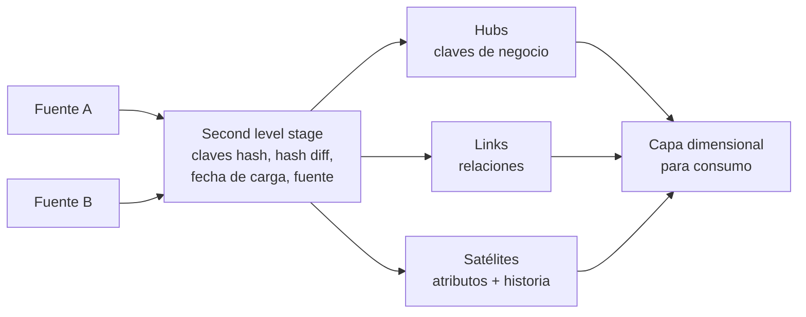

## 1. Resumen

Data Vault es un modelo para la **capa de integración** del warehouse. Lo inventó Dan Linstedt y hoy lo difunde Data Vault Alliance. Separa cada concepto de negocio en tres tipos de tabla:

- **hubs:** las claves de negocio;
- **links:** las relaciones entre ellas;
- **satélites:** los atributos descriptivos con su historia.

Una fuente nueva se incorpora agregando hubs, links o satélites, sin rehacer lo existente. No es un modelo para que el negocio consulte directamente: según la propia Data Vault Alliance, encima va una capa dimensional para los consumidores. Por eso no reemplaza al modelo dimensional.

## 2. Qué es

Según Data Vault Alliance (Nivel 4, conceptual):

- **Hub:** organiza las claves de negocio de un concepto (cliente, pedido).
- **Satellite:** mantiene los atributos de lo que se quiere saber sobre ese concepto.
- **Link:** captura la relación transaccional entre claves (un cliente compra un pedido).
- **Clave hash:** representación hexadecimal de un resultado matemático, distribuida sobre la longitud del hash, que funciona como clave del hub y del link.
- **Columnas de sistema:**
  - calculadas al cargar, en un *second level stage*: fecha de carga, hash difference, claves hash y fuente del registro;
  - las convenciones sugeridas las abrevian HK, HD, LDTS y RSRC.
- **Otros objetos:** Business Vault, Point-in-time (PIT) y Bridge, entre las convenciones de nombres de Data Vault 2.0.

## 3. Problema que resuelve

Integrar muchas fuentes que cambian a menudo directamente en un modelo dimensional obliga a rehacer dimensiones y hechos cada vez que llega una fuente o cambia una regla. Data Vault desacopla la integración del consumo. Data Vault Alliance dice que una fuente nueva se acomoda en hubs y satélites existentes o en nuevos, sin retrabajo, y que el modelo guarda los registros históricos de todo lo que llega. Las reglas de negocio y la forma de consumo se resuelven en la capa dimensional de encima.

## 4. Cómo funciona

1. **Staging:** por fila de la fuente se calculan la clave hash de cada clave de negocio, la de cada combinación (para links), el hash diff de los atributos, la fecha de carga y la fuente. Es el *second level stage* de Data Vault Alliance.
2. **Hubs:** una fila por clave de negocio. En el ejemplo de esta ficha se inserta solo si la clave hash no existe.
3. **Links:** una fila por combinación de claves, con la misma regla.
4. **Satélites:** cuando cambia el contenido (otro hash diff), se agrega una versión nueva en lugar de modificar la anterior. En el ejemplo, se compara contra la última versión.
5. **Entrega:** vistas o tablas con forma dimensional para los consumidores.

**Hash:** Data Vault Alliance recomienda no usar índices clustered sobre claves hash ni sobre hash diff, porque el hash distribuye los valores. El ejemplo de esta ficha calcula los hash con la serialización JSON adoptada en `change-detection`. Esa es una decisión de esta base de conocimiento, no un requisito del estándar.

## 5. Cuándo utilizarlo

- Como capa de integración (silver) con muchas fuentes que cambian. Azure Databricks dice que esa capa a menudo sigue un modelo 3NF o Data Vault.
- Cuando se necesita historia completa de lo recibido, con fuente y fecha de carga por fila.
- Cuando las fuentes se incorporan de a una y no se quiere rehacer el modelo con cada una.

## 6. Cuándo no utilizarlo

- Como modelo de consumo directo: muchos joins y tablas que el negocio no reconoce. Encima va una capa dimensional, como indica Data Vault Alliance.
- Con pocas fuentes estables y un equipo pequeño: el número de tablas y la disciplina de convenciones pesan más que el beneficio.
- Sin una convención escrita de hash, nombres y nulos: el modelo depende de que las claves se calculen igual en todas las cargas.

## 7. Ejemplo sencillo

El cliente `C1` con un pedido `P1`:

- **Hub:** `hub_cliente(C1)` y `hub_pedido(P1)`.
- **Link:** `lnk_cliente_pedido(C1, P1)`.
- **Satélite:** `sat_cliente(C1, nombre, email)`.

Si cambia el email, el hub y el link no cambian, y el satélite recibe una versión nueva.

## 8. Ejemplo de producción

Una aseguradora integra pólizas desde tres sistemas heredados y un CRM:

- **Hubs:** Póliza, Cliente y Agente, con la clave de negocio de cada sistema.
- **Links:** Póliza–Cliente y Póliza–Agente.
- **Satélites:** uno por sistema de origen.

Cuando se incorpora un cuarto sistema, se agrega un satélite nuevo sin tocar el resto. Encima, el equipo publica estrellas por proceso (emisión, siniestros) para el BI y una vista de cliente actual. Las cargas corren cada 15 minutos y son idempotentes.

## 9. Arquitectura



## 10. Código

```sql
-- PostgreSQL 17 (ejecutado): hub, link y satélite con claves hash, carga solo de inserción e idempotente,
-- y una vista con el estado actual. Las huellas usan la serialización JSON (jsonb_build_array) de esta base
-- de conocimiento en lugar de concatenar con separador y marcador de NULL.
CREATE TABLE stg_cliente (cliente_id text, nombre text, email text, pedido_id text, fuente text, cargado timestamptz);

CREATE TABLE hub_cliente (cliente_hk text PRIMARY KEY, cliente_id text NOT NULL, cargado timestamptz NOT NULL, fuente text NOT NULL);
CREATE TABLE hub_pedido  (pedido_hk  text PRIMARY KEY, pedido_id  text NOT NULL, cargado timestamptz NOT NULL, fuente text NOT NULL);
CREATE TABLE lnk_cliente_pedido (
  cliente_pedido_hk text PRIMARY KEY,
  cliente_hk text NOT NULL REFERENCES hub_cliente, pedido_hk text NOT NULL REFERENCES hub_pedido,
  cargado timestamptz NOT NULL, fuente text NOT NULL);
CREATE TABLE sat_cliente (
  cliente_hk text NOT NULL REFERENCES hub_cliente, cargado timestamptz NOT NULL,
  hash_diff text NOT NULL, nombre text, email text, fuente text NOT NULL,
  PRIMARY KEY (cliente_hk, cargado));

CREATE FUNCTION hk(VARIADIC partes text[]) RETURNS text LANGUAGE sql IMMUTABLE
  AS $$ SELECT md5(to_jsonb(array(SELECT upper(trim(p)) FROM unnest(partes) AS p))::text) $$;

CREATE PROCEDURE cargar() LANGUAGE sql AS $$
  INSERT INTO hub_cliente
  SELECT DISTINCT ON (hk(cliente_id)) hk(cliente_id), cliente_id, cargado, fuente FROM stg_cliente
  ON CONFLICT (cliente_hk) DO NOTHING;                    -- un hub nunca se actualiza
  INSERT INTO hub_pedido
  SELECT DISTINCT ON (hk(pedido_id)) hk(pedido_id), pedido_id, cargado, fuente FROM stg_cliente
  ON CONFLICT (pedido_hk) DO NOTHING;
  INSERT INTO lnk_cliente_pedido
  SELECT DISTINCT ON (hk(cliente_id, pedido_id)) hk(cliente_id, pedido_id), hk(cliente_id), hk(pedido_id), cargado, fuente
  FROM stg_cliente ON CONFLICT (cliente_pedido_hk) DO NOTHING;
  INSERT INTO sat_cliente                                 -- nueva fila solo si el contenido cambió
  SELECT s.hk, s.cargado, s.hd, s.nombre, s.email, s.fuente
  FROM (SELECT DISTINCT ON (hk(cliente_id)) hk(cliente_id) AS hk, cargado, nombre, email, fuente,
               md5(jsonb_build_array(nombre, email)::text) AS hd
        FROM stg_cliente ORDER BY hk(cliente_id), cargado DESC) s
  LEFT JOIN LATERAL (SELECT hash_diff FROM sat_cliente t WHERE t.cliente_hk = s.hk ORDER BY t.cargado DESC LIMIT 1) u ON true
  WHERE u.hash_diff IS DISTINCT FROM s.hd;
$$;

INSERT INTO stg_cliente VALUES
  ('C1', 'Ana', 'ana@example.com', 'P1', 'crm', '2026-10-07 10:00'),
  ('C1', 'Ana', 'ana@example.com', 'P2', 'crm', '2026-10-07 10:00'),
  ('C2', 'Beto', NULL, 'P3', 'crm', '2026-10-07 10:00');
CALL cargar();
CALL cargar();                                              -- re-ejecutar el mismo lote no agrega nada
SELECT (SELECT count(*) FROM hub_cliente) AS hubs, (SELECT count(*) FROM lnk_cliente_pedido) AS links,
       (SELECT count(*) FROM sat_cliente) AS sats;          -- 2 | 3 | 2

TRUNCATE stg_cliente;
INSERT INTO stg_cliente VALUES ('C1', 'Ana', 'ana.p@example.com', 'P4', 'crm', '2026-10-08 09:00');   -- cambia el email
CALL cargar();
SELECT cliente_hk = hk('c1 ') AS misma_clave, count(*) AS versiones FROM sat_cliente
WHERE cliente_hk = hk('C1') GROUP BY 1;                     -- true | 2: la clave hash normaliza mayúsculas y espacios

CREATE VIEW cliente_actual AS                               -- entrega: la última versión de cada cliente
SELECT h.cliente_id, s.nombre, s.email
FROM hub_cliente h
JOIN LATERAL (SELECT * FROM sat_cliente s WHERE s.cliente_hk = h.cliente_hk ORDER BY s.cargado DESC LIMIT 1) s ON true;
SELECT * FROM cliente_actual ORDER BY cliente_id;
-- C1 | Ana  | ana.p@example.com
-- C2 | Beto |
```

Ejecutado en PostgreSQL 17.11 local, en un esquema desechable:

- La segunda carga del mismo lote no agrega filas (2 hubs, 3 links, 2 satélites).
- El cambio de email agrega una segunda versión del satélite de `C1`.
- La clave hash normaliza mayúsculas y espacios, así que `'c1 '` y `'C1'` dan la misma clave.
- La vista `cliente_actual` entrega la última versión de cada cliente.

El cálculo de hash y la regla de inserción del satélite son decisiones del ejemplo, no del estándar.

## 11. GCP

Esta ficha no cita una fuente de Google Cloud sobre Data Vault.

## 12. AWS

Esta ficha no cita una fuente de nivel 1–2 de AWS sobre Data Vault: los materiales de AWS encontrados son entradas de blog (nivel 3), que esta base de conocimiento no usa.

## 13. Azure

La documentación de **Azure Databricks** sobre arquitectura de data warehousing ubica la integración de fuentes dispares en la capa **silver**, y dice que esos datos a menudo siguen un modelo 3NF o **Data Vault**. El warehouse resultante es la fuente única de verdad para los data marts. Encaja con el uso de esta ficha: Data Vault para integrar y marts dimensionales para consumir. La página no describe hubs, links ni satélites; eso viene de Data Vault Alliance.

## 14. Buenas prácticas

- Convención escrita de hash, serialización, tratamiento de nulos y nombres (HK, HD, LDTS, RSRC), aplicada igual en todas las cargas.
- Hubs y links estables; los cambios de atributos van a versiones nuevas de los satélites.
- Fecha de carga y fuente en cada fila, para auditar.
- Capa dimensional para el consumo; nadie consulta hubs, links y satélites directamente.
- Sin índices clustered sobre claves hash ni hash diff, como recomienda Data Vault Alliance.
- **Seguridad:** el modelo guarda todo el historial, incluidos los datos personales que llegaron alguna vez; definir retención y borrado por clave de negocio con un procedimiento explícito.
- **Observabilidad:** conteos por carga de hubs, links y versiones de satélite nuevas; un pico de versiones nuevas sin cambios reales suele indicar un hash diff mal definido (por ejemplo, con espacios o mayúsculas sin normalizar).
- **Costo:** muchas tablas y joins para entregar; las estructuras de entrega materializadas (o PIT y Bridge, entre los objetos de Data Vault 2.0) reducen el costo de consulta a cambio de almacenamiento.

## 15. Errores frecuentes

- Exponer hubs, links y satélites a los usuarios de negocio como si fueran el modelo de consumo.
- Calcular el hash diff con atributos sin normalizar y crear versiones por cambios de formato.
- Mezclar algoritmos o convenciones de hash entre cargas.
- Modificar versiones de satélite en lugar de agregar nuevas, y perder la historia.
- Elegir Data Vault para dos fuentes estables y un mart.

## 16. Trade-offs

Data Vault da flexibilidad para incorporar fuentes y conserva la historia. A cambio:

- tiene muchas tablas;
- las consultas de entrega son más complejas;
- exige disciplina de convenciones;
- necesita una capa adicional para el consumo.

No compite con el modelo dimensional: lo alimenta. Frente a una capa de integración 3NF, separa más las piezas y agrega historia por diseño, a costa de más estructura.

## 17. Conceptos relacionados

- `kimball-methodology`: la capa dimensional que suele publicarse encima.
- `surrogate-key-generation` y `change-detection`: claves hash y hash diff.
- `slowly-changing-dimensions`: historia en las dimensiones de entrega.
- `idempotency`: cargas que se pueden repetir.
- Del blueprint (dominio 07), pendiente de ficha: `medallion-architecture`.

## 18. Preguntas técnicas abiertas

1. ¿Cuántas fuentes y cuántos cambios de fuente al año justificarían Data Vault en tu organización?
2. ¿Cómo implementarías el borrado de un cliente por requerimiento legal en un modelo que conserva toda la historia?
3. ¿Qué atributos excluirías del hash diff para no crear versiones por cambios irrelevantes?

## 19. Laboratorio relacionado

Pendiente (F4).

## 20. Fuentes

- Data Vault Alliance: *Your Data Vault 2.0 Introduction*, *Clustered Hash Keys – Don't Do it!*, *Effectivity Sats and Second Level Stages* y *Data Vault 2.0 Suggested Object Naming Conventions* (Nivel 4, conceptual).
- Microsoft Learn: *Data warehousing architecture* (Azure Databricks).
- PostgreSQL 17: *INSERT* (ON CONFLICT).

El detalle de cada fuente está en `sources` del frontmatter.

## 21. Fecha de última verificación

2026-10-11. `review_required`: pendiente de revisión B-F3.1 del lote F3b-04a.

## 22. Historial de cambios importantes

- 2026-10-10: creación (lote F3b-04a).
- 2026-10-11: revisión B-F3.1 del lote F3b-04a aplicada (docs/reviews/cards-f3b-04a.md): el quickstart de Snowflake pasa a Nivel 3 y deja de citarse; lo conceptual (hubs, links, satélites, claves hash, columnas de sistema) se apoya en Data Vault Alliance (Nivel 4, páginas firmadas por Daniel Linstedt) y el uso en plataforma en Microsoft Learn (Nivel 1). Se quitan las afirmaciones que solo sostenía la guía de Snowflake (año de origen, regla de inserción del satélite de esa guía, exigencia de consistencia del hash de DV2.1).
